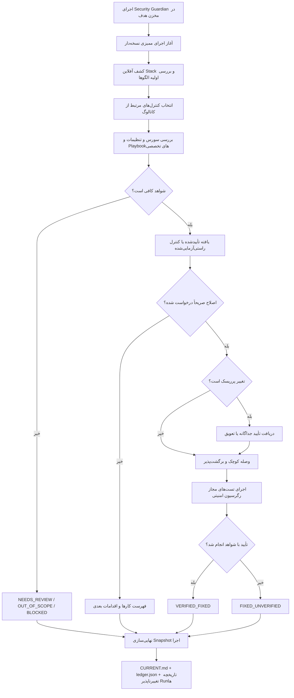

<div align="center" dir="rtl">

# 🛡️ Security Guardian

### امنیت متناسب با فناوری‌های پروژه، در دل ایجنت شما.

**باگ‌های امنیتی را پیدا کنید. ایمن اصلاح کنید. نتیجه را راستی‌آزمایی کنید. شواهد را نگه دارید.**

یک Skill امنیتی متن‌باز و آگاه از فناوری‌های پروژه برای Claude Code، Codex و Gemini CLI.

[](https://github.com/omidkh68/security-guardian/actions/workflows/ci.yml)


**۱۴۵ کنترل** · **۱۳ حوزه امنیتی** · **۱۰۷ Playbook** · **تاریخچه نسخه‌دار ممیزی**

[چرا Security Guardian؟](#why-security-guardian) · [شروع سریع](#quick-start) · [نحوه کار](#how-it-works) · [سناریوهای کاربردی](#real-world-use-cases) · [پیگیری یافته‌ها](#versioned-findings--audit-history) · [مستندات](#documentation) · [English](README.md)

</div>

---

<a id="why-security-guardian"></a>

## چرا Security Guardian؟

**ایجنت شما می‌تواند یک باگ امنیتی پیدا کند؛ Security Guardian روش مهندسی‌شده‌ای برای کشف، اصلاح، راستی‌آزمایی و به‌خاطرسپردن باگ‌های امنیتی به آن می‌دهد.**

یک پرامپت موردی امنیتی می‌تواند مفید باشد، اما محدوده بررسی، عمق تحلیل، شواهد و پیگیری آن به نحوه درخواست و اجرای بررسی بستگی دارد. Security Guardian بدون جایگزین‌کردن ایجنت شما، یک فرایند تکرارپذیر و مبتنی بر استانداردهای امنیتی را به Claude Code، Codex یا Gemini CLI اضافه می‌کند.

| بررسی امنیتی موردی | با Security Guardian |
|---|---|
| محدوده بررسی بر اساس پرامپت تعیین می‌شود | کنترل‌های مشخص، معیارهای پذیرش و گردش کار قابل تکرار |
| احتمال تغییر یا ازقلم‌افتادن بررسی‌ها وجود دارد | کنترل‌های مرتبط و Playbookهای تخصصی بررسی را هدایت می‌کنند |
| توصیه‌ها ممکن است کلی باشند | فناوری‌ها و قابلیت‌های پروژه، بررسی‌های مرتبط را تعیین می‌کنند |
| ممکن است یک الگوی مشکوک، آسیب‌پذیری اعلام شود | سیگنال‌های احتمالی از یافته‌های تأییدشده جدا می‌شوند |
| ممکن است وصله‌ای بدون تست رگرسیون امنیتی پیشنهاد شود | اصلاح حداقلی و مجاز با شواهد اعتبارسنجی مرتبط |
| نتیجه ممکن است فقط در متن گفتگو بماند | شناسه ثابت یافته، JSON/Markdown نسخه‌دار و گزارش PDF اختیاری |
| مشکلات حل‌نشده ممکن است فراموش شوند | ثبت وضعیت، علت مسدودبودن و اقدامات بعدی |
| دانش امنیتی باید در هر پرامپت تکرار شود | دانش امنیتی قابل استفاده مجدد در ایجنت فعلی شما |

ارزش این ابزار در این نیست که ایجنت عمومی چنین توانایی‌هایی ندارد؛ بلکه Security Guardian آن‌ها را **صریح، ساختاریافته و ماندگار** می‌کند.

### پنج ستون مهندسی

| ستون | تعهد محصول |
|---|---|
| **۰۱ · شناخت Stack** | شناخت پروژه و انتخاب بررسی‌های مرتبط با فناوری‌ها و محدوده واقعی آن |
| **۰۲ · کشف کاربردی آسیب‌پذیری‌ها** | اولویت‌دادن به ضعف‌های مهم، رایج و قابل‌اقدام؛ بررسی مسیرهای واقعی کد و مرزهای اعتماد |
| **۰۳ · اصلاح ایمن** | حفظ رفتار و معماری برنامه؛ الزام تأیید برای تغییرات حساس |
| **۰۴ · راستی‌آزمایی مبتنی بر شواهد** | تست ویژگی امنیتی موردنظر، تمایز میان اصلاحات تأییدشده و تأییدنشده و اعلام کمبود شواهد |
| **۰۵ · حافظه ماندگار امنیتی** | حفظ تاریخچه یافته‌ها، رگرسیون‌ها، ریسک‌های حل‌نشده و اقدامات بعدی در پروژه هدف |

**موجود در نسخه ۱.۲.۱:** نصب قابل‌حمل Skill، پایگاه دانش ۱۴۵ کنترل و ۱۰۷ Playbook، بررسی اولیه اکتشافی متناسب با محدوده، شش قانون اختیاری Semgrep، بازبینی و اصلاح با هدایت ایجنت، ثبت تست‌های مرتبط و گزارش‌های نسخه‌دار. **در دست توسعه:** بسته‌های فریم‌ورک‌های بیشتر، پروفایل‌های صریح محدوده بررسی برای توسعه‌دهندگان و موتور اجرایی قوی‌تر برای راستی‌آزمایی. [خط مبنای اندازه‌گیری‌شده](docs/wiki/SG-Baseline-v1.2.1.md) · [چشم‌انداز و اصول توسعه](docs/wiki/SG-Vision.md) · [نقشه راه](docs/wiki/SG-Roadmap-and-RFCs.md).

> [!IMPORTANT]
> سیگنال اسکنر فقط یک **یافته احتمالی** است، نه اثبات آسیب‌پذیری؛ نبود سیگنال هم به‌معنی امن‌بودن نیست. نتایج به کد واقعی، شواهد در دسترس، تست‌های مجاز و ایجنت انتخاب‌شده بستگی دارند. Security Guardian ابزار صدور گواهی انطباق یا تست نفوذ خودکار مستقل نیست. ممیزی سورس برنامه را ویرایش نمی‌کند و اصلاحات به مجوز مناسب نیاز دارند.

<a id="quick-start"></a>

## 🚀 شروع سریع

### روش پیشنهادی — نصب تعاملی چندایجنتی

```bash
git clone https://github.com/omidkh68/security-guardian.git
cd security-guardian
bash install-agent.sh
```

با کلیدهای جهت‌نما و Space، Claude Code، Codex و/یا Gemini CLI را انتخاب کنید. با Enter به انتخاب محدوده نصب Global یا Local بروید. مسیرهای مقصد را مرور و نصب را تأیید کنید. از نسخه‌های معتبر موجود پشتیبان گرفته می‌شود؛ Codex و Gemini مقصد نصب مشترکی دارند.

| ایجنت | نحوه فراخوانی در پروژه هدف |
|---|---|
| Claude Code | درخواست استفاده از Skill به نام security-guardian؛ فرمان Marketplace در ادامه آمده است. |
| Codex | `Use $security-guardian to audit this repository` |
| Gemini CLI | `Use the security-guardian skill to audit this repository` |

برای نصب خودکار از `bash install-agent.sh --agent all --user` استفاده کنید یا [راهنمای نصب چندایجنتی](docs/multi-agent.md) را ببینید. برای فعال‌کردن خروجی اختیاری و خودکار گزارش مدیریتی PDF، وابستگی‌های `requirements-pdf.txt` را در محیط Python مورد استفاده Tracker نصب کنید. [راهنمای گزارش PDF](docs/pdf-reporting.md).

### گزینه A — نصب از Marketplace افزونه‌های Claude Code

در نشست ترمینال Claude Code اجرا کنید:

```text
/plugin marketplace add omidkh68/security-guardian
/plugin install security-guardian@security-guardian-marketplace
```

فرمان کامل Skill برای این افزونه:

```text
/security-guardian:security-guardian audit
```

فرمان کوتاه `/security-guardian` نیز ممکن است کار کند، به‌شرطی که فرمان یا Skill دیگری با همین نام تداخل نداشته باشد. شکل دارای فضای نام، بدون ابهام است. نصب Marketplace توسط Claude Code مدیریت می‌شود. [مستندات رسمی افزونه‌ها](https://code.claude.com/docs/en/plugin-marketplaces).

### گزینه B — نصب به‌صورت Skill مستقل

```bash
git clone https://github.com/omidkh68/security-guardian.git
cd security-guardian

# Available to Claude Code in every local project
bash install.sh --user

# OR available only inside one application repository
bash install.sh --project /path/to/your-app
```

از داخل برنامه‌ای که می‌خواهید بررسی کنید، در Claude Code فراخوانی کنید:

```text
/security-guardian audit
```

اگر نسخه قدیمی‌تری نصب کرده‌اید، از `bash install.sh --user --upgrade` یا `--project /path/to/your-app --upgrade` استفاده کنید. از نسخه قبلی Skill مستقل به‌طور خودکار پشتیبان نگه‌داری می‌شود. **از نصب هم‌زمان نسخه Plugin و Skill مستقل خودداری کنید** مگر اینکه تداخل احتمالی نام فرمان‌ها را بشناسید.

### گزینه C — اجرای اسکنر آفلاین بدون Claude Code

به **Python 3.10 یا جدیدتر** نیاز دارد و هیچ بسته شخص ثالث Python لازم نیست:

```bash
python3 plugins/security-guardian/skills/security-guardian/scripts/security_scan.py \
  --root /path/to/your-app --format markdown
```

برای دریافت JSON قابل‌پردازش توسط ابزارها:

```bash
python3 plugins/security-guardian/skills/security-guardian/scripts/security_scan.py \
  --root /path/to/your-app --format json --output /tmp/security-candidates.json
```

این اسکنر برای **بررسی اولیه و اولویت‌بندی (Triage)** است، نه تأیید مستقل هر ۱۴۵ کنترل. نمی‌تواند سرور زنده، مجوزهای Cloud IAM، سیاست‌های واقعی مربوط به اسرار در محیط تولید یا تنظیمات خارج از مخزن را بررسی کند.

## پیش‌نمایش محدوده بررسی (در دست توسعه — RFC #31)

شاخه توسعه فعلی، فهرست‌برداری خواندنی از Manifestها و پروفایل‌های صریح کامپوننت‌ها را اضافه می‌کند. این قابلیت برای شناخت پروژه است، **نه افزودن قواعد امنیتی اختصاصی فریم‌ورک‌های جدید**؛ نسخه منتشرشده ۱.۲.۱ هنوز این فرمان‌ها را ندارد.

```bash
python3 plugins/security-guardian/skills/security-guardian/scripts/security_scan.py \
  --root /path/to/project --discover --profile auto
```

از `--profile frontend|backend|fullstack|mobile|custom` استفاده کنید. برای انتخاب کامپوننت‌های مشخص، `--component <relative-root>` را تکرار کنید. [قرارداد تعیین محدوده](docs/scope-resolution.md) را ببینید. اجرای مستقیم فرمان‌های قدیمی بدون Profile همچنان سازگار است.

## 🔍 اسکن ساختاری اختیاری و شواهد پوشش

Security Guardian علاوه بر بررسی اولیه Python بدون وابستگی خارجی، **امکان اختیاری تشخیص یافته‌های احتمالی بر اساس ساختار کد و AST با Semgrep محلی** را دارد. Semgrep بدون اطلاع نصب نمی‌شود و نبود این موتور به‌عنوان موفقیت گزارش نمی‌شود. قطعات خام کدی که با الگوها تطابق دارند از گزارش حذف می‌شوند.

اسکنر اصلی فایل‌های حذف‌شده از دامنه اسکن، محدودیت اندازه و عمق و ناقص‌ماندن احتمالی اسکن را گزارش می‌کند. برای هر اصلاح تأییدشده، اکنون باید یک تست موفق در همان Run به شناسه همان یافته متصل شود؛ سازگاری Git HEAD نیز در صورت امکان بررسی می‌شود. این سوابق گواهی مستقل اجرای واقعی تست‌ها نیستند.

جزئیات تست نصب در زمان اجرا، محدودیت‌های شواهد، آمادگی انتشار و تنظیمات GitHub در [ماتریس راستی‌آزمایی](docs/verification-matrix.md) آمده است.

## 🧭 طبقه‌بندی کنترل‌ها و مهاجرت ایمن تاریخچه

برای یافته‌های امنیتی، بررسی اختیاری و قطعی نگاشت دسته‌بندی در نظر گرفته شده است. Tracker مغایرت آشکار دسته یافته و شناسه کنترل را رد می‌کند، یافته‌های مبهم یا ناشناخته را نیازمند بازبینی نگاشت علامت می‌زند و تغییر صریح و غیرمخرب طبقه‌بندی یافته‌های قدیمی را امکان‌پذیر می‌کند. تاریخچه Runها بدون اطلاع بازنویسی نمی‌شود؛ شناسه قدیمیِ جایگزین‌شده به شناسه جدید متصل می‌شود و از تعداد مشکلات فعال کنار می‌رود. این **کمک به طبقه‌بندی** است، نه تضمین معنایی خودکار برای همه ۱۴۵ کنترل.

برای بررسی Ledger قدیمی، `security_tracker.py mapping-audit --root .` را اجرا کنید و روش مهاجرت را در [مستندات پیگیری](docs/tracking.md) بخوانید.

## 🎛️ فرمان‌ها

| فرمان در Claude Code | رفتار | آیا فایل برنامه تغییر می‌کند؟ |
|---|---|---|
| `/security-guardian audit` | شناسایی Stack، بازبینی کنترل‌های مرتبط، اولویت‌بندی ریسک‌ها و تولید یافته‌ها | کد برنامه تغییر نمی‌کند؛ **فایل‌های تاریخچه ممیزی نوشته می‌شوند** |
| `/security-guardian plan P0` | برنامه‌ریزی رفع مهم‌ترین ریسک‌ها، تست‌ها و بازگشت تغییرات | بدون تغییر کد؛ فقط تاریخچه |
| `/security-guardian fix ANG-01` | ایمن‌سازی هدفمند DOM/XSS در Angular بر مبنای محل‌های واقعی مصرف داده | ممکن است؛ با تأیید و بررسی‌های ایمنی |
| `/security-guardian fix API-01 BIZ-01` | بررسی DTO/Mass Assignment و مجوزدهی چندمستاجری | ممکن است؛ با تأیید و بررسی‌های ایمنی |
| `/security-guardian skill mobile-webview-bridge-audit` | بازکردن روش تخصصی پل Flutter WebView و کد Native | بدون تغییر زنده خودکار |
| `/security-guardian verify` | بازبینی یافته‌های شناخته‌شده و ثبت نتایج تست واقعی | لزوماً اصلاحی انجام نمی‌شود |
| `/security-guardian release-gate` | ارزیابی انتشار یا توقف انتشار (Go/No-Go) بر اساس شواهد | فقط تاریخچه |
| `/security-guardian roadmap` | تدوین برنامه مرحله‌ای اجرای اقدامات امنیتی | فقط تاریخچه |
| `/security-guardian control PKI-03` | توضیح کنترل، پیاده‌سازی و معیار پذیرش آن | فقط تاریخچه |

در نسخه Marketplace، به‌جای پیشوند `/security-guardian` از `/security-guardian:security-guardian` استفاده کنید.

> [!NOTE]
> حالت‌های عملیاتی ممیزی، از جمله `audit` و `plan`، یک Run جدید در `.security-guardian/` ثبت می‌کنند. عیب‌یابی فقط خواندنیِ نگاشت و خروجی مجدد PDF اجرای تازه ایجاد نمی‌کنند. `audit` فقط **نسبت به کد برنامه خواندنی است**، نه نسبت به کل فایل‌سیستم مخزن.

## 🧩 فناوری‌های تحت پوشش و قابلیت‌های فعلی (نسخه ۱.۲.۱)

| حوزه | نمونه پرسش‌های امنیتی |
|---|---|
| **Angular + SSR/PWA** | محل‌های XSS، دورزدن Sanitizer، Trusted Types، CSP، توکن‌های احراز هویت، قرارداد XSRF، نشت کش SSR، کش خصوصی Service Worker و Popupهای ناامن Mapbox/ECharts |
| **NestJS + REST/GraphQL/WS** | اعتبارسنجی DTO، Mass Assignment، مجوزدهی بر اساس نقش و منبع، CORS، اعتبارسنجی JWT، محدودیت نرخ، SSRF، Upload، امضای Webhook و پیچیدگی GraphQL |
| **Flutter + Android/iOS** | Keystore/Keychain، Callbackهای اعتماد TLS، پل WebView، اعتبارسنجی MethodChannel، Deep Link، نشست ذخیره‌شده، امضا و تنظیمات انتشار |
| **PKI و چرخه عمر گواهی** | اتصال CSR به کلید، کلید غیرقابل‌استخراج، رضایت کاربر برای تراکنش، بایت‌های استانداردشده داده امضاشده و قواعد وضعیت صدور/ابطال |
| **منطق کسب‌وکار و مستأجرها** | BOLA/IDOR، BOPLA، مرزهای RBAC/ABAC، هم‌زمانی، Replay در OTP، پرداخت، دعوت کاربران، انتقال مالکیت و مجوز دانلود |
| **داده و زیرساخت** | حداقل دسترسی PostgreSQL و RLS، جداسازی Redis، سخت‌سازی Linux، Nginx/TLS، تفکیک Docker، اسرار و پشتیبان‌گیری |
| **تحویل و عملیات** | Pipelineهای GitLab، Runner، ریسک وابستگی‌ها، SBOM، انتشار محافظت‌شده، پایش، پاسخ به رخداد و آمادگی باگ‌بانتی |

هر ۱۴۵ کنترل در [`references/controls.json`](plugins/security-guardian/skills/security-guardian/references/controls.json) و [فهرست خواندنی](plugins/security-guardian/skills/security-guardian/references/controls-index.md) هستند. وجود یک کنترل در کاتالوگ، اثبات بررسی یا رعایت آن نیست.

<a id="how-it-works"></a>

## 🧠 نحوه کار



این گردش کار بین **یافته احتمالی / یافته تأییدشده / اصلاح‌شده اما تأییدنشده / اصلاح تأییدشده / ریسک پذیرفته‌شده / مسدودشده** تفاوت قائل می‌شود. ناپدیدشدن سیگنال اسکنر به‌تنهایی یافته قبلی را نمی‌بندد.

<a id="real-world-use-cases"></a>

## 📚 سناریوهای کاربردی دنیای واقعی

مثال‌های زیر **صرفاً آموزشی و فرضی** هستند، نه نتایج بررسی مخزن واقعی یک مشتری. روش‌های قدم‌به‌قدم در [docs/use-cases.md](docs/use-cases.md) قرار دارند.

<details>
<summary><b>۱. آسیب‌پذیری XSS در Tooltipهای پویای نقشه Angular</b></summary>

**وضعیت:** داشبورد Angular برچسب سایتی را که کاربر می‌تواند کنترل کند به Popup نقشه شخص ثالث می‌فرستد؛ این Popup ورودی HTML می‌پذیرد. **بررسی:** کنترل‌های `ANG-01` و `ANG-13`، منشأ واقعی داده، محل مصرف در DOM و Escapeکردن خروجی. **اقدام:** نمایش امن به‌صورت متن و تست رگرسیون هدفمند. **پیگیری:** یافته احتمالی ← تأییدشده ← اصلاح ← در صورت اجرای واقعی تست، راستی‌آزمایی‌شده.

```text
/security-guardian audit
/security-guardian fix ANG-01
/security-guardian verify
```

</details>

<details>
<summary><b>۲. دسترسی غیرمجاز بین مستأجرها (IDOR) در NestJS</b></summary>

**وضعیت:** مسیر `GET /orders/:id` سفارش را فقط با شناسه آن پیدا می‌کند، در حالی که کاربر درخواست‌کننده به یک Tenant مشخص محدود است. **بررسی:** کنترل‌های `IAM-01`، `BIZ-01`، `DATA-02`، سیاست‌های Service و مرزهای Query در Repository. **اقدام:** مقیدکردن Query به Tenant استخراج‌شده از هویت معتبر و تست Tenant A در برابر Tenant B. UUID را معادل مجوز دسترسی ندانید.

```text
/security-guardian plan P0
/security-guardian fix BIZ-01
```

</details>

<details>
<summary><b>۳. دسترسی WebView در Flutter به عملیات امضای Native</b></summary>

**وضعیت:** یک پل JavaScript در WebView می‌تواند عملیات امضا درخواست کند. **بررسی:** فهرست مجاز Originها، مجوز متدها، رضایت کاربر، مالکیت کلید بومی و اعتبارسنجی واقعی سمت سرور (`MOB-05`، `MOB-08`، `PKI-04`). **اقدام:** پیشنهاد سخت‌سازی مرزهای اعتماد و دریافت تأیید قبل از تغییر رفتار امضا.

```text
/security-guardian skill mobile-webview-bridge-audit
/security-guardian plan P0
```

</details>

<details>
<summary><b>۴. درمعرض‌بودن Image داکر یا GitLab Runner</b></summary>

**وضعیت:** فایل Compose از `privileged: true` استفاده می‌کند یا سرویس‌های داخلی را در معرض دسترسی قرار می‌دهد؛ Pipelineهای انتشار نیز ممکن است اسرار را افشا کنند. **بررسی:** کنترل‌های `CLOUD-02`، `HOST-03`، کنترل‌های زنجیره تأمین مرتبط و تنظیمات مستقرشده. **اقدام:** تهیه وصله با حداقل دسترسی همراه با برنامه امن استقرار و بازگشت؛ **بدون مجوز، محیط تولید را تغییر ندهید**.

```text
/security-guardian audit
/security-guardian release-gate
```

</details>

<a id="versioned-findings--audit-history"></a>

## 🗂️ یافته‌ها و تاریخچه ممیزی نسخه‌دار

هر بار فراخوانی عملیاتی ممیزی، یک Run نسخه‌دار جدید را در **پروژه هدف** می‌سازد، نه در پوشه Skill نصب‌شده:

```text
my-angular-app/
└── .security-guardian/           # Keep private / ignored in Git
    ├── CURRENT.md               # Current unresolved/resolved status and reasons
    ├── index.json               # Run metadata and sequential version numbers
    ├── ledger.json              # Stable finding IDs and status history
    └── runs/
        ├── v0001-.../
        │   ├── RUN.md           # Human-readable report
        │   ├── manifest.json    # Git context, mode, test records, completion
        │   ├── scanner.json     # Unconfirmed offline signals
        │   ├── findings.json    # Snapshot of tracked findings
        │   └── events.jsonl     # Per-run event chronology
        └── v0002-.../
            └── ...
```

نمونه چرخه عمر یک یافته:

```text
v0001  SG-BIZ-01-xxxxxxxxxxxx  CANDIDATE
v0002  same finding ID         CONFIRMED_OPEN        (owner-scope bypass confirmed)
v0003  same finding ID         FIXED_UNVERIFIED     (patch applied; test unavailable)
v0004  same finding ID         VERIFIED_FIXED       (negative test executed, passed)
v0005  same finding ID         CONFIRMED_OPEN        (regression reproduced; reopened)
```

علت بازماندن یافته (مثل نبود Fixture برای تست Tenant، نداشتن دسترسی زیرساختی، مهاجرت پرخطر در محیط تولید یا پذیرش ریسک به‌وسیله تأییدکننده مشخص) باید مستند شود. **تست ثبت‌شده با `NOT_RUN` نمی‌تواند مبنای تأیید اصلاح باشد.** Tracker اجازه بازکردن دوباره Snapshot اجرای نهایی‌شده را نمی‌دهد.

پرس‌وجوی دستی از Tracker:

```bash
SG=~/.claude/skills/security-guardian/scripts/security_tracker.py
python3 "$SG" summary --root /path/to/app
python3 "$SG" history --root /path/to/app --id SG-BIZ-01-<actual-id>
```

[قراردادهای پیگیری](docs/tracking.md) و [گردش کار داخلی پیگیری](plugins/security-guardian/skills/security-guardian/references/workflows/tracking.md) را ببینید.

## 🔐 ایمنی و مرزهای عملکرد

- **بدون ادعای کاذب پوشش کامل:** فقط بخشی از کنترل‌های کاتالوگ دارای نشانگرهای خودکار تحلیل ایستا هستند. برای هر کنترل، تصمیم مستقل درباره کاربرد آن و شواهد لازم است.
- **اسکنر اکتشافی آفلاین:** بدون نصب وابستگی، اسکن میزبان، درخواست HTTP خارجی یا تغییر سورس برنامه.
- **Tracker ابزار ثبت سوابق است، نه موتور اجرای تست امنیتی:** نتایج و شواهد از بازبینی واقعی و فرمان‌های اجراشده با مجوز می‌آیند؛ نباید آن‌ها را جعل کرد.
- **تأیید تغییرات پرریسک:** احراز هویت، RBAC، OTP، پرداخت، PKI، مهاجرت پایگاه داده، SSH/Firewall، اسرار CI و استقرار تولید صرفاً به‌خاطر یک درخواست کلی اصلاح، خودکار تغییر نمی‌کنند.
- **محرمانگی پیش‌فرض:** تاریخچه ممیزی ممکن است معماری داخلی یا آسیب‌پذیری‌های رفع‌نشده را آشکار کند. `.gitignore` این مخزن فقط همین مخزن را محافظت می‌کند؛ در صورت نیاز `.security-guardian/` را به `.gitignore` هر پروژه هدف اضافه کنید.
- **توجه به مدل تهدید:** Guard سمت کلاینت، Obfuscation، WAF و خلاصه‌های AI جایگزین اجرای کنترل سمت سرور و تست تجربی نیستند.

[SECURITY.md](SECURITY.md)، [مدل امنیت و اعتماد](docs/security-model.md) و [مراجع OWASP](docs/provenance.md) را ببینید.

## 🧪 توسعه و تست

```bash
git clone https://github.com/omidkh68/security-guardian.git
cd security-guardian
python3 scripts/validate_package.py
python3 -m unittest discover -s plugins/security-guardian/skills/security-guardian/tests -v
# or
make validate test
```

GitHub Actions مجموعه تست آفلاین را روی سه نسخه Python اجرا می‌کند و کاتالوگ و تست اولیه نصب را بررسی می‌کند. CI **جایگزین بازبینی زمان اجرای مجاز برنامه هدف نیست**. اگر نسخه نصب‌شده Claude Code پشتیبانی کند، می‌توانید ساختار Marketplace را روی سیستم خود با `claude plugin validate .` اعتبارسنجی کنید.

## 📁 ساختار مخزن

```text
.
├── .claude-plugin/marketplace.json      # GitHub-installable marketplace
├── plugins/security-guardian/
│   ├── .claude-plugin/plugin.json       # Plugin metadata
│   └── skills/security-guardian/
│       ├── SKILL.md                     # Agent workflow
│       ├── scripts/                     # Offline scanner + versioned tracker
│       ├── references/
│       │   ├── controls.json            # 145 controls
│       │   ├── domains/                 # 13 domains
│       │   ├── playbooks/               # 107 playbooks
│       │   └── workflows/               # Audit/remediation/reporting rules
│       └── tests/
├── docs/                                # User/admin documentation
├── examples/                            # Sanitized demonstration scenarios
├── .github/                              # CI and community templates
├── install-agent.sh                     # Interactive/noninteractive multi-agent installer
├── install.sh                           # Standalone Claude Code Skill installer
└── LICENSE                              # MIT
```

<a id="documentation"></a>

## 📖 مستندات

| راهنما | محتوای راهنما |
|---|---|
| [نصب](docs/installation.md) | تفاوت Plugin و Skill مستقل، محدوده کاربر/پروژه و ارتقا |
| [نصب‌کننده چندایجنتی](docs/multi-agent.md) | راه‌اندازی تعاملی و فعال‌سازی |
| [گزارش‌های مدیریتی PDF](docs/pdf-reporting.md) | گزارش‌های محلی اختیاری و محدودیت‌های اشتراک‌گذاری |
| [فرمان‌ها و حالت‌ها](docs/commands.md) | معنای فرمان‌ها، مجوزها و مثال‌های دقیق |
| [معماری](docs/architecture.md) | اسکنر، ایجنت، Playbookها، Tracker و مرزهای اعتماد |
| [سناریوهای کاربردی](docs/use-cases.md) | هشت سناریوی واقع‌گرایانه امنیتی و نتیجه‌های مورد انتظار |
| [پیگیری](docs/tracking.md) | معنای وضعیت‌ها، نسخه‌بندی، دلایل، اصلاح ناموفق و شناسه‌های رگرسیون |
| [مدل امنیتی](docs/security-model.md) | اجرای امن، فایل‌های حساس و محدودیت‌ها |
| [رفع اشکال](docs/troubleshooting.md) | مشکلات رایج نصب یا پیگیری |
| [مشارکت در Playbookها](docs/contributing-playbook.md) | افزودن یا بهبود امن کنترل‌ها |
| [منشأ و منابع](docs/provenance.md) | استانداردها، خط مبنا و تفسیر امتیازهای دشواری |
| [فارسی](README.fa.md) | راهنمای فارسی شروع سریع و استفاده |

## 🤝 مشارکت

False Positive یافته‌اید؟ پشتیبانی از یک فریم‌ورک جدید می‌خواهید؟ می‌خواهید نگاشت OWASP را بهبود دهید یا تست رگرسیون اضافه کنید؟ [CONTRIBUTING.md](CONTRIBUTING.md) را بخوانید و سپس Issue یا Pull Request ارسال کنید. **آسیب‌پذیری پروژه‌های خصوصی را در Issue عمومی منتشر نکنید**؛ [SECURITY.md](SECURITY.md) را ببینید.

## 📜 مجوز و ارجاع به منابع

پیاده‌سازی اصلی Security Guardian، Playbookها و مستندات پروژه تحت [مجوز MIT](LICENSE) در دسترس هستند. کنترل‌های خط مبنا از راهنمای ارائه‌شده توسط کاربر به نام *Defense-in-Depth Software Security Engineering / 2026* گردآوری شده‌اند. ارجاع به OWASP، NIST، SLSA، Angular، NestJS، Flutter، Anthropic و محصولات شخص ثالث صرفاً اطلاع‌رسانی است؛ این سازمان‌ها **حامی مالی یا تأییدکننده پروژه نیستند**. استانداردهای شخص ثالثِ ارجاع‌شده، مجوزها و نشان‌های تجاری خود را حفظ می‌کنند.

**برای مهندسی امنیت دفاعی ساخته شده است: محلی ارزیابی کنید، با دقت اصلاح کنید، با شواهد راستی‌آزمایی کنید و هر تصمیم را ثبت کنید.**

## Skill قابل‌حمل چندایجنتی و گزارش PDF

یک فایل مرجع `SKILL.md` مشترک برای **Claude Code، OpenAI Codex و Gemini CLI** به‌کار می‌رود. از Claude Marketplace یا `install-agent.sh` محلی برای نصب در مسیرهای `.agents/skills` استفاده کنید. [راهنمای چندایجنتی](docs/multi-agent.md).

اجرای نهایی‌شده ممیزی در صورت نصب محلی ReportLab می‌تواند فایل‌های `RUN.pdf` و `CURRENT.pdf` را برای ارائه به ذی‌نفعان بسازد. این گزارش‌ها واقعیت‌های تأییدشده، کارهای انجام‌شده و ریسک‌ها را نشان می‌دهند، نه گواهی ساختگی امنیت یا انطباق. [راهنمای گزارش PDF](docs/pdf-reporting.md).

برای عیب‌یابی مستقیم و فقط خواندنی نگاشت کنترل‌ها، `python3 <skill-dir>/scripts/security_tracker.py mapping-audit --root .` را اجرا کنید. برای خروجی مجدد PDF بدون ایجاد نسخه تازه ممیزی نیز `python3 <skill-dir>/scripts/security_report.py --root .` را اجرا کنید.

## چشم‌انداز مهندسی و نقشه راه

[سورس Wiki مهندسی](docs/wiki/SG-Home.md) شامل وضعیت مبنای نسخه ۱.۲.۱، استانداردهای ۲۰۲۶ و طراحی آینده آگاه از محدوده پروژه است. RFCها پیشنهادهایی در انتظار بررسی‌اند، نه قابلیت‌های منتشرشده. [GitHub Wiki](https://github.com/omidkh68/security-guardian/wiki) جداگانه نگه‌داری می‌شود؛ [دستورالعمل انتشار Wiki](docs/wiki-publishing.md) را ببینید.
