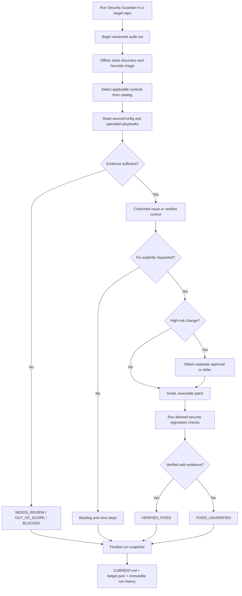

<div align="center">

# 🛡️ Security Guardian

### Security for your stack, inside your agent.

**Find security bugs. Fix them safely. Verify the result. Keep the evidence.**

An open-source, stack-aware security skill for Claude Code, Codex and Gemini CLI.

[](https://github.com/omidkh68/security-guardian/actions/workflows/ci.yml)


**145 controls** · **13 security domains** · **107 playbooks** · **versioned audit history**

[Why Security Guardian?](#why-security-guardian) · [Quick start](#-quick-start) · [How it works](#-how-it-works) · [Use cases](#-real-world-use-cases) · [Tracking](#-versioned-findings--audit-history) · [Documentation](#-documentation) · [فارسی](README-FA.md)

</div>

---

## Why Security Guardian?

**Your agent can find a security bug. Security Guardian gives it an engineered way to find, fix, verify and remember security bugs.**

A one-off security prompt can be useful, but the scope, depth, evidence and follow-up depend on how the review is requested and performed. Security Guardian adds a reusable, standards-informed workflow to Claude Code, Codex or Gemini CLI — without replacing your agent.

| One-off security review | With Security Guardian |
|---|---|
| Prompt-defined review | Explicit security controls, acceptance criteria and repeatable workflow |
| Checks may vary or be overlooked | Applicable controls and specialist playbooks guide the review |
| Broad or generic recommendations | Stack and feature discovery guide relevant checks |
| A suspicious pattern may be called a vulnerability | Candidate signals separated from confirmed findings |
| A patch may be proposed without a security regression test | Approved, minimal remediation with linked verification evidence |
| Results may remain in a chat transcript | Stable finding IDs, versioned JSON/Markdown and optional PDF reports |
| Unresolved issues may be forgotten | Persistent status, blocker reasons and actionable next steps |
| Security expertise must be supplied in each prompt | Reusable security knowledge inside your existing agent |

The value is not that a general-purpose agent lacks these abilities; it is that Security Guardian makes them explicit, structured and persistent.

### Five engineering pillars

| Pillar | Product commitment |
|---|---|
| **01 · Stack intelligence** | Understand the project and select security checks relevant to its actual stack and scope. |
| **02 · Practical vulnerability detection** | Prioritize important, common, actionable weaknesses; trace real code and trust boundaries. |
| **03 · Safe remediation** | Preserve application behavior and architecture; require approval for sensitive changes. |
| **04 · Evidence-based verification** | Test the security invariant, distinguish verified from unverified fixes, and disclose missing evidence. |
| **05 · Persistent security memory** | Retain finding history, regressions, unresolved risks and next actions in the target repository. |

**Available in v1.2.1:** portable skill installation, a 145-control knowledge base with 107 playbooks, scoped heuristic triage, six optional Semgrep rules, agent-led review/remediation, linked test records and versioned reports. **In development:** broader framework packs, explicit developer scope profiles and a stronger operational verification engine. [Measured baseline](docs/wiki/SG-Baseline-v1.2.1.md) · [Product vision & guardrails](docs/wiki/SG-Vision.md) · [Roadmap](docs/wiki/SG-Roadmap-and-RFCs.md).

> [!IMPORTANT]
> A scanner signal is a candidate, not proof of a vulnerability; no signal is not proof of safety. Results depend on actual code, available evidence, authorized tests and your selected agent. Security Guardian is not a certification or an autonomous penetration tester. Audit does not edit application source; remediation requires appropriate authorization.

## 🚀 Quick start

### Recommended — Interactive multi-agent installation

```bash
git clone https://github.com/omidkh68/security-guardian.git
cd security-guardian
bash install-agent.sh
```

Use arrow keys and Space to select Claude Code, Codex and/or Gemini CLI; Enter advances to Global or Local scope. Review destinations and approve installation. Existing valid copies are backed up; Codex and Gemini share a destination.

| Agent | Invocation in the target project |
|---|---|
| Claude Code | Ask to use the security-guardian skill (Marketplace command below). |
| Codex | `Use $security-guardian to audit this repository` |
| Gemini CLI | `Use the security-guardian skill to audit this repository` |

For automation use `bash install-agent.sh --agent all --user` or see [multi-agent installation](docs/multi-agent.md). To enable optional automatic executive PDF exports, install `requirements-pdf.txt` in the Python environment used by the tracker. See [PDF reporting](docs/pdf-reporting.md).

### Option A — Install from the Claude Code plugin marketplace

In your Claude Code terminal session:

```text
/plugin marketplace add omidkh68/security-guardian
/plugin install security-guardian@security-guardian-marketplace
```

The fully qualified skill command for this plugin is:

```text
/security-guardian:security-guardian audit
```

A bare `/security-guardian` may also work if it is not shadowed by another command/skill; the namespaced form is unambiguous. Marketplace installation is managed by Claude Code. See [official plugin docs](https://code.claude.com/docs/en/plugin-marketplaces).

### Option B — Install as a standalone Skill

```bash
git clone https://github.com/omidkh68/security-guardian.git
cd security-guardian

# Available to Claude Code in every local project
bash install.sh --user

# OR available only inside one application repository
bash install.sh --project /path/to/your-app
```

Invoke in Claude Code from the app you want to review:

```text
/security-guardian audit
```

Already installed an earlier version? Use `bash install.sh --user --upgrade` or `--project /path/to/your-app --upgrade`. A backup of the previous standalone Skill is retained automatically. **Avoid installing both plugin and standalone versions at once** unless you understand the command-name collision.

### Option C — Try the offline scanner without Claude Code

Requires **Python 3.10+**, with no third-party Python packages:

```bash
python3 plugins/security-guardian/skills/security-guardian/scripts/security_scan.py \
  --root /path/to/your-app --format markdown
```

Or machine-readable JSON:

```bash
python3 plugins/security-guardian/skills/security-guardian/scripts/security_scan.py \
  --root /path/to/your-app --format json --output /tmp/security-candidates.json
```

The scanner is **triage**, not an independent confirmation of all 145 controls. It cannot inspect a live server, cloud IAM, actual production secrets policies, or non-repository settings.

## Scope preview (development — RFC #31)

The current development branch adds a read-only manifest inventory and explicit component profiles. This is discovery, **not new framework-specific rule coverage**; v1.2.1 releases do not contain these commands yet.

```bash
python3 plugins/security-guardian/skills/security-guardian/scripts/security_scan.py \
  --root /path/to/project --discover --profile auto
```

Use `--profile frontend|backend|fullstack|mobile|custom` and repeat `--component <relative-root>` when selecting explicit components. See [scope contract](docs/scope-resolution.md). Existing manual invocations without a profile retain legacy behavior.

## 🔍 Optional structural scanning and coverage evidence

In addition to its zero-dependency Python triage, Security Guardian offers **optional local Semgrep structural/AST-backed candidate detection**. It never silently installs Semgrep or claims that an unavailable engine has passed. Raw matched source snippets are excluded from the report.

The standard scanner reports excluded files, size and depth limits, and whether the scan was truncated. Each verified fix now needs a same-run passing test linked to the same finding ID, with Git HEAD consistency checks when available. These records are not independent attestations.

See the [verification matrix](docs/verification-matrix.md) for runtime installation testing, evidence limitations, release readiness and GitHub settings.

## 🧭 Control classification and safe history migration

Security findings now have optional deterministic category mapping checks. The
tracker rejects obvious category/control mismatches, marks ambiguous or
unrecognized findings as needing mapping review, and supports explicit,
non-destructive reclassification of older findings. Historical runs are never
silently rewritten; a superseded ID is linked to its replacement and excluded
from active issue totals. This is **assisted classification**, not an automatic
semantic guarantee for all 145 controls.

Review an old ledger with `security_tracker.py mapping-audit --root .` and see
[tracking documentation](docs/tracking.md) for the explicit migration workflow.

## 🎛️ Commands

| Command in Claude Code | Behavior | Application writes? |
|---|---|---|
| `/security-guardian audit` | Detect stack, review applicable controls, triage risks, produce findings | No source edits; **audit-history files are written** |
| `/security-guardian plan P0` | Plan highest-priority remediations, tests and rollback | No source edits; history only |
| `/security-guardian fix ANG-01` | Focused Angular DOM/XSS hardening based on actual sinks | Possible, with approval/safety checks |
| `/security-guardian fix API-01 BIZ-01` | DTO/mass-assignment and multi-tenant authorization review | Possible, with approval/safety checks |
| `/security-guardian skill mobile-webview-bridge-audit` | Open specialist procedure for Flutter WebView ↔ native bridge | No automatic live changes |
| `/security-guardian verify` | Revisit known findings, record actual test results | No remediation implied |
| `/security-guardian release-gate` | Evidence-based Go/No-Go assessment | History only |
| `/security-guardian roadmap` | Sequence work into security delivery plan | History only |
| `/security-guardian control PKI-03` | Explain one control, implementation and acceptance | History only |

In the marketplace variant, prefix commands with `/security-guardian:security-guardian` instead of `/security-guardian`.

> [!NOTE]
> Operational audit modes write a new run under `.security-guardian/`, including `audit` and `plan`. Read-only mapping diagnostics and PDF re-export do not create runs. `audit` is **read-only with respect to application code**, not the entire repository filesystem.

## 🧩 Current supported stacks and coverage (v1.2.1)

| Area | Example security questions |
|---|---|
| **Angular + SSR/PWA** | XSS sinks, sanitizer bypass, Trusted Types, CSP, auth tokens, XSRF contract, SSR cache leaks, service worker private cache, unsafe Mapbox/ECharts popups |
| **NestJS + REST/GraphQL/WS** | DTO validation, mass assignment, role/resource authorization, CORS, JWT verification, rate budgets, SSRF, uploads, webhook signatures, GraphQL complexity |
| **Flutter + Android/iOS** | Keystore/Keychain, TLS trust callbacks, WebView bridges, MethodChannel validation, deep links, persisted session state, signing and release configuration |
| **PKI / certificate lifecycle** | CSR↔key binding, non-exportable keys, transaction consent, canonical signed payloads, issued/revoked state invariants |
| **Business logic & tenants** | BOLA/IDOR, BOPLA, RBAC/ABAC boundaries, concurrency, OTP replay, payments, invites, ownership transfer and file-download authorization |
| **Data / infrastructure** | PostgreSQL least privilege/RLS, Redis isolation, Linux host hardening, Nginx/TLS, Docker segmentation, secrets, backups |
| **Delivery & operations** | GitLab pipelines, runners, dependency risk, SBOM, protected releases, monitoring, incident response, bug-bounty readiness |

All 145 controls live in [`references/controls.json`](plugins/security-guardian/skills/security-guardian/references/controls.json) and the [human-readable index](plugins/security-guardian/skills/security-guardian/references/controls-index.md). A control's presence in the catalog is not proof it has been assessed or satisfied.

## 🧠 How it works



The workflow distinguishes **candidate / confirmed / fixed but unverified / verified fixed / accepted risk / blocked**. A missing scanner signal never automatically closes an existing finding.

## 📚 Real-world use cases

The examples below are **illustrative**, not results from a real customer repository. Read the step-by-step playbooks in [docs/use-cases.md](docs/use-cases.md).

<details>
<summary><b>1. Angular XSS in dynamic map tooltips</b></summary>

**Situation:** an Angular dashboard sends a user-controlled site label to a third-party map popup that accepts HTML. **Review:** `ANG-01` and `ANG-13`, actual data origin, DOM sink and escaping. **Action:** use text-safe rendering and targeted regression checks. **Track:** candidate → confirmed → fix → verified if the test really runs.

```text
/security-guardian audit
/security-guardian fix ANG-01
/security-guardian verify
```

</details>

<details>
<summary><b>2. NestJS IDOR between tenants</b></summary>

**Situation:** `GET /orders/:id` resolves by ID only, even though the requester is a tenant-scoped user. **Review:** `IAM-01`, `BIZ-01`, `DATA-02`, service policies and repository query boundaries. **Action:** bind the query to identity-derived tenant scope and test tenant A vs tenant B. Do not interpret UUIDs as authorization.

```text
/security-guardian plan P0
/security-guardian fix BIZ-01
```

</details>

<details>
<summary><b>3. Flutter WebView reaching native signing</b></summary>

**Situation:** a WebView JavaScript bridge can request a signing operation. **Review:** origin allowlist, method permissions, user consent, native key ownership and actual server-side verification (`MOB-05`, `MOB-08`, `PKI-04`). **Action:** propose hardened boundaries, then get approval before altering signing behavior.

```text
/security-guardian skill mobile-webview-bridge-audit
/security-guardian plan P0
```

</details>

<details>
<summary><b>4. Docker image or GitLab runner exposure</b></summary>

**Situation:** a Compose file uses `privileged: true` or exposes internal services; release pipelines may leak secrets. **Review:** `CLOUD-02`, `HOST-03`, relevant supply-chain controls and deployed config. **Action:** prepare least-privilege patch plus a safe rollout/rollback plan; **no production changes without authorization**.

```text
/security-guardian audit
/security-guardian release-gate
```

</details>

## 🗂️ Versioned findings & audit history

Each operational audit invocation creates a new versioned run inside the **target project**, not inside the installed Skill:

```text
my-angular-app/
└── .security-guardian/           # Keep private / ignored in Git
    ├── CURRENT.md               # Current unresolved/resolved status and reasons
    ├── index.json               # Run metadata and sequential version numbers
    ├── ledger.json              # Stable finding IDs and status history
    └── runs/
        ├── v0001-.../
        │   ├── RUN.md           # Human-readable report
        │   ├── manifest.json    # Git context, mode, test records, completion
        │   ├── scanner.json     # Unconfirmed offline signals
        │   ├── findings.json    # Snapshot of tracked findings
        │   └── events.jsonl     # Per-run event chronology
        └── v0002-.../
            └── ...
```

Example lifecycle:

```text
v0001  SG-BIZ-01-xxxxxxxxxxxx  CANDIDATE
v0002  same finding ID         CONFIRMED_OPEN        (owner-scope bypass confirmed)
v0003  same finding ID         FIXED_UNVERIFIED     (patch applied; test unavailable)
v0004  same finding ID         VERIFIED_FIXED       (negative test executed, passed)
v0005  same finding ID         CONFIRMED_OPEN        (regression reproduced; reopened)
```

Why a finding stays open (missing tenant fixtures, infrastructure access, unsafe production migration, risk accepted by an identified approver, etc.) must be documented. **Tests recorded as `NOT_RUN` cannot satisfy verification.** Finished run snapshots cannot be reopened by tracker commands.

Manual tracker queries:

```bash
SG=~/.claude/skills/security-guardian/scripts/security_tracker.py
python3 "$SG" summary --root /path/to/app
python3 "$SG" history --root /path/to/app --id SG-BIZ-01-<actual-id>
```

See [tracking contracts](docs/tracking.md) and [internal tracking workflow](plugins/security-guardian/skills/security-guardian/references/workflows/tracking.md).

## 🔐 Safety and boundaries

- **No false claims of total coverage.** Only a subset of the catalog has automated static indicators. Every control requires a proper applicability and evidence decision.
- **Offline heuristic scanner.** No dependency installation, host scanning, external HTTP calls, or changes to application code.
- **Tracker is a recorder, not a security testing engine.** Evidence/results come from actual review and commands executed with permission; do not invent them.
- **Approval for high-risk changes.** Auth, RBAC, OTP, payments, PKI, DB migrations, SSH/firewall, CI secrets and production deployments are not auto-modified just because someone requests a broad fix.
- **Private by default.** Audit history may expose internal architecture or unpatched vulnerabilities. `.gitignore` protects this repo only; add `.security-guardian/` to each target project's `.gitignore` if necessary.
- **Threat-model-aware.** Client-side guards, obfuscation, WAF and AI summaries are not substitutes for server enforcement and empirical testing.

See [SECURITY.md](SECURITY.md), [security/trust model](docs/security-model.md), and [OWASP references](docs/provenance.md).

## 🧪 Develop and test

```bash
git clone https://github.com/omidkh68/security-guardian.git
cd security-guardian
python3 scripts/validate_package.py
python3 -m unittest discover -s plugins/security-guardian/skills/security-guardian/tests -v
# or
make validate test
```

GitHub Actions runs the offline test suite on three Python versions, checks the catalog and installation smoke tests. CI **cannot** replace an authorized runtime review of a target application. You can validate marketplace syntax on your own machine with `claude plugin validate .` if supported by your installed Claude Code version.

## 📁 Repository layout

```text
.
├── .claude-plugin/marketplace.json      # GitHub-installable marketplace
├── plugins/security-guardian/
│   ├── .claude-plugin/plugin.json       # Plugin metadata
│   └── skills/security-guardian/
│       ├── SKILL.md                     # Agent workflow
│       ├── scripts/                     # Offline scanner + versioned tracker
│       ├── references/
│       │   ├── controls.json            # 145 controls
│       │   ├── domains/                 # 13 domains
│       │   ├── playbooks/               # 107 playbooks
│       │   └── workflows/               # Audit/remediation/reporting rules
│       └── tests/
├── docs/                                # User/admin documentation
├── examples/                            # Sanitized demonstration scenarios
├── .github/                              # CI and community templates
├── install-agent.sh                     # Interactive/noninteractive multi-agent installer
├── install.sh                           # Standalone Claude Code Skill installer
└── LICENSE                              # MIT
```

## 📖 Documentation

| Guide | What it explains |
|---|---|
| [Installation](docs/installation.md) | Plugin vs standalone, user/project scope, upgrades |
| [Multi-agent installer](docs/multi-agent.md) | Interactive setup and activation |
| [Executive PDF reports](docs/pdf-reporting.md) | Optional local reports and sharing limits |
| [Commands & modes](docs/commands.md) | Command semantics, permissions, exact examples |
| [Architecture](docs/architecture.md) | Scanner, agent, playbooks, tracker and trust boundaries |
| [Use cases](docs/use-cases.md) | Eight realistic security scenarios and expected outcomes |
| [Tracking](docs/tracking.md) | Status meanings, versioning, reasons, failed fixes and regression IDs |
| [Security model](docs/security-model.md) | Safe operation, sensitive artifacts and limits |
| Verification fingerprints ([EN](docs/verification-fingerprint.md), [FA](docs/verification-fingerprint-FA.md)) | Selected-file evidence binding; not an independent runner |
| Local verification runner ([EN](docs/verification-runner.md), [FA](docs/verification-runner-FA.md)) | Explicitly authorized Python unittest and Node.js 22/24 node:test execution; receipts are not verified fixes |
| [Troubleshooting](docs/troubleshooting.md) | Common installation or tracking problems |
| [Playbook contribution](docs/contributing-playbook.md) | Add or improve controls safely |
| [Source and provenance](docs/provenance.md) | Standards, baseline and interpretation of difficulty scores |
| [فارسی](README-FA.md) | Complete Persian translation of this README |

## 🤝 Contribute

Found a false positive? Need support for a new framework? Want to improve an OWASP mapping or add a regression test? Read [CONTRIBUTING.md](CONTRIBUTING.md), then submit an issue or pull request. **Please do not publish vulnerabilities from private projects in issues**; see [SECURITY.md](SECURITY.md).

## 📜 License and attribution

Security Guardian's original implementation, playbooks and project documentation are made available under the [MIT License](LICENSE). Baseline controls were compiled from the user-provided *Defense-in-Depth Software Security Engineering / 2026* handbook. References to OWASP, NIST, SLSA, Angular, NestJS, Flutter, Anthropic and third-party products are informational; those organizations are **not** sponsors or endorsers of this project. Referenced third-party standards retain their own licenses and trademarks.

**Built for defensive engineering. Evaluate locally. Fix deliberately. Verify with evidence. Track every decision.**

## Portable Agent Skills and client PDF reports

One canonical `SKILL.md` serves **Claude Code, OpenAI Codex and Gemini CLI**.
Use the existing Claude Marketplace or the local `install-agent.sh` for
`.agents/skills` installations. [Multi-agent instructions](docs/multi-agent.md).

Finalized audit runs optionally generate `RUN.pdf` and `CURRENT.pdf` for
stakeholder presentation when local ReportLab is installed. They present
verified facts, work and risks, not invented safety/compliance certification.
[PDF reporting instructions](docs/pdf-reporting.md).

For direct, read-only mapping diagnostics use
`python3 <skill-dir>/scripts/security_tracker.py mapping-audit --root .`.
For PDF re-export without creating a new audit version use
`python3 <skill-dir>/scripts/security_report.py --root .`.

## Engineering vision and roadmap

See the [engineering wiki source](docs/wiki/SG-Home.md) for the v1.2.1 baseline, 2026 standards and scope-aware future design. RFCs are proposals pending review, not shipped features. The [GitHub Wiki](https://github.com/omidkh68/security-guardian/wiki) is maintained separately; see [publication instructions](docs/wiki-publishing.md).

The [tracker-bound execution evidence](docs/tracker-execution-evidence.md) command distinguishes direct local execution from manually reported evidence. [فارسی](docs/tracker-execution-evidence-FA.md).

For contributors: [private npm/npx distribution preview](docs/npm-distribution.md) ([فارسی](docs/npm-distribution-FA.md)) — local tarball only; no public registry package has been published by this work.

[Web core indicator pack](docs/web-core.md) ([فارسی](docs/web-core-FA.md)): scoped browser candidates across discovered web frameworks; not framework-specific verification.

[Backend core indicator pack](docs/backend-core.md) ([فارسی](docs/backend-core-FA.md)): scoped Node HTTP/API candidates; not authorization or framework-specific verification.

[React/Next.js review pack](docs/react-next.md) ([فارسی](docs/react-next-FA.md)): scoped raw HTML, public secret-like names and browser source-map candidates; SSR and server authorization still require review.

[Vue/Nuxt review pack](docs/vue-nuxt.md) ([فارسی](docs/vue-nuxt-FA.md)): scoped v-html and public runtime-config candidates; manual SSR and server authorization review.

[Svelte/SvelteKit review pack](docs/svelte-kit.md) ([فارسی](docs/svelte-kit-FA.md)): scoped raw HTML and public environment import candidates; manual server authorization and SSR review.

[Express/Fastify review pack](docs/express-fastify.md) ([فارسی](docs/express-fastify-FA.md)): scoped proxy trust and validation-handler candidates, requiring deployment and handler review.

[Intent routing](docs/intent-routing.md) ([فارسی](docs/intent-routing-FA.md)): select an explicitly named framework with a read-only preview before auditing; ambiguity requires selection.

[Bounded Python SQL AST review](docs/python-sql-flow.md) ([فارسی](docs/python-sql-flow-FA.md)): selected Flask/SQLite source-to-query candidates with bounded if/else paths, direct aliases and local helper summaries, not exploit proof.

[Optional JS/TS AST DOM flow](docs/js-dom-flow.md) ([فارسی](docs/js-dom-flow-FA.md)): explicitly authorized external parser; scoped location-to-innerHTML candidates, not exploit proof.

[Optional Node API SQL AST review](docs/js-sql-flow.md) ([فارسی](docs/js-sql-flow-FA.md)): bounded Express/Fastify/NestJS to pg query-text review.

[Optional SSR AST review](docs/js-ssr-flow.md) ([فارسی](docs/js-ssr-flow-FA.md)): bounded Next.js Pages/App Router, Angular server/credential transfer, Nuxt H3 and SvelteKit HTML endpoint flows; other SSR paths require review.

[Optional authorization evidence review](docs/js-authz-flow.md) ([فارسی](docs/js-authz-flow-FA.md)): Express, Fastify and NestJS resource-scope matrix with explicit Prisma and TypeORM selectors; all rows unverified.

[Semantic AST contract](docs/semantic-contract.md) ([فارسی](docs/semantic-contract-FA.md)): source/sink and binding matrix, shared parser/evidence validation and explicit sanitizer review.

JS/TS DOM AST v2 adds bounded branches and same-file helper summaries (#88).

Python SQL AST v4 adds direct SQLite context-manager normal-path review (#90), with transaction/exception semantics marked partial.

[Framework coverage and pack contributor contract](docs/framework-coverage.md) ([فارسی](docs/framework-coverage-FA.md)): versioned read-only inventory of discovery, heuristic/AST eligibility and runtime NOT_RUN; contributor mapping and migration policy.

[Independent detection benchmark](docs/independent-benchmark.md) ([فارسی](docs/independent-benchmark-FA.md)): external labeled CWE-89 slice, separate post-freeze synthetic corpus and transparent denominators.

[Standards crosswalk](docs/standards-crosswalk.md) ([فارسی](docs/standards-crosswalk-FA.md)): versioned advisory relationships, separate applicability and verification.

[Professional reporting](docs/pdf-reporting.md) ([فارسی](docs/pdf-reporting-FA.md)): structured management/technical PDF, JSON and Markdown views, residual risk and finalized snapshot exports.


Expansion #107: see [semantic coverage expansion](docs/semantic-expansion.md) for current model boundaries and separate evaluation. Prior version sections describe historical baselines.

Capability architecture index: [English](docs/architecture-index.md) · [فارسی](docs/architecture-index-FA.md).

[Real application SQL analysis](docs/real-app-sql.md) ([فارسی](docs/real-app-sql-FA.md)): Python AST v13, bounded seeded/Row factories, receiver close and digest provenance, bounded typed exception/cleanup paths, bounded one-hop cross-module SQL sink evidence, bounded literal string replacement helpers (not sanitizers), BOM-aware source parsing, bounded JSON route flow and Flask context-cache factories and literal HTTP method guards, absolute-import and named-path factories, explicit finally paths and execute/fetch chains; external benchmark limitations remain explicit.

The coverage inventory uses the same Python SQL pack version as the scanner; authorized local Python/Node runners remain separate from framework-wide verification. See [framework coverage](docs/framework-coverage.md) and [semantic contract](docs/semantic-contract.md).

For an explicitly approved local remediation, use `prepare-fix` and `review-fix` to retain scoped pre/post Git evidence; these commands never edit application source. See [verification runner](docs/verification-runner.md).
