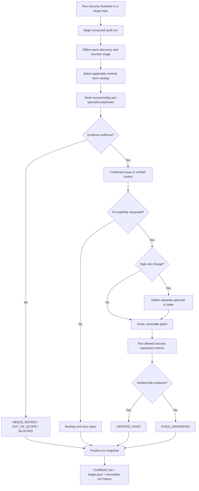

<div align="center">

# 🛡️ Security Guardian

### One security skill. Your whole stack. Every finding tracked.

**Stack-aware, evidence-first security auditing and safe remediation for Claude Code.**

[](https://github.com/omidkh68/security-guardian/actions/workflows/ci.yml)


**145 controls** · **13 security domains** · **107 playbooks** · **versioned audit history**

[Quick start](#-quick-start) · [How it works](#-how-it-works) · [Use cases](#-real-world-use-cases) · [Tracking](#-versioned-findings--audit-history) · [Documentation](#-documentation) · [فارسی](README.fa.md)

</div>

---

> [!IMPORTANT]
> Security Guardian is an **AI-assisted security review workflow**, not an autonomous penetration tester or a security certification. The Python scanner detects heuristics; Claude Code evaluates actual code and can propose or apply **approved** changes. Infrastructure assessments require real, authorized evidence. **Do not run active attacks on systems without permission.**

## ✨ Why Security Guardian?

Security reviews often fail in the handoff: someone sees an insecure CORS rule or an IDOR, makes a partial fix, forgets the negative test, and the same issue returns a sprint later. Security Guardian makes that process repeatable and auditable.

| Capability | What you get |
|---|---|
| 🧭 **Automatic stack discovery** | Finds Angular, NestJS, Flutter, Docker and related manifests/configurations. Uses evidence to determine which control areas apply. |
| 🛡️ **Real control catalog** | 145 source-derived controls with stable IDs (`ANG-01`, `API-01`, `BIZ-01`, etc.), priority, complexity, implementation guidance, acceptance criteria and mapped playbooks. |
| 🧠 **On-demand specialist playbooks** | 107 files covering authorization, SSR/XSS, API validation, mobile storage, native crypto, PKI, CI/CD, containers, tenancy and more. |
| 🔬 **Evidence over assumptions** | A regex match means **candidate**, not confirmed vulnerability. An absence of a match is **not** a pass. |
| 🛠️ **Risk-aware remediation** | Small, reversible code changes when requested. Extra approval for auth, payments, certificates, prod networking, database migrations or other high-impact changes. |
| 🧾 **Permanent, versioned findings** | Every invocation writes its own run and updates stable finding IDs, status transitions, reasons, test evidence and next actions. |
| 🧱 **Defensive boundaries** | The scanner makes no network requests or application changes. The tracker records evidence but does not perform tests or fixes. |
| 🧪 **Useful release decisions** | Build an evidence-backed release gate and prioritized backlog, with unknowns and unresolved risks visible. |

## 🚀 Quick start

### Option A — Install from the Claude Code plugin marketplace

Once this GitHub repository is published, in your Claude Code terminal session:

```text
/plugin marketplace add omidkh68/security-guardian
/plugin install security-guardian@security-guardian-marketplace
```

The fully qualified skill command for this plugin is:

```text
/security-guardian:security-guardian audit
```

A bare `/security-guardian` may also work if it is not shadowed by another command/skill; the namespaced form is unambiguous. Marketplace installation is managed by Claude Code. See [official plugin docs](https://code.claude.com/docs/en/plugin-marketplaces).

### Option B — Install as a standalone Skill

```bash
git clone https://github.com/omidkh68/security-guardian.git
cd security-guardian

# Available to Claude Code in every local project
bash install.sh --user

# OR available only inside one application repository
bash install.sh --project /path/to/your-app
```

Invoke in Claude Code from the app you want to review:

```text
/security-guardian audit
```

Already installed an earlier version? Use `bash install.sh --user --upgrade` or `--project /path/to/your-app --upgrade`. A backup of the previous standalone Skill is retained automatically. **Avoid installing both plugin and standalone versions at once** unless you understand the command-name collision.

### Option C — Try the offline scanner without Claude Code

Requires **Python 3.10+**, with no third-party Python packages:

```bash
python3 plugins/security-guardian/skills/security-guardian/scripts/security_scan.py \
  --root /path/to/your-app --format markdown
```

Or machine-readable JSON:

```bash
python3 plugins/security-guardian/skills/security-guardian/scripts/security_scan.py \
  --root /path/to/your-app --format json --output /tmp/security-candidates.json
```

The scanner is **triage**, not an independent confirmation of all 145 controls. It cannot inspect a live server, cloud IAM, actual production secrets policies, or non-repository settings.

## 🔍 Optional structural scanning and coverage evidence

In addition to its zero-dependency Python triage, Security Guardian offers **optional local Semgrep structural/AST-backed candidate detection**. It never silently installs Semgrep or claims that an unavailable engine has passed. Raw matched source snippets are excluded from the report.

The standard scanner reports excluded files, size and depth limits, and whether the scan was truncated. Each verified fix now needs a same-run passing test linked to the same finding ID, with Git HEAD consistency checks when available. These records are not independent attestations.

See the [verification matrix](docs/verification-matrix.md) for runtime installation testing, evidence limitations, release readiness and GitHub settings.

## 🧭 Control classification and safe history migration

Security findings now have optional deterministic category mapping checks. The
tracker rejects obvious category/control mismatches, marks ambiguous or
unrecognized findings as needing mapping review, and supports explicit,
non-destructive reclassification of older findings. Historical runs are never
silently rewritten; a superseded ID is linked to its replacement and excluded
from active issue totals. This is **assisted classification**, not an automatic
semantic guarantee for all 145 controls.

Review an old ledger with `security_tracker.py mapping-audit --root .` and see
[tracking documentation](docs/tracking.md) for the explicit migration workflow.

## 🎛️ Commands

| Command in Claude Code | Behavior | Application writes? |
|---|---|---|
| `/security-guardian audit` | Detect stack, review applicable controls, triage risks, produce findings | No source edits; **audit-history files are written** |
| `/security-guardian plan P0` | Plan highest-priority remediations, tests and rollback | No source edits; history only |
| `/security-guardian fix ANG-01` | Focused Angular DOM/XSS hardening based on actual sinks | Possible, with approval/safety checks |
| `/security-guardian fix API-01 BIZ-01` | DTO/mass-assignment and multi-tenant authorization review | Possible, with approval/safety checks |
| `/security-guardian skill mobile-webview-bridge-audit` | Open specialist procedure for Flutter WebView ↔ native bridge | No automatic live changes |
| `/security-guardian verify` | Revisit known findings, record actual test results | No remediation implied |
| `/security-guardian release-gate` | Evidence-based Go/No-Go assessment | History only |
| `/security-guardian roadmap` | Sequence work into security delivery plan | History only |
| `/security-guardian control PKI-03` | Explain one control, implementation and acceptance | History only |

In the marketplace variant, prefix commands with `/security-guardian:security-guardian` instead of `/security-guardian`.

> [!NOTE]
> All invocation modes write a new run under `.security-guardian/` by design, including `audit` and `plan`. `audit` is **read-only with respect to application code**, not the entire repository filesystem.

## 🧩 Supported stacks and coverage

| Area | Example security questions |
|---|---|
| **Angular + SSR/PWA** | XSS sinks, sanitizer bypass, Trusted Types, CSP, auth tokens, XSRF contract, SSR cache leaks, service worker private cache, unsafe Mapbox/ECharts popups |
| **NestJS + REST/GraphQL/WS** | DTO validation, mass assignment, role/resource authorization, CORS, JWT verification, rate budgets, SSRF, uploads, webhook signatures, GraphQL complexity |
| **Flutter + Android/iOS** | Keystore/Keychain, TLS trust callbacks, WebView bridges, MethodChannel validation, deep links, persisted session state, signing and release configuration |
| **PKI / certificate lifecycle** | CSR↔key binding, non-exportable keys, transaction consent, canonical signed payloads, issued/revoked state invariants |
| **Business logic & tenants** | BOLA/IDOR, BOPLA, RBAC/ABAC boundaries, concurrency, OTP replay, payments, invites, ownership transfer and file-download authorization |
| **Data / infrastructure** | PostgreSQL least privilege/RLS, Redis isolation, Linux host hardening, Nginx/TLS, Docker segmentation, secrets, backups |
| **Delivery & operations** | GitLab pipelines, runners, dependency risk, SBOM, protected releases, monitoring, incident response, bug-bounty readiness |

All 145 controls live in [`references/controls.json`](plugins/security-guardian/skills/security-guardian/references/controls.json) and the [human-readable index](plugins/security-guardian/skills/security-guardian/references/controls-index.md). A control's presence in the catalog is not proof it has been assessed or satisfied.

## 🧠 How it works



The workflow distinguishes **candidate / confirmed / fixed but unverified / verified fixed / accepted risk / blocked**. A missing scanner signal never automatically closes an existing finding.

## 📚 Real-world use cases

The examples below are **illustrative**, not results from a real customer repository. Read the step-by-step playbooks in [docs/use-cases.md](docs/use-cases.md).

<details>
<summary><b>1. Angular XSS in dynamic map tooltips</b></summary>

**Situation:** an Angular dashboard sends a user-controlled site label to a third-party map popup that accepts HTML. **Review:** `ANG-01` and `ANG-13`, actual data origin, DOM sink and escaping. **Action:** use text-safe rendering and targeted regression checks. **Track:** candidate → confirmed → fix → verified if the test really runs.

```text
/security-guardian audit
/security-guardian fix ANG-01
/security-guardian verify
```

</details>

<details>
<summary><b>2. NestJS IDOR between tenants</b></summary>

**Situation:** `GET /orders/:id` resolves by ID only, even though the requester is a tenant-scoped user. **Review:** `IAM-01`, `BIZ-01`, `DATA-02`, service policies and repository query boundaries. **Action:** bind the query to identity-derived tenant scope and test tenant A vs tenant B. Do not interpret UUIDs as authorization.

```text
/security-guardian plan P0
/security-guardian fix BIZ-01
```

</details>

<details>
<summary><b>3. Flutter WebView reaching native signing</b></summary>

**Situation:** a WebView JavaScript bridge can request a signing operation. **Review:** origin allowlist, method permissions, user consent, native key ownership and actual server-side verification (`MOB-05`, `MOB-08`, `PKI-04`). **Action:** propose hardened boundaries, then get approval before altering signing behavior.

```text
/security-guardian skill mobile-webview-bridge-audit
/security-guardian plan P0
```

</details>

<details>
<summary><b>4. Docker image or GitLab runner exposure</b></summary>

**Situation:** a Compose file uses `privileged: true` or exposes internal services; release pipelines may leak secrets. **Review:** `CLOUD-02`, `HOST-03`, relevant supply-chain controls and deployed config. **Action:** prepare least-privilege patch plus a safe rollout/rollback plan; **no production changes without authorization**.

```text
/security-guardian audit
/security-guardian release-gate
```

</details>

## 🗂️ Versioned findings & audit history

Each invocation creates a new versioned run inside the **target project**, not inside the installed Skill:

```text
my-angular-app/
└── .security-guardian/           # Keep private / ignored in Git
    ├── CURRENT.md               # Current unresolved/resolved status and reasons
    ├── index.json               # Run metadata and sequential version numbers
    ├── ledger.json              # Stable finding IDs and status history
    └── runs/
        ├── v0001-.../
        │   ├── RUN.md           # Human-readable report
        │   ├── manifest.json    # Git context, mode, test records, completion
        │   ├── scanner.json     # Unconfirmed offline signals
        │   ├── findings.json    # Snapshot of tracked findings
        │   └── events.jsonl     # Per-run event chronology
        └── v0002-.../
            └── ...
```

Example lifecycle:

```text
v0001  SG-BIZ-01-xxxxxxxxxxxx  CANDIDATE
v0002  same finding ID         CONFIRMED_OPEN        (owner-scope bypass confirmed)
v0003  same finding ID         FIXED_UNVERIFIED     (patch applied; test unavailable)
v0004  same finding ID         VERIFIED_FIXED       (negative test executed, passed)
v0005  same finding ID         CONFIRMED_OPEN        (regression reproduced; reopened)
```

Why a finding stays open (missing tenant fixtures, infrastructure access, unsafe production migration, risk accepted by an identified approver, etc.) must be documented. **Tests recorded as `NOT_RUN` cannot satisfy verification.** Finished run snapshots cannot be reopened by tracker commands.

Manual tracker queries:

```bash
SG=~/.claude/skills/security-guardian/scripts/security_tracker.py
python3 "$SG" summary --root /path/to/app
python3 "$SG" history --root /path/to/app --id SG-BIZ-01-<actual-id>
```

See [tracking contracts](docs/tracking.md) and [internal tracking workflow](plugins/security-guardian/skills/security-guardian/references/workflows/tracking.md).

## 🔐 Safety and boundaries

- **No false claims of total coverage.** Only a subset of the catalog has automated static indicators. Every control requires a proper applicability and evidence decision.
- **Offline heuristic scanner.** No dependency installation, host scanning, external HTTP calls, or changes to application code.
- **Tracker is a recorder, not a security testing engine.** Evidence/results come from actual review and commands executed with permission; do not invent them.
- **Approval for high-risk changes.** Auth, RBAC, OTP, payments, PKI, DB migrations, SSH/firewall, CI secrets and production deployments are not auto-modified just because someone requests a broad fix.
- **Private by default.** Audit history may expose internal architecture or unpatched vulnerabilities. `.gitignore` protects this repo only; add `.security-guardian/` to each target project's `.gitignore` if necessary.
- **Threat-model-aware.** Client-side guards, obfuscation, WAF and AI summaries are not substitutes for server enforcement and empirical testing.

See [SECURITY.md](SECURITY.md), [security/trust model](docs/security-model.md), and [OWASP references](docs/provenance.md).

## 🧪 Develop and test

```bash
git clone https://github.com/omidkh68/security-guardian.git
cd security-guardian
python3 scripts/validate_package.py
python3 -m unittest discover -s plugins/security-guardian/skills/security-guardian/tests -v
# or
make validate test
```

GitHub Actions runs the offline test suite on three Python versions, checks the catalog and installation smoke tests. CI **cannot** replace an authorized runtime review of a target application. You can validate marketplace syntax on your own machine with `claude plugin validate .` if supported by your installed Claude Code version.

## 📁 Repository layout

```text
.
├── .claude-plugin/marketplace.json      # GitHub-installable marketplace
├── plugins/security-guardian/
│   ├── .claude-plugin/plugin.json       # Plugin metadata
│   └── skills/security-guardian/
│       ├── SKILL.md                     # Agent workflow
│       ├── scripts/                     # Offline scanner + versioned tracker
│       ├── references/
│       │   ├── controls.json            # 145 controls
│       │   ├── domains/                 # 13 domains
│       │   ├── playbooks/               # 107 playbooks
│       │   └── workflows/               # Audit/remediation/reporting rules
│       └── tests/
├── docs/                                # User/admin documentation
├── examples/                            # Sanitized demonstration scenarios
├── .github/                              # CI and community templates
├── install.sh                           # Standalone Claude Code Skill installer
└── LICENSE                              # MIT
```

## 📖 Documentation

| Guide | What it explains |
|---|---|
| [Installation](docs/installation.md) | Plugin vs standalone, user/project scope, upgrades |
| [Commands & modes](docs/commands.md) | Command semantics, permissions, exact examples |
| [Architecture](docs/architecture.md) | Scanner, agent, playbooks, tracker and trust boundaries |
| [Use cases](docs/use-cases.md) | Eight realistic security scenarios and expected outcomes |
| [Tracking](docs/tracking.md) | Status meanings, versioning, reasons, failed fixes and regression IDs |
| [Security model](docs/security-model.md) | Safe operation, sensitive artifacts and limits |
| [Troubleshooting](docs/troubleshooting.md) | Common installation or tracking problems |
| [Playbook contribution](docs/contributing-playbook.md) | Add or improve controls safely |
| [Source and provenance](docs/provenance.md) | Standards, baseline and interpretation of difficulty scores |
| [فارسی](README.fa.md) | Persian quick start and usage |

## 🤝 Contribute

Found a false positive? Need support for a new framework? Want to improve an OWASP mapping or add a regression test? Read [CONTRIBUTING.md](CONTRIBUTING.md), then submit an issue or pull request. **Please do not publish vulnerabilities from private projects in issues**; see [SECURITY.md](SECURITY.md).

## 📜 License and attribution

Security Guardian's original implementation, playbooks and project documentation are made available under the [MIT License](LICENSE). Baseline controls were compiled from the user-provided *Defense-in-Depth Software Security Engineering / 2026* handbook. References to OWASP, NIST, SLSA, Angular, NestJS, Flutter, Anthropic and third-party products are informational; those organizations are **not** sponsors or endorsers of this project. Referenced third-party standards retain their own licenses and trademarks.

**Built for defensive engineering. Evaluate locally. Fix deliberately. Verify with evidence. Track every decision.**
