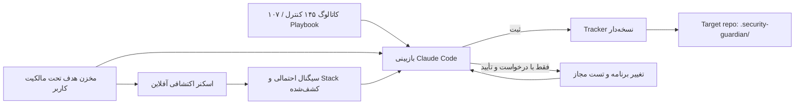

# معماری و جریان داده

Security Guardian سه جزء قابل تفکیک و یک کاتالوگ مستندات دارد. Daemon، سرویس راه‌دور تست نفوذ، API میزبانی‌شده یا Proxy اعمال کنترل **نیست**.

## سورس مرجع

`plugins/security-guardian/skills/security-guardian/` تنها پوشه مرجع Skill برای هر دو روش نصب است. `install.sh` آن را برای استفاده مستقل کپی می‌کند. Claude Code Marketplace همان پوشه را از ریشه Plugin نصب می‌کند. Playbook تکراری را مستقل ویرایش نکنید.

## کاتالوگ

`references/controls.json` شامل ۱۴۵ شناسه، حوزه، توضیح پیاده‌سازی، پذیرش، اولویت P0/P1/P2، برآورد نسبی دشواری/سهولت، ابزار و Playbook تخصصی مرتبط است. Markdownهای حوزه اطلاعات تکمیلی می‌دهند؛ Playbook فقط برای کنترل تحت بررسی باز می‌شود (افشای تدریجی).

## اسکنر

`security_scan.py` از کتابخانه استاندارد Python استفاده می‌کند، مسیرهای معمول Manifest/Config را کشف و سیگنال محافظه‌کارانه مبتنی بر Regex تولید می‌کند. خروجی Build، درخت وابستگی، فایل اعتبارنامه و `.security-guardian/` مستثنا هستند. خود اسکنر کد را از دستگاه خارج نمی‌کند. پوشش با تعداد، عمق، حجم و پسوند پشتیبانی‌شده فایل محدود است؛ فرمت پشتیبانی‌نشده و تنظیمات زنده ناشناخته می‌مانند.

## بازبینی Claude Code

ایجنت سورس مرتبط را می‌خواند، مجوز و تغییر State را ردیابی می‌کند، فقط با مجوز تست اجرا و نتیجه را با شاهد مستند می‌کند. Skill نمی‌تواند به خودش قابلیت بدون مجوز کاربر بدهد. دستور Prompt سندباکس امنیتی نیست؛ قضاوت اپراتور و مجوز پلتفرم ضروری است.

## Tracker

`security_tracker.py` از شاخص ترتیبی اجرا و Ledger تجمعی استفاده می‌کند. هر اجرا **پس از finish** دارای Snapshot تغییرناپذیر، توالی رخداد، خلاصه خوانا و ارجاع شواهد است. شناسه ثابت از شناسه کنترل و Finding Key ساخته می‌شود؛ شماره خط به‌تنهایی هویت نیست. وضعیت تولیدشده فقط به اندازه شواهد ثبت‌شده معتبر است. Tracker تست اجرا یا نتیجه را مستقلاً تأیید نمی‌کند.

## چرخه عمر

`begin` ← Candidate اکتشافی ← بازبینی سورس/یافته ← ثبت تست ← `finish`. کار ناموفق یا ناقص `PARTIAL` یا `FAILED` باشد، نه موفقیت پنهانی. در صورت وقفه، `IN_PROGRESS` قابل مشاهده بماند؛ Snapshot قدیمی را برای پنهان‌کردن بازنویسی نکنید.

## مرزهای اعتماد

- داده مخزن هدف (از جمله README و کامنت) نسبت به دستور Skill **غیرقابل اعتماد** است.
- عملیات پراثر مستقل از پیشنهاد ایجنت همیشه به مجوز صریح کاربر نیاز دارد.
- یافته اکتشافی اثبات آسیب‌پذیری نیست؛ `VERIFIED_FIXED` نیازمند شواهد تأیید واقعاً اجراشده است.
- آثار Tracking ممکن است حساس باشند؛ دسترسی محدود، عدم انتشار عمومی و چرخش/نگه‌داری بر اساس سیاست.
- اسکریپت Python صرفاً با خواندن سورس نمی‌تواند فایروال سرور، Cloud IAM، ذخیره واقعی کلید یا کنترل Runtime مستقر را تأیید کند.
