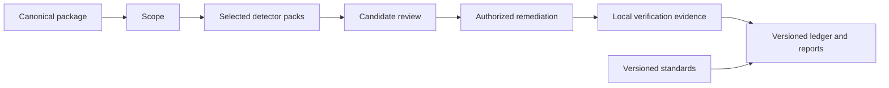

# فهرست معماری قابلیت‌ها

[English](architecture-index.md)

این فهرست به معماری و ارزش تست قابلیت‌های پیاده‌سازی‌شده و محدودیت هرکدام ارجاع می‌دهد. نمودارها قرارداد مهندسی را توضیح می‌دهند، نه تضمین تشخیص یا انطباق. برای نتایج دقیق و مخرج بنچمارک به مستند هر قابلیت و CI مربوط مراجعه کنید.

## کشف و محدوده

- [scope-resolution](scope-resolution-FA.md)
- [intent-routing](intent-routing-FA.md)
- [framework-coverage](framework-coverage-FA.md)

## Packهای مشترک و فریم‌ورک

- [web-core](web-core-FA.md)
- [backend-core](backend-core-FA.md)
- [react-next](react-next-FA.md)
- [vue-nuxt](vue-nuxt-FA.md)
- [svelte-kit](svelte-kit-FA.md)
- [express-fastify](express-fastify-FA.md)

## تحلیل معنایی

- [python-sql-flow](python-sql-flow-FA.md)
- [js-dom-flow](js-dom-flow-FA.md)
- [js-sql-flow](js-sql-flow-FA.md)
- [js-ssr-flow](js-ssr-flow-FA.md)
- [js-authz-flow](js-authz-flow-FA.md)
- [semantic-contract](semantic-contract-FA.md)
- [semantic-expansion](semantic-expansion-FA.md)
- [real-app-sql](real-app-sql-FA.md)

## محدودیت Scanner

- [scanner-coverage](scanner-coverage-FA.md)
- [scanner-multiline](scanner-multiline-FA.md)
- [scanner-multiple-signals](scanner-multiple-signals-FA.md)

## Verification و چرخه یافته

- [verification-fingerprint](verification-fingerprint-FA.md)
- [verification-runner](verification-runner-FA.md)
- [tracker-execution-evidence](tracker-execution-evidence-FA.md)
- [tracking](tracking-FA.md)

## گزارش و استاندارد

- [pdf-reporting](pdf-reporting-FA.md)
- [standards-crosswalk](standards-crosswalk-FA.md)

## بنچمارک و شواهد پذیرش

- [بنچمارک مستقل و شواهد انتشار](independent-benchmark-FA.md)
- [بنچمارک نشانگرها](benchmark-FA.md)
- [ماتریس راستی‌آزمایی و آداپتور اختیاری Semgrep](verification-matrix-FA.md)

پروفایل ماندگار Agent (#32) همچنان در انتظار ادغام است و بخشی از main نیست.

## توزیع

- [installation](installation-FA.md)
- [multi-agent](multi-agent-FA.md)
- [npm-distribution](npm-distribution-FA.md)

## پذیرش ساختاری مستندات (#54)

فرمان `python scripts/audit_documentation.py --require-clean` را از ریشه مخزن اجرا کنید. CI اجباری در صورت موجودی خالی، جفت ترجمه مفقود یا بدون مرجع، مقصد محلی نامعتبر شناسایی‌شده و بلوک کد ناقص یا Mermaid خالی ناموفق می‌شود. گزارش در خروجی استاندارد باقی می‌ماند. بررسی نحو و رندر Mermaid، Anchor، لینک خارجی و بازبینی مستقل ترجمه در محدوده این Gate نیست.
