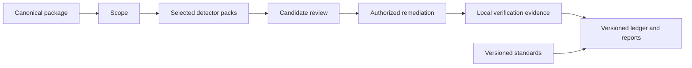

# Capability architecture index

[فارسی](architecture-index-FA.md)

This index links capability architecture and testing value with explicit limitations. Diagrams describe engineering contracts, not detection or compliance guarantees. For measured results and benchmark denominators consult each capability guide and its CI evidence.

## Discovery and scope

- [scope-resolution](scope-resolution.md)
- [intent-routing](intent-routing.md)
- [framework-coverage](framework-coverage.md)

## Common and framework packs

- [web-core](web-core.md)
- [backend-core](backend-core.md)
- [react-next](react-next.md)
- [vue-nuxt](vue-nuxt.md)
- [svelte-kit](svelte-kit.md)
- [express-fastify](express-fastify.md)

## Semantic analysis

- [python-sql-flow](python-sql-flow.md)
- [js-dom-flow](js-dom-flow.md)
- [js-sql-flow](js-sql-flow.md)
- [js-ssr-flow](js-ssr-flow.md)
- [js-authz-flow](js-authz-flow.md)
- [semantic-contract](semantic-contract.md)
- [semantic-expansion](semantic-expansion.md)
- [real-app-sql](real-app-sql.md)

## Scanner limits

- [scanner-coverage](scanner-coverage.md)
- [scanner-multiline](scanner-multiline.md)
- [scanner-multiple-signals](scanner-multiple-signals.md)

## Verification and lifecycle

- [verification-fingerprint](verification-fingerprint.md)
- [verification-runner](verification-runner.md)
- [tracker-execution-evidence](tracker-execution-evidence.md)
- [tracking](tracking.md)

## Reporting and standards

- [pdf-reporting](pdf-reporting.md)
- [standards-crosswalk](standards-crosswalk.md)

## Benchmark and acceptance evidence

- [Independent benchmark and release evidence](independent-benchmark.md)
- [Indicator benchmark](benchmark.md)
- [Verification matrix and optional Semgrep adapter](verification-matrix.md)

Persistent native agent profiles (#32) remain a pending integration, not part of main.

## Distribution

- [installation](installation.md)
- [multi-agent](multi-agent.md)
- [npm-distribution](npm-distribution.md)

## Persistent profile (pending acceptance)

- [Project profile](project-profile.md)
