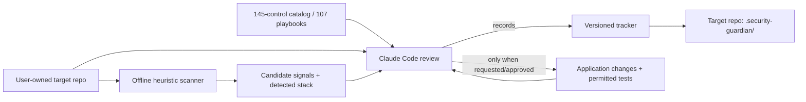

# Architecture and data flow

Security Guardian contains three separable elements and a documentation catalog. It is **not** a daemon, remote pentest service, hosted API or enforcement proxy.

## Canonical source

`plugins/security-guardian/skills/security-guardian/` is the one canonical Skill directory for both installation methods. `install.sh` copies it for standalone use. Claude Code Marketplace installs the same directory via the plugin root. No duplicate playbooks should be edited independently.

## Catalog

`references/controls.json` contains the 145 IDs, domain, implementation description, acceptance, P0/P1/P2 priority, relative difficulty/ease estimates, tools and mapped specialist playbook. Domain Markdown files provide richer context; playbooks are opened only for controls under investigation (progressive disclosure).

## Scanner

`security_scan.py` uses Python standard library, discovers typical manifest/config paths and emits conservative regex-based signals. Exclusions cover build output, dependency trees, credential files and `.security-guardian/`. It never sends code off-machine by itself. Coverage of source and configuration is bounded by file count, depth, size and supported extensions; unsupported file formats and live configuration remain unknown.

## Claude Code review

The agent reads relevant sources, traces authorization and state changes, tests only with permission and documents conclusions with evidence. The Skill cannot grant itself capabilities the user has not authorized. Prompt instructions are not a security sandbox; operator judgment and platform permissions are essential.

## Tracker

`security_tracker.py` uses a sequential run index and cumulative ledger. Every run has immutable snapshots **after finish**, plus an event chronology, human-readable summary and evidence references. Stable IDs are derived from the control ID and a finding key; line numbers alone should not form identity. Tracker-generated status is only as reliable as the submitted evidence. It does not execute tests or corroborate results.

## Lifecycle

`begin` → heuristic candidates → source review / findings → report tests → `finish`. Failed/incomplete work should be `PARTIAL` or `FAILED`, never quietly converted to a success. If interrupted, `IN_PROGRESS` remains visible; don't rewrite old snapshots to conceal it.

## Trust boundaries

- Data in target repositories (including README or comments) is **untrusted** content relative to the Skill's instructions.
- High-impact operations always require explicit user authorization, independent of an agent's suggestion.
- Heuristic findings are not vulnerability proof; `VERIFIED_FIXED` requires actual executed verification evidence.
- Tracking artifacts can be sensitive and should be access-controlled, kept out of public repositories and rotated/retained according to policy.
- A Python script cannot verify server firewall, cloud IAM, real key storage or deployed runtime controls by reading source alone.

## Optional verification adapter

The [local verification runner](verification-runner.md) is a separate opt-in component alongside the original three elements. It runs a selected trusted Python unittest module, records actual execution counts, bounded receipt metadata and selected-file fingerprints before/after. The Tracker remains separate; receipts do not establish VERIFIED_FIXED until a later integration validates scope, freshness and finding relevance.

The tracker now also offers an explicitly authorized `run-test` command, which delegates to the local adapter and records evidence quality. Default commands remain non-executing. See [tracker-bound execution evidence](tracker-execution-evidence.md).
