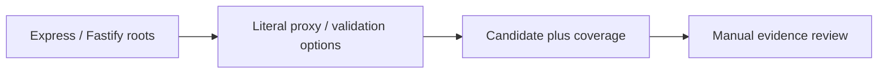

# بسته بازبینی Express و Fastify

نگه‌دارنده: @omidkh68 · اولویت P0 · #33، #74 · [English](express-fastify.md)

## قرارداد

بسته Express/Fastify نسخه ۱ سه نشانه متنی محدود و آفلاین در مؤلفه‌های Backend منتخب با شواهد Manifest مربوط اضافه می‌کند. شناسه‌های تاریخی، کاتالوگ ۱۴۵ کنترل و اسکن بدون محدوده بدون تغییر می‌مانند.

| شناسه Rule | نگاشت تاریخی | Candidate |
|---|---|---|
| EXPRESS.PROXY.TRUST_ALL | API-15 | فعال‌سازی صریح trust proxy روی app/server |
| FASTIFY.PROXY.TRUST_ALL | API-15 | مقدار صریح trustProxy: true |
| FASTIFY.VALIDATION.HANDLER_REVIEW | API-01 | مقدار صریح attachValidation: true |

قواعد فقط در فایل‌های JS/TS/MJS/CJS و بر اساس فریم‌ورک مربوط اعمال می‌شوند. اعتماد Proxy پشت Proxy مورد اعتماد با تنظیم صحیح ممکن است مناسب باشد. گزینه attachValidation در Fastify عمداً پردازش خطا را به Handler مسیر واگذار می‌کند؛ وجود گزینه به‌تنهایی دورزدن اعتبارسنجی نیست. اسکنر هرگز از این نشانه‌ها آسیب‌پذیری را تأیید نمی‌کند.

## استفاده و شواهد

```bash
python3 <skill-dir>/scripts/security_scan.py --root . --profile backend --format json
```

خلاصه express_fastify ریشه‌های منتخب، ریشه‌های اختصاصی فریم‌ورک، فایل‌های واجد شرایط، قواعد فعال و شمارش را فهرست می‌کند. سقف‌های قبلی شواهد اعمال می‌شوند؛ scoped_additional_indicator_rules شامل این قواعد است. Tracker نگاشت‌های تاریخی و عنوان‌های متمایز را حفظ می‌کند. سورس خام یا مقادیر در Candidateها ظاهر نمی‌شوند.

## بازبینی، محدودیت‌ها و بازگردانی

پیش از نتیجه‌گیری درباره ناامن‌بودن اعتماد گسترده، زنجیره واقعی Proxy، محدودیت Ingress و بازنویسی هدرهای Forwarded را بررسی کنید. انتساب IP کلاینت و رفتار Rate Limit را در Fixture محلی مجاز راستی‌آزمایی کنید. برای attachValidation نحوه پردازش request.validationError را بررسی کنید و اطمینان حاصل کنید ورودی نامعتبر به عملیات حساس نمی‌رسد. مجوز مسیر، جداسازی Tenant/Resource، Schema ورودی و فیلتر پاسخ را جداگانه بازبینی کنید. Parser، بازرسی Proxy مستقر، تحلیل جریان داده، دسترسی‌پذیری مسیر، اجرای واقعی درخواست یا تأیید نسخه فریم‌ورک نداریم. فقط گزینه‌های صریح و Receiverهای app/server شناسایی می‌شوند؛ Alias، تنظیم محاسبه‌شده و Handler غیرمستقیم نیازمند بازبینی دستی است. نبود Candidate به معنای امنیت نیست.

اعتبارسنجی بسته، تست رگرسیون و بررسی بسته‌بندی npm را اجرا کنید. Fixtureهای مصنوعی نشانه‌های مثبت/منفی، تفکیک فریم‌ورک، محدوده، سازگاری قدیمی و عدم افشای سورس را پوشش می‌دهند. برای بازگردانی PR را Revert کنید؛ مهاجرت Ledger لازم نیست.

مراجع: [Express پشت Proxy](https://expressjs.com/en/guide/behind-proxies/)، [Fastify Server](https://fastify.dev/docs/latest/Reference/Server/)، [اعتبارسنجی Fastify](https://fastify.dev/docs/latest/Reference/Validation-and-Serialization/).

## معماری و ارزش تست (#74)



نمونه‌ها جداسازی فریم‌ورک، گزینه امن و محدوده را می‌سنجند؛ اعتماد Proxy واقعی تست مجاز می‌خواهد.
