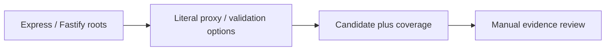

# Express and Fastify review pack

Maintainer: @omidkh68 · P0 · #33, #74 · [فارسی](express-fastify-FA.md)

## Contract

Express/Fastify v1 adds three bounded offline text indicators in selected backend components with relevant manifest evidence. Historical control IDs, 145-control catalog and unscoped scan are unchanged.

| Rule ID | Legacy mapping | Candidate |
|---|---|---|
| EXPRESS.PROXY.TRUST_ALL | API-15 | app/server literal trust proxy enabled |
| FASTIFY.PROXY.TRUST_ALL | API-15 | Literal trustProxy: true |
| FASTIFY.VALIDATION.HANDLER_REVIEW | API-01 | Literal attachValidation: true |

The rules apply in JS/TS/MJS/CJS files only and are framework-gated. Proxy trust can be appropriate behind a correctly configured trusted proxy. Fastify attachValidation deliberately delegates handling to the route handler; the option alone is not a bypass. The scanner never confirms a vulnerability from these signals.

## Usage and evidence

```bash
python3 <skill-dir>/scripts/security_scan.py --root . --profile backend --format json
```

The express_fastify summary lists selected roots, framework-specific roots, eligible files, enabled rules and counts. Existing evidence caps apply; scoped_additional_indicator_rules includes these additions. Tracker keeps historical control mappings and distinct labels. No raw source or values appear in candidates.

## Review, limitations and rollback

Inspect the real proxy chain, ingress restrictions and overwritten forwarding headers before concluding that broad trust is unsafe. Validate client IP attribution and rate-limit behavior in an authorized local fixture. For attachValidation, inspect request.validationError handling and verify malformed input cannot reach protected business operations. Separately review route authorization, tenant/resource isolation, input schemas and response filtering. No parser, deployed proxy inspection, data-flow, route reachability, actual request execution or framework version certification. Only literal options and app/server receivers are recognized; aliases/computed settings and indirect handlers require manual review. Absence of a candidate is not safety.

Run package validation, regression tests and npm packaging checks. Synthetic fixtures cover positive/negative signals, framework separation, scope, legacy compatibility and redaction. Revert this PR for rollback; no ledger migration.

References: [Express behind proxies](https://expressjs.com/en/guide/behind-proxies/), [Fastify server](https://fastify.dev/docs/latest/Reference/Server/), [Fastify validation](https://fastify.dev/docs/latest/Reference/Validation-and-Serialization/).

## Architecture and testing value (#74)



Fixtures check framework separation, safe options and scope; deployed proxy trust needs authorized tests.
