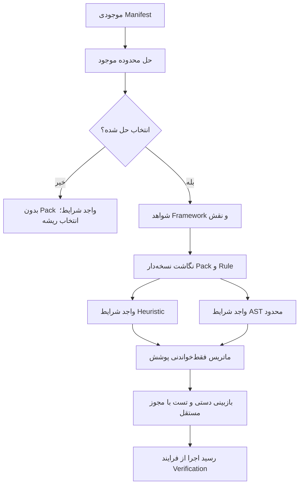

# ماتریس پوشش فناوری و قرارداد توسعه Pack

Issue [#95](https://github.com/omidkh68/security-guardian/issues/95) · [English](framework-coverage.md) · نسخه ۱ Schema

شاخه توسعه دارای ۱۹ نشانه شناسایی Framework از Manifest است، نه تأیید نسخه نصب‌شده یا پشتیبانی کامل. فرمان فقط‌خواندنی نصب‌شده:

```bash
python3 <skill-dir>/scripts/security_coverage.py
python3 <skill-dir>/scripts/security_coverage.py --root . --profile frontend
python3 <skill-dir>/scripts/security_coverage.py --root . --profile custom --component apps/api
python3 <skill-dir>/scripts/security_coverage.py --root . --framework Next.js
```

فرمان اول کاتالوگ نسخه‌دار و بقیه با همان Scope Resolver، Packهای واجد شرایط، شناسه Rule و Control، نسخه، ورودی اجرا، قابلیت و Componentهای خارج از محدوده را نمایش می‌دهند. Scope حل‌نشده هیچ Pack واجد شرایط ندارد. اسکن سورس، بارگذاری وابستگی، Parser، تست و ایجاد Ledger انجام نمی‌شوند.

## معماری



## ماتریس قابلیت‌ها

همه ردیف‌ها Discovery از Manifest و بازبینی دستی دارند. H برابر Pack نشانگر نام‌دار و A برابر AST محدود به نحو و فایل مشخص است. A معادل اجرا نیست. وضعیت Runtime همه ردیف‌ها NOT_RUN است.

| فناوری | H | A |
|---|---|---|
| Angular | web-core | DOM؛ SSR در CommonEngine/NodeAppEngine و اعتبارنامه TransferState |
| React | web-core، react-next (قوانین React) | DOM |
| Next.js | web-core، react-next | DOM؛ رندر خام Pages/App |
| Vue | web-core، vue-nuxt (قوانین Vue) | فقط DOM، نه قالب Vue |
| Nuxt | web-core، vue-nuxt | DOM؛ Endpoint صریح H3 |
| Svelte | web-core، svelte-kit (قوانین Svelte) | فقط DOM، نه قالب Svelte |
| SvelteKit | web-core، svelte-kit | DOM؛ پاسخ HTML در +server |
| NestJS | backend-core | SQL در pg؛ شواهد منابع Prisma/TypeORM |
| Express | backend-core، express-fastify (قوانین Express) | SQL در pg؛ شواهد منابع Prisma/TypeORM |
| Fastify | backend-core، express-fastify (قوانین Fastify) | SQL در pg؛ شواهد منابع Prisma/TypeORM |
| Koa، Hono | backend-core | بدون AST نام‌دار |
| Flask | بدون Pack نشانگر نام‌دار | SQL در Flask/SQLite محدوده‌دار با Context محدود Helper، Loop و Slot داده |
| Django، FastAPI، Spring Boot، ASP.NET Core، Laravel | بدون Pack نشانگر نام‌دار | بدون AST نام‌دار |
| Flutter | بدون Pack نشانگر نام‌دار؛ نشانگرهای قدیمی موبایل | بدون AST نام‌دار |

نشانگرهای عمومی قدیمی با Applicability فیلتر می‌شوند و مستقل از Pack نام‌دارند؛ ۱۴۵ کنترل و Playbook معادل پوشش خودکار نیستند. Android، PKI، زیرساخت و سایر فناوری‌ها ممکن است نشانگر یا Playbook داشته باشند اما در Resolver ردیف Framework مستقل ندارند. نشانه قابلیت database، SSR، OIDC یا workspace اثبات استفاده یا پیکربندی نیست. Semgrep فقط برای حالت قدیمی بدون Scope است. Runner موجود Python unittest با مجوز و Finding انتخاب‌شده شواهد محلی جمع می‌کند؛ تأیید Runtime سراسری Framework وجود ندارد. برای محدوده دقیق [قرارداد معنایی](semantic-contract-FA.md) را ببینید. قالب Vue/Svelte، سیاست میان ماژول و Verification گسترده‌تر دستی یا پشتیبانی‌نشده‌اند.

## قرارداد توسعه Pack و سیاست نگاشت و مهاجرت

۱. شناسه پایدار Pack، نسخه صحیح مثبت، شرط دقیق Framework/Role، فایل واجد شرایط، شناسه پایدار Rule، نگاشت کنترل موجود و سطح شواهد را تعریف کنید. از Predicate و Tupleهای Scanner استفاده شود؛ موجودی باید با Dispatch واقعی یکسان باشد، نه استنباط از نام فناوری.

۲. بازبینی آفلاین قطعی با سقف فایل/AST/مسیر/نتیجه، Exclusion و مالکیت Scope پیاده شود. شناسه Rule/Control، مسیر، خط، تکنیک، Confidence و وضعیت بازبینی صادر شوند، نه راز یا متن خام. Adapter اختیاری از قرارداد مشترک AST استفاده کند. بارگذاری هدف و تست خودکار ممنوع.

۳. شناسه Rule، برچسب قدیمی، شناسه کنترل و کلید تاریخی Finding حفظ شود. توسعه سازگار نسخه Pack را افزایش داده و ماتریس، تست و مستندات را به‌روز کند. تغییر ناسازگار معنا یا نگاشت نیازمند Rule ID جدید، مستند رابطه قدیم/جدید، حفظ تفسیر قبلی و مهاجرت یا Reclassification بازبینی‌شده در Tracker است. تغییر یا حذف خاموش کلید ممنوع. شکست سازگاری JSON نسخه Schema را افزایش دهد؛ فیلد افزوده نتیجه تأییدشده القا نکند.

۴. تست مثبت، منفی، ناقص، Framework نامرتبط، Component مختلط، جداسازی Scope، سقف و Redaction حسب مورد اضافه شود. موجودی Rule، معماری و ارزش تست در EN/FA، بسته‌بندی دقیق و شش CI بررسی شوند. از شواهد ایستا ادعای Runtime نشود.

۵. پیش از Merge، Diff، شواهد اندازه‌گیری و ریسک باقی‌مانده بازبینی شوند. ادعای Runtime نیازمند اجرای واقعی مجاز، بررسی Security Assertion و Receipt محدوده‌دار است، نه ردیف ماتریس یا موفقیت Fixtureهای CI.

## ارزش معماری در تست

| تست | هدف |
|---|---|
| سازگاری کاتالوگ Framework و Rule | نبود ردیف جاافتاده یا Control ناشناخته؛ نگاشت پایدار |
| مقایسه Dispatch واقعی | تطابق نشانگرهای نام‌دار با Predicate فناوری |
| Metadata موتور AST اختیاری | نبود Parser برابر NOT_AVAILABLE؛ تطابق نسخه و Rule |
| محدوده مختلط و ناشناخته | عدم انتخاب خودکار Component خارج یا حل‌نشده |
| Manifest نامعتبر و Intent دقیق | Discovery ناقص مجوز ایجاد نکند |
| CLI قطعی و Redaction | عدم اجرای هدف، خروج نسخه خام یا تغییر Ledger |

موجودی افزوده است؛ قالب Scanner و Tracker، کلیدها و اسکن پیش‌فرض تغییر نمی‌کنند. بازگشت با Revert و بدون مهاجرت Ledger است. ارزیابی مستقل (#96)، Verification چندفناوری (#35) و Runtime ایجنت (#32) جداگانه باقی می‌مانند.


توسعه #107: برای مدل‌های جاری و محدودیت‌ها و ارزیابی جداگانه، [توسعه پوشش معنایی](semantic-expansion-FA.md) را ببینید. توضیحات نسخه‌های قبلی خط مبنای تاریخی هستند.
