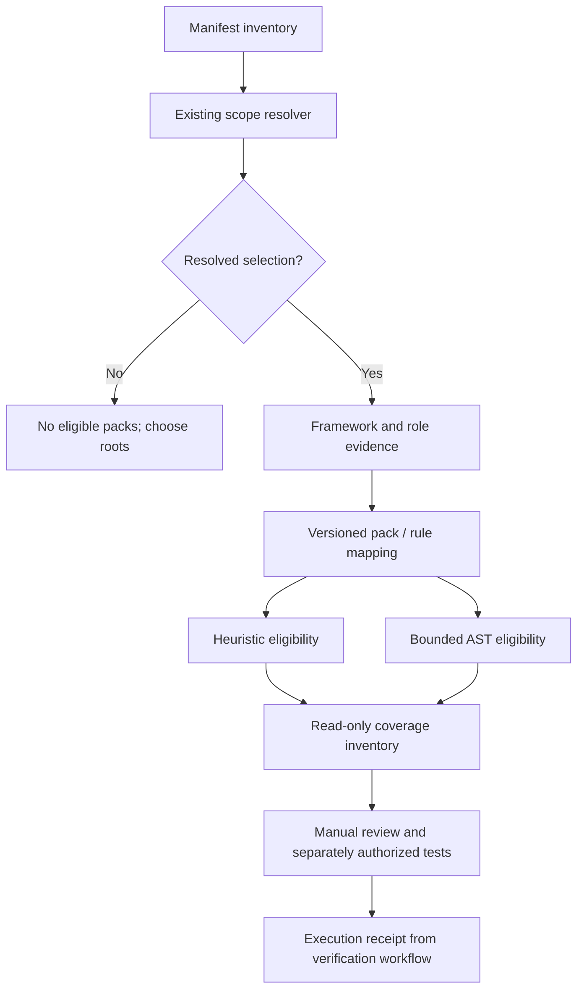

# Framework coverage and pack contributor contract

Issue [#95](https://github.com/omidkh68/security-guardian/issues/95) · [فارسی](framework-coverage-FA.md) · matrix v2 · schema v1

The development tree provides 19 manifest framework hints (not installed-version or support certification). Run the installed read-only inventory:

```bash
python3 <skill-dir>/scripts/security_coverage.py
python3 <skill-dir>/scripts/security_coverage.py --root . --profile frontend
python3 <skill-dir>/scripts/security_coverage.py --root . --profile custom --component apps/api
python3 <skill-dir>/scripts/security_coverage.py --root . --framework Next.js
```

The first command prints the versioned catalog. The remaining commands reuse scope resolution and show eligible packs, exact rule/control IDs, versions, entrypoints, capabilities and excluded components. An unresolved scope yields no eligible packs. This command does not run even a static scanner, load dependencies, start a parser, run tests or create a ledger.

## Architecture



## Supported-feature matrix

All rows have manifest discovery and manual review. H = named heuristic pack; A = bounded AST, subject to exact syntax and file rules. A does not imply execution. All runtime status values are NOT_RUN.

| Framework | H | A |
|---|---|---|
| Angular | web-core | DOM; SSR CommonEngine/NodeAppEngine/credential TransferState |
| React | web-core, react-next (React rules) | DOM |
| Next.js | web-core, react-next | DOM; Pages/App raw rendering |
| Vue | web-core, vue-nuxt (Vue rules) | DOM only, not Vue templates |
| Nuxt | web-core, vue-nuxt | DOM; explicit H3 HTML endpoint |
| Svelte | web-core, svelte-kit (Svelte rules) | DOM only, not Svelte templates |
| SvelteKit | web-core, svelte-kit | DOM; +server HTML response |
| NestJS | backend-core | pg SQL with bounded local helpers; Prisma/TypeORM resource evidence |
| Express | backend-core, express-fastify (Express rules) | pg SQL; Prisma/TypeORM resource evidence |
| Fastify | backend-core, express-fastify (Fastify rules) | pg SQL; Prisma/TypeORM resource evidence |
| Koa, Hono | backend-core | No named AST model |
| Flask | No named heuristic pack | Flask/SQLite SQL flow in scoped scanner; bounded helper context, loops and data slots |
| Django, FastAPI, Spring Boot, ASP.NET Core, Laravel | No named heuristic pack | No named AST model |
| Flutter | No named heuristic pack; legacy mobile indicators | No named AST model |

Generic legacy indicators are applicability-filtered and separate from named packs; 145 controls and playbooks are not automated coverage. Android, PKI, infrastructure and other stacks may have legacy indicators/playbooks but are not independently identified framework rows in this resolver. Capability hints such as database, SSR, OIDC or workspace are not evidence that the feature is configured or used. Semgrep is legacy unscoped only. The existing Python unittest runner can collect authorized local evidence for a selected finding; no framework-wide runtime verification exists. See [semantic contract](semantic-contract.md) for exact scope limits. Vue/Svelte templates, cross-module policies and broader verification remain manual/unsupported.

## Contributor interface and stable migration policy

1. Declare a stable pack ID, positive integer version, exact discovery framework/role predicate, file eligibility, stable rule ID, existing control mapping, and explicit evidence level. Reuse scanner predicates and rule tuples; the inventory must mirror actual dispatch, never infer from framework name alone.
2. Implement deterministic offline review with bounded file/AST/path/result budgets, exclusions and scope ownership. Emit rule/control IDs, path, line, technique, confidence and review-only status, never raw secrets or source values. Optional parser adapters use the shared AST contract. No target loading or automatic tests.
3. Preserve existing rule IDs, legacy labels, control IDs and historical finding keys. Compatible expansions increment pack version and update inventory/tests/docs. Incompatible semantics or mapping use a new rule ID; document old-to-new relation, maintain legacy interpretation and require reviewed migration/reclassification through existing tracker workflow. Never silently rekey or delete prior findings. Breaking JSON shape changes increment schema version; additive fields must not imply verified results.
4. Add positive, negative, unsupported, wrong-framework, mixed-component, scope isolation, bounds and redaction tests as relevant. Update named rule inventory and EN/FA architecture and testing documentation; verify exact packaged assets and all six CI gates. No new rule may claim runtime verification from static evidence.
5. Review the diff, measured evidence and residual risk before merging. A runtime claim requires authorized actual execution, security assertion review and scoped receipt, not an inventory entry or CI fixture pass.

## Testing value

| Test | Why |
|---|---|
| Framework / rule catalog consistency | No missing rows or unknown control IDs; stable unique mappings |
| Actual dispatch comparison | Named heuristic rules agree with framework predicates |
| Optional AST metadata | Missing parser stays NOT_AVAILABLE and pack versions/rules match |
| Mixed and unknown scope | No automatic selection of excluded or unresolved components |
| Invalid manifests and exact framework intent | Incomplete discovery does not grant permission |
| Deterministic CLI and redaction | No target code execution, raw manifest versions or ledger mutation |

This inventory is additive; scanner and tracker formats, rule keys and default scan behavior remain unchanged. Rollback is PR revert with no ledger migration. Independent detection evaluation (#96), multi-technology verification (#35) and runtime agent tests (#32) remain separate.


Expansion #107: see [semantic coverage expansion](semantic-expansion.md) for current model boundaries and separate evaluation. Prior version sections describe historical baselines.

## Synchronized inventory (#95)

Python SQL pack version is sourced directly from the scanner (v13), with an actual scoped dispatch test; inventory lists both Python and Node authorized adapters, preserving legacy available_runner and NOT_RUN. This is not automatic framework verification. Flask/Angular fixtures are separate CI evidence, not customer coverage. CI pending.

## Explicit version evidence (#33)

Matrix v2 adds `version_evidence` to each framework row and to the scoped component inventory. Installed target versions are always `NOT_INSPECTED`; supported version ranges are `NOT_CERTIFIED`. The reference fixture is null for other frameworks. The exact direct dependency pins below describe repository-owned executable fixtures, not a tested range or target security verdict.

| Framework | Reference fixture version | Scenario |
|---|---|---|
| Angular | 20.3.34 | Angular SSR |
| NestJS | 11.1.6 | NestJS HTTP |
| Flask | 3.1.2 | Flask SQLite HTTP |

The inventory reports `NOT_RUN_BY_INVENTORY` for reference fixtures and `NOT_RUN` for target verification, even for a selected component. The repository CI runs these suites separately; [main CI #246](https://github.com/omidkh68/security-guardian/actions/runs/45898734410) is historical evidence for those exact fixtures. Regression tests compare the metadata with the fixture manifests in a full checkout and check that target dependency strings are not exposed. This is additive to schema v1 and does not expand scanner support. No framework-version certification, independent benchmark or automatic remediation claim.
