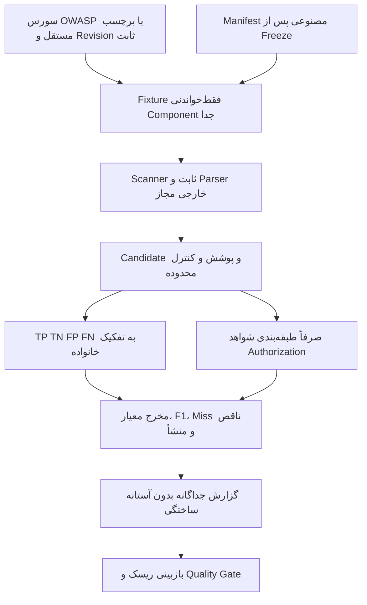
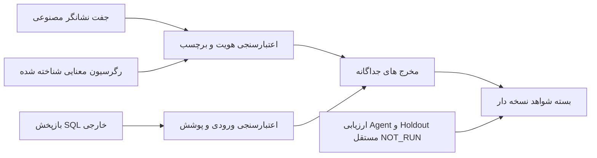

# ارزیابی مستقل موتور تشخیص (#96)

[English](independent-benchmark.md)

## جداسازی مجموعه‌ها

Fixtureهای توسعه ثابت می‌مانند. موتور در Commit 914f1a0ed7383d6cbdd1f835c0d5446f4416dcc5 ثابت شده و این PR هیچ تغییری در تشخیص ندارد. مجموعه خارجی دارای برچسب مستقل OWASP BenchmarkPython v0.1 در Revision f1291485808b66e20ddb6b01b10dc71b3df8c8ba است: [برچسب رسمی](https://github.com/OWASP-Benchmark/BenchmarkPython/blob/f1291485808b66e20ddb6b01b10dc71b3df8c8ba/expectedresults-0.1.csv)، [مجوز GPL v3](https://github.com/OWASP-Benchmark/BenchmarkPython/blob/f1291485808b66e20ddb6b01b10dc71b3df8c8ba/LICENSE). هر ۱۶ مورد CWE-89/sqli (۵ مثبت و ۱۱ منفی) بدون تغییر سورس ارزیابی می‌شوند؛ سورس GPL وارد Repository نمی‌شود و اجرا یا Import Helper انجام نمی‌شود. CI شیء Git ثابت را در Repository خالی و جداگانه دریافت می‌کند. این سنجش محدود تطابق Candidate با برچسب است، نه امتیاز کامل OWASP. برچسب بالادستی Ground Truth آسیب‌پذیری است؛ مدل ما محدود است و ممکن است Handler تودرتو و گیرنده Helper را از دست بدهد. این موارد نباید حذف شوند.

مجموعه مصنوعی جداگانه MIT با ۲۷ سناریو پس از Freeze موتور تهیه شده: ۲۲ سناریوی دودویی Python SQL، JS DOM، Node SQL و پنج مدل SSR؛ پنج طبقه‌بندی شواهد Authorization. این خط مبنای Holdout پس از Freeze است، **نه داوری مستقل انسانی**. موتور با این مجموعه تنظیم نشود و نتایج آن مستقل خارجی نامیده نشوند. Manifest، برچسب و Miss حفظ شوند؛ مجموعه بعدی نسخه جدا داشته باشد. ارزیابی Agent، اصلاح، مقایسه CodeQL/Semgrep برابر NOT_RUN است؛ #35، #32 و Quality Gate #105 آن‌ها را پیگیری می‌کنند. سورس مشتری استفاده نمی‌شود.

## معماری



## بازتولید و ارزش تست

از ریشه Repository:
```bash
python scripts/benchmark_holdout.py --synthetic python
python scripts/benchmark_holdout.py --synthetic js --typescript-module /absolute/trusted/typescript.js
git init --bare /tmp/sg-owasp-benchmark
git -C /tmp/sg-owasp-benchmark fetch --depth=1 --no-tags https://github.com/OWASP-Benchmark/BenchmarkPython.git f1291485808b66e20ddb6b01b10dc71b3df8c8ba
python scripts/benchmark_holdout.py --external-git /tmp/sg-owasp-benchmark
```

CI از TypeScript 5.9.3 ثابت استفاده می‌کند؛ برنامه اجرا نمی‌شود. گزارش شامل Commit، نسخه و Hash موتور/Parser، Hash برچسب و سورس، برچسب هر مورد، وضعیت Candidate، زمان اجرا، پوشش ناقص و جداسازی Scope است. فرمول F1 برابر 2TP/(2TP+FP+FN) است؛ مخرج صفر null می‌شود. منفی اثبات امنیت نیست؛ مثبت ناقص بدون Candidate برابر FN است. Authorization توافق طبقه‌بندی است نه Precision/Recall آسیب‌پذیری. Gate صحت داده، کامل بودن، Scope، دسترس‌پذیری Parser و نبود تأیید ساختگی را کنترل می‌کند، نه حداقل امتیاز. مجموعه خارجی روی Python 3.12، مصنوعی Python روی سه Job و مصنوعی JS روی دو Job Node اجرا می‌شود. تست‌های آفلاین مخرج‌ها، Miss ناقص و Manifest را بررسی می‌کنند. کیفیت تشخیص، زمان رسیدن به یافته قابل اقدام، داوری مستقل و نرخ اصلاح واقعی هنوز اثبات نشده‌اند. نتیجه از CI استخراج شود نه اعداد مورد انتظار.

کد محصول و Ledger تغییر نکرده‌اند. بازگشت با Revert؛ تعیین آستانه پس از بازبینی شواهد. مقایسه خارجی ابزارها نیازمند محدوده و نسخه و Ground Truth یکسان است، نه مقایسه امتیاز آزمایش‌های متفاوت.

## یکپارچگی Manifest ثابت #96

هویت Git Blob مجموعه اصلی ۲۷ مورد ثابت است؛ اجرای فعلی صریحاً بازپخش است نه موتور قدیمی ثابت یا Holdout مستقل تازه. گیت رگرسیون همه برچسب‌های منتخب قبلاً مشاهده‌شده، هویت یکتا، محدوده، پوشش و سازگاری مشاهده/طبقه‌بندی را الزام می‌کند. گزارش تاریخی تغییر ندارد؛ ادعای ارزیابی Agent یا Runtime ندارد. CI هر دو زیرمجموعه Python و JS را اجرا می‌کند؛ تست جدید تغییر Manifest، مورد تکراری/ناقص و نتیجه اشتباه را رد می‌کند. CI در انتظار است.

## بسته شواهد انتشار (#37)

CI پایتون ۳٫۱۲ فایل نسخه‌دار `benchmark-evidence.json` را از خط مبنای نشانگر مصنوعی، رگرسیون معنایی ۲۷ موردی از قبل شناخته‌شده و هفت گزارش SQL خارجی موجود می‌سازد. هویت Checkout، Hash موتور و Parser در صورت وجود، شناسه Case و Scope اعتبارسنجی می‌شوند، مخرج‌ها از ردیف‌های معتبر دوباره محاسبه می‌شوند و SHA-256 گزارش‌های ورودی ثبت می‌شود. مجموعه‌های OWASP ایزوله و دارای Context با Gate موجود بر اساس بایت و برچسب Route تطبیق داده می‌شوند؛ مجموعه‌های دارای برچسب نویسنده خارجی صریحاً Replay شناخته‌شده‌اند. نرخ دقت تجمیعی میان مجموعه‌ها محاسبه نمی‌شود. Artifact فقط شواهد ساختاریافته تجمیعی، Hash و نوع مجموعه عمومی دارد، نه سورس خام یا داده مشتری. CI آن را هفت روز نگه می‌دارد؛ برای بازبینی انتشار از Run و Commit متناظر استفاده کنید.



این توسعه برای یکپارچگی شواهد است، نه Benchmark مستقل جدید. Holdout تازه و کور، داوری انسانی مستقل، رفتار Agent و نرخ اصلاح، زمان اولین Finding قابل اقدام و مقایسه CodeQL/Semgrep همچنان NOT_RUN هستند. نمونه‌های اجرایی Framework شواهد جداگانه‌اند، نه نرخ اصلاح Agent. آستانه انتشار تعیین نشده است. تست آفلاین Hash قدیمی، Case جاافتاده یا تکراری، شکست Scope و برچسب ناسازگار را رد می‌کند و Missهای دارای پوشش ناقص و مخرج تعریف‌نشده را نگه می‌دارد. موفقیت این مرحله فقط پس از تولید واقعی Artifact در CI قابل ادعا است.

## یکپارچگی شواهد DOM خارجی (#34 / #37)

آزمون فقط مثبت شامل چهار انتساب innerHTML با برچسب نویسنده در دو فایل عمومی ثابت CodeQL است. بسته شواهد انتشار گزارش را به هش موتور و Parser جاری، شناسه Blob منبع، شناسه موارد، جداسازی محدوده و زمان سپری‌شده متصل می‌کند. تمام موارد ازدست‌رفته، از جمله موارد با پوشش جزئی، حفظ می‌شوند و مخرج آزمون فقط مثبت دوباره محاسبه می‌شود. برچسب منفی موجود نیست؛ Precision برابر null است و اجرای CodeQL یا داوری مستقل همچنان NOT_RUN است. امتیاز ترکیبی یا ادعای دقت مستقل نداریم. پذیرش مستلزم موفقیت کنترل‌های جدید در CI است.
