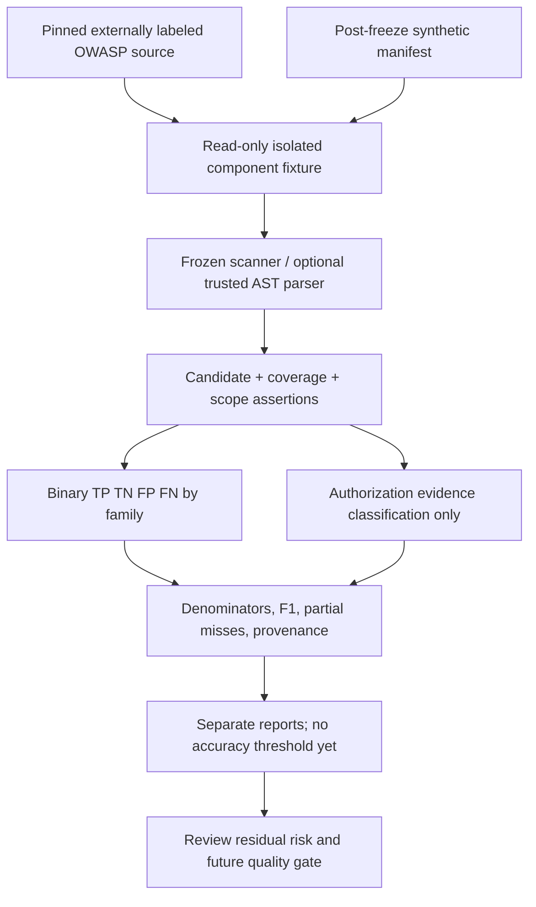

# Independent detection benchmark (#96)

[فارسی](independent-benchmark-FA.md)

## Corpus separation

The development fixtures remain unchanged. Freeze the detection engine at commit 914f1a0ed7383d6cbdd1f835c0d5446f4416dcc5; no detector changes in this PR. The external independently labeled corpus is OWASP BenchmarkPython v0.1 at revision f1291485808b66e20ddb6b01b10dc71b3df8c8ba, [official labels](https://github.com/OWASP-Benchmark/BenchmarkPython/blob/f1291485808b66e20ddb6b01b10dc71b3df8c8ba/expectedresults-0.1.csv), [GPL v3 license](https://github.com/OWASP-Benchmark/BenchmarkPython/blob/f1291485808b66e20ddb6b01b10dc71b3df8c8ba/LICENSE). Evaluate all 16 CWE-89/sqli cases (5 positive, 11 negative) without changing source; no vendoring or executing GPL fixtures, no helper imports resolved. CI fetches the pinned Git object into an isolated bare repository. This is a narrow **candidate-overlap** assessment, not OWASP's full application score. The upstream labels describe real vulnerability ground truth; our model is bounded and may miss nested handlers/helper receivers. Do not discard these misses.

The separate 27-case MIT synthetic holdout was authored after freezing the engine: 22 binary candidate cases across Python SQL, JS DOM, Node SQL and five SSR entry models; five authorization evidence classifications. This is a post-freeze regression/holdout baseline, **not independently adjudicated**. Do not tune the engine on it or describe its metrics as externally independent. Preserve the manifest, labels and misses; new frozen cohorts need new versions. The agent and fix evaluations, CodeQL/Semgrep comparisons are explicitly NOT_RUN; #35/#32 and quality gate #105 track the remaining work. No customer source.

## Architecture



## Reproduction and testing value

From repository root:
```bash
python scripts/benchmark_holdout.py --synthetic python
python scripts/benchmark_holdout.py --synthetic js --typescript-module /absolute/trusted/typescript.js
git init --bare /tmp/sg-owasp-benchmark
git -C /tmp/sg-owasp-benchmark fetch --depth=1 --no-tags https://github.com/OWASP-Benchmark/BenchmarkPython.git f1291485808b66e20ddb6b01b10dc71b3df8c8ba
python scripts/benchmark_holdout.py --external-git /tmp/sg-owasp-benchmark
```

CI uses pinned TypeScript 5.9.3; no application starts. Reports contain commit, interpreter/parser versions and hashes, corpus/label/source hashes, individual labels, observed candidate status, elapsed seconds, partial cases, partial misses and scope isolation. F1 = 2TP/(2TP+FP+FN); undefined ratios are null. Negative cases do not prove safety; partial positives without candidates count as FN. Authorization is agreement, never vulnerability precision/recall. CI gates integrity, completeness, scope, parser availability and no confirmation, not a minimum detection score. The external slice runs on Python 3.12; synthetic Python on all three Python jobs and synthetic JS on both Node jobs. Offline unit tests check ratios, partial accounting and manifest integrity. Detection quality, time to actionable finding, independent reviewer validation and actual fix rates remain unproven. Report results from CI, not expected counts.

No product code or ledger change. Roll back by reverting the PR; future benchmark thresholds require reviewed baseline evidence. External comparison with other engines must use equivalent scope, versions and ground truth, not published scores from incompatible experiments.

## Frozen manifest integrity (#96)

Pin the original 27-case Git blob identity; current execution is explicitly a replay, not the frozen engine and not a fresh independent holdout. The optional regression gate requires all selected exposed labels, exact unique case identity, scope, coverage and observation/classification consistency. Historical reports stay unchanged; no runtime/agent evaluation claim. CI runs both Python and JS subsets; new tests reject altered manifest, duplicate/missing cases and wrong outcomes. CI pending.
