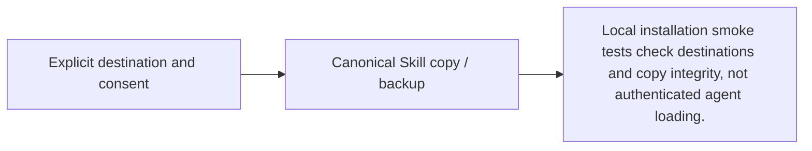

# نصب، به‌روزرسانی و حذف نصب

[English](installation.md)

## پیش‌نیازها

- برای بررسی توسط ایجنت: نصب عملیاتی **Claude Code، Codex یا Gemini CLI** و دسترسی به پروژه.
- برای اسکنر و Tracker مستقل: **Python 3.10+**؛ بدون وابستگی pip.
- برای اسکریپت نصب: Bash و ابزارهای استاندارد POSIX؛ Linux/macOS پیشنهاد می‌شود.
- Git برای Clone و ثبت فراداده Commit پروژه هدف مفید است.
- اتصال اینترنت فقط برای Clone یا Marketplace میزبانی‌شده لازم است، نه اسکنر Python.

## نصب از Marketplace گیت‌هاب

در نشست تعاملی Claude Code:

```text
/plugin marketplace add omidkh68/security-guardian
/plugin install security-guardian@security-guardian-marketplace
```

فراخوانی صریح Skill افزونه:

```text
/security-guardian:security-guardian audit
```

اگر افزونه ظاهر نشد، نشست Claude Code را دوباره بارگذاری یا راه‌اندازی کنید. به‌روزرسانی با مدیر افزونه Claude Code انجام می‌شود. همان Skill را همزمان در `~/.claude/skills/` کپی نکنید، مگر تداخل فرمان‌ها را درک کرده باشید.

## نصب تعاملی چندایجنتی

مخزن یک بسته مرجع Agent Skills برای هر سه ایجنت دارد. Codex و Gemini از `.agents/skills/security-guardian` در محدوده کاربر یا پروژه استفاده می‌کنند. از Clone قابل اعتماد اجرا کنید:

```bash
bash install-agent.sh
```

با Space و کلیدهای جهت ایجنت‌ها را انتخاب کنید، Global یا Local را مشخص کنید، مقصدها را بازبینی و تأیید کنید. با q یا n بدون نوشتن لغو کنید. برای اتوماسیون:

```bash
bash install-agent.sh --agent codex --user
bash install-agent.sh --agent gemini --project /path/to/application
bash install-agent.sh --agent all --user
```

برای فعال‌سازی و ارتقا [مستندات چندایجنتی](multi-agent.md) را ببینید. گزارش PDF به نصب اختیاری محلی `requirements-pdf.txt` نیاز دارد؛ [گزارش PDF](pdf-reporting.md) را ببینید.

## نصب Skill مستقل

```bash
git clone https://github.com/omidkh68/security-guardian.git
cd security-guardian
bash install.sh --user
```

نصب سطح کاربر در `~/.claude/skills/security-guardian/` کپی می‌شود.

نصب سطح پروژه:

```bash
bash install.sh --project /path/to/application
```

Skill در `/path/to/application/.claude/skills/security-guardian/` کپی می‌شود و خود برنامه تغییر نمی‌کند.

### ارتقا

مخزن توزیع را مجدداً Clone یا `git pull` کنید، سپس:

```bash
bash install.sh --user --upgrade
# or
bash install.sh --project /path/to/application --upgrade
```

نصب‌کننده از بازنویسی تصادفی جلوگیری و Backup را در `~/.claude/skill-backups/` (کاربر) یا `<project>/.claude/skill-backups/` نگه می‌دارد. جایگزینی Symlink یا پوشه با نام Skill دیگر را رد می‌کند.

### حذف نصب

فقط برای نصب مستقل، **پس از تأیید اینکه مسیر متعلق به نصب Skill شماست**:

```bash
rm -r -- "$HOME/.claude/skills/security-guardian"
```

در سطح پروژه فقط `<project>/.claude/skills/security-guardian/` را حذف کنید. یافته‌های محلی `.security-guardian/` حذف نمی‌شوند؛ آن‌ها حساس هستند و طبق سیاست نگه‌داری خود حفظ یا حذف کنید. برای Marketplace از مدیر `/plugin` در Claude Code استفاده کنید.

## هنگام ممیزی چه اتفاقی می‌افتد؟

برخلاف Linter کاملاً فقط خواندنی، حالت **audit** Skill رکورد اجرا را در `<target-root>/.security-guardian/` برنامه می‌نویسد. در صورت مناسب بودن `.security-guardian/` را به `.gitignore` برنامه اضافه کنید. اسکنر Python به‌تنهایی و با فراخوانی مستقیم، نسبت به سورس کاملاً فقط خواندنی است.

## درخت سورس در برابر پروژه هدف

**درخت سورس:** توزیع Cloneشده security-guardian، شامل دستورالعمل و اسکریپت.

**پروژه هدف:** مخزن Angular/NestJS/Flutter که می‌خواهید ممیزی کنید. Claude Code را از داخل پروژه هدف اجرا کنید، نه توزیع Skill؛ مگر هدف شما ممیزی خود Skill باشد.

## اعتبارسنجی Marketplace

توزیع شامل `.claude-plugin/marketplace.json` و `plugins/security-guardian/.claude-plugin/plugin.json` و Skill در `plugins/security-guardian/skills/security-guardian/` است.

اگر Claude Code CLI نصب شده است، اعتبارسنجی کنید:

```bash
claude plugin validate ./plugins/security-guardian
claude plugin validate .
```

نتیجه اعتبارسنجی به نسخه Claude Code نصب‌شده وابسته است. برای کنترل ساختاری محلی مخزن نیز `python3 scripts/validate_package.py` اجرا کنید.

## پیش‌نمایش محلی npm (منتشرنشده)

برای پیش‌نمایش tarball خصوصی، مجوز صریح، ارتقای ایمن و تست npx آفلاین [توزیع npm](npm-distribution-FA.md) را ببینید. نصب رجیستری هنوز در دسترس نیست و ادعای انتشار نمی‌شود.

## معماری و ارزش تست (Installer)



undefined
