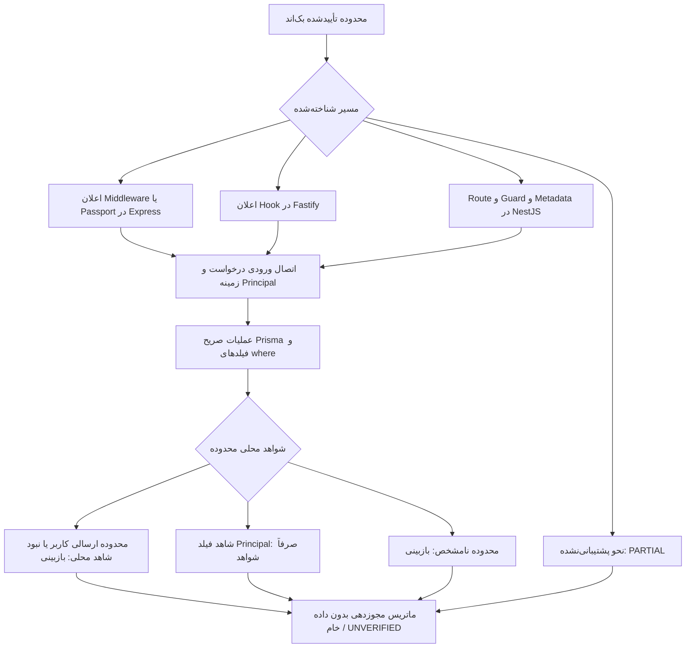
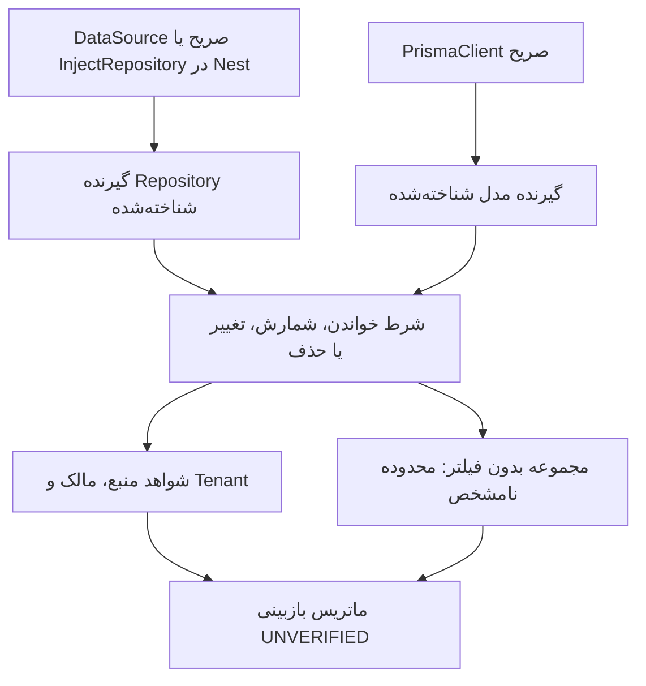

# بازبینی شواهد مجوزدهی و محدوده منابع

Issue [#93](https://github.com/omidkh68/security-guardian/issues/93) · [English](js-authz-flow.md)

قاعده اختیاری JS.NODE.AUTHZ.RESOURCE_SCOPE برای Handlerهای انتخاب‌شده Express، Fastify و NestJS که به عملیات مدل PrismaClient با Import صریح و نمونه محلی می‌رسند، ماتریس شواهد مجوزدهی تولید می‌کند. شناسه و محدوده Tenant یا Owner کنترل‌شده توسط درخواست، مقادیر ثابت، فیلدهای ظاهراً متعلق به Principal و اعلان Guard/Metadata/Middleware جدا می‌شوند. کنترل‌های مرتبط IAM-01، BIZ-01 و DATA-02 هستند؛ Candidate به BIZ-01 نگاشت می‌شود. همه ردیف‌ها UNVERIFIED هستند. وجود Guard یا فیلد Principal اثبات هویت معتبر یا مجوز مؤثر نیست.

## معماری

با مجوز صریح و Parser قابل‌اعتماد TypeScript 5.9.3 خارج از پروژه اجرا کنید: `python3 <skill-dir>/scripts/security_js_authz_flow.py --root . --profile backend --typescript-module <absolute-trusted-parser-path>`؛ همان Componentهای تأییدشده را بدهید. کد پروژه اجرا نمی‌شود، شبکه و پایگاه داده فراخوانی نمی‌شوند و Ledger تغییر نمی‌کند. سقف فایل، اندازه، گره AST و خروجی مطابق Adapter SQL است. نحو ناشناخته PARTIAL و Parser ناموجود NOT_AVAILABLE است. مسیر خام Route، نام مدل، مقادیر فیلدها، نقش‌ها یا متن سورس صادر نمی‌شوند.

| وضعیت ماتریس | تفسیر |
|---|---|
| CALLER_SCOPE_REVIEW | محدوده Tenant/Owner از درخواست آمده؛ تطبیق با زمینه قابل‌اعتماد لازم است. |
| MISSING_LOCAL_SCOPE_REVIEW | منبع انتخاب‌شده توسط کاربر بدون شرط محلی شناخته‌شده Owner/Tenant؛ ممکن است سیاست سراسری وجود داشته باشد. |
| PRINCIPAL_SCOPE_EVIDENCE | شرط ظاهراً منطبق با Principal؛ منشأ هویت، سیاست بیزینس و معنای Query بررسی شود. |
| UNKNOWN_RESOURCE_SCOPE | شرط ثابت/خالی یا نبود اتصال محلی شناخته‌شده؛ بازبینی دستی. |

مسیرهای مستقیم Express با Middleware واردشده (از جمله اعلان Passport authenticate)، مسیرهای مستقیم Fastify با Hook ساده واردشده، و Decoratorهای صریح Controller/HTTP/Param/Body/Query/Req و UseGuards و SetMetadata ثابت roles/permissions در NestJS مدل می‌شوند. بدنه Guard/Hook یا موفقیت Authentication استنباط نمی‌شود. خواندن، شمارش، ویرایش، حذف و upsert در Prisma با فیلدهای ساده id، tenantId/organizationId/companyId/schoolId و ownerId/userId/customerId، Alias محلی const و ورودی درخواست بررسی می‌شوند. شکل Principal همان req.user با فیلدهای شناخته‌شده است؛ انطباق فیلد صرفاً نحوی است. OR/AND، فیلتر رابطه‌ای تودرتو، where پویا، شناسه سفارشی، سایر Repository/DI، Helper، Middleware عمومی، شاخه، SQL خام و سیاست بین فایل‌ها خارج از پوشش‌اند. این ابزار اثبات BOLA/IDOR یا SAST کامل نیست. نبود ردیف یا وجود شاهد Principal اثبات امنیت نیست.

## ارزش معماری در تست و پذیرش

| نوع تست | شواهد مورد نیاز |
|---|---|
| مثبت | مسیر شناسه بدون محدوده، Tenant/Owner ارسالی کاربر و صرفاً Authentication، Candidate بازبینی ایجاد کنند. |
| منفی Candidate | شرط محلی Owner/Tenant فقط شاهد ماتریس باشد، نه نتیجه امنیت تأییدشده. |
| نامشخص / ناقص | شرط ثابت یا خالی نامشخص؛ گیرنده جعلی، Shadowing، شاخه، Spread، نحو نامعتبر و Helper ناقص. |
| رگرسیون | جداسازی Componentها، عدم خروج مقادیر سورس و کنترل مستقل بسته npm. |
| Runtime | بررسی منشأ هویت، Guard مؤثر و سیاست DB و تست مجاز دو کاربر/دو Tenant برای خواندن و تغییر. |

ماتریس تست Runtime (توسط این Adapter اجرا نمی‌شود):

| عامل | منبع | انتظار |
|---|---|---|
| مالک A در Tenant A | منبع A | مجاز فقط طبق سیاست |
| کاربر دیگر Tenant A | منبع A | رد مگر اشتراک یا مجوز صریح |
| کاربر B در Tenant B | منبع A و Tenant A ارسالی | رد |
| کاربر بدون احراز هویت | منبع محافظت‌شده | رد |
| نقش فاقد Permission | منبع در دسترس | رد تغییر |
| نقش/نشست ابطال‌شده | منبع قبلاً در دسترس | رد پس از ابطال طبق سیاست |

متدهای GET/PUT/PATCH/DELETE و سایر عملیات مرتبط، پاسخ و وضعیت پایدار داده، نشت List/Count/Export و Execution Receipt مستقل بررسی شوند. خطای HTTP به‌تنهایی در صورت تغییر داده کافی نیست. سیاست RLS و Tenant جداگانه بررسی شود. ماتریس اولیه Prisma شامل ۱۵ Fixture طبقه‌بندی‌شده و هفت Fixture ناقص/خطای نحو است؛ اعداد مورد انتظار تا CI نتیجه اندازه‌گیری نیستند. این معیار توافق طبقه‌بندی است، نه Precision/Recall آسیب‌پذیری. بازگشت با Revert و بدون مهاجرت است.

## توسعه TypeORM و عملیات مجموعه بدون فیلتر

ساخت مستقیم DataSource با تنظیم واردشده یا ساده و getRepository از Entity واردشده، و تزریق پارامتر-ویژگی Constructor در Nest با InjectRepository(Entity) صریح و نوع منطبق Repository<Entity> شواهد نحوی گیرنده را برقرار می‌کنند. گزینه‌های find/findOne/count/exists، شرط‌های findBy/findOneBy/countBy/existsBy و update/delete/softDelete/restore بررسی می‌شوند. نبود فیلتر در عملیات مجموعه مدل‌شده UNKNOWN_RESOURCE_SCOPE است، نه نتیجه سالم. اتصال، مقداردهی Repository، ثبت Provider، سیاست و SQL واقعی تأیید نشده‌اند. شرط تودرتو/OR و گیرنده یا نوع ناشناخته PARTIAL هستند. هشت Fixture طبقه‌بندی‌شده و چهار Fixture ناقص شامل Tenant، مالک، ورودی کاربر، Repository تزریقی و لیست بدون فیلتر اضافه شده‌اند؛ تمام ردیف‌ها UNVERIFIED می‌مانند.
