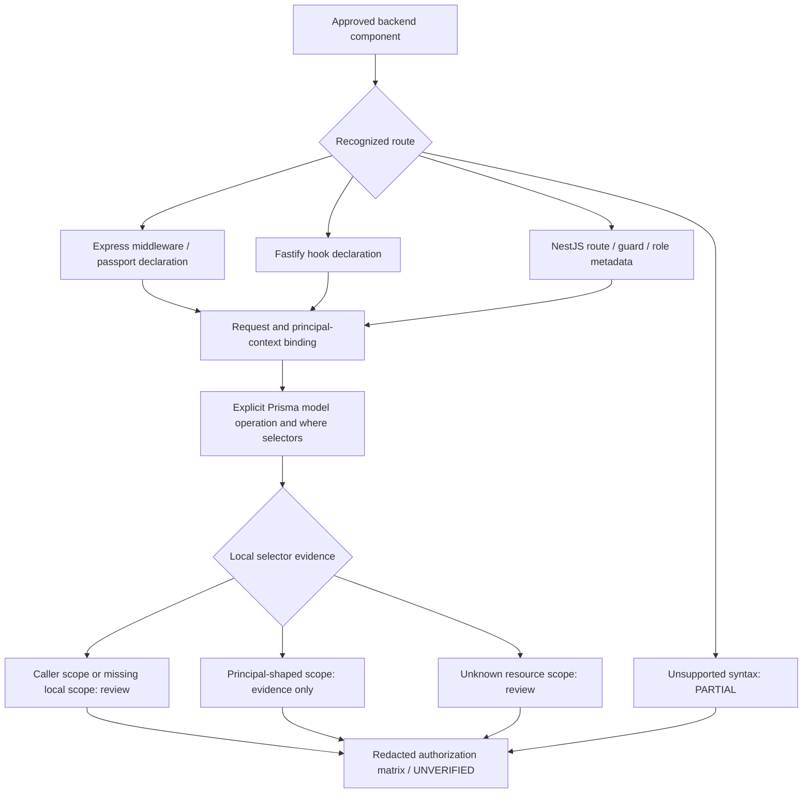
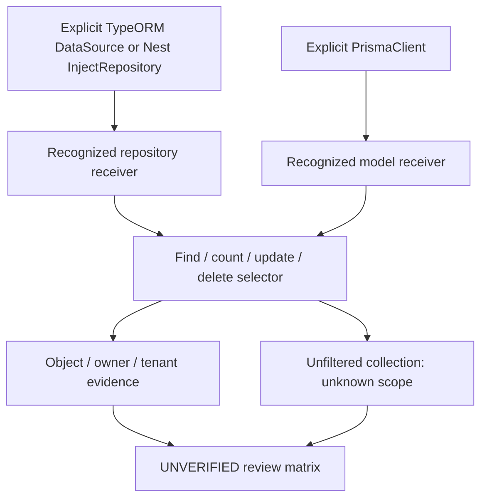

# Authorization and resource-scope evidence review

Issue [#93](https://github.com/omidkh68/security-guardian/issues/93) · [فارسی](js-authz-flow-FA.md)

The optional rule JS.NODE.AUTHZ.RESOURCE_SCOPE provides an authorization review matrix for scoped Express, Fastify and NestJS route handlers reaching an explicitly imported, module-local PrismaClient model operation. It distinguishes caller-controlled object/tenant/owner selectors, constant selectors, apparent principal-context selectors and declared guards/metadata/middleware. IAM-01, BIZ-01 and DATA-02 are related controls; candidate signals map to BIZ-01. Every matrix entry is UNVERIFIED. Neither a guard declaration nor a principal-shaped property proves a trusted principal or effective authorization.

## Architecture

Run `python3 <skill-dir>/scripts/security_js_authz_flow.py --root . --profile backend --typescript-module <absolute-trusted-parser-path>` with explicit trusted external TypeScript 5.9.3 authorization and the same approved component roots. The adapter reads source and manifests, never executes project code, makes no requests or database calls and never updates the ledger. Scope, file, size, AST-node and result bounds follow the SQL adapter. Unknown syntax is PARTIAL; missing parser is NOT_AVAILABLE. No raw route, model, selector values, role names or source snippets are exported.

| Matrix state | Interpretation |
|---|---|
| CALLER_SCOPE_REVIEW | Tenant/owner selector directly derived from the HTTP request; validate against trusted context. |
| MISSING_LOCAL_SCOPE_REVIEW | Caller-selected object without a locally recognized principal owner/tenant predicate; global policies may exist. |
| PRINCIPAL_SCOPE_EVIDENCE | Matching principal-context-shaped predicate present; verify identity provenance, business policy and query semantics. |
| UNKNOWN_RESOURCE_SCOPE | Constant or empty selectors or no recognized local resource binding; manually review. |

Express direct literal routes and imported middleware references (including explicit Passport authenticate declaration), Fastify direct literal routes and simple imported hook references, and NestJS explicit Controller/HTTP/Param/Body/Query/Req decorators plus imported UseGuards and literal roles/permissions SetMetadata are supported. Guard/hook bodies and authentication success are not inferred. Prisma reads/counts, updates/deletes and upsert with simple where fields id, tenantId/organizationId/companyId/schoolId and ownerId/userId/customerId are modeled; local const aliases and request properties are tracked. Principal shape is req.user with recognized field names; field matching is syntactic only. OR/AND, nested relation filters, dynamic where, custom IDs, other repositories/DI, helpers, arbitrary middleware, branches, raw SQL and cross-module policy are unsupported. No complete SAST or proof of BOLA/IDOR. A row with principal evidence still requires review; absence of a row is not safety.

## Testing value and acceptance

| Test class | Required evidence |
|---|---|
| Positive review | Object-only route, caller-supplied tenant/owner and authentication-only route produce review candidates. |
| Negative candidate | Matching local owner or tenant context yields matrix evidence, not a verified-safe result. |
| Unknown / partial | Constant/empty selectors stay unknown; fake receiver, shadowing, branches, spreads, invalid syntax and unsupported helper stay partial. |
| Regression | Same selected root, no excluded-component evidence, no source values; independent strict npm allowlist. |
| Runtime | Confirm identity source and effective guards, inspect database policy and run authorized two-user/two-tenant read and mutation tests. |

Runtime test matrix (not executed by this adapter):

| Actor | Resource | Expected |
|---|---|---|
| Owner A in tenant A | A's object | Allow only if permitted by policy |
| Other user in tenant A | A's object | Deny unless explicitly shared/authorized |
| User B in tenant B | A's object and caller-supplied tenant A | Deny |
| Unauthenticated actor | Protected object | Deny |
| Role without permission | Otherwise accessible object | Deny mutation |
| Revoked role/session | Previously accessible object | Deny after policy-defined invalidation |

Cover GET/PUT/PATCH/DELETE (and other applicable operations), verify response and persistent state, compare list/count/export leakage and record independent execution receipts. An HTTP error alone is insufficient if state changes. RLS and tenancy policy must be checked separately. The initial Prisma matrix contains 15 classified fixtures and seven unsupported/parse fixtures; the expected counts are assertions until CI executes. It measures classification agreement, not vulnerability precision/recall. Revert PR for rollback; no migration.

## TypeORM and unfiltered collection extension

Direct TypeORM DataSource construction with imported or simple literal configuration and getRepository of an imported entity, and Nest constructor parameter-property injection with explicit InjectRepository(Entity) and matching Repository<Entity> type, establish syntactic receiver evidence. Supports find/findOne/count/exists options, findBy/findOneBy/countBy/existsBy, update/delete/softDelete/restore selectors. A missing filter on supported collection operations is UNKNOWN_RESOURCE_SCOPE, not a clean result. The actual connection, initialized repository, registered DI provider, policy and SQL are not verified. Nested/OR conditions and unknown receiver/type remain PARTIAL. The extension adds eight classified and four unsupported fixtures, including tenant, owner, caller, injected repository and unfiltered lists; all matrix rows remain UNVERIFIED.
