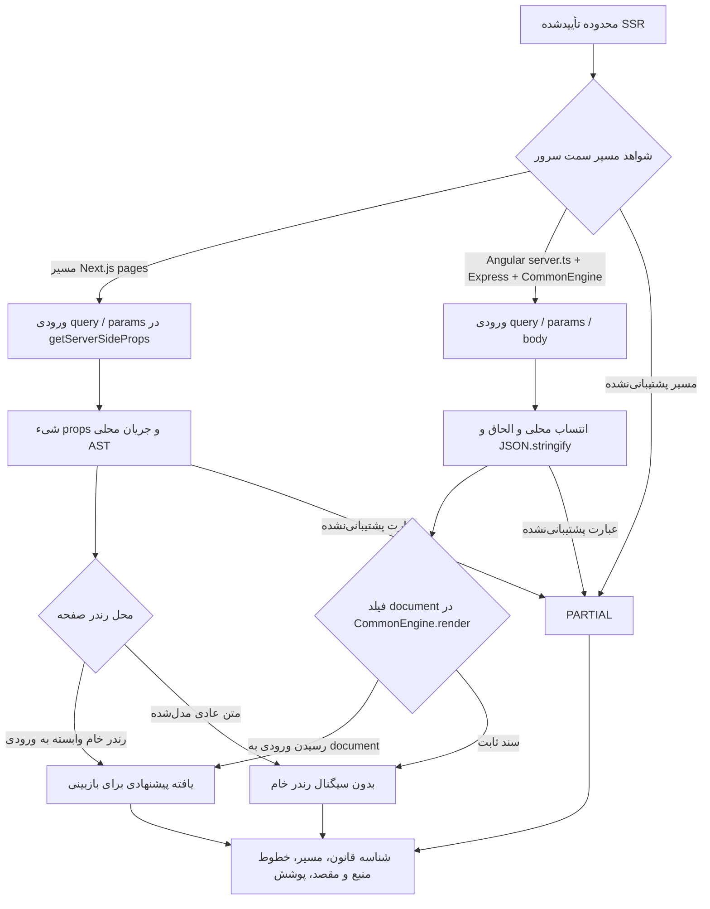

# بازبینی محدود مرز اعتماد رندر SSR

اولویت P0 · #92 · [English](js-ssr-flow.md)

قاعده اختیاری JS.NEXT.SSR.REQUEST_TO_RAW_HTML به ANG-01 نگاشت می‌شود. در Component انتخاب‌شده Next.js و مسیر pages یا src/pages (به‌جز API و صفحات رزروشده)، جریان مستقیم query/params از getServerSideProps به شیء props و سپس متد پیش‌فرض صفحه و dangerouslySetInnerHTML در JSX یا createElement واردشده از React بررسی می‌شود. Alias محلی const، الحاق رشته، Template و JSON.stringify محدود مدل می‌شوند. JSON.stringify به‌تنهایی معادل Escape متن HTML یا Script نیست. متن عادی مدل‌شده Candidate رندر خام ایجاد نمی‌کند. کد پروژه اجرا نمی‌شود و خروجی اثبات بهره‌برداری، Cache یا مجوزدهی نیست.

با مجوز صریح و Parser قابل‌اعتماد TypeScript 5.9.3 خارج از پروژه اجرا کنید: `python3 <skill-dir>/scripts/security_js_ssr_flow.py --root . --profile frontend --typescript-module <absolute-trusted-parser-path>`. شواهد فقط مسیر و شماره خطوط هستند. موارد پشتیبانی‌نشده با PARTIAL مشخص می‌شوند. Ledger تغییر نمی‌کند و نبود Candidate اثبات امنیت نیست.

| زمینه | وضعیت |
|---|---|
| Next.js Pages Router | جریان محدود در همان فایل |
| Next.js App Router | بازبینی دستی Server Component و Serialization |
| Angular SSR | جریان محدود سند CommonEngine؛ سایر مسیرها و TransferState دستی |
| Nuxt | بازبینی دستی v-html و Payload |
| SvelteKit | بازبینی دستی Server Load و رندر خام |
| جداسازی Cache | تست مجاز دو حساب، بررسی Cache Key و Header |

قبل از ثبت یافته، دسترسی واقعی به مسیر، Escape متناسب با زمینه خروجی و جداسازی پاسخ کاربران بررسی شود. شاخه، Helper، Sanitizer و جریان میان فایل‌ها مدل نشده‌اند. Benchmark مصنوعی ۱۲ سناریویی شامل Helper عمداً پشتیبانی‌نشده است؛ خط مبنا در CI شماره 45628382963 اندازه‌گیری شد. بازگردانی با Revert و بدون مهاجرت انجام می‌شود.

## معماری تشخیص و ارزش آن در تست (#92، PR #101)

قاعده Angular با شناسه `JS.ANGULAR.SSR.REQUEST_TO_DOCUMENT` نیازمند مسیر مشخص سرور، Import مستقیم Express و CommonEngine از @angular/ssr یا @angular/ssr/node، Handler درون‌خطی و نمونه محلی موتور است. فیلد document در گزینه‌های render مدل می‌شود، نه هر متد render. ساخت JSON-LD با JSON.stringify در سند HTML یک Candidate بازبینی است؛ اثبات اجرای Script یا تشخیص همه زمینه‌های HTML نیست. AngularNodeAppEngine، TransferState، تزریق DOM، Template، Middleware، Helper و Cache همچنان خارج از پوشش‌اند.

| نوع تست | ارزش معماری |
|---|---|
| مثبت | ردیابی ورودی تا Props یا سند Angular و JSON-LD به مقصد درست. |
| منفی | متن عادی، سند ثابت و ورودی در گزینه نامرتبط سیگنال رندر خام تولید نمی‌کنند. |
| ناقص | گیرنده ناشناخته، Helper، Shadowing و مسیر یا فناوری پشتیبانی‌نشده امنیت را تأیید نمی‌کنند. |
| رگرسیون | Benchmark اولیه ۱۲ سناریویی Next.js ثابت مانده و Angular مجموعه مستقل ۸ سناریویی دارد. |
| شواهد | خطوط منبع و مقصد، شناسه قانون، Scope و خروجی بدون متن خام، بازبینی هدفمند را ممکن می‌کنند. |

نتیجه اندازه‌گیری Next.js در CI شماره 45628382963: TP برابر ۴ از ۵، TN برابر ۷ از ۷، FP صفر از ۷، FN یک از ۵ و پوشش ناقص ۵ از ۱۲؛ Precision برابر ۴ از ۴ و Recall برابر ۴ از ۵. اعداد مورد انتظار Angular تا اجرای CI نتیجه اندازه‌گیری نیستند. در تست Runtime مجاز، پاسخ رندرشده، Escape متناسب با زمینه و جداسازی کاربران بررسی شود؛ AST برنامه را اجرا نمی‌کند.
