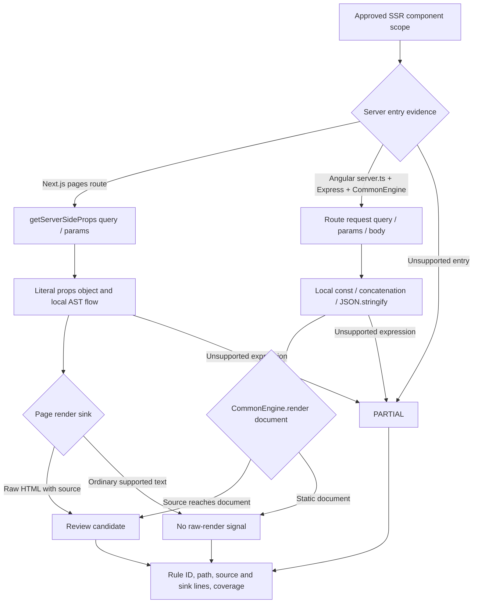
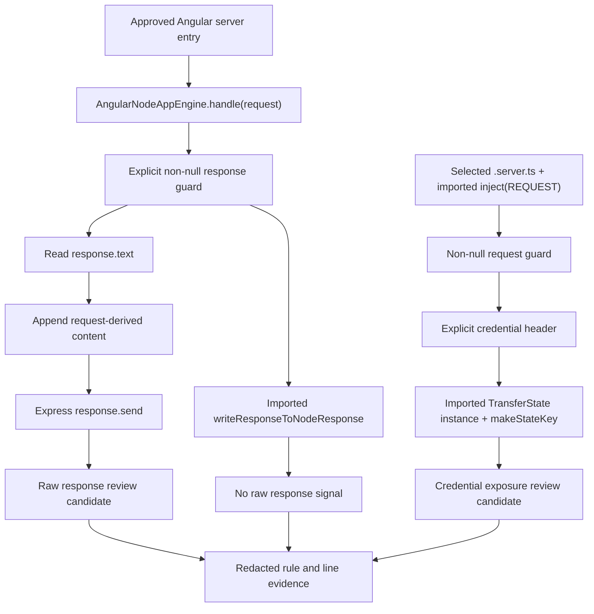
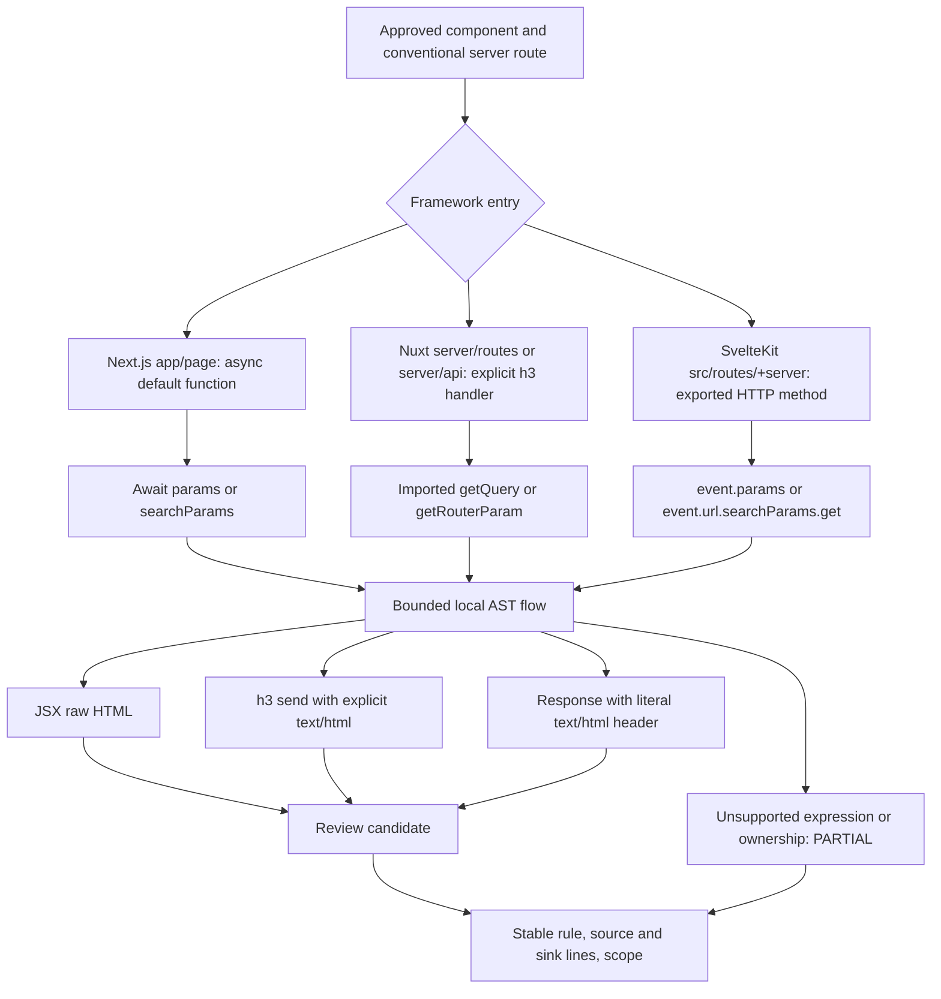

# Bounded SSR render trust-boundary review

P0 · #92 · [فارسی](js-ssr-flow-FA.md)

The optional rule JS.NEXT.SSR.REQUEST_TO_RAW_HTML maps to ANG-01. It requires a selected Next.js component and a pages/ or src/pages/ route (excluding API and reserved pages). In the same module it connects explicit exported getServerSideProps(ctx) query/params properties, a literal returned props object, and a default page function that sends a derived prop to an intrinsic JSX dangerouslySetInnerHTML or explicitly imported React createElement raw HTML property. Local const aliases, concatenation, templates and unshadowed JSON.stringify on supported values are modeled. JSON.stringify alone is not treated as HTML/script-context escaping. Ordinary supported text children are not raw HTML candidates. No project code executes; no runtime, exploit, cache or authorization proof.

Run `python3 <skill-dir>/scripts/security_js_ssr_flow.py --root . --profile frontend --typescript-module <absolute-trusted-parser-path>` with approved components and explicit authorization for trusted external TypeScript 5.9.3. The result reports paths/line numbers only, bounded files/nodes/signals, PARTIAL for unsupported files, frameworks or syntax. No ledger mutation. A missing signal does not establish safety.

## Residual coverage

| Context | Current evidence |
|---|---|
| Next.js Pages Router | Bounded same-file request-to-raw-render candidate |
| Next.js App Router | Bounded async page request-to-JSX flow; other paths manual |
| Angular SSR | Bounded CommonEngine, NodeAppEngine response and explicit credential-to-TransferState flow; other paths manual |
| Nuxt | Bounded H3 HTML endpoint flow; Vue v-html and payload manual |
| SvelteKit | Bounded +server HTML response; page load and template manual |
| Cache isolation | Manual two-account authorized tests; inspect cache keys, cookies, personalization and response headers |

Review actual source reachability, output-context escaping, HTML/script boundary and per-user response isolation before recording a finding. Branches, imported helpers, complex props, sanitizers, framework templates outside the modeled JSX and cross-file data flow are unsupported. Benchmark tests/js-ssr-flow.test.mjs includes 12 synthetic cases (one intentional unsupported helper); baseline measured in CI run 45628382963. Revert PR for rollback, no migration.

## Detection architecture and testing value (#92, PR #101)

The Angular rule `JS.ANGULAR.SSR.REQUEST_TO_DOCUMENT` requires an explicit Angular server entry path, direct Express import/factory and CommonEngine import from @angular/ssr or @angular/ssr/node, a direct inline route, and a locally constructed engine. It models the render options document field, not arbitrary render methods. JSON-LD assembled into the HTML document using JSON.stringify is a review candidate; the rule does not prove script execution or classify every HTML context. AngularNodeAppEngine, TransferState, DOM injection, templates, middleware, helpers and cache isolation remain unsupported.

| Test class | Why it matters |
|---|---|
| Positive | Request-derived props and Angular document / serialized JSON-LD reach the correct sink. |
| Negative | Ordinary text, literal documents, and data in an unrelated option do not create raw-render signals. |
| Partial | Unknown receivers, helper calls, shadowed imports, unsupported routes or frameworks never certify safety. |
| Regression | The original Next.js 12-case benchmark is unchanged; Angular has a separate 8-case fixture set. |
| Evidence | Source/sink line numbers, stable rule identity, selected roots and redacted output enable targeted manual verification. |

The Next.js baseline was measured in CI run 45628382963: TP 4/5, TN 7/7, FP 0/7, FN 1/5, partial 5/12; precision 4/4, recall 4/5. Angular expected counts are assertions until its CI runs. For an authorized runtime test, inspect the rendered response and confirm context-aware serialization/escaping and user isolation; AST does not execute the application.

## Angular NodeAppEngine and TransferState (pack v3)

- JS.ANGULAR.SSR.REQUEST_TO_RESPONSE_HTML (ANG-01): direct await of a locally constructed AngularNodeAppEngine.handle with the route request, a simple non-null early-return guard, then response.text and Express response.send. Only a request-derived value combined with the modeled response body is a candidate. Native forwarding using the imported writer is not a raw-render signal. No proof of actual HTML content type, execution, or response status preservation.
- JS.ANGULAR.SSR.CREDENTIAL_TO_TRANSFER_STATE (ANG-04, related credential exposure review, not a claim about Web Storage): selected .server.ts file, explicit @angular/core imports, exported synchronous zero-argument function, local inject(REQUEST), non-null guard, direct credential header read (cookie, authorization, proxy-authorization), inject(TransferState), literal makeStateKey and set. This is a possible server-to-browser confidentiality boundary, not XSS. It does not prove the function runs in an injection context, the key reaches the browser, or another user can read it. Other header names do not trigger this specific rule.

Positive fixtures target direct postprocessing and credential headers; negatives target native forwarding, constant content and ordinary locale headers; unsupported receivers, missing guards and shadowed imports remain PARTIAL. The 8-case CommonEngine baseline measured in CI 45631179074 was TP 3, TN 4, FP 0, FN 1, partial 3, precision 3/3 and recall 3/4. Existing benchmarks remain unchanged. New regression fixtures are not measurements until CI executes. For manual testing, inspect actual response content type and context-aware encoding; verify credentials are absent from serialized HTML and compare authorized isolated sessions. Never emit credential values in evidence.

API references: [Angular SSR](https://angular.dev/guide/ssr), [AngularNodeAppEngine](https://angular.dev/api/ssr/node/AngularNodeAppEngine), [REQUEST](https://angular.dev/api/core/REQUEST), [TransferState](https://angular.dev/api/core/TransferState). Promise chains, generic middleware, component injection, HTTP transfer cache, custom headers and cross-file flow remain outside this subset.

## App Router, Nuxt and SvelteKit server response analysis (pack v4)

| Rule | Supported positive path | Negative / partial test |
|---|---|---|
| JS.NEXT.APP.REQUEST_TO_RAW_HTML | async default function in app or src/app page.tsx/jsx; await props.params/searchParams; raw JSX | ordinary text, literal HTML; client directive and helpers partial |
| JS.NUXT.SSR.REQUEST_TO_HTML | explicit h3 defineEventHandler, getQuery/getRouterParam and send with literal text/html (H3 send API subset) | static HTML, text/plain and unknown sinks; auto-imports and Vue SFC v-html SSR flow manual |
| JS.SVELTEKIT.SSR.REQUEST_TO_HTML | exported named HTTP function in src/routes/**/+server.ts/js; event params or URL query to new Response with explicit text/html | static body, non-HTML and shadowed Response; +page.server load to .svelte {@html} manual |

The three new fixture groups each contain six cases and an outside-route scope test. All are candidates, not confirmed vulnerabilities; unsupported helper positives count as misses. No target app runs. Framework/version/configuration and actual response reachability/content type must be verified manually. Nuxt Vue SSR payloads and SvelteKit page hydration are not covered by the endpoint models. Next.js client/server module graphs, custom route directories, middleware, caching and data across modules are not modeled. Verify cache isolation separately with authorized distinct accounts and identical route requests, inspecting response body, cache headers and variation; syntax alone cannot certify isolation. No real runtime test is claimed.

The preceding Angular v3 CI run 45632019323 passed all six jobs. New group measurements require the final head CI.

## SSR pack v5 — bounded server-entry control flow (#34)

Next.js App Router, explicit Nuxt H3 server handlers and SvelteKit +server HTML endpoints now model independent states for restricted if/else, nested lexical blocks, local let reassignment and early returns. Boolean literals prune dead paths; unknown conditions/effects and missing returns are PARTIAL, retaining already modeled candidates. Bounds: 64 paths, 4096 statement steps, depth 32. Exact duplicate evidence is deduplicated. Thirty synthetic scenarios (ten per framework) exercise positive, negative, incomplete and budget cases on the trusted TypeScript parser. Existing Pages Router, Angular CommonEngine/NodeAppEngine and TransferState models are unchanged; their path expansion remains separate. No proof of exploitability, general template or cross-module flow, or runtime security.
