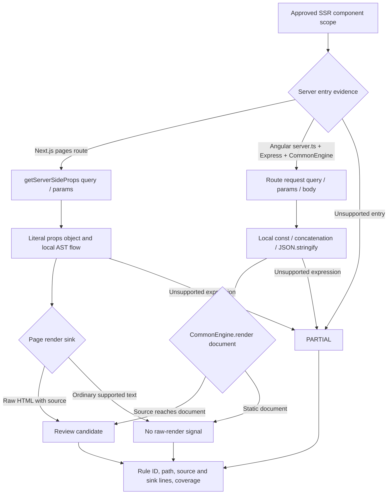

# Bounded SSR render trust-boundary review

P0 · #92 · [فارسی](js-ssr-flow-FA.md)

The optional rule JS.NEXT.SSR.REQUEST_TO_RAW_HTML maps to ANG-01. It requires a selected Next.js component and a pages/ or src/pages/ route (excluding API and reserved pages). In the same module it connects explicit exported getServerSideProps(ctx) query/params properties, a literal returned props object, and a default page function that sends a derived prop to an intrinsic JSX dangerouslySetInnerHTML or explicitly imported React createElement raw HTML property. Local const aliases, concatenation, templates and unshadowed JSON.stringify on supported values are modeled. JSON.stringify alone is not treated as HTML/script-context escaping. Ordinary supported text children are not raw HTML candidates. No project code executes; no runtime, exploit, cache or authorization proof.

Run `python3 <skill-dir>/scripts/security_js_ssr_flow.py --root . --profile frontend --typescript-module <absolute-trusted-parser-path>` with approved components and explicit authorization for trusted external TypeScript 5.9.3. The result reports paths/line numbers only, bounded files/nodes/signals, PARTIAL for unsupported files, frameworks or syntax. No ledger mutation. A missing signal does not establish safety.

## Residual coverage

| Context | Current evidence |
|---|---|
| Next.js Pages Router | Bounded same-file request-to-raw-render candidate |
| Next.js App Router | Manual review of server components and serialization |
| Angular SSR | Bounded direct CommonEngine document flow; other render paths and TransferState manual |
| Nuxt | Manual review of server routes, v-html and payload serialization |
| SvelteKit | Manual review of server load, raw HTML and serialized data |
| Cache isolation | Manual two-account authorized tests; inspect cache keys, cookies, personalization and response headers |

Review actual source reachability, output-context escaping, HTML/script boundary and per-user response isolation before recording a finding. Branches, imported helpers, complex props, sanitizers, framework templates outside the modeled JSX and cross-file data flow are unsupported. Benchmark tests/js-ssr-flow.test.mjs includes 12 synthetic cases (one intentional unsupported helper); baseline measured in CI run 45628382963. Revert PR for rollback, no migration.

## Detection architecture and testing value (#92, PR #101)

The Angular rule `JS.ANGULAR.SSR.REQUEST_TO_DOCUMENT` requires an explicit Angular server entry path, direct Express import/factory and CommonEngine import from @angular/ssr or @angular/ssr/node, a direct inline route, and a locally constructed engine. It models the render options document field, not arbitrary render methods. JSON-LD assembled into the HTML document using JSON.stringify is a review candidate; the rule does not prove script execution or classify every HTML context. AngularNodeAppEngine, TransferState, DOM injection, templates, middleware, helpers and cache isolation remain unsupported.

| Test class | Why it matters |
|---|---|
| Positive | Request-derived props and Angular document / serialized JSON-LD reach the correct sink. |
| Negative | Ordinary text, literal documents, and data in an unrelated option do not create raw-render signals. |
| Partial | Unknown receivers, helper calls, shadowed imports, unsupported routes or frameworks never certify safety. |
| Regression | The original Next.js 12-case benchmark is unchanged; Angular has a separate 8-case fixture set. |
| Evidence | Source/sink line numbers, stable rule identity, selected roots and redacted output enable targeted manual verification. |

The Next.js baseline was measured in CI run 45628382963: TP 4/5, TN 7/7, FP 0/7, FN 1/5, partial 5/12; precision 4/4, recall 4/5. Angular expected counts are assertions until its CI runs. For an authorized runtime test, inspect the rendered response and confirm context-aware serialization/escaping and user isolation; AST does not execute the application.
