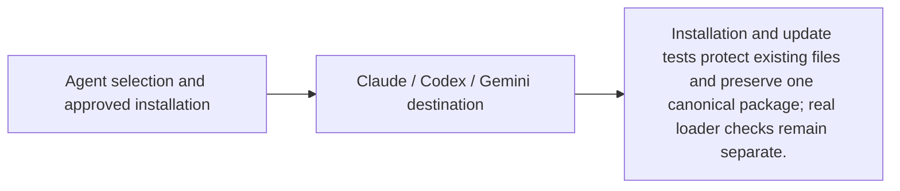

# Skill قابل‌حمل Security Guardian برای Agentها

[English](multi-agent.md)

استاندارد **Agent Skills** از `SKILL.md` و اسکریپت‌ها/مراجع همراه آن استفاده می‌کند. Security Guardian **یک بسته مرجع** نگهداری می‌کند: `plugins/security-guardian/skills/security-guardian`. منطق اختصاصی Agent را Fork یا کپی نکنید؛ Marketplace پلاگین Claude Code، Codex و Gemini CLI همگی محتوای Auditشده یکسان را مصرف می‌کنند.

## نصب از Clone مخزن قابل اعتماد

از Clone مربوط به Security Guardian اجرا کنید:

```bash
bash install-agent.sh
```

Wizard سه‌مرحله‌ای دارای برند، نسخه بسته، نویسنده، نگهدارنده، لینک مخزن، وضعیت CLI کشف‌شده و تعداد انتخاب را نمایش می‌دهد. Claude Code، Codex و Gemini CLI را پشتیبانی می‌کند. رنگ اختیاری است (`NO_COLOR=1`)؛ ترمینال فشرده از Layout کوچک‌تر استفاده می‌کند. با Up/Down حرکت، Space انتخاب Agent و Enter ادامه دهید. Global (کاربر) یا Local (پروژه) را انتخاب کنید؛ اگر محلی است دایرکتوری پروژه هدف را وارد کنید، مقصدهای فیزیکی را بررسی و نصب را تأیید کنید. با q یا رد تأیید لغو کنید. نسخه‌های معتبر موجود با تأیید صریح پشتیبان می‌شوند، حتی در ترکیب مقصد جدید/موجود. هیچ Agent اجرا نمی‌شود. Python 3 و ترمینال استاندارد UI را فراهم می‌کنند؛ ترمینال کوچک یا dumb پرسش شماره‌دار دارد. فراخوان غیر TTY باید Flag صریح بدهد.

برای اتوماسیون، صورت‌های اصلی برقرارند:

```bash
bash install-agent.sh --agent codex --user
bash install-agent.sh --agent gemini --project /path/to/target
bash install-agent.sh --agent claude --user
# Or for all three, using one Claude and one shared Codex/Gemini copy:
bash install-agent.sh --agent all --project /path/to/target
```

Codex و Gemini **هر دو** `.agents/skills/security-guardian/SKILL.md` را در محدوده Workspace یا `~/.agents/skills/security-guardian/SKILL.md` در محدوده کاربر کشف می‌کنند. Gemini از `.gemini/skills` هم پشتیبانی دارد، ولی Alias مشترک از نصب تکراری جلوگیری می‌کند. Claude Standalone از `.claude/skills` یا Workflow پلاگین موجود Marketplace استفاده می‌کند. Standalone و Marketplace را با هم نصب نکنید مگر اولویت را بدانید.

نصب موجود: `--upgrade` پشتیبان نگه می‌دارد. برای اجازه صریح مقصد ترکیبی جدید/موجود در اسکریپت به‌جای آن `--upgrade-existing` استفاده کنید. مقصدهای جداشده با کاما مثل `--agent claude,codex` پشتیبانی می‌شوند. Installer دانلود راه دور، اجرای پلاگین یا اسکن ندارد. پیش از نصب Skill ثالث، SKILL.md بالادستی را بازبینی کنید.

## فعال‌سازی

- **Claude Code:** `/plugin marketplace add omidkh68/security-guardian`، `/plugin install security-guardian@security-guardian-marketplace`، سپس `/security-guardian:security-guardian audit`. Standalone: صریحاً استفاده از Skill امنیتی برای Audit را درخواست کنید.
- **Codex:** Codex را در پروژه هدف اجرا و `Use $security-guardian to audit this repository` را درخواست کنید. در صورت پشتیبانی، Skillهای موجود را از UI مربوط به Skills در Codex کشف کنید.
- **Gemini CLI:** `/skills list`، در نصب تازه `/skills reload` و سپس `Use the security-guardian skill to audit this repository` را اجرا/درخواست کنید. Gemini هنگام فعال‌سازی تأیید می‌خواهد.

یک تمایز رایج طبقه‌بندی: اعتماد Host/Proxy در Angular SSR به کنترل `ANG-06` تعلق دارد؛ `BIZ-01` مجوزدهی شیء Tenant است. بررسی نگاشت می‌تواند این نوع را طبقه‌بندی کند، بدون ادعای امنیت Deployment.

مدل **نباید** Slash Command برای زیر‌فرمان Tracker اختراع کند. برای بررسی طبقه‌بندی بدون Run، `python3 <installed-skill>/scripts/security_tracker.py mapping-audit --root .` را اجرا کنید. برای خروجی Run نهایی، `python3 <installed-skill>/scripts/security_report.py --root . [--run RUN_ID]` را اجرا کنید.

## امنیت / قابلیت حمل

شواهد پروژه پیش‌فرض در `.security-guardian/` حساس‌اند. هیچ Agent نباید مجوز تغییر Production، اسکن Host، استفاده Credential یا Deployment را مفروض بگیرد. تمام Platformها الزامات یکسان طبقه‌بندی، بازبینی و شواهد `VERIFIED_FIXED` را رعایت کنند.

### مراجع بالادستی

- [Agent Skills open standard](https://agentskills.io/)
- [OpenAI Skills](https://developers.openai.com/api/docs/guides/tools-skills)
- [Gemini CLI Agent Skills](https://geminicli.com/docs/cli/skills/)
- [Claude Code plugins](https://code.claude.com/docs/en/plugins)

## وضعیت تست

تست بسته‌بندی آفلاین، Install Smoke و رگرسیون Linux PTY در CI اجرا می‌شوند. تست محلی نگهدارنده Audit واقعی Codex CLI 0.169.0 و فعال‌سازی/خواندن Skill در Gemini CLI 0.68.0 را تأیید کرد. Audit کامل Gemini و نسخه‌های تازه Vendor هنوز تست جداگانه می‌خواهند. اصلاح ورودی نامعتبر نیز در Linux PTY واقعی و ایزوله تأیید شد؛ ادعای تست مجدد همه ترمینال‌های Desktop نیست. CI بدون حساب مجاز نمی‌تواند رفتار واقعی Agent را اثبات کند.

## معماری و ارزش تست (Canonical Skill package)



undefined
