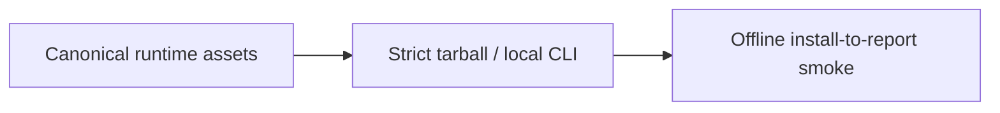

# توزیع npm — پیش‌نمایش محلی

نگه‌دارنده: @omidkh68 · اولویت P0 · Issue #46 · [English](npm-distribution.md)

## دسترسی و پیش‌نیازها

این پیش‌نمایش بسته خصوصی و منتشرنشده است. نام پیشنهادی `@omidkh68/security-guardian` منوط به تأیید مالکیت Scope و آزادبودن نام توسط نگه‌دارنده است. نام فرمان `security-guardian` است. نسخه Manifest با نسخه مرجع Skill برابر است و انتشار جدید محسوب نمی‌شود. `private: true` مانع انتشار عادی npm است. در این مرحله انتشار رجیستری، تنظیم اعتبارنامه یا رزرو نام انجام نمی‌شود.

برای Linux/macOS به Node.js 22+ نیاز است؛ CI نسخه‌های Node 22 و 24 را روی Linux بررسی می‌کند. برای گردش کار امنیتی همچنان Python 3.10+ و ایجنت پشتیبانی‌شده لازم هستند. وابستگی اجرایی خارجی Node و اسکریپت Lifecycle نصب نداریم. CLI فایل‌های اجرایی مرجع Skill را کپی می‌کند و آن‌ها را اجرا نمی‌کند.

## استفاده از بسته محلی

در نسخه قابل اعتماد مخزن، کد را بازبینی و اجرا کنید:

```bash
npm test
node scripts/verify-npm-package.mjs
npm pack --ignore-scripts
```

نام دقیق tarball چاپ‌شده توسط npm را استفاده کنید (مسیر مثال را با فایل واقعی جایگزین کنید):

```bash
npx --offline --yes --package /absolute/path/omidkh68-security-guardian-1.2.1.tgz -- security-guardian --help
npx --offline --yes --package /absolute/path/omidkh68-security-guardian-1.2.1.tgz -- security-guardian --agent all --project /absolute/path/to/project --dry-run
npx --offline --yes --package /absolute/path/omidkh68-security-guardian-1.2.1.tgz -- security-guardian --agent all --project /absolute/path/to/project --yes
```

اولین --yes متعلق به npm و آخرین --yes متعلق به CLI است. دقیقاً یکی از --dry-run یا --yes و یکی از --user یا --project DIR را انتخاب کنید. ایجنت‌ها: claude، codex، gemini، all یا نام‌های جداشده با کاما. Claude از .claude/skills و Codex/Gemini مشترکاً از .agents/skills استفاده می‌کنند. --version نسخه بسته را چاپ می‌کند. پیش‌نمایش فقط خواندنی است. --upgrade نیازمند وجود Skill هم‌نام در تمام مقصدهاست؛ ترکیب نصب جدید و ارتقا در این پیش‌نمایش پشتیبانی نمی‌شود.

## ایمنی و بازیابی

CLI مسیرهای بالادست، مقصدها و ورودی‌های سورس دارای Symlink، اجزای مقصد غیردایرکتوری، Skill نامرتبط، قفل نصب همزمان و بازنویسی بدون مجوز را رد می‌کند. درخت مقصد قبلی نباید Symlink داشته باشد. تمام کپی‌ها پیش از جایگزینی Stage می‌شوند؛ ارتقا نسخه پشتیبان با نام یکتا در skill-backups تنظیمات متناظر نگه می‌دارد. هنگام خطای قابل دریافت، CLI برای بازگردانی معکوس تلاش و شکست احتمالی را گزارش می‌کند. توقف اجباری، قطع برق، دستکاری خصمانه همزمان فایل‌سیستم و سایر نصب‌کننده‌ها تحت تضمین قفل و Rollback نیستند. از فایل‌سیستم پایدار و قابل اعتماد استفاده کنید؛ Stageها، Backupها و .security-guardian-install.lock باقی‌مانده را پیش از بازیابی دستی بررسی کنید. هنگام نصب فعال دیگری قفل را حذف نکنید.

برای بازگردانی ارتقا، نشست ایجنت‌ها را متوقف کنید، Backup و مقصد گزارش‌شده را بررسی کنید، مقصد جدید را کنار بگذارید و Backup را به محل اصلی بازگردانید. تاریخچه خصوصی ممیزی را حذف نکنید. برای حذف نصب فقط پوشه تأییدشده Skill را حذف کنید. CLI سورس برنامه را تغییر نمی‌دهد، اسکنر دانلود نمی‌کند، ایجنت فعال نمی‌کند و گزارش منتشر نمی‌کند.

## شواهد و دروازه‌های انتشار

تست بسته، فهرست دقیق فایل‌های اجرایی Trackشده، بایت فایل‌ها، پیش‌نمایش/نصب npx از tarball محلی، کشف محدوده و تولید گزارش مصنوعی عمداً PARTIAL را بررسی می‌کند. این تست اثبات فعال‌شدن واقعی ایجنت‌های فروشندگان، اصلاح امنیتی تأییدشده، آزمون macOS یا دسترسی رجیستری نیست. هویت npm، انتشار مجاز مالک، گردش انتشار Tag، Provenance و تست نسخه دقیق رجیستری دروازه‌های جداگانه‌اند. Issue #46 را ببینید. پیش از تأیید انتشار، فرمان نصب رجیستری را تبلیغ نکنید.

## انتشار تحت کنترل مالک (انتشار برنامه‌ریزی‌شده)

نگه‌دارنده اعلام کرده حساب npm با نام `omidkh68` ساخته و 2FA را فعال کرده است. به‌صورت محلی با `npm login --registry=https://registry.npmjs.org/` و `npm whoami --registry=https://registry.npmjs.org/` هویت را بررسی کنید. کد بازیابی، OTP و رمز را هرگز به اشتراک نگذارید. نخستین انتشار نیازمند نسخه تأییدشده 1.3.0 یا بالاتر، هماهنگی نسخه‌های package/Skill/plugin و `private: false` در Commit انتشار بازبینی‌شده است. پیش‌نمایش خصوصی فعلی را دستی تغییر ندهید. پس از تست Tag دقیق تأییدشده، مالک می‌تواند نخستین بسته عمومی را با `npm publish --access public --ignore-scripts` از همان Checkout منتشر کند. مالک و نسخه را در npm بررسی کنید. اینجا ادعای نخستین انتشار نداریم.

برای نسخه‌های بعدی، Trusted Publisher پکیج را در npm تنظیم کنید: GitHub Actions؛ مالک `omidkh68`؛ مخزن `security-guardian`؛ فایل `npm-publish.yml`؛ محیط `npm-release`. محیط هم‌نام GitHub را با محدودیت استقرار و تأیید بازبین در صورت پشتیبانی تنظیم کنید. NPM_TOKEN ذخیره نکنید. Workflow دستی روی Tag، تاریخچه و نسخه‌ها را بررسی، تست و بسته‌بندی می‌کند؛ سپس Artifact بررسی‌شده را در Job جداگانه OIDC منتشر و نسخه دقیق رجیستری را بررسی می‌کند. اتصال را نزدیک انتشار تأییدشده بعدی تنظیم کنید: npm مهلت دو روزه اعتبارسنجی اولیه را مستند کرده است. در این مرحله Release یا Tag ساخته نمی‌شود. انتشار موفق OIDC و Provenance تا انتشار مجاز تأیید نشده‌اند. [مستندات Trusted Publishing](https://docs.npmjs.com/trusted-publishers/) را ببینید. اگر تست رجیستری بعد از انتشار شکست خورد، نسخه منتشرشده را بررسی کنید و کورکورانه انتشار را تکرار نکنید. اعلان حق نشر مشارکت‌کنندگان MIT را حفظ کنید.

## معماری و ارزش تست (#46)



تست بسته Node 22/24 دارایی دقیق، نصب و گزارش PARTIAL را می‌سنجد؛ انتشار Registry شرط جداست.


### توقف ناگهانی نصب

فایل `.security-guardian-install.lock` در ریشه انتخاب‌شده، شواهد مرحله‌های تراکنش را به صورت JSON Lines نگه می‌دارد. در صورت توقف ناگهانی یا rollback ناقص، نصب بعدی قفل را حذف نمی‌کند. ابتدا مطمئن شوید هیچ نصاب فعالی وجود ندارد، سپس از فایل قفل و مسیرهای نصب، staging و backup نسخه پشتیبان بگیرید. مسیرهای ثبت‌شده صرفاً شواهد هستند؛ بدون بررسی مستقل به آن‌ها اعتماد نکنید. بازیابی خودکار هنوز پیاده‌سازی نشده است؛ حذف قفل یا اجرای مجدد پیش از بررسی و بازیابی دستی توصیه نمی‌شود. این سازوکار تضمین دوام در قطع برق نیست.
