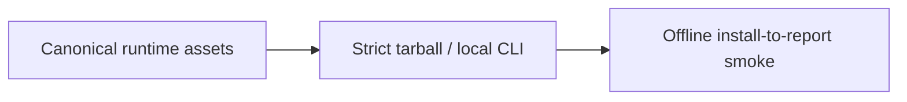
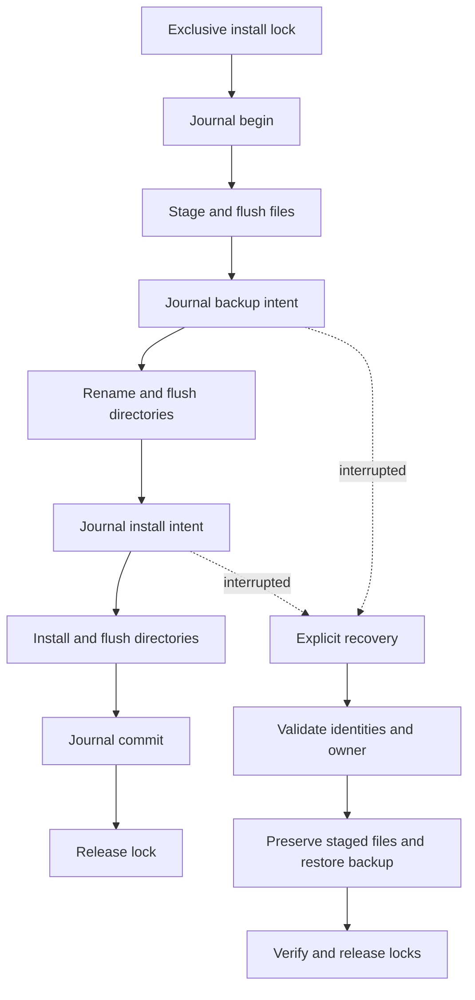

# توزیع npm — پیش‌نمایش محلی

نگه‌دارنده: @omidkh68 · اولویت P0 · Issue #46 · [English](npm-distribution.md)

## دسترسی و پیش‌نیازها

این پیش‌نمایش بسته خصوصی و منتشرنشده است. نام پیشنهادی `@omidkh68/security-guardian` منوط به تأیید مالکیت Scope و آزادبودن نام توسط نگه‌دارنده است. نام فرمان `security-guardian` است. نسخه Manifest با نسخه مرجع Skill برابر است و انتشار جدید محسوب نمی‌شود. `private: true` مانع انتشار عادی npm است. در این مرحله انتشار رجیستری، تنظیم اعتبارنامه یا رزرو نام انجام نمی‌شود.

برای Linux/macOS به Node.js 22+ نیاز است؛ CI نسخه‌های Node 22 و 24 را روی Linux بررسی می‌کند. برای گردش کار امنیتی همچنان Python 3.10+ و ایجنت پشتیبانی‌شده لازم هستند. وابستگی اجرایی خارجی Node و اسکریپت Lifecycle نصب نداریم. CLI فایل‌های اجرایی مرجع Skill را کپی می‌کند و آن‌ها را اجرا نمی‌کند.

## استفاده از بسته محلی

در نسخه قابل اعتماد مخزن، کد را بازبینی و اجرا کنید:

```bash
npm test
node scripts/verify-npm-package.mjs --artifact-dir /absolute/path/to/new-artifact-directory
```

نام دقیق tarball چاپ‌شده توسط npm را استفاده کنید (مسیر مثال را با فایل واقعی جایگزین کنید):

```bash
npx --offline --yes --package /absolute/path/omidkh68-security-guardian-1.2.1.tgz -- security-guardian --help
npx --offline --yes --package /absolute/path/omidkh68-security-guardian-1.2.1.tgz -- security-guardian --agent all --project /absolute/path/to/project --dry-run
npx --offline --yes --package /absolute/path/omidkh68-security-guardian-1.2.1.tgz -- security-guardian --agent all --project /absolute/path/to/project --yes
```

اولین --yes متعلق به npm و آخرین --yes متعلق به CLI است. دقیقاً یکی از --dry-run یا --yes و یکی از --user یا --project DIR را انتخاب کنید. ایجنت‌ها: claude، codex، gemini، all یا نام‌های جداشده با کاما. Claude از .claude/skills و Codex/Gemini مشترکاً از .agents/skills استفاده می‌کنند. --version نسخه بسته را چاپ می‌کند. پیش‌نمایش فقط خواندنی است. --upgrade نیازمند وجود Skill هم‌نام در تمام مقصدهاست؛ ترکیب نصب جدید و ارتقا در این پیش‌نمایش پشتیبانی نمی‌شود.

## ایمنی و بازیابی

CLI مسیرهای بالادست، مقصدها و ورودی‌های سورس دارای Symlink، اجزای مقصد غیردایرکتوری، Skill نامرتبط، قفل نصب همزمان و بازنویسی بدون مجوز را رد می‌کند. درخت مقصد قبلی نباید Symlink داشته باشد. تمام کپی‌ها پیش از جایگزینی Stage می‌شوند؛ ارتقا نسخه پشتیبان با نام یکتا در skill-backups تنظیمات متناظر نگه می‌دارد. هنگام خطای قابل دریافت، CLI برای بازگردانی معکوس تلاش و شکست احتمالی را گزارش می‌کند. توقف اجباری، قطع برق، دستکاری خصمانه همزمان فایل‌سیستم و سایر نصب‌کننده‌ها تحت تضمین قفل و Rollback نیستند. از فایل‌سیستم پایدار و قابل اعتماد استفاده کنید؛ Stageها، Backupها و .security-guardian-install.lock باقی‌مانده را پیش از بازیابی دستی بررسی کنید. هنگام نصب فعال دیگری قفل را حذف نکنید.

برای بازگردانی ارتقا، نشست ایجنت‌ها را متوقف کنید، Backup و مقصد گزارش‌شده را بررسی کنید، مقصد جدید را کنار بگذارید و Backup را به محل اصلی بازگردانید. تاریخچه خصوصی ممیزی را حذف نکنید. برای حذف نصب فقط پوشه تأییدشده Skill را حذف کنید. CLI سورس برنامه را تغییر نمی‌دهد، اسکنر دانلود نمی‌کند، ایجنت فعال نمی‌کند و گزارش منتشر نمی‌کند.

## شواهد و دروازه‌های انتشار

تست بسته، فهرست دقیق فایل‌های اجرایی Trackشده، بایت فایل‌ها، پیش‌نمایش/نصب npx از tarball محلی، کشف محدوده و تولید گزارش مصنوعی عمداً PARTIAL را بررسی می‌کند. این تست اثبات فعال‌شدن واقعی ایجنت‌های فروشندگان، اصلاح امنیتی تأییدشده، آزمون macOS یا دسترسی رجیستری نیست. هویت npm، انتشار مجاز مالک، گردش انتشار Tag، Provenance و تست نسخه دقیق رجیستری دروازه‌های جداگانه‌اند. Issue #46 را ببینید. پیش از تأیید انتشار، فرمان نصب رجیستری را تبلیغ نکنید.

## انتشار مرحله‌ای تحت کنترل مالک (انتشار برنامه‌ریزی‌شده)

نگه‌دارنده حساب npm با نام `omidkh68` و 2FA را گزارش کرده است. هویت را محلی با `npm whoami --registry=https://registry.npmjs.org/` بررسی کنید؛ اعتبارنامه و OTP را به اشتراک نگذارید. [سیاست کاربرد دوگانه npm](https://docs.npmjs.com/policies/dual-use/) مورخ ۲۸ ژوئیه ۲۰۲۶ برای بسته‌های اعلام‌شده، تداوم اعلام و 2FA هنگام ارتقای بسته مرحله‌ای را الزامی می‌کند. بسته فعلاً خصوصی است؛ مجوز Stage، Placeholder عمومی، Release یا Tag صادر نشده است.

پس از تکمیل #105، تأیید Manifest عمومی و نسخه‌های هماهنگ و Tag دقیق، Workflow `npm-publish.yml` را روی همان Tag با `mode=prepare` (پیش‌فرض) اجرا کنید. بسته دقیق آزموده، Attest و اعتبارسنجی می‌شود؛ Stage یا Publish انجام نمی‌شود. Artifact با نام npm-release را دانلود و هش، رسید و GitHub Attestation را با Tag و Commit بازبینی‌شده تطبیق دهید. npm نسخه 11.15.0 یا جدیدتر لازم است. برای اولین انتشار پیش از ایجاد Trusted Publisher، مالک محلی احراز هویت کند و `npm stage publish ./EXACT-TESTED.tgz --access public --tag latest --ignore-scripts` را روی فایل تأییدشده، نه Checkout، اجرا کند. Stage بسته جدید ممکن است Placeholder عمومی 0.0.0-stage بسازد؛ ابتدا مجوز صریح انتشار لازم است.

شناسه Stage را با `npm stage list @omidkh68/security-guardian` و `npm stage view STAGE_ID` بررسی کنید. با `npm stage download STAGE_ID` در پوشه خالی جداگانه دانلود کنید. نام، نسخه، Tag و منتشرکننده را بررسی و SHA-256 بایت‌های دانلودشده را با رسید بسته آزموده تطبیق دهید. محتوای غیرمنتظره را رد کنید. تنها پس از بازبینی دقیق مالک، `npm stage approve STAGE_ID` را تعاملی با 2FA اجرا کنید (یا از npmjs.com استفاده کنید). سپس همان Tag را با `mode=registry` و شناسه Run موفق prepare/stage اجرا کنید. Job فقط‌خواندنی هویت Run، بسته امضاشده اولیه، Integrity رجیستری، بایت‌های واقعاً دانلودشده و نسخه دقیق CLI را بررسی می‌کند. شکست بررسی رجیستری مجوز Stage یا انتشار مجدد نیست.

برای نسخه‌های بعدی Trusted Publisher را تنظیم کنید: GitHub Actions، مالک `omidkh68`، مخزن `security-guardian`، Workflow `npm-publish.yml`، محیط `npm-release` و مجوز فقط Stage. بازبینی محیط و محدودیت Tag الزامی باشند؛ NPM_TOKEN ذخیره نکنید. `mode=stage` فقط پس از تست و اعتبارسنجی Provenance بسته را Stage می‌کند. تأیید 2FA مالک و بررسی جداگانه رجیستری الزامی می‌مانند. اتصال را نزدیک انتشار بعدی تنظیم کنید (مهلت اعتبارسنجی اولیه طبق مستند npm). Provenance مرحله OIDC و انتشار رجیستری تا مشاهده واقعی NOT_RUN هستند؛ اولین انتشار دستی به GitHub Attestation مستقلاً اعتبارسنجی‌شده متکی است، نه فرض وجود Provenance رجیستری npm. [انتشار مرحله‌ای](https://docs.npmjs.com/staged-publishing/) و [Trusted Publishing](https://docs.npmjs.com/trusted-publishers/) را ببینید. اعلان حق نشر MIT را حفظ کنید.


## معماری و ارزش تست (#46)



تست بسته Node 22/24 دارایی دقیق، نصب و گزارش PARTIAL را می‌سنجد؛ انتشار Registry شرط جداست.


### توقف ناگهانی نصب

برای Journal نسخه ۲، ابتدا `security-guardian --recover --project DIR --dry-run` و پس از بررسی طرح، `security-guardian --recover --project DIR --yes` را اجرا کنید (برای نصب کاربری، `--user` جایگزین محدوده پروژه است). بازیابی صریح است و هنگام نصب عادی اجرا نمی‌شود. مالک زنده، میزبان متفاوت، Journal ناقص/قدیمی، مسیر نامعتبر، تغییر شناسه فایل‌سیستم یا قفل بازیابی نامعتبر باعث توقف امن می‌شود. نسخه اصلی از backup بازگردانده می‌شود و فایل‌های نصب جدید به staging منتقل و برای بررسی حفظ می‌شوند؛ حذف بازگشتی انجام نمی‌شود. اجرای مجدد پس از خطای قابل‌مدیریت باید قابل تکرار باشد. مالکیت قفل بازیابی به‌صورت رکوردهای تغییرناپذیر و با ایجاد انحصاری hard link منتقل می‌شود؛ در صورت پایان فرایند مالک و معتبر بودن Journal، اجرای مجدد بازیابی را ادامه می‌دهد. میزبان متفاوت، مالک نامشخص، قفل قدیمی یا فایل‌سیستم فاقد hard link نیازمند بررسی دستی است. قطع فرایند هنگام پاک‌سازی نهایی ممکن است فایل‌های متادیتای بی‌اثر باقی بگذارد. تضمین قطع برق یا مقاومت در برابر عامل محلی مخرب وجود ندارد.


### معماری و حدود دوام داده‌ها



فایل‌های staging و Journal با fsync همگام می‌شوند؛ روی POSIX، دایرکتوری‌های مرتبط نیز پیش از ثبت مرحله بعد همگام می‌شوند. خطای همگام‌سازی به موفقیت ساختگی تبدیل نمی‌شود. در Windows، Node رابط قابل‌حمل برای همگام‌سازی دایرکتوری ارائه نمی‌کند. آزمون‌های CI توقف فرایند و تزریق خطا هستند، نه آزمون قطع فیزیکی برق. تضمین دوام در برابر قطع برق، cache سخت‌افزار یا خرابی فایل‌سیستم ارائه نمی‌شود.

## تحویل دقیق Artifact آزموده‌شده (#64)

Verifier همان Tarball آزموده‌شده در تست آفلاین را در دایرکتوری مطلق جدید خروجی می‌دهد؛ پس از آزمون بسته‌بندی مجدد نمی‌کند. رسید شامل SHA-256، Commit سورس، هویت بسته، نسخه محیط اجرا و محدوده محدود Smoke است. CI لینوکس Node 22 و 24 Artifactهای آزموده‌شده جداگانه را حفظ می‌کند. Workflow انتشار Tag از خروجی همان Verifier استفاده می‌کند و هش و رسید را قبل از انتشار بررسی می‌کند. پیش‌نمایش خصوصی باقی می‌ماند؛ رسید شواهد CI است نه امضای مستقل یا اثبات انتشار رجیستری. برای نخستین انتشار تأییدشده از Tarball آزموده‌شده همان Revision استفاده کنید، نه بسته‌بندی مجدد Checkout. هش را بازبینی و رسید را حفظ کنید. این تغییر مجوز ایجاد Tag یا انتشار نیست.

## کنترل ماشینی Release Gate (#105)

Workflow انتشار قبل از ساخت بسته، Issue دقیق #105 را با مجوز خواندن Issues از GitHub دریافت می‌کند. Issue باید با دلیل completed بسته شده باشد و حداقل ۱۸ ردیف پذیرش، شامل هر ۱۲ استاندارد #149 تا #160، علامت‌خورده باشند. خطای API، Issue باز یا بسته‌شده با دلیل not_planned، ردیف ناقص یا استاندارد تکراری مانع انتشار است. این کنترل فقط وضعیت و Checklist را بررسی می‌کند؛ جای بازبینی واقعی شواهد، تصمیم مالک، الزامات محیط انتشار و تأیید مستقل را نمی‌گیرد. برای انتشارهای بعدی بازبینی معیارهای نسخه جدید جداگانه لازم است. هیچ Issue یا Tag با این تغییر بسته یا ایجاد نمی‌شود.

## بررسی Integrity رجیستری (#64)

پس از انتشار مجاز، Job فقط‌خواندنی Registry Smoke، SHA-256 و SHA-512 همان Tarball آزموده‌شده را محاسبه و `dist.integrity` نسخه دقیق رجیستری را تطبیق می‌دهد. نسخه، بسته، Commit و وضعیت عمومی رسید نیز باید یکسان باشند. نصب CLI نسخه دقیق همچنان لازم است. این بررسی صرفاً تطابق هش اعلام‌شده رجیستری است و جای بررسی مستقل Provenance را نمی‌گیرد. هیچ انتشار یا Tag در این تغییر انجام نمی‌شود.


## هدف محدود SLSA Build L2 برای اولین انتشار عمومی (#160)

Workflow انتشار همان Tarball آزموده‌شده را در Job میزبانی‌شده جداگانه Attest می‌کند. Job فقط‌خواندنی قبل از Publish نوع Predicate نسخه ۱ SLSA، مخزن مرجع، Workflow امضاکننده، Tag دقیق و Commit سورس را بررسی و Attestation مربوط به Runner خودمیزبان را رد می‌کند. پیش‌نمایش خصوصی آزمون منفی تغییر بایت و Ref اشتباه دارد. هیچ Tag یا انتشار عمومی در این تغییر انجام نمی‌شود. تأیید انتشار و #105 همچنان الزامی است. Trusted Publishing می‌تواند برای بسته و مخزن عمومی Provenance رجیستری تولید کند؛ شواهد واقعی رجیستری پس از انتشار بررسی شوند، نه استنباط از OIDC. احراز هویت اولین انتشار و تنظیم Trusted Publisher باید با Maintainer تأیید شود.

دستور اعتبارسنجی مصرف‌کننده با نسخه و Commit دقیق بازبینی‌شده در [مستند انگلیسی](npm-distribution.md#first-public-release-bounded-slsa-build-l2-target-160) آمده است. منابع رسمی: [الزامات SLSA v1.2](https://slsa.dev/spec/v1.2/build-requirements)، [Provenance](https://slsa.dev/spec/v1.2/build-provenance)، [Verification](https://slsa.dev/spec/v1.2/verifying-artifacts)، [GitHub Attestation](https://docs.github.com/en/actions/how-tos/secure-your-work/use-artifact-attestations)، [npm Trusted Publishing](https://docs.npmjs.com/trusted-publishers/). L2 هدف است، نه سطح تأییدشده یا گواهی. ارزیابی L3، Source Track و Audit جامع SLSA پروژه کاربران پس از انتشار است؛ معیارهای موجود #105 تغییر نمی‌کنند.
