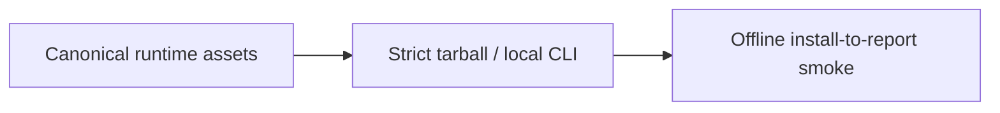
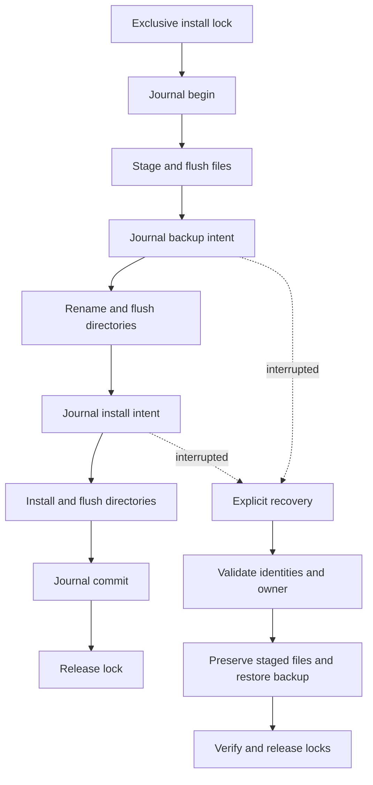

# npm distribution — local preview

Maintainer: @omidkh68 · P0 · Issue #46 · [فارسی](npm-distribution-FA.md)

## Availability and prerequisites

This is a private, unpublished package preview. The proposed name is `@omidkh68/security-guardian`, subject to the maintainer confirming npm scope ownership and name availability. The executable is `security-guardian`. The manifest version matches the canonical Skill version; it is not a new release. `private: true` prevents normal npm publication. No registry publish, credential setup or package reservation is performed here.

Node.js 22+ on Linux/macOS is required; CI exercises Node 22 and 24 on Linux. Python 3.10+ and a supported coding agent are still needed for the security workflow. No external Node runtime dependencies or install lifecycle scripts are used. The CLI copies the canonical runtime assets and does not execute them.

## Local package usage

From a trusted checkout, inspect the code and run:

```bash
npm test
node scripts/verify-npm-package.mjs --artifact-dir /absolute/path/to/new-artifact-directory
```

Use the exact tarball filename printed by npm (replace the example path with your actual file):

```bash
npx --offline --yes --package /absolute/path/omidkh68-security-guardian-1.2.1.tgz -- security-guardian --help
npx --offline --yes --package /absolute/path/omidkh68-security-guardian-1.2.1.tgz -- security-guardian --agent all --project /absolute/path/to/project --dry-run
npx --offline --yes --package /absolute/path/omidkh68-security-guardian-1.2.1.tgz -- security-guardian --agent all --project /absolute/path/to/project --yes
```

The first --yes belongs to npm; the final --yes belongs to the CLI. Use exactly one of --dry-run or --yes. Choose exactly one of --user or --project DIR. Agents: claude, codex, gemini, all, or comma-separated names. Claude uses .claude/skills; Codex and Gemini share .agents/skills. --version prints the bundled version. Preview is read-only. --upgrade requires every selected destination to contain the existing named Skill; mixed new/upgrade installs are not supported in this preview.

## Safety and recovery

The CLI rejects symlinked ancestors, destinations and source entries, non-directory destination components, foreign Skills, concurrent installer locks and unapproved overwrite. Existing target trees must not contain symlinks. Each copy is staged before any replacement; upgrades keep uniquely named backups under the corresponding config's skill-backups directory. On a caught failure the CLI attempts reverse-order rollback and reports failures. Hard termination, power loss, malicious concurrent filesystem modification and other installers are not covered by the lock/rollback guarantee. Use a stable, trusted filesystem; inspect residual stages/backups and the .security-guardian-install.lock before manual recovery. Never delete a lock while another installation is active.

To roll back an upgrade, stop agent sessions, inspect the reported backup and target, move the new target out of the way, then restore the backup to its original location. Never delete private project audit history. Uninstall only the verified Skill directory. The CLI does not alter application source, download scanners, activate agents or publish reports.

## Evidence and release gates

The pack smoke checks the exact tracked runtime manifest, file bytes, local tarball npx preview/install, scope discovery and generation of a deliberately PARTIAL synthetic audit report. It does not establish actual vendor agent activation, a verified security fix, macOS support by testing, or registry availability. The npm identity, owner-approved publication, tagged release workflow, provenance and registry exact-version smoke remain separate gates. See #46. Do not advertise a registry installation command before verifying publication.

## Owner-controlled staged publishing (planned release)

The maintainer reports npm account `omidkh68` with 2FA. Confirm locally with `npm whoami --registry=https://registry.npmjs.org/`; never share credentials or OTPs. The [npm dual-use policy](https://docs.npmjs.com/policies/dual-use/) (2026-07-28) requires persistent declaration and 2FA for promotion of declared packages. The package is currently private. No staging, public placeholder, release or tag is authorized here.

After #105 is completed and an approved public manifest, matching versions and exact release tag exist, dispatch `npm-publish.yml` on that tag with `mode=prepare` (default). It tests, packs, attests and verifies the exact tarball without contacting the registry to stage or publish. Download the npm-release artifact and verify its checksum, receipt and GitHub attestation against the reviewed tag and commit. Use npm >=11.15.0. For first publication before a Trusted Publisher exists, authenticate as the owner locally and run `npm stage publish ./EXACT-TESTED.tgz --access public --tag latest --ignore-scripts` with the verified file, not the checkout. Staging a new package may create a public 0.0.0-stage placeholder; require explicit release authorization first.

List/view the stage ID with `npm stage list @omidkh68/security-guardian` and `npm stage view STAGE_ID`. Download with `npm stage download STAGE_ID` into a separate empty directory. Review name, version, tag and publisher; compare SHA-256 of downloaded bytes with the tested tarball receipt. Reject unexpected content. Only after the owner reviews the exact stage, run `npm stage approve STAGE_ID` interactively with 2FA (or use npmjs.com). Then dispatch the same exact tag with `mode=registry` and the successful prepare/stage workflow run ID. This read-only job verifies the source run identity, signed original artifact, registry integrity, actual downloaded bytes and exact-version CLI. Registry failure does not authorize re-staging or re-publishing.

For later releases, configure the package Trusted Publisher: GitHub Actions, owner `omidkh68`, repository `security-guardian`, workflow `npm-publish.yml`, environment `npm-release`, stage-only permission. Require environment review and tag restrictions; do not store NPM_TOKEN. Dispatch `mode=stage` to stage only after the existing tests and provenance verification. Owner 2FA promotion and separate registry verification remain mandatory. Configure trust near the next approved release (initial validation window per npm documentation). OIDC stage provenance and registry publication remain NOT_RUN until observed; manual bootstrap relies on independently verified GitHub artifact attestation, not an assumed npm registry attestation. See [staged publishing](https://docs.npmjs.com/staged-publishing/) and [trusted publishing](https://docs.npmjs.com/trusted-publishers/). Preserve the MIT contributor copyright notice.


## Architecture and testing value (#46)



Node 22/24 packaging tests exercise exact runtime assets, install and partial report; registry publication is a separate gate.


### Interrupted installation

For schema-2 journals, preview with `security-guardian --recover --project DIR --dry-run`, then explicitly approve with `security-guardian --recover --project DIR --yes` (use `--user` for user scope). Normal installation never triggers recovery automatically. Active or ambiguous owners, another host, malformed or legacy journals, unsafe paths, changed filesystem identity, and an invalid recovery lock fail closed. Recovery restores original backups and moves interrupted new installations back to staging for inspection rather than recursively deleting data. Retrying after a handled error is supported; abrupt termination of recovery itself can be resumed using immutable owner claims published via exclusive hard links, provided the prior owner is demonstrably gone and the journal or verified completion receipt is valid. Legacy guards, ambiguous owners and filesystems without hard-link support require manual inspection. Interrupted final cleanup can leave inert metadata files. This is not a power-loss guarantee or protection against hostile local filesystem actors.


### Architecture and durability limits



Staged files and journal records are flushed with fsync; supported POSIX directory entries are flushed before advancing the journal. Flush errors are not reported as success. Node provides no portable Windows directory flush. CI exercises process termination and injected failures, not physical power loss. No guarantee is made for physical power loss, hardware write caches or filesystem corruption.

## Exact tested artifact handoff (#64)

The verifier can export the very tarball used for the offline smoke test to a fresh absolute directory; it does not repack after testing. It records SHA-256, source commit, package identity, runtime versions and the limited smoke scope in a receipt. Linux Node 22 and 24 CI retain their separate tested artifacts. The tagged release workflow uses the same verifier export and checks the digest and receipt before publishing. Private previews stay private; a receipt is CI evidence, not an independent signature or successful registry publication. For an approved first publication use the tested tarball from the approved revision, not a newly packed checkout. Review the digest and retain the receipt. No tag or publication is authorized by this change.

## Machine-enforced Release Gate (#105)

Before packaging, the publish workflow reads the exact GitHub issue #105 using read-only Issues permission. It must be closed as completed with at least 18 checked acceptance rows, including each of standards #149–160 exactly once. API failure, an open or not-planned issue, unchecked rows or duplicate/missing standard IDs block publication. This is a checklist metadata gate only, not independent validation of the underlying evidence, maintainer approval, environment protections or compliance. Future releases require their own review. This change does not close an issue or create a tag.

## Registry artifact integrity (#64)

After authorized publication, the read-only registry smoke job computes SHA-256 and SHA-512 from the exact tested tarball and compares the latter to exact-version registry `dist.integrity`. Receipt package, version, source commit and public state must match. Exact-version CLI installation remains required. This checks registry-advertised integrity, not independent provenance verification. No publication or tag is performed by this change.


## First public release: bounded SLSA Build L2 target (#160)

The release workflow builds and tests the exact tarball, generates a signed GitHub artifact attestation in a separate hosted job, then verifies the SLSA v1 predicate, canonical repository, signing workflow, exact tag and source commit in a read-only job before the existing publish job can run. Self-hosted runner attestations are rejected. The private preview runs negative controls for altered artifact bytes and incorrect source ref. No public publish or tag is performed by this change. Release approval and #105 remain mandatory. npm trusted publishing can generate its own registry provenance for a public package from a public repository; verify actual registry evidence after publication, not by inference from OIDC. First-release authentication and npm Trusted Publisher configuration must be verified with the maintainer.

Consumer verification after an authorized release (replace placeholders with the reviewed exact version and commit):

```bash
npm pack @omidkh68/security-guardian@VERSION --ignore-scripts
# Use the downloaded tarball filename from npm pack.
gh attestation verify PACKAGE.tgz --repo omidkh68/security-guardian --signer-workflow omidkh68/security-guardian/.github/workflows/npm-publish.yml --source-ref refs/tags/vVERSION --source-digest COMMIT_SHA --predicate-type https://slsa.dev/provenance/v1 --deny-self-hosted-runners
```

Normative baseline: [SLSA v1.2 build requirements](https://slsa.dev/spec/v1.2/build-requirements), [build provenance](https://slsa.dev/spec/v1.2/build-provenance), [verification](https://slsa.dev/spec/v1.2/verifying-artifacts), [GitHub attestation](https://docs.github.com/en/actions/how-tos/secure-your-work/use-artifact-attestations), [npm trusted publishing](https://docs.npmjs.com/trusted-publishers/). Target L2, not an achieved level or certification. Level 3, Source Track and comprehensive consumer-project SLSA auditing are post-release evaluation, not additional first-release requirements. Existing #105 criteria are unchanged.
