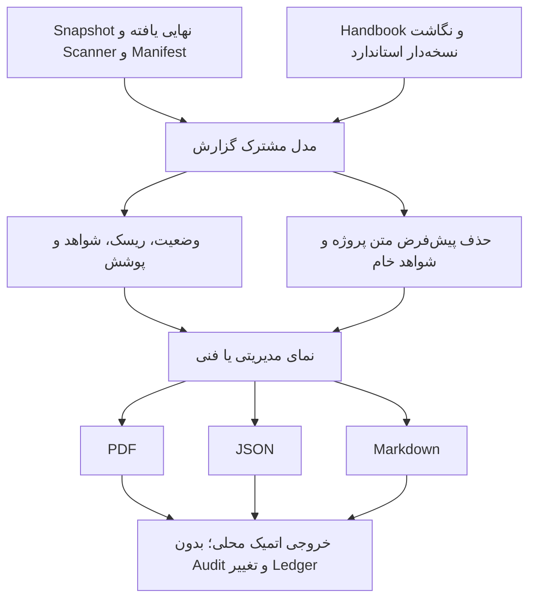

# گزارش‌دهی امنیتی حرفه‌ای نسخه‌دار (#98)

[English](pdf-reporting.md)

شواهد اصلی در JSON و Markdown خصوصی و نسخه‌دار حفظ می‌شوند. گزارش مدیریتی و فنی در PDF، JSON و Markdown از مدل مشترک تولید می‌شوند. JSON و Markdown فقط به Python نیاز دارند؛ PDF به ReportLab اختیاری:

```bash
python3 -m pip install -r requirements-pdf.txt
```

## معماری و ارزش تست



مدل مشترک از اختلاف فرمت‌ها جلوگیری می‌کند. همه وضعیت‌ها از جمله جایگزین‌شده، مثبت کاذب، مسدود، تعویق، ریسک پذیرفته و اصلاح تأییدنشده حفظ می‌شوند. ریسک باقی‌مانده همه وضعیت‌های بسته‌نشده است. هر ردیف دلیل و اقدام مبتنی بر وضعیت، شرط پذیرش Handbook، تعداد شواهد و وضعیت اتصال تست دارد؛ نمای فنی پیاده‌سازی، Playbook، تاریخچه و وجود مالک/تأییدکننده را اضافه می‌کند. کیفیت تست دستی و Receipt اجرای محلی تفکیک شده است. وضعیت اصلاح تأییدشده گذشته به معنی تأیید مجدد نیست. تعداد Scope و ناقص بودن Scanner حفظ می‌شود؛ تعداد کنترل‌های قابل‌اعمال، ارزیابی‌شده و تأییدشده بدون Schema شواهد صریح ناشناخته است. بازبینی یافته برابر پاس کنترل نیست. استانداردها از نسخه نصب‌شده Crosswalk می‌آیند، نه گواهی تاریخی؛ کاربرد و تأیید NOT_ASSESSED و NOT_VERIFIED است.

## خروجی خودکار و دستی

پس از finish دو PDF مدیریتی RUN.pdf و CURRENT.pdf مانند قبل تلاش می‌شوند؛ pdf_reports و pdf_warnings بدون تغییرند. RUN.md، CURRENT.md، Manifest و Ledger تغییر نمی‌کنند. هر دو PDF Snapshot کامل نهایی را می‌خوانند؛ پرچم بازبینی و Delta کار همان نسخه را مشخص می‌کند. CURRENT نمای Snapshot آخرین نسخه نهایی است، نه ترکیب با Ledger زنده. خروجی تاریخی Audit جدید شروع نمی‌کند؛ cumulative تاریخی به مسیر صریح خارج از فضای ثبت نیاز دارد.

```bash
python3 <skill-dir>/scripts/security_report.py --root /path/to/project
python3 <skill-dir>/scripts/security_report.py --root /path/to/project --run v0004-ACTUAL-ID --view technical --format pdf
python3 <skill-dir>/scripts/security_report.py --root /path/to/project --view management --format json
python3 <skill-dir>/scripts/security_report.py --root /path/to/project --view technical --format md
```

نام پیش‌فرض RUN.pdf، RUN.json، RUN-REPORT.md، RUN-TECHNICAL-REPORT.md و مانند آن است؛ cumulative با CURRENT آغاز می‌شود. پسوند جداگانه REPORT از بازنویسی RUN.md و CURRENT.md خصوصی جلوگیری می‌کند. CLI سازگاری هویت و وضعیت Manifest نهایی با Index را بررسی می‌کند. مقصد صریح با پسوند منطبق پذیرفته می‌شود؛ مسیر شواهد خصوصی در فضای ثبت محافظت می‌شود. نوشتن اتمیک از فایل نیمه‌کاره جلوگیری می‌کند. PDF_UNAVAILABLE صریح است و JSON/Markdown قابل استفاده‌اند. PDF انگلیسی LTR است؛ --font شکل‌دهی فارسی RTL فراهم نمی‌کند.

## حریم خصوصی و محدودیت

خروجی پیش‌فرض متن آزاد پروژه، عنوان‌ها، مسیرها، فرمان‌ها، یادداشت، شواهد خام، لاگ تست و هویت‌ها به‌جز شناسه معتبر یافته را حذف می‌کند. دلیل و اقدام راهنمای مبتنی بر وضعیت‌اند، نه متن بازبین. برای مانع واقعی و بازتولید دقیق به Snapshot خصوصی رجوع کنید. --private-details خلاصه با Redaction بهترین‌تلاش در فایل جداگانه PRIVATE می‌دهد؛ برای اشتراک امن فرض نشود. حتی در حالت خصوصی Payload شواهد و لاگ صادر نمی‌شود. گزارش ساختاری نیز تعداد ریسک و شناسه را افشا می‌کند؛ بازبینی انسانی پیش از اشتراک ضروری است. Markdown و JSON خصوصی Tracker بدون تغییرند و پیش‌فرض قابل اشتراک نیستند.

حداکثر ۵۰۰۰ یافته و ۵۰۰۰ رکورد تست؛ بیشتر از آن خطای صریح است نه حذف خاموش. PDF پاراگراف قابل شکستن و شماره صفحه دارد؛ محدودیت ۱۲۰ یافته حذف شده است. CI صحت وضعیت، مخرج ناشناخته، Scope، خروجی تاریخی، مسیر محافظت‌شده، نبود Renderer، Canary اطلاعات حساس در دو نما و استخراج متن PDF چندصفحه‌ای با ۱۲۵ یافته و متن خصوصی طولانی را تست می‌کند. pypdf وابستگی صرفاً تست CI است. بازبینی بصری و انسانی تایپوگرافی و افشا همچنان ضروری است. ادعای Verification مستقل یا انطباق وجود ندارد.

## لینک شواهد بدون ابهام #98

شناسه تکراری تست نمی‌تواند مبنای PASS مرتبط باشد. نوع شواهد محلی/دستی ناشناخته یا ناسازگار قابل اتصال نیست؛ رکورد دستی تاریخی MANUAL_REPORTED باقی می‌ماند. وضعیت Ledger و Projection حریم خصوصی تغییر ندارند. تست رگرسیون رکورد مبهم و ناقص را پوشش می‌دهد؛ صفحه‌بندی و استخراج PDF واقعی در CI باقی است. بازبینی بصری انسانی جداگانه است. CI در انتظار است.
