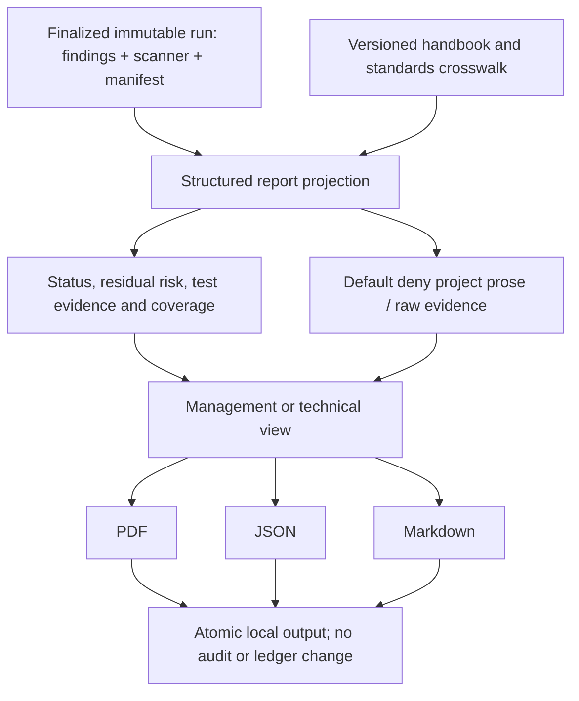

# Professional versioned security reporting (#98)

[فارسی](pdf-reporting-FA.md)

Security Guardian keeps original evidence in private versioned JSON and Markdown. It now offers management and technical views in PDF, JSON and Markdown from a single structured report projection. Core JSON/Markdown exports require only Python; PDF requires optional ReportLab:

```bash
python3 -m pip install -r requirements-pdf.txt
```

## Architecture and testing value



The same projection prevents disagreement between formats. All finding states (including superseded, false positive, blocked, deferred, accepted risk and fixed-unverified) are retained. Residual risk includes every nonclosed status. Each row has status-based reason, next action, handbook acceptance condition, evidence count and verification link status; technical adds implementation, playbook and history/ownership-presence metadata. Current run linked test quality distinguishes manual reports from local execution receipts. Earlier verified statuses remain ledger statuses, not newly verified. Scope counts and known scanner truncation are preserved; assessed, applicable and verified control counts are unknown unless supported by a future explicit assessment schema. A reviewed finding is not a passed control. Standards references use the installed crosswalk edition, not historical certification; applicability and verification remain NOT_ASSESSED / NOT_VERIFIED.

## Automatic and on-demand exports

Tracker finish still attempts the two default management PDFs, RUN.pdf and CURRENT.pdf, with pdf_reports/pdf_warnings unchanged. Existing RUN.md, CURRENT.md, manifest and ledger are untouched. Both PDFs read the entire finalized finding snapshot; per-run reviewed flags and deltas distinguish new work. CURRENT represents the selected latest finalized snapshot, not a live ledger join. Historical re-export never starts an audit; historical cumulative exports need an explicit destination outside tracking storage.

```bash
python3 <skill-dir>/scripts/security_report.py --root /path/to/project
python3 <skill-dir>/scripts/security_report.py --root /path/to/project --run v0004-ACTUAL-ID --view technical --format pdf
python3 <skill-dir>/scripts/security_report.py --root /path/to/project --view management --format json
python3 <skill-dir>/scripts/security_report.py --root /path/to/project --view technical --format md
```

Default export names are RUN.pdf, RUN.json, RUN-REPORT.md and RUN-TECHNICAL-REPORT.md etc.; cumulative names start CURRENT. The separate -REPORT suffix prevents overwriting original private RUN.md and CURRENT.md. The CLI reads the finalized manifest and checks its identity/status against the index. An explicit destination with matching extension is accepted; existing private evidence paths inside storage are protected. Atomic output avoids a partial file after renderer failure. PDF_UNAVAILABLE is explicit and JSON/Markdown remain available. English/LTR PDF; optional --font does not implement Persian RTL shaping.

## Privacy and limitations

Default exports intentionally exclude all project-controlled free prose, titles, paths, commands, notes, raw evidence, test logs and identities except validated finding IDs; reasons/actions are status-based guidance, not quotes from reviewer notes. Consult private snapshots for actual blockers and exact reproduction steps. Optional --private-details adds best-effort sanitized summaries in separately named PRIVATE outputs; NEVER assume these are share-safe. No raw evidence/log payload is exported even in private mode. Structured reports can still disclose risk counts and identifiers; manually review before sharing. The legacy private tracker Markdown and JSON remain unchanged and must not be shared by default.

Up to 5000 findings and 5000 test records; larger inputs fail explicitly rather than silently omit rows. PDF uses split-capable paragraphs and page numbers; no 120-finding truncation. CI tests status fidelity, null denominators, scope isolation, historical re-export, protected paths, missing renderer, secret canaries in both views and extracted multipage PDF text with 125 findings plus long private content. pypdf is a test-only CI dependency. Visual/human review of typography and disclosure remains necessary. No independent security verification or compliance claim.

## Unambiguous evidence links (#98)

Duplicate test IDs cannot support a linked PASS. Unknown or inconsistent local/manual receipt quality cannot be linked as eligible evidence; historical manual records remain labeled MANUAL_REPORTED. Ledger status and privacy projection are unchanged. Test regressions cover ambiguous and malformed records; actual PDF pagination and extraction remain in CI. Visual human review remains separate. CI pending.

## Synthetic visual-review artifacts (#98)

The required Python 3.12 CI step renders the existing wholly synthetic 125-finding fixture in both management and technical PDF views, asserts every finding ID is present, pagination and absence of private canary in text and metadata, and uploads only these synthetic PDFs as `synthetic-pdf-review` with seven-day retention. No customer data, private ledger or logs are uploaded. CI output is automated content evidence, not independent human typography or disclosure approval. Visual review of the artifacts remains a distinct recorded task. CI pending.
