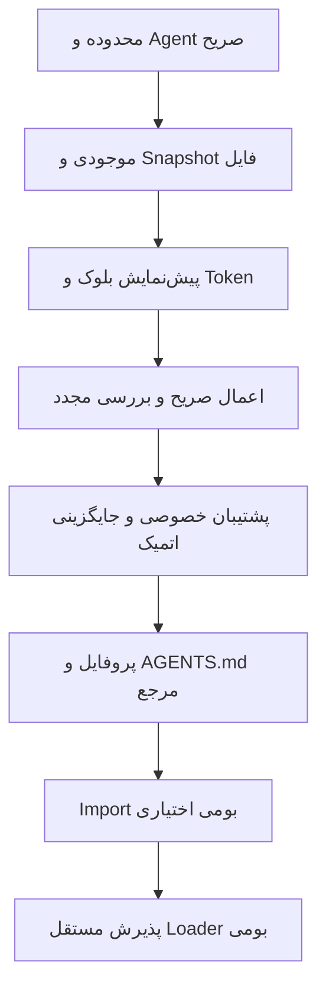

# نگهداری محدوده امنیتی تأییدشده — RFC #32 (در دست توسعه)

[English](project-profile.md)

Security Guardian در Audit عادی فایل دستورالعمل را تغییر نمی‌دهد، Agent نصب نمی‌کند و محدوده را ذخیره نمی‌کند. پروژه قابل اعتماد متعلق به کاربر می‌تواند محدوده پیش‌فرض تأییدشده را صریحاً مقداردهی یا به‌روزرسانی کند. این قابلیت توسعه است و در انتشار v1.2.1 وجود ندارد.

## CLI

از دایرکتوری scripts مربوط به Skill:

```bash
python3 security_project.py status --root /path/to/project
python3 security_project.py preview --root /path/to/project --profile backend
python3 security_project.py preview --root /path/to/project --profile fullstack --agent claude --agent gemini
# Only after reviewing the exact preview and existing instruction files locally:
python3 security_project.py apply --root /path/to/project --profile fullstack \
  --agent claude --agent gemini --approve <approval_token>
```

برای انتخاب ریشه‌های صریح، `--component <relative-root>` را تکرار کنید. پروفایل، Component و Agent انتخابی بین preview و apply یکسان باشند. Token قدیمی (تغییر محتوا، محدوده، Manifest یا Agent) مجدداً استفاده نشود. Token اتصال تأیید به پیش‌نمایش است، نه احراز هویت یا مجوز تازه. فایل‌های موجود را محلی بازبینی کنید؛ پیش‌نمایش فقط متن مدیریت‌شده پیشنهادی و مسیرها را چاپ می‌کند، نه محتوای موجود. شبکه یا Audit جدید ندارد.

## فایل‌ها

| فایل | هدف |
|---|---|
| `.security-guardian-profile.json` | Schema سخت‌گیرانه نسخه ۱: پروفایل منتخب، ریشه نسبی، Fingerprint موجودی؛ در صورت صلاحدید قابل اشتراک تیم. بدون یافته خام، Secret، فرمان تست یا مجوز. |
| `AGENTS.md` | بلوک کوتاه مدیریت‌شده امنیتی؛ تمام بایت‌های بیرون بلوک حفظ می‌شوند. UTF-8 LF/CRLF. |
| `CLAUDE.md`, `GEMINI.md` | Import بومی اختیاری به AGENTS.md در ریشه، فقط با انتخاب صریح؛ Import موجود دوباره استفاده می‌شود. |
| `.security-guardian/profile-backups/` | نسخه پشتیبان خصوصی فایل‌های بازنویسی‌شده؛ Commit نشود. |

Fingerprint موجودی، Componentهای کشف‌شده و محتوای محدود Manifest را متصل می‌کند، نه سورس یا نسخه وابستگی نصب‌شده. تغییر/جابجایی ریشه، تغییر Manifest، موجودی ناقص یا پروفایل نامعتبر، بازبینی صریح قبل از استفاده مجدد می‌خواهد. READY پیش‌فرض است نه اثبات پشتیبانی یا مجوز کاربر. انتخاب صریح فعلی اولویت دارد. فیلد مستقل instruction_sync راهنمای غایب یا تغییرکرده را مشخص می‌کند؛ فقط با تأیید به‌روزرسانی شود.

## سازگاری Agent

- [Codex](https://developers.openai.com/codex/guides/agents-md): پیش‌فرض AGENTS.md ریشه؛ AGENTS.override.md غیرخالی در همان پوشه مقدم است؛ تنظیمات nested، fallback و محدودیت اندازه زنجیره نهایی را تغییر می‌دهند. برای تأیید Session جدید شروع کنید.
- [Claude Code](https://code.claude.com/docs/en/memory): پشتیبانی مستقیم AGENTS.md از v2.1.277 با تنظیمات مناسب. اولویت پیش‌فرض CLAUDE.md/CLAUDE.local.md ممکن است AGENTS.md را کنار بگذارد. Import اختیاری در CLAUDE.md برای اشتراک AGENTS.md؛ /memory و تنظیمات را بررسی کنید؛ تغییر خودکار تنظیمات ندارد.
- [Gemini CLI](https://geminicli.com/docs/cli/gemini-md/): GEMINI.md پیش‌فرض، Import نسبی و نام فایل Context قابل تنظیم. پس از Reload یا Session جدید /memory show را بررسی کنید.

Import تمام AGENTS.md را بارگذاری می‌کند نه فقط بلوک مدیریت‌شده؛ پیش از انتخاب مناسب بودن را بررسی کنید. فایل‌های دستورالعمل ریشه، ancestor/Component، قدیمی و nested مرتبط برای بازبینی فهرست می‌شوند؛ Import دلخواه، تنظیمات جایگزین Loader و تعارض معنایی خودکار مشخص نمی‌شوند. Helper فایل override یا nested را تغییر نمی‌دهد. موجودی Context حداکثر ۱۲۸ فایل مرتبط، ۲۵۶ KB هر فایل و ۲ MB مجموع؛ بیش از آن بازبینی دستی می‌خواهد. AGENTS.md بزرگ درباره بودجه پیش‌فرض Codex هشدار می‌گیرد. محدودیت‌های کاربر/تیم و مجوز پابرجاست. اگر Agent مستقیماً AGENTS.md را می‌خواند، Import بومی لازم نیست.

## شکست‌ها و محدودیت‌ها

Helper Encoding پشتیبانی‌نشده، Marker مدیریت‌شده تکراری/مبهم/نامعتبر (از جمله مثال fenced)، Fence بسته‌نشده Markdown، فایل بزرگ/Symlink/Hardlink، Schema نامعتبر، کشف ناقص یا حل‌نشده و تأیید قدیمی را رد می‌کند. Snapshot ورودی مجدداً بررسی و هر فایل اتمیک جایگزین می‌شود؛ فایل جدید بدون بازنویسی ساخته می‌شود. ابتدا فایل موجود پشتیبان می‌شود. به‌روزرسانی چندفایل به‌صورت گروهی اتمیک نیست؛ خطا BLOCKED/PARTIAL با فهرست فایل تغییرکرده و مسیر پشتیبان برمی‌گردد. توقف و بررسی کنید، در صورت نیاز آگاهانه بازیابی کنید؛ Retry خودکار یا بازنویسی تغییر ناشناخته نکنید. فقط دایرکتوری محلی قابل اعتماد؛ محافظت در برابر عامل یا فایل‌سیستم همزمان متخاصم نیست. پشتیبان به مجوز محلی (حالت خصوصی POSIX) متکی است و تاریخچه Audit خصوصی می‌ماند.

تست Package/Fixture رفتار فایل را بررسی می‌کند؛ بارگذاری واقعی Context به اعتبارسنجی جدا در Repo موقت نیاز دارد. ادعای پوشش آسیب‌پذیری جدید یا Verification مستقل ندارد.

## معماری و ارزش تست (#32 / PR #41)



تست‌های Fixture مجوز، Token قدیمی، حفظ بایت، تغییر محدوده، احتمال تعارض و شکست جزئی نوشتن را بررسی می‌کنند. پذیرش Loader باید با Client احرازشده واقعی در پروژه موقت انجام شود؛ نسخه یا ایجاد فایل کافی نیست. این PR تنظیمات Agent یا Credential اضافه نمی‌کند.


## پروتکل پذیرش Loader واقعی

این تست فقط در مخزن موقت تحت مالکیت با CLI نصب‌شده و حساب مجاز انجام شود. فایل‌های واقعی پروژه و تنظیمات سراسری تغییر نکنند.

1. نسخه CLI و وضعیت ورود را محلی ثبت کنید. یک پروژه موقت با Manifest فرانت و بک‌اند و AGENTS.md دارای یک Marker مصنوعی یکتا بسازید؛ محتوای خارج از بلوک را Hash کنید.
2. preview با scope بک‌اند و Agent منتخب را بررسی کنید؛ apply با همان token و رضایت صریح. status باید READY و instruction_sync باید MATCHED باشد. دوباره اجرا کنید و UNCHANGED و Hash محتوای بیرون بلوک را بررسی کنید.
3. در Session تازه Codex از همان ریشه بخواهید فقط Marker و محدوده منتخب را از دستورالعمل بارگذاری‌شده بیان کند، بدون باز کردن فایل یا اجرای ابزار. در Claude از /memory و در Gemini از /memory show و Session تازه استفاده کنید و وجود دستورالعمل/Marker و محدوده را بررسی کنید. اگر Client محتوای دستورالعمل را نشان نمی‌دهد و شواهد کافی نیست، NOT_VERIFIED ثبت شود.
4. با AGENTS.override.md یا تنظیم native موجود (فقط در Fixture) تعارض ایجاد کنید؛ هیچ مجوزی از آن استنباط نشود، محدوده نباید گسترش یابد. برای هر Client انتخاب Profile بک‌اند و رد عملیات خارج از محدوده را بررسی کنید.
5. نتیجه هر Agent را جدا با نسخه، تنظیم Loader، تاریخ UTC، Commit، نتیجه PASS/FAIL/NOT_VERIFIED و شواهد پاک‌سازی‌شده ثبت کنید. از انتشار توکن، مسیر شخصی و متن پروژه واقعی خودداری کنید. صرف ایجاد فایل، نسخه CLI یا پاسخ حدسی مدل PASS نیست. پس از تست پروژه موقت را پاک کنید.
