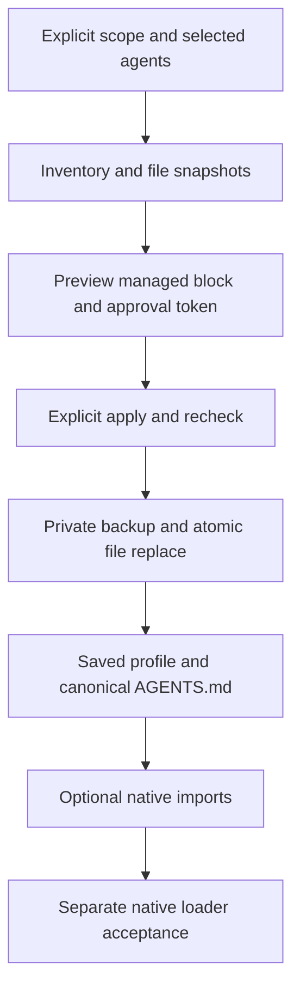

# Persisting approved security scope — RFC #32 (development)

Security Guardian does not change instruction files, install agents or persist scope during normal audits. An owned trusted project can explicitly initialize or update an approved default scope. This is a development feature, not in the v1.2.1 release.

## CLI

From the skill's scripts directory:

```bash
python3 security_project.py status --root /path/to/project
python3 security_project.py preview --root /path/to/project --profile backend
python3 security_project.py preview --root /path/to/project --profile fullstack --agent claude --agent gemini
# Only after reviewing the exact preview and existing instruction files locally:
python3 security_project.py apply --root /path/to/project --profile fullstack \
  --agent claude --agent gemini --approve <approval_token>
```

Repeat `--component <relative-root>` for explicit selected roots. Use the same profile, components and agent selections between preview and apply. A stale token (content, scope, manifest or selected agent changed) must not be reused. The token is confirmation binding, not authentication or a new permission grant. Review existing files locally; preview prints proposed managed text and paths only, not existing content. No network or audit-run creation.

## Files

| File | Purpose |
|---|---|
| `.security-guardian-profile.json` | Strict version 1 schema: selected profile, relative roots, inventory fingerprint; optionally team-shareable. No raw findings, secrets, test commands or permissions. |
| `AGENTS.md` | Small security-specific managed block; all previous bytes outside owned block retained. UTF-8 LF/CRLF. |
| `CLAUDE.md`, `GEMINI.md` | Optional root native imports to AGENTS.md, only when explicitly selected; existing imports reused. |
| `.security-guardian/profile-backups/` | Private backups of overwritten files; do not commit. |

The inventory fingerprint binds discovered components and bounded manifest content, not source contents or installed dependency versions. New/moved roots, changed manifests, incomplete inventory or invalid profile require explicit review before reuse. A READY profile is a default, not proof of support or user authorization. Explicit current user selection wins. The independent instruction_sync field flags missing or drifted managed guidance; update only with approval.

## Agent compatibility

- [Codex](https://developers.openai.com/codex/guides/agents-md): root AGENTS.md by default; nonempty AGENTS.override.md takes precedence at the same directory, and nested, fallback and size-limit settings affect the final chain. Start a new session to verify.
- [Claude Code](https://code.claude.com/docs/en/memory): direct AGENTS.md support from v2.1.277 under appropriate settings. Default CLAUDE.md/CLAUDE.local.md precedence can exclude AGENTS.md. Optional CLAUDE.md import permits sharing AGENTS.md. Inspect /memory and settings; no automatic changes to those settings.
- [Gemini CLI](https://geminicli.com/docs/cli/gemini-md/): default GEMINI.md, relative imports and configurable context filenames. Inspect /memory show after reload or new session.

Imports load the complete AGENTS.md, not just the owned block. Check this is appropriate before opting in. Existing root, ancestor/component, legacy and nested instruction candidates are listed for review; arbitrary imports, alternate loader settings and semantic conflicts cannot be determined automatically. The helper does not edit override files or nested instructions. Context inventory is bounded to 128 relevant files, 256 KB per file and 2 MB total, beyond which it requests manual review. Large AGENTS.md files also receive a warning about Codex's default instruction budget. User/team restrictions and authorization remain binding. Skip native imports if the client already loads AGENTS.md directly.

## Failures and limits

The helper rejects unsupported encodings, ambiguous duplicate/malformed managed markers (including examples in fenced code), unclosed Markdown code fences, oversized/symlinked/hardlinked files, invalid saved profile schemas, unresolved or incomplete discovery and stale approvals. It rechecks input snapshots and uses per-file atomic replacements; new files are no-clobber. Existing files are backed up first. Multi-file updates are not atomic as a group; a failure returns BLOCKED/PARTIAL with the changed-file list and backup path. Stop and inspect, restore deliberately if needed; do not auto-retry or overwrite unknown edits. Trusted local directories only; not protection against a hostile concurrent filesystem or agent. Backups rely on local filesystem permissions (private mode on POSIX), and audit history remains private.

Package/fixture tests exercise file behavior; actual agent context loading requires a separate disposable repository validation. No expanded vulnerability coverage or independent verification claim.

## Architecture and testing (#32 / PR #41)



The fixture suite checks consent, stale tokens, byte preservation, scope drift, conflict candidates and partial write failure. Native loader acceptance must use the actual authenticated client in a disposable project; versions or static file creation are not sufficient. No agent settings or credentials are added by this PR.


## Native loader acceptance protocol

Run only in a disposable owned repository with installed CLI and authorized account. Do not change real project files or global settings.

1. Record CLI version and authorized session locally. Create a disposable repository with frontend/backend manifests and an AGENTS.md containing a unique synthetic marker; hash the bytes outside the managed block.
2. Review a backend-scope preview for the chosen agent; apply the same token with explicit consent. Check READY and instruction_sync MATCHED. Repeat and verify UNCHANGED and the outside-block hash.
3. Start Codex in the repository and ask it to report only the loaded marker and selected scope, without opening files or running tools. For Claude inspect /memory, and for Gemini inspect /memory show in a new session or after reload; verify the instruction/marker and scope. If the client does not expose adequate loading evidence, record NOT_VERIFIED.
4. Introduce an AGENTS.override.md or existing native-context conflict in the disposable fixture only; do not infer authorization or widen scope. Check that each client respects backend scope and refuses unrelated operations.
5. Record separate PASS/FAIL/NOT_VERIFIED for each agent with version, loader configuration, UTC date, commit and redacted evidence. Never publish credentials, personal paths or real project content. File creation, CLI version or a guessed model response is not a pass. Remove the disposable fixture after testing.

## Re-integration review

Previous draft #41 at 9196f94 conflicts with current main. The five added files were recovered, shared-file changes reapplied additively to 916d280 (verified main CI #246), without replacing newer scanner, workflow or reporting code. Existing regression suite must run on the new branch. No native CLI binaries available in the current local environment; native loading remains NOT_RUN and must be separately demonstrated on the exact client/version/configuration. Do not mark runtime acceptance from static tests.
