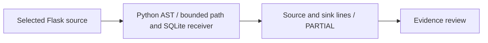

# بازبینی محدود جریان ورودی تا SQL با AST پایتون

اولویت P0 · #80، #82، #84، #90 · [English](python-sql-flow.md)

در مؤلفه‌های Backend منتخب Flask، اسکنر اکنون نحو Python را به‌صورت آفلاین با کتابخانه استاندارد Parse می‌کند. قاعده `PY.FLASK.SQL.REQUEST_FLOW` به کنترل تاریخی API-07 نگاشت می‌شود و فقط زمانی Candidate بازبینی گزارش می‌کند که مقدار شناخته‌شده request.args/form به اولین آرگومان SQL در execute متعلق به Connection/Cursor محلی شناخته‌شده sqlite3 برسد. شماره خطوط منبع و مقصد، شناسه Rule و شواهد محدود نگه‌داری می‌شوند؛ Query، نام متغیر یا مقدار درخواست چاپ نمی‌شود. سقف‌های سراسری و هر کنترل و رفتار اسکن قدیمی بدون محدوده حفظ می‌شوند.

مدل اولیه در ابتدا به Import بدون Alias در سطح ماژول برای request از Flask و sqlite3، تابع همگام سطح بالا، انتساب ساده محلی، Index/get مستقیم درخواست و ساخت رشته منتخب (f-string، الحاق، قالب‌بندی درصدی و format روی Literal) نیاز دارد. Query ثابت با Tuple پارامتر جداگانه صرفاً به‌خاطر ورودی آلوده تطابق ندارد. انتساب مجدد مقدار قبلی را پاک می‌کند. Receiver ناشناخته، Shadowing، ساختار کنترلی/فراخوانی پشتیبانی‌نشده، تابع تو‌در‌تو/ناهمگام و مسیر ORM استنباط نمی‌شوند. زیرمجموعه Alias مستقیم در نسخه ۳ توضیح داده شده است. این مدل نه معنای کامل Python است و نه تضمین SQL Injection یا پارامتری‌سازی ایمن.

از `python3 <skill-dir>/scripts/security_scan.py --root . --profile backend --format json` استفاده کنید. خلاصه python_sql_flow، شمارش فایل واجد شرایط/Parseشده، توابع پشتیبانی‌نشده، Import مدل‌نشده، خطای Parse و محدودیت اندازه/پیچیدگی را بررسی کنید. ورودی AST در هر فایل به ۱۲۸٬۰۰۰ بایت UTF-8 و ۱۰٬۰۰۰ Node محدود است. پوشش ناقص یا نبود Candidate هرگز امنیت تأییدشده نیست. کد اجرا نمی‌شود و ارتباط پایگاه داده/شبکه برقرار نمی‌شود.

قبل از پذیرش یافته، ساخت واقعی Query، اتصال پارامتر، اعتبارسنجی، دسترسی‌پذیری Route و مجوز پایگاه داده را بازبینی کنید. فقط تست منفی محلی مجاز اجرا و راستی‌آزمایی را جداگانه ثبت کنید. تست مصنوعی خطوط منبع/مقصد، پارامتری‌سازی، انتساب مجدد، Shadowing، خطای Parse، محدوده و عدم افشا را بررسی می‌کند. برای بازگردانی PR را Revert کنید؛ مهاجرت Ledger لازم نیست. تحلیل معنایی JavaScript/TypeScript، جریان میان‌تابعی و Benchmark واقع‌گرایانه مستقل مراحل بعدی هستند.

## Benchmark سناریوها

از Checkout فرمان `python3 scripts/benchmark_sql_flow.py` را اجرا کنید. Manifest مستقل MIT شامل ۱۴ سناریوی مصنوعی ساخت SQL با برچسب دستی (هشت ساخت ناامن و شش ساخت ایمن در زمینه تعریف‌شده) است. شاخه‌ها، توابع کمکی، Context Manager و Aliasهای Import عمداً شکاف‌های خط مبنای اولیه را می‌آزمایند؛ تمام نمونه‌های مثبت برای الگوی پشتیبانی‌شده طراحی نشده‌اند. نبود Candidate در نمونه مثبت حتی با پوشش PARTIAL به‌عنوان False Negative محاسبه می‌شود. گزارش طبقه‌بندی، پوشش ناقص، جداسازی محدوده، هش و مخرج صریح معیارها را ثبت می‌کند. CI اندازه‌گیری را گزارش می‌دهد و در Fixture نامعتبر یا نقض محدوده/شواهد شکست می‌خورد، نه آستانه دلخواه دقت. مجموعه مستقل، بهره‌برداری واقعی یا تست اجراشده پایگاه داده ادعا نمی‌شود. Tracker begin و RUN.md پوشش ناقص AST را نمایش می‌دهند؛ فراداده کامل منبع/مقصد در scanner.json است. دستورات سطح ماژول مدل‌نشده محافظه‌کارانه شمارش می‌شوند.

## جریان کنترل محدود (نسخه ۲ بسته)

همان Rule و کلید تاریخی یافته اکنون if/elif/else و بازگشت زودهنگام را پشتیبانی می‌کند. هر مسیر احتمالی مقادیر محلی و Receiverهای SQLite جداگانه دارد؛ مدل مقدار آلوده یک شاخه را با Receiver شاخه دیگر ترکیب نمی‌کند. فقط شرط Boolean صریح حذف مسیر می‌شود؛ نام ساده، ثابت، مقایسه و عملگر Boolean از نظر نحوی پذیرفته می‌شوند و ارزیابی نمی‌شوند. شرط، فراخوانی، تغییر وضعیت، حلقه و استثنای مدل‌نشده مسیر را با پوشش ناقص متوقف می‌کنند. Candidate اثبات امکان اجرای مسیر نیست: Overload دلخواه Truth/Comparison پایتون و هم‌بستگی شرط‌های تکراری مدل نشده‌اند. سقف هر تابع ۶۴ مسیر و ۴٬۰۹۶ گام دستوری است؛ در صورت رسیدن به سقف، path_limited_functions گزارش می‌شود. خطوط مقصد یکسان در هر تابع بدون تکرار گزارش می‌شوند و خطوط منبع (حداکثر ۱۶) ادغام می‌شوند. کد هدف اجرا نمی‌شود. Manifest چهارده‌سناریویی اولیه برای مقایسه CI بدون تغییر باقی مانده است. تحلیل میان‌تابعی کامل خارج از محدوده است؛ نسخه ۳ زیرمجموعه محدود زیر را اضافه می‌کند.

## نام مستعار مستقیم و خلاصه تابع کمکی محلی (نسخه ۳ بسته)

اتصال مستقیم سطح ماژول `from flask import request as ...` و `import sqlite3 as ...` و حالت بدون Alias شناخته می‌شود. اتصال متعارض، نام چندبار متصل‌شده، Import ستاره‌ای و Shadowing محلی رد می‌شوند. تابع کمکی همان ماژول باید نام یکتا، همگام و بدون Decorator باشد، حداکثر ۱۶ پارامتر موقعیتی (بدون مقدار پیش‌فرض، Variadic یا پارامتر صرفاً کلیدی) و یک عبارت Return پشتیبانی‌شده شامل فقط همان پارامترها و Literal داشته باشد. عبارت به ۱۲۸ گره AST محدود است. فراخوانی مستقیم موقعیتی با تعداد دقیق آرگومان فقط خطوط منبع پارامترهای استفاده‌شده را جایگزین می‌کند. فراخوانی تودرتو، بازگشتی، زنجیره Helper، تابع واردشده، Dispatch پویا، Context Manager دلخواه و تغییر پویای اتصال‌ها در زمان اجرا خارج از مدل هستند. فراخوانی پشتیبانی‌نشده پوشش ناقص دارد؛ هیچ مقدار، تابع یا Query واقعی Python اجرا نمی‌شود. خطوط منبع/مقصد و شناسه ثابت Rule/Control حفظ می‌شوند. Manifest اولیه ۱۴ سناریویی تغییر نکرده است. تست مصنوعی Alias مستقیم، Shadowing، اتصال مجدد، جریان آرگومان تابع کمکی، پارامتر استفاده‌نشده، Dispatch پشتیبانی‌نشده و تعداد آرگومان را می‌سنجد. Scanner و Tracker تعداد تعریف تابع و Alias شناخته‌شده را گزارش می‌کنند، نه تعداد فراخوانی اجراشده. برای بازگردانی PR را Revert کنید؛ مهاجرت Ledger لازم نیست.

## مدیر زمینه مستقیم SQLite (نسخه ۴ بسته)

ساختار تک‌موردی `with sqlite3.connect(<literal string>) as name:` (با Alias مستقیم sqlite3 پشتیبانی‌شده) یک Connection شناخته‌شده برای تحلیل مسیر عادی بدنه و ادامه ایجاد می‌کند. دستور with در Python محدوده محلی تازه ایجاد نمی‌کند و مدیر زمینه Connection در SQLite تراکنش را مدیریت می‌کند، نه بستن Connection را. معنای استثنا، Commit و Rollback مدل نشده و این مسیرها حتی با Candidate وضعیت PARTIAL دارند. مدیر ناشناخته، آرگومان پویا و Context چندموردی مسیر را متوقف می‌کنند. سقف مسیر و گام قبلی برقرار است. context_manager_paths تعداد ورودی‌های تحلیل‌شده را گزارش می‌کند، نه تراکنش اجراشده. Benchmark چهارده‌سناریویی بدون تغییر است. تست رگرسیون جریان مستقیم، جداسازی شاخه، اتصال پارامتر، ادامه مسیر و Context پشتیبانی‌نشده را می‌سنجد. رفتار واقعی پایگاه داده یا بهره‌برداری اثبات نمی‌شود. برای بازگردانی Revert کنید؛ مهاجرت Ledger لازم نیست.

توسعه #107: برای مدل‌های جاری و محدودیت‌ها و ارزیابی جداگانه، [توسعه پوشش معنایی](semantic-expansion-FA.md) را ببینید. توضیحات نسخه‌های قبلی خط مبنای تاریخی هستند.

## معماری و ارزش تست (#80 / #82 / #84 / #90 / #107)

نمونه‌ها Bind پارامتر، انتساب مجدد، شاخه، Alias، Context Manager و سقف‌ها را بررسی می‌کنند؛ اندازه‌گیری تاریخی و توسعه جاری جدا هستند.

## بسته نسخه ۱۴ — عبارت شرطی (#34)

مدل محدود مقدار SQL عبارت شرطی Python را با Predicateهای قبلی می‌پذیرد. Boolean ثابت یک مقدار را انتخاب می‌کند؛ سایر شرط‌های مجاز منشأهای ممکن را به‌صورت محافظه‌کارانه ترکیب می‌کنند و شرط ناشناخته پشتیبانی نمی‌شود. این Candidate جریان ممکن است، نه اثبات امکان‌پذیری یا پاک‌سازی. شش سناریوی رگرسیون و برچسب‌های ثابت بازپخش SQL خارجی حفظ می‌شوند.
