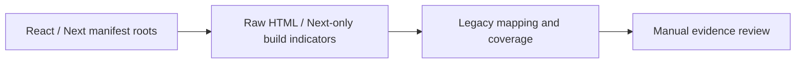

# React and Next.js review pack

Maintainer: @omidkh68 · P0 · #33, #68 · [فارسی](react-next-FA.md)

## Contract

React/Next v1 adds three bounded offline text indicators for selected, manifest-discovered frontend components. React and Next share the raw HTML rule; the other two require Next.js manifest evidence. The canonical 145 controls, 13 domains and 107 playbooks are unchanged. Unscoped legacy matching remains unchanged.

| Rule ID | Legacy mapping | Candidate |
|---|---|---|
| REACT.DOM.RAW_HTML | ANG-01 | dangerouslySetInnerHTML attribute/property assignment |
| NEXT.BUILD.PUBLIC_SECRET_NAME | ANG-12 | Direct process.env.NEXT_PUBLIC_ reference with a secret-like name |
| NEXT.BUILD.BROWSER_SOURCEMAPS | ANG-12 | productionBrowserSourceMaps: true in next.config.js/mjs/cjs/ts |

The secret-like name rule covers SECRET, PRIVATE_KEY, PASSWORD, ACCESS_TOKEN, REFRESH_TOKEN and API_KEY substrings. It reports no name or value; some public API keys are intentionally public. Source maps can be intentional. Raw HTML may be sanitized. A match is a candidate, never confirmation.

## Usage

```bash
python3 <skill-dir>/scripts/security_scan.py --root . --profile frontend --format json
```

The react_next summary reports eligible inspected files, selected React/Next and Next-only roots, rule IDs, enabled flags and counts. The existing evidence caps remain active. The indicator_rules field still counts baseline rules; scoped_additional_indicator_rules counts the enabled additions. The tracker retains legacy IDs with distinct labels; no historical migration is needed.

## Manual verification and limitations

Review the source-to-render flow and actual sanitizer configuration before accepting an HTML finding. Verify public/private environment boundaries against built assets in an authorized local build, without copying secret values into reports. Review production source-map access and intended policy. Separately trace server action and route handler authorization, tenant/resource scoping, validation, SSR/hydration serialization and cross-user cache isolation. A frontend route guard, client directive or server action marker alone proves neither authorization nor a vulnerability. This pack does not parse JSX, prove taint flow, inspect excluded .env files, analyze built artifacts or certify framework versions. It cannot detect all syntactic variants; comments and literals can create false positives. No network or target code execution occurs during scanning.

References: [React DOM](https://react.dev/reference/react-dom/components/common), [Next environment variables](https://nextjs.org/docs/app/guides/environment-variables), [Next production source maps](https://nextjs.org/docs/pages/api-reference/config/next-config-js/productionBrowserSourceMaps), [Next production checklist](https://nextjs.org/docs/app/guides/production-checklist).

Run package validation, Python regression tests and npm packaging smoke. Synthetic fixtures cover positive and negative examples, scope, Next-only filtering, legacy compatibility and source redaction. Revert this isolated change if necessary; no ledger migration.

## Architecture and testing value (#68)



Fixtures distinguish React from Next-only rules, safe alternatives and excluded roots; actual builds require separate tests.
