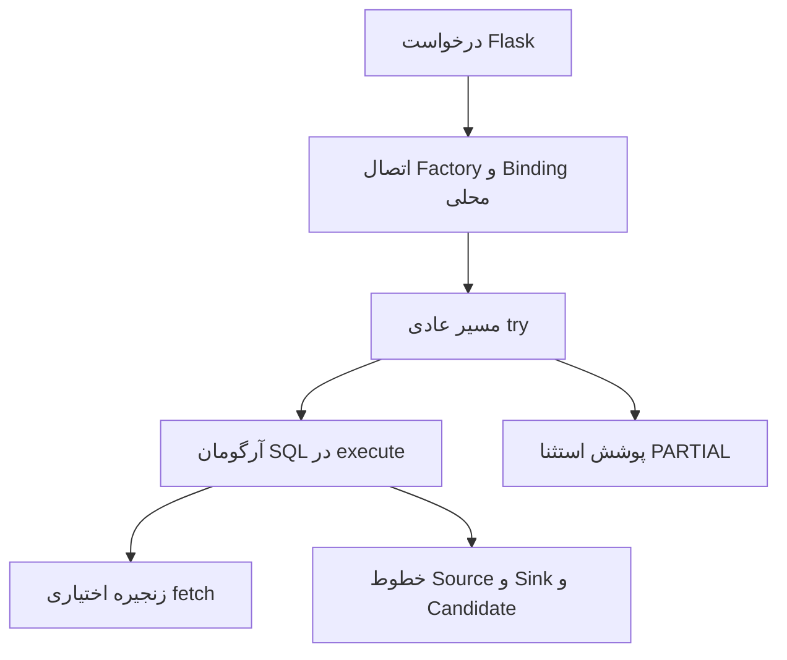

# تحلیل SQL برنامه واقعی (#111)

[English](real-app-sql.md)

بسته Python SQL نسخه ۶، شناسه ثابت PY.FLASK.SQL.REQUEST_FLOW / API-07. تابع محلی بدون آرگومان که اتصال SQLite را با مسیر نام‌دار برمی‌گرداند، مسیر عادی try/else/finally و زنجیره مستقیم execute/fetchone یا fetchall مدل می‌شوند. کد هدف و پایگاه داده اجرا نمی‌شوند. تغییر صریح اعضای ماژول Importشده تحلیل را نامعتبر می‌کند. پارامترهای متصل از متن SQL جدا می‌مانند. نتیجه انتساب Query ناشناخته است، نه Source جدید. مدل مسیر عادی PARTIAL است؛ Handler استثنا، finally پس از return/raise، Dispatch دلخواه و هویت واقعی ماژول اثبات نمی‌شوند.

تست‌ها: Factory نام‌دار، تغییر صریح و Shadowing، SQL پارامتری، زنجیره ناشناخته و مرز return. جفت EyalSec که قبلاً مشاهده شد اکنون رگرسیون است، نه Holdout تازه. CI موتور ثابت #107 را با موتور فعلی روی سورس و محدوده یکسان مقایسه می‌کند؛ لاگ‌های تاریخی حفظ می‌شوند. مجموعه مستقل تازه و بزرگ‌تر قبل از بستن #111 لازم است. ادعای انطباق یا Exploit وجود ندارد.
