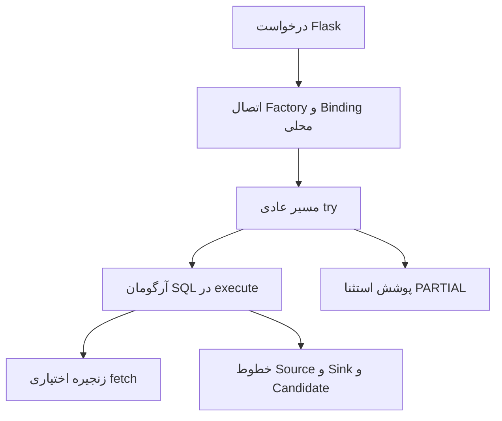
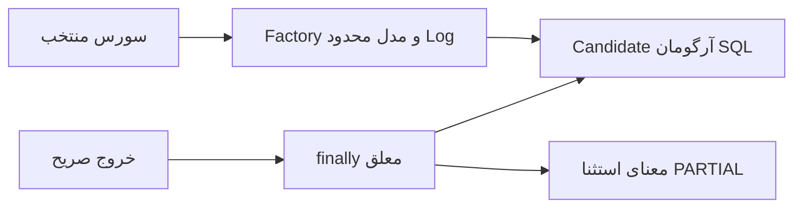
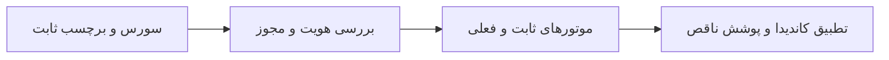
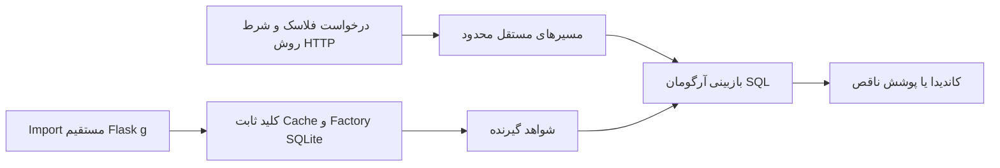
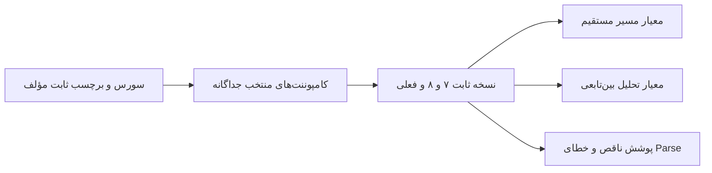
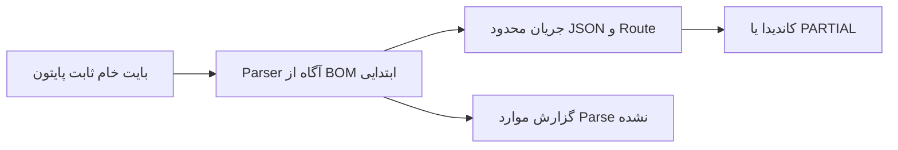
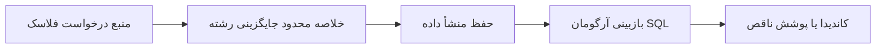
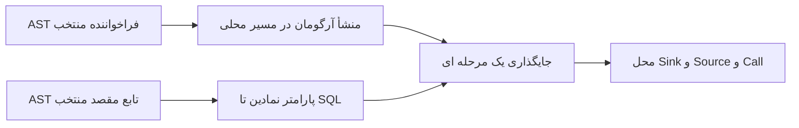
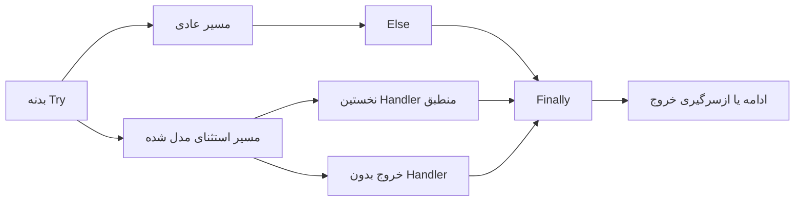

# تحلیل SQL برنامه واقعی (#111)

[English](real-app-sql.md)

بسته Python SQL نسخه ۶، شناسه ثابت PY.FLASK.SQL.REQUEST_FLOW / API-07. تابع محلی بدون آرگومان که اتصال SQLite را با مسیر نام‌دار برمی‌گرداند، مسیر عادی try/else/finally و زنجیره مستقیم execute/fetchone یا fetchall مدل می‌شوند. کد هدف و پایگاه داده اجرا نمی‌شوند. تغییر صریح اعضای ماژول Importشده تحلیل را نامعتبر می‌کند. پارامترهای متصل از متن SQL جدا می‌مانند. نتیجه انتساب Query ناشناخته است، نه Source جدید. مدل مسیر عادی PARTIAL است؛ Handler استثنا، finally پس از return/raise، Dispatch دلخواه و هویت واقعی ماژول اثبات نمی‌شوند.



تست‌ها: Factory نام‌دار، تغییر صریح و Shadowing، SQL پارامتری، زنجیره ناشناخته و مرز return. جفت EyalSec که قبلاً مشاهده شد اکنون رگرسیون است، نه Holdout تازه. CI موتور ثابت #107 را با موتور فعلی روی سورس و محدوده یکسان مقایسه می‌کند؛ لاگ‌های تاریخی حفظ می‌شوند. مجموعه مستقل تازه و بزرگ‌تر قبل از بستن #111 لازم است. ادعای انطباق یا Exploit وجود ندارد.


## مجموعه آزمایشگاهی خارجی مستقل از توسعه v6

آزمایشگاه عمومی BackdoorAli/sql-injection-demo با Revision و Hash فایل ثابت، هر هفت Sink اجرای SQL در Routeهای نسخه ناامن/امن توصیف‌شده توسط نویسنده را بررسی می‌کند (۲ مثبت، ۵ منفی؛ Initializer پایگاه داده خارج است). سورس موقت و فقط برای تحلیل خوانده می‌شود؛ کد و تست نویسنده اجرا یا بازنشر نمی‌شوند. هر دو موتور ثابت v5 و v6 با ورودی/محدوده یکسان مقایسه می‌شوند؛ Miss ناقص حفظ می‌شود. این تعداد و برچسب سطح نسخه برای نتیجه عمومی یا پذیرش نهایی #111 کافی نیست.

```bash
python scripts/benchmark_semantic_context.py --external-lab
```

## پیگیری نسخه ۷ (#111)

Import مطلق تابع Factory بدون آرگومان از سورس ریشه Component منتخب حل می‌شود، نه sys.path واقعی. فراخوانی print بدون Shadowing روی مقادیر شناخته‌شده مسیر را قطع نمی‌کند؛ اثر Formatting و IO مدل نمی‌شود. مسیر return و raise صریح می‌تواند به finally معلق برسد بدون اجرای ادامه عادی غیرقابل دسترس؛ raise با Handler میانی خارج مدل است. همه مسیرها PARTIAL هستند. تست‌ها پارامتر امن، Shadowing، تغییر ماژول و finally تودرتو را پوشش می‌دهند. آزمایشگاه خارجی قبلی رگرسیون است، نه مجموعه مستقل تازه؛ ادعای پوشش عمومی Exception یا کل برنامه وجود ندارد.



## زوج‌های مستقل مسیرهای HTTP برای SQL (#111)

دو آزمایشگاه آموزشی خارجی با مجوز MIT (JimProKing/sql-injection-lab و MariamKhubashvilii/break-it-fix-it)، با نسخه و شناسه Blob ثابت، شامل چهار محل مثبت و چهار محل منفی اجرای SQL. موتورهای ثابت v6 و v7 و موتور فعلی با بایت‌های یکسان و محدوده یکسان مقایسه می‌شوند. هر نسخه برنامه جداگانه اسکن می‌شود. فقط مسیرهای متناظر توصیف‌شده توسط مؤلف برچسب دارند؛ سایر محل‌ها بدون برچسب‌اند. کد و تست هدف اجرا نمی‌شوند و ادعای دقت در محیط عملیاتی نداریم. نتیجه در انتظار CI است؛ موارد ناقص حفظ می‌شوند. این مرحله صرفاً گزارش‌گیری است و پذیرش #111 محسوب نمی‌شود.



اجرا: `python scripts/benchmark_independent_sql.py`. بازگشت: Revert همین تغییر Benchmark؛ رفتار اسکنر تغییر نکرده است.

## توسعه Cache در Context فلاسک (نسخه ۸، #111)

خط مبنای CI در #120 (45776574343) هر چهار محل مثبت را از دست داد (TP=0، TN=4، FP=0، FN=4؛ هر ۸ مورد PARTIAL). مدل محلی محدود یک Alias مستقیم از `flask.g`، شرط نبود کلید ثابت، ذخیره اتصال مستقیم SQLite در همان کلید، تنظیم اختیاری و دقیق SQLite Row و بازگرداندن همان فیلد را می‌شناسد. Import مبهم، نوشتن صریح متعارض در Context و ارجاع مستقیم پشتیبانی‌نشده به Context رد می‌شوند. شرط برابری، نابرابری و عضویت `request.method` با مقادیر ثابت در هر دو مسیر بررسی می‌شود؛ دسترسی واقعی مسیر در اجرا اثبات نمی‌شود. مالکیت Context بین ماژول‌ها، تغییر پویای رفتار، Teardown، استثناهای دلخواه یا اجرای برنامه تضمین نشده است. شواهد Candidate صرفاً از سورس به دست می‌آیند و پوشش PARTIAL باقی می‌ماند. شناسه قوانین ثابت می‌ماند.



تست‌های مصنوعی شامل Alias، اتصال Cacheشده، زنجیره execute/fetch، شرط روش ثابت، نمونه منفی پارامتری، Shadowing، تغییر متعارض، کلید متفاوت و گیرنده ناشناخته هستند. CI اولیه 45776952724 دو شکست مورد انتظار ثبت کرد؛ نتیجه پیاده‌سازی در انتظار CI است. مجموعه تست آفلاین و `python scripts/benchmark_independent_sql.py` را اجرا کنید؛ هشت نمونه شناخته‌شده فقط Regression هستند. بازگشت با Revert همین تغییر محدود اسکنر.

## ارزیابی خارجی مرز تحلیل پس از نسخه ۸ (#111)

در CI 45777183558 مربوط به #121، هر ۱۵۸ تست پایتون ۳٫۱۲ و شش Check موفق شدند؛ مجموعه هشت‌موردی قبلی TP4 TN4 FP0 FN0 شد (قبلاً TP0 TN4 FP0 FN4)، هر هشت مورد PARTIAL و دو کاندیدای بدون برچسب. CI شاخه اصلی 45777504571 موفق بود. این شواهد Regression است و نه Holdout تازه.

نسخه ۸ در 540fcd3 پیش از ارزیابی سه آزمایشگاه آموزشی دیگر با مجوز MIT تثبیت شد. ۱۴ محل اجرای SQL برچسب‌خورده و متمایز به دو گروه مسیر مستقیم HTTP (۴ مثبت، ۳ منفی) و مرز بین‌تابعی Source/Sink (۲ مثبت، ۵ منفی) تقسیم می‌شوند. سه فراخوان یک Sink مشترک فقط یک بار شمرده می‌شوند. هر نسخه برنامه ساختار Import ریشه Component خود را حفظ می‌کند. برچسب‌ها و Hashهای Blob پیش از ارزیابی ثابت شدند؛ بدون نرمال‌سازی سورس، اجرای کد یا تست هدف، ادعای دقت عملیاتی یا نمایندگی آماری. خطاهای Parse و موارد ناقص حفظ، محل کاندیداهای بدون برچسب ثبت و مخرج‌ها جداگانه گزارش می‌شوند. منابع قبلاً بررسی‌شده Holdout کور نیستند. خود اسکنر تغییر نکرده است.



اجرا: `python scripts/benchmark_external_sql_boundaries.py`. سه تست آفلاین ارزیاب شامل برچسب تکراری، حفظ بایت خام، موارد ناقص، کاندیدای بدون برچسب و انتخاب اشتباه است. اجرا در انتظار CI. بازگشت با Revert تغییر Benchmark. به معنی بستن #111 یا تصمیم انتشار نیست.

## پوشش سورس پایتون و مسیرهای JSON (نسخه ۹، #111)

در CI 45777804891 مربوط به #122 فایل گروه مستقیم به علت UTF-8 BOM Parse نشد و هر شش نمونه مثبت دو گروه از دست رفتند. اسکنر فقط یک BOM ابتدایی متن Decodeشده را پیش از AST حذف می‌کند؛ هویت بایت‌های خام و شماره خطوط حفظ می‌شوند و سایر خطاها PARTIAL می‌مانند. ارزیاب مجموع تاریخی را حفظ کرده و تعداد موارد مسدود به دلیل Parse و معیار واحدهای کاملاً Parseشده را جداگانه گزارش می‌کند (در صورت نبود واحد، null). مدل محلی محدود request.get_json() بدون آرگومان با یا بدون دیکشنری خالی پیش‌فرض، خواندن کلید رشته‌ای ثابت، Factory اتصال محلی SQLite با تنظیم اختیاری Row و مسیر ثابت os.path join/dirname و Factory بدون آرگومان ساخت Flask با Setup محدود و تعریف مستقیم Route را اضافه می‌کند. تغییر دلخواه JSON، فراخوان ناشناخته یا Sanitizer مبتنی بر Blacklist استنتاج نمی‌شود. جریان بین ماژول‌ها، مسیر استثنا و هویت در اجرا همچنان پشتیبانی نشده است. مسیرهای جدید فقط Candidate بازبینی هستند و نه اثبات امنیت.



تست‌ها: حفظ شماره خط و رد BOM تکراری، منبع JSON و پارامترگذاری و تغییرات، منشأ Factory و Shadowing، تفکیک موارد Parse نشده در ارزیاب. اجرا: مجموعه تست آفلاین و `python scripts/benchmark_external_sql_boundaries.py`. نتیجه #123 در انتظار CI؛ بازگشت با Revert تغییر اسکنر و ارزیاب.

## تبدیل محدود رشته با مقادیر ثابت (نسخه ۱۰، #111)

در CI 45783100817 مربوط به #123، هر ۱۶۱ تست اسکنر، شش تست ارزیاب و شش Check موفق شدند؛ گروه مستقیم TP3 TN3 FP0 FN1 و تعداد موارد Parse نشده از هفت به صفر رسید؛ گروه بین‌تابعی TP0 TN5 FP0 FN2 و هر ۱۴ مورد PARTIAL باقی ماندند. نتایج Regression قبلی حفظ شدند. مورد مستقیم باقی‌مانده از حلقه جایگزینی رشته محلی عبور می‌کند. نسخه ۱۰ تابع بدون Decorator با یک پارامتر موقعیتی، Docstring و بازگشت زودهنگام اختیاری دقیق برای ورودی falsy، متغیر متمایز نگهدارنده مقدار، یک حلقه شامل ۱ تا ۱۶ رشته ثابت غیرخالی (حداکثر ۱۲۸ کاراکتر)، انتساب accumulator.replace(loop_variable, literal) و بازگرداندن همان متغیر را می‌شناسد. فهرست پویا، فراخوان بیرونی، آرگومان پیش‌فرض، بازتعریف و Shadowing استنتاج نمی‌شوند. شماره خطوط منبع در کاندیدای بازبینی حفظ می‌شود؛ جایگزینی رشته Sanitizer معتبر یا اثبات نوع در اجرا نیست. موارد منفی پارامتری و ثابت جدا می‌مانند. پوشش PARTIAL است. جریان عمومی بین ماژول‌ها و مسیر استثنا خارج از این تغییر هستند.



تست‌ها: منبع درخواست و JSON، حلقه ثابت، موارد منفی ثابت و پارامتری، جایگزینی ناشناخته، شکل حلقه نامعتبر و Shadowing. اجرا: تست آفلاین و `python scripts/benchmark_external_sql_boundaries.py`. نتیجه #124 در انتظار CI؛ بازگشت با Revert تغییر محدود اسکنر. مجموعه شناخته‌شده فقط Regression است.

## شواهد محدود یک‌مرحله‌ای بین‌تابعی (نسخه ۱۱، #111)

در CI 45821821192 مربوط به #124، هر ۱۶۴ تست اسکنر، ۶ تست ارزیاب و ۶ Check موفق شدند؛ گروه مستقیم TP4 TN3 FP0 FN0 و گروه بین‌تابعی TP0 TN5 FP0 FN2 بود. نسخه ۱۱ خلاصه نمادین پارامتر تا محل اجرای SQL و جایگذاری منشأ آرگومان در مسیر محلی فراخوان مستقیم را فقط در Component منتخب اضافه می‌کند. Import مستقیم، جفت Import نسبی/اسکریپتی همسان بدون ماژول رقیب در ریشه و فراخوان محلی با تعداد دقیق آرگومان موقعیتی؛ بدون Dispatch پویا، آرگومان پیش‌فرض، گسترش بازگشتی یا استنتاج مقدار بازگشتی. فراخوان ناشناخته مسیر را متوقف می‌کند. برش محدود ابتدای رشته و لیست خالی در فراخواننده و انتساب دقیق SQLite Row در مسیر تابع مقصد. شماره خط و فایل واقعی Sink و محل‌های Source و Call جداگانه حفظ می‌شوند؛ سقف ۱۶ محل، ۱۲۸ فایل و خلاصه، ۲۵۶ شواهد فراخوان در هر تابع. شواهد همچنان Candidate و PARTIAL هستند؛ کد هدف اجرا نمی‌شود و ادعای تحلیل کل برنامه یا مسیر استثنا نداریم. تست مثبت و منفی Import، Shadowing، محدوده، تغییر گیرنده و پارامترگذاری. نتیجه در انتظار CI.



اجرا: تست آفلاین و `python scripts/benchmark_external_sql_boundaries.py`. بازگشت با Revert تغییر محدود اسکنر.

## کنترل جریان محدود استثنا (نسخه ۱۲، #111)

CI 45822446274 مربوط به #126 و CI 45822620489 شاخه اصلی موفق شدند؛ گروه مستقیم TP4 TN3 و بین‌تابعی TP2 TN5 بدون FP/FN برچسب‌خورده و هر ۱۴ مورد PARTIAL. نسخه ۱۲ از نشانگرهای داخلی ادامه مسیر برای هدایت raise شناخته‌شده Builtin/SQLite به نخستین Handler منطبق (شامل Tuple و except بدون نوع)، حفظ finally تودرتو، ادامه یا بازپرتاب خطا و جایگزینی خروج قبلی توسط خروج جدید در Cleanup استفاده می‌کند. Else فقط پس از تکمیل عادی بدنه اجرا می‌شود. Binding استثنا هنگام خروج Handler پاک می‌شود. فراخوان شناخته‌شده execute/fetch مسیر احتمالی کلاس‌های خطای SQLite را پیش از انتساب نتیجه بررسی می‌کند، نه احتمال واقعی خطا در اجرا. کلاس مبهم یا Shadowشده، فراخوان دلخواه، علت استثنا و Dispatch پویا صریحاً خارج از مدل‌اند؛ سقف مسیرها حفظ می‌شود. ادعای اثبات دسترسی مسیر، Exploit یا پوشش کل برنامه نداریم.



تست‌ها: ترتیب Handler، Else و Finally، بازپرتاب تودرتو، جایگزینی خروج با Return، پاکسازی Binding استثنا، مسیر احتمالی خطای SQLite و نمونه‌های منفی پارامتری. نتیجه در انتظار CI؛ بازگشت با Revert تغییر محدود اسکنر.
