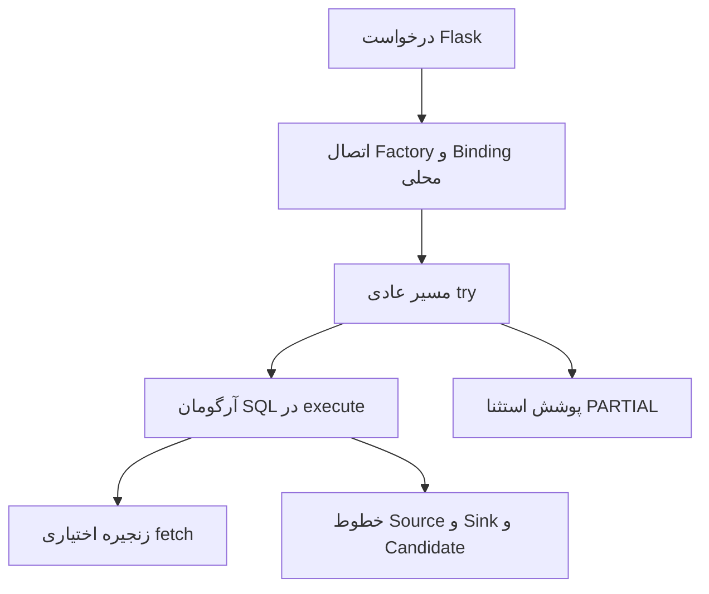
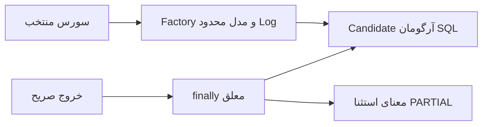
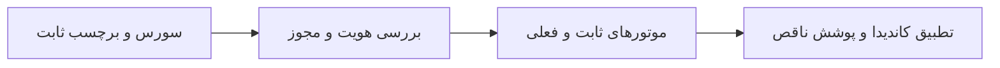
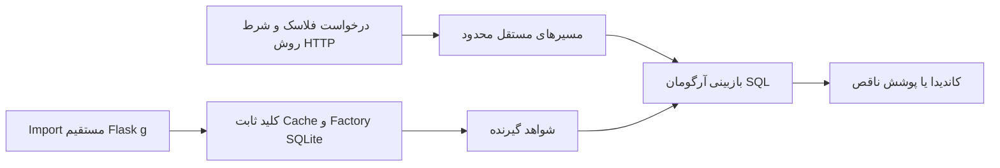

# تحلیل SQL برنامه واقعی (#111)

[English](real-app-sql.md)

بسته Python SQL نسخه ۶، شناسه ثابت PY.FLASK.SQL.REQUEST_FLOW / API-07. تابع محلی بدون آرگومان که اتصال SQLite را با مسیر نام‌دار برمی‌گرداند، مسیر عادی try/else/finally و زنجیره مستقیم execute/fetchone یا fetchall مدل می‌شوند. کد هدف و پایگاه داده اجرا نمی‌شوند. تغییر صریح اعضای ماژول Importشده تحلیل را نامعتبر می‌کند. پارامترهای متصل از متن SQL جدا می‌مانند. نتیجه انتساب Query ناشناخته است، نه Source جدید. مدل مسیر عادی PARTIAL است؛ Handler استثنا، finally پس از return/raise، Dispatch دلخواه و هویت واقعی ماژول اثبات نمی‌شوند.



تست‌ها: Factory نام‌دار، تغییر صریح و Shadowing، SQL پارامتری، زنجیره ناشناخته و مرز return. جفت EyalSec که قبلاً مشاهده شد اکنون رگرسیون است، نه Holdout تازه. CI موتور ثابت #107 را با موتور فعلی روی سورس و محدوده یکسان مقایسه می‌کند؛ لاگ‌های تاریخی حفظ می‌شوند. مجموعه مستقل تازه و بزرگ‌تر قبل از بستن #111 لازم است. ادعای انطباق یا Exploit وجود ندارد.


## مجموعه آزمایشگاهی خارجی مستقل از توسعه v6

آزمایشگاه عمومی BackdoorAli/sql-injection-demo با Revision و Hash فایل ثابت، هر هفت Sink اجرای SQL در Routeهای نسخه ناامن/امن توصیف‌شده توسط نویسنده را بررسی می‌کند (۲ مثبت، ۵ منفی؛ Initializer پایگاه داده خارج است). سورس موقت و فقط برای تحلیل خوانده می‌شود؛ کد و تست نویسنده اجرا یا بازنشر نمی‌شوند. هر دو موتور ثابت v5 و v6 با ورودی/محدوده یکسان مقایسه می‌شوند؛ Miss ناقص حفظ می‌شود. این تعداد و برچسب سطح نسخه برای نتیجه عمومی یا پذیرش نهایی #111 کافی نیست.

```bash
python scripts/benchmark_semantic_context.py --external-lab
```

## پیگیری نسخه ۷ (#111)

Import مطلق تابع Factory بدون آرگومان از سورس ریشه Component منتخب حل می‌شود، نه sys.path واقعی. فراخوانی print بدون Shadowing روی مقادیر شناخته‌شده مسیر را قطع نمی‌کند؛ اثر Formatting و IO مدل نمی‌شود. مسیر return و raise صریح می‌تواند به finally معلق برسد بدون اجرای ادامه عادی غیرقابل دسترس؛ raise با Handler میانی خارج مدل است. همه مسیرها PARTIAL هستند. تست‌ها پارامتر امن، Shadowing، تغییر ماژول و finally تودرتو را پوشش می‌دهند. آزمایشگاه خارجی قبلی رگرسیون است، نه مجموعه مستقل تازه؛ ادعای پوشش عمومی Exception یا کل برنامه وجود ندارد.



## زوج‌های مستقل مسیرهای HTTP برای SQL (#111)

دو آزمایشگاه آموزشی خارجی با مجوز MIT (JimProKing/sql-injection-lab و MariamKhubashvilii/break-it-fix-it)، با نسخه و شناسه Blob ثابت، شامل چهار محل مثبت و چهار محل منفی اجرای SQL. موتورهای ثابت v6 و v7 و موتور فعلی با بایت‌های یکسان و محدوده یکسان مقایسه می‌شوند. هر نسخه برنامه جداگانه اسکن می‌شود. فقط مسیرهای متناظر توصیف‌شده توسط مؤلف برچسب دارند؛ سایر محل‌ها بدون برچسب‌اند. کد و تست هدف اجرا نمی‌شوند و ادعای دقت در محیط عملیاتی نداریم. نتیجه در انتظار CI است؛ موارد ناقص حفظ می‌شوند. این مرحله صرفاً گزارش‌گیری است و پذیرش #111 محسوب نمی‌شود.



اجرا: `python scripts/benchmark_independent_sql.py`. بازگشت: Revert همین تغییر Benchmark؛ رفتار اسکنر تغییر نکرده است.

## توسعه Cache در Context فلاسک (نسخه ۸، #111)

خط مبنای CI در #120 (45776574343) هر چهار محل مثبت را از دست داد (TP=0، TN=4، FP=0، FN=4؛ هر ۸ مورد PARTIAL). مدل محلی محدود یک Alias مستقیم از `flask.g`، شرط نبود کلید ثابت، ذخیره اتصال مستقیم SQLite در همان کلید، تنظیم اختیاری و دقیق SQLite Row و بازگرداندن همان فیلد را می‌شناسد. Import مبهم، نوشتن صریح متعارض در Context و ارجاع مستقیم پشتیبانی‌نشده به Context رد می‌شوند. شرط برابری، نابرابری و عضویت `request.method` با مقادیر ثابت در هر دو مسیر بررسی می‌شود؛ دسترسی واقعی مسیر در اجرا اثبات نمی‌شود. مالکیت Context بین ماژول‌ها، تغییر پویای رفتار، Teardown، استثناهای دلخواه یا اجرای برنامه تضمین نشده است. شواهد Candidate صرفاً از سورس به دست می‌آیند و پوشش PARTIAL باقی می‌ماند. شناسه قوانین ثابت می‌ماند.



تست‌های مصنوعی شامل Alias، اتصال Cacheشده، زنجیره execute/fetch، شرط روش ثابت، نمونه منفی پارامتری، Shadowing، تغییر متعارض، کلید متفاوت و گیرنده ناشناخته هستند. CI اولیه 45776952724 دو شکست مورد انتظار ثبت کرد؛ نتیجه پیاده‌سازی در انتظار CI است. مجموعه تست آفلاین و `python scripts/benchmark_independent_sql.py` را اجرا کنید؛ هشت نمونه شناخته‌شده فقط Regression هستند. بازگشت با Revert همین تغییر محدود اسکنر.
