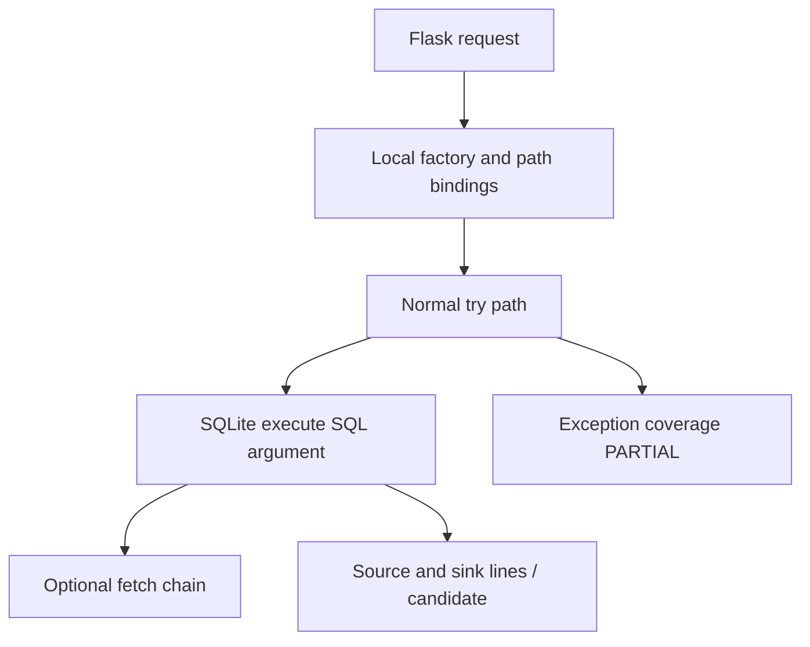

# Real application SQL flow (#111)

[فارسی](real-app-sql-FA.md)

Python SQL pack v6, stable rule PY.FLASK.SQL.REQUEST_FLOW / API-07. Models zero-argument local SQLite factory returning connect(named_path), normal try/else/finally paths and direct execute/fetchone or fetchall chains. No database or target execution. Explicit mutation of imported module attributes invalidates analysis. Bound parameters remain separate from SQL text. Assigned query results are unknown, not new request sources. Normal-path modeling is PARTIAL: exception handlers, finally after return/raise, arbitrary dispatch and runtime module identity are not established.

Tests: named factory, explicit mutation and shadowing negatives, bound SQL, unknown chain and return boundary. The previously exposed EyalSec pair is now a regression, not a fresh holdout. CI compares the frozen #107 scanner against current scanner on identical pinned source and scope; historic logs are retained. A larger newly labeled independent cohort remains required before #111 closure. No compliance or exploit claim.
