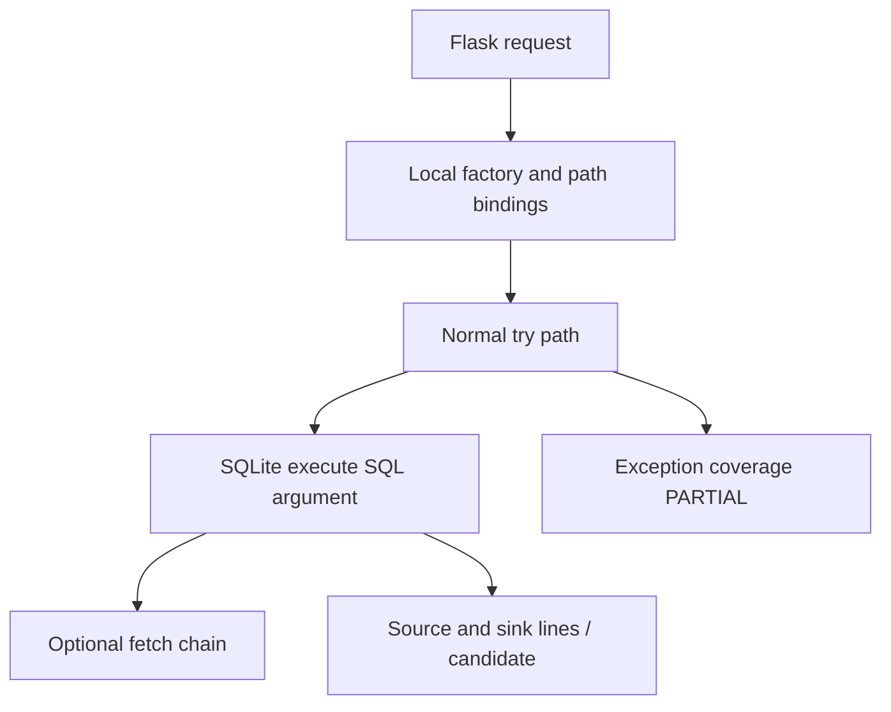
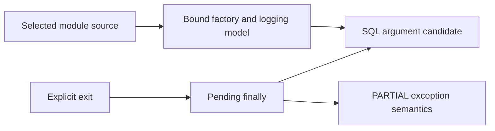
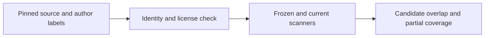

# Real application SQL flow (#111)

[فارسی](real-app-sql-FA.md)

Python SQL pack v6, stable rule PY.FLASK.SQL.REQUEST_FLOW / API-07. Models zero-argument local SQLite factory returning connect(named_path), normal try/else/finally paths and direct execute/fetchone or fetchall chains. No database or target execution. Explicit mutation of imported module attributes invalidates analysis. Bound parameters remain separate from SQL text. Assigned query results are unknown, not new request sources. Normal-path modeling is PARTIAL: exception handlers, finally after return/raise, arbitrary dispatch and runtime module identity are not established.



Tests: named factory, explicit mutation and shadowing negatives, bound SQL, unknown chain and return boundary. The previously exposed EyalSec pair is now a regression, not a fresh holdout. CI compares the frozen #107 scanner against current scanner on identical pinned source and scope; historic logs are retained. A larger newly labeled independent cohort remains required before #111 closure. No compliance or exploit claim.


## Additional external lab cohort, frozen before evaluation

The pinned public BackdoorAli/sql-injection-demo lab covers all seven SQL execution sinks in the author's insecure/safe route versions (2 positive, 5 negative; DB initializer excluded). Sources are fetched transiently for analysis only; neither application nor author tests are executed or redistributed. Frozen v5 and v6 engines use identical inputs and scope; partial misses are retained. This sample size and version-level labeling are insufficient for general accuracy or final #111 acceptance.

```bash
python scripts/benchmark_semantic_context.py --external-lab
```

## v7 follow-up (#111)

Source-only absolute from-imports of zero-argument SQLite connection factories are resolved under the selected component root, never through runtime sys.path. Explicit unshadowed builtin print calls over recognized values no longer terminate a path; possible formatting/IO effects are not modeled. Explicit return and raise paths can reach pending finally blocks without executing unreachable normal tails; raise through an intervening handler remains unsupported. All these paths remain PARTIAL. Tests include safe parameters, shadowing, module mutation and nested finally. Existing external lab is a regression, not a fresh cohort; no generic exception or whole-program coverage claim.



## Independent matched route pairs (#111)

Two external MIT teaching labs (JimProKing/sql-injection-lab and MariamKhubashvilii/break-it-fix-it), pinned revisions and blob identities, four positive and four negative SQL sinks. Compare frozen v6, frozen v7 and current scanner using identical source bytes and scope. Each application version is scanned separately. Author-described matched routes only; other sinks are unlabeled. No target code/tests executed, no production accuracy claim. Results pending CI; retain partial misses. This is a report-only increment, not #111 acceptance.



Run: `python scripts/benchmark_independent_sql.py`. Rollback: revert this benchmark-only change; scanner behavior is unchanged.
