# Real application SQL flow (#111)

[فارسی](real-app-sql-FA.md)

Python SQL pack v6, stable rule PY.FLASK.SQL.REQUEST_FLOW / API-07. Models zero-argument local SQLite factory returning connect(named_path), normal try/else/finally paths and direct execute/fetchone or fetchall chains. No database or target execution. Explicit mutation of imported module attributes invalidates analysis. Bound parameters remain separate from SQL text. Assigned query results are unknown, not new request sources. Normal-path modeling is PARTIAL: exception handlers, finally after return/raise, arbitrary dispatch and runtime module identity are not established.

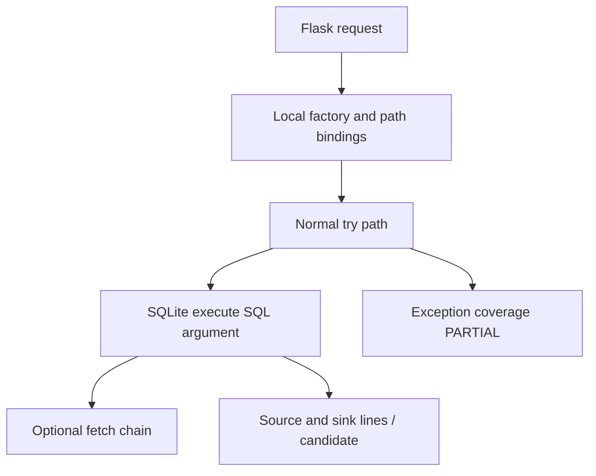

Tests: named factory, explicit mutation and shadowing negatives, bound SQL, unknown chain and return boundary. The previously exposed EyalSec pair is now a regression, not a fresh holdout. CI compares the frozen #107 scanner against current scanner on identical pinned source and scope; historic logs are retained. A larger newly labeled independent cohort remains required before #111 closure. No compliance or exploit claim.


## Additional external lab cohort, frozen before evaluation

The pinned public BackdoorAli/sql-injection-demo lab covers all seven SQL execution sinks in the author's insecure/safe route versions (2 positive, 5 negative; DB initializer excluded). Sources are fetched transiently for analysis only; neither application nor author tests are executed or redistributed. Frozen v5 and v6 engines use identical inputs and scope; partial misses are retained. This sample size and version-level labeling are insufficient for general accuracy or final #111 acceptance.

```bash
python scripts/benchmark_semantic_context.py --external-lab
```

## v7 follow-up (#111)

Source-only absolute from-imports of zero-argument SQLite connection factories are resolved under the selected component root, never through runtime sys.path. Explicit unshadowed builtin print calls over recognized values no longer terminate a path; possible formatting/IO effects are not modeled. Explicit return and raise paths can reach pending finally blocks without executing unreachable normal tails; raise through an intervening handler remains unsupported. All these paths remain PARTIAL. Tests include safe parameters, shadowing, module mutation and nested finally. Existing external lab is a regression, not a fresh cohort; no generic exception or whole-program coverage claim.

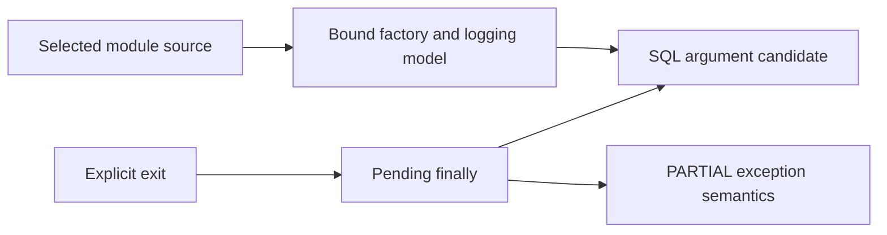

## Independent matched route pairs (#111)

Two external MIT teaching labs (JimProKing/sql-injection-lab and MariamKhubashvilii/break-it-fix-it), pinned revisions and blob identities, four positive and four negative SQL sinks. Compare frozen v6, frozen v7 and current scanner using identical source bytes and scope. Each application version is scanned separately. Author-described matched routes only; other sinks are unlabeled. No target code/tests executed, no production accuracy claim. Results pending CI; retain partial misses. This is a report-only increment, not #111 acceptance.


Run: `python scripts/benchmark_independent_sql.py`. Rollback: revert this benchmark-only change; scanner behavior is unchanged.

## Flask context-cache follow-up (v8, #111)

The #120 CI baseline (45776574343) missed all four positive matched-route sinks (TP=0, TN=4, FP=0, FN=4; 8/8 PARTIAL). The bounded local model recognizes a single directly imported `flask.g` alias, a literal missing-key guard, a direct SQLite connection stored under that key, optional exact SQLite Row setup, and return of the same slot. Ambiguous imports, explicit competing context writes and unsupported bare context references fail closed. Literal `request.method` equality/inequality and membership guards are modeled along both paths, without runtime reachability claims. No cross-module context ownership, monkey-patch, teardown, arbitrary exception or application execution guarantee. Source-only candidate evidence remains PARTIAL. Stable rule IDs retained.

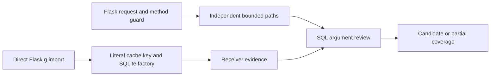

Synthetic tests cover aliases, cached connections, execute/fetch, literal guards, parameterized negatives, shadowing, mutation, mismatched keys and unknown receivers. Test-first CI 45776952724 recorded two expected failures; implementation results pending. Run the offline suite and `python scripts/benchmark_independent_sql.py`; the eight exposed cases are regression only. Rollback by reverting this bounded scanner change.

## Post-v8 external boundary evaluation (#111)

PR #121 CI 45777183558: 158/158 Python 3.12 tests and six required checks; previous eight-site cohort TP4 TN4 FP0 FN0 (previously TP0 TN4 FP0 FN4), all PARTIAL; two unlabeled candidates. Main CI 45777504571 succeeded. This is regression evidence, not a fresh holdout.

Freeze v8 at 540fcd3 before evaluating three further MIT teaching labs. The 14 distinct labeled execute sites are split into direct HTTP route (4 positive, 3 negative) and interprocedural source/sink boundary (2 positive, 5 negative). Three callers reaching one shared sink count once. Separate app versions retain their own component-root import layout. Labels and blob hashes fixed before evaluation; no source normalization, source or test execution, production claim or statistical representativeness. Preserve parse failures and partial misses, list unlabeled candidate locations, report separate denominators. Previously inspected sources are not a blind holdout. The scanner itself is unchanged.

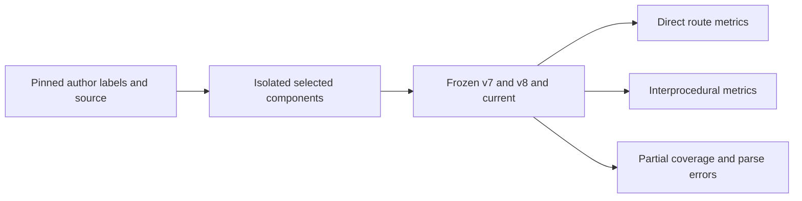

Run: `python scripts/benchmark_external_sql_boundaries.py`. Three offline evaluator tests cover duplicate labels, raw bytes, partial misses, unlabeled hits and wrong selection. Execution pending CI. Revert benchmark-only change to roll back. No #111 closure or release decision.

## Python source coverage and JSON routes (v9, #111)

#122 CI 45777804891 found zero parsed files in the direct cohort (UTF-8 BOM), and all six positive cases across boundaries were missed. The scanner removes only one leading decoded BOM before AST parsing, preserving raw artifact identities and line numbering; other syntax failures remain PARTIAL. The evaluator retains historical totals and separately reports parse-blocked cases and metrics for fully parsed units (null if none). The bounded local model adds no-argument Flask request.get_json() optionally followed by or an empty dict, literal string key reads, exact local SQLite connection factories with optional Row setup and literal os.path join/dirname, and zero-argument locally constructed Flask app factories with restricted setup and direct route declarations. No arbitrary JSON mutations, unknown calls or blacklist sanitizer summaries are inferred. Cross-module data flow, exception paths and runtime identity remain unsupported. All new semantic paths are review candidates, not safety proof.

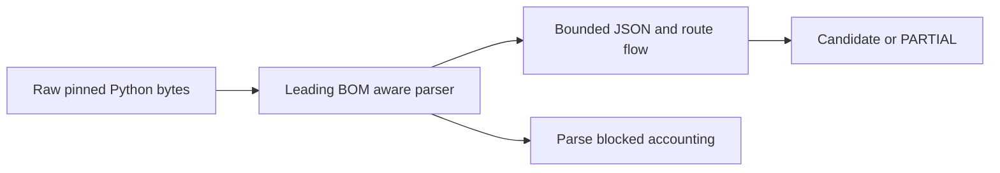

Tests: BOM line preservation and duplicate BOM rejection, JSON source/parameter binding and mutations, factory provenance and shadowing, evaluator parse-blocked separation. Run offline suite and `python scripts/benchmark_external_sql_boundaries.py`. #123 results pending; revert scanner/evaluator change for rollback.

## Bounded literal string transformation (v10, #111)

PR #123 CI 45783100817: 161/161 scanner tests, six evaluator tests, six successful checks; direct route TP3 TN3 FP0 FN1, seven parse-blocked cases reduced to zero; interprocedural TP0 TN5 FP0 FN2; all 14 PARTIAL. Earlier regression cohorts retained. The remaining direct miss crosses a local literal replacement loop. v10 recognizes an undecorated one-positional-parameter function with optional docstring and exact falsy-input early return, a distinct accumulator assigned from the parameter, one loop over 1–16 literal nonempty strings (128 characters maximum each), one accumulator.replace(loop_variable, literal) assignment, and return of the accumulator. No dynamic lists, external calls, default arguments, rebindings or shadowed calls are inferred. Source lines survive the transformation as review candidates. Replacement is not accepted as a sanitizer or runtime type proof. Existing constant/parameterized negatives remain separate. Coverage is PARTIAL. Generic cross-module flow and exception paths remain outside this change.

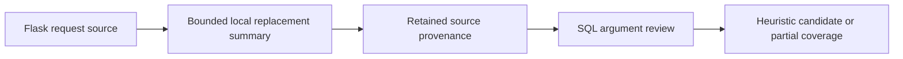

Tests cover request form/JSON source, literal loop, constant and parameterized negatives, unknown replacements, invalid loop shapes and shadowing. Run offline tests and `python scripts/benchmark_external_sql_boundaries.py`. #124 implementation results pending CI; rollback by reverting the bounded scanner change. Exposed cohort is regression, not fresh evaluation.

## Bounded one-hop interprocedural sink evidence (v11, #111)

PR #124 CI 45821821192: 164 scanner tests, 6 evaluator tests, 6 required checks; direct TP4 TN3 FP0 FN0, interprocedural TP0 TN5 FP0 FN2. v11 adds symbolic parameter-to-sink summaries and path-local substitution at direct call sites, within a selected component only. Direct from-imports, matching relative/script fallback without competing root module, and local calls; exact positional arity, no dynamic dispatch, default arguments, recursive expansion or return-value inference. Unknown calls stop a path. Bounded prefix slices and empty lists in caller analysis, exact SQLite Row assignment in callee paths. Preserve separate source and call locations and actual sink file/line; cap locations at 16, eligible source files and summaries at 128, call evidence at 256 per caller. All evidence remains heuristic and PARTIAL. No target code executed; no whole-program or exception reachability claim. Test positives and negatives for imports, shadowing, scope, receiver mutation and binding parameters. Results pending CI.

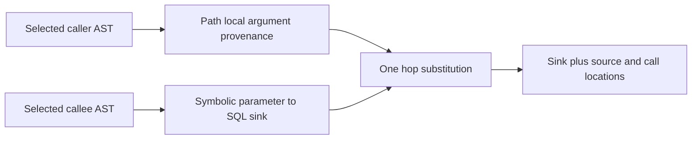

Run the offline suite and `python scripts/benchmark_external_sql_boundaries.py`. Revert the bounded scanner increment to roll back.

## Bounded exception control flow (v12, #111)

PR #126 CI 45822446274 and main CI 45822620489 succeeded; direct TP4 TN3 and interprocedural TP2 TN5, zero labeled FP/FN, all 14 PARTIAL. v12 uses internal continuation markers to dispatch known explicit builtin/SQLite raises to the first matching handler (including tuples and bare except), preserve nested finally, resume/rethrow and let abrupt completion in cleanup override the earlier exit. Else is only a normal-body continuation. Exception binding is cleared on handler exit. Known execute/fetch calls explore modeled possible SQLite error classes before assignment, not actual runtime failure probabilities. Shadowed/unknown exception class, arbitrary calls, exception causes and dynamic dispatch remain explicitly unmodeled; budgets retained. No proof of reachability, exploit or whole-program coverage.

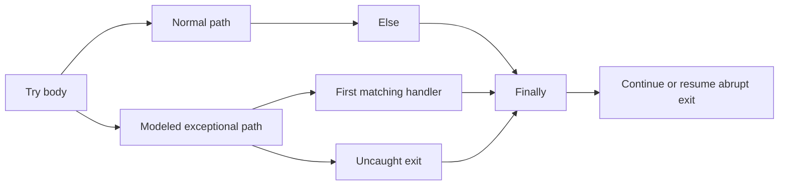

Tests: handler order, else/finally, nested rethrow, return override, exception binding cleanup, SQLite possible error and parameterized negatives. CI pending; revert bounded scanner change to roll back.

## Post-v12 independent matched evaluation (#111)

Freeze v12 at da83968 (main CI 45823249614 passed) before evaluation. Six external MIT teaching labs, seven matched positive and seven matched negative execute sites; explicit repository revisions, blob identities and route labels fixed before running. Compare frozen v10 and v12 and current on identical source-only inputs. Report imported receiver and local route boundaries separately, parsed-unit and historical no-candidate metrics, unlabeled candidates, partial coverage and timing. No cherry-picking based on execution outcomes; other routes are unlabeled. Source inspection is not blind validation, target applications and tests are never executed, no production accuracy claim. Two offline manifest/metrics tests; run `python scripts/benchmark_final_sql_holdout.py`. Results pending; no #111 closure until misses and acceptance reviewed. Benchmark-only rollback by revert.

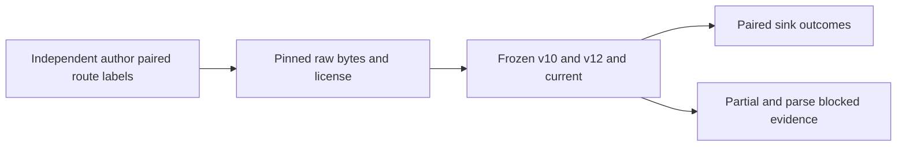

## Post-v12 receiver and transformation regressions (v13, #111)

Independent CI 45823731266 on frozen v12: TP2 TN7 FP0 FN5, all 14 PARTIAL, zero parse-blocked. Five misses across four patterns: imported Row-configured SQLite factories, close/reopen and empty list, direct hashlib digest chain, and seeded connection factory. v13 adds source-only imported Row and bounded literal seed factory summaries (no target code executed); exact close invalidates all live SQLite receiver aliases conservatively until explicit re-establishment; empty list known; direct unshadowed hashlib digest chains retain source provenance, never classify as a SQL sanitizer. Literal seed setup requires exact connection/optional Row, one to four constant execute/executemany calls, bounded literals and same returned receiver. Dynamic setup, unknown calls, mutation and closed receivers are not inferred. Coverage PARTIAL remains, not a proof of safety or runtime behavior.

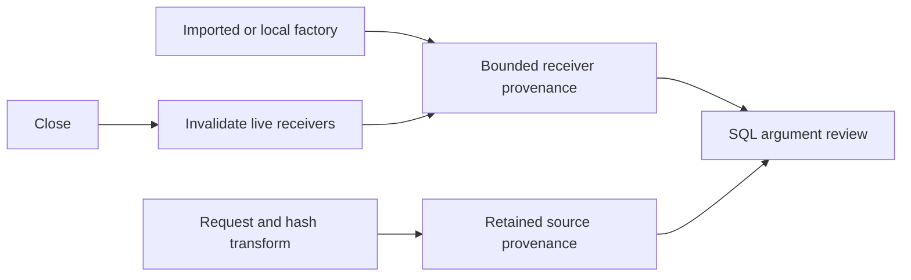

Run offline tests and `python scripts/benchmark_final_sql_holdout.py`; prior frozen evidence retained. New tests cover mutations, dynamic seed setup, stale receiver alias, parameterized negatives and digest provenance. Implementation CI pending; revert this bounded scanner increment for rollback. New cohort becomes regression evidence after tuning.

## #111 bounded acceptance evidence (v13)

The acceptance is for the explicitly bounded Python Flask/SQLite candidate engine, not universal static detection or production verification. The following results were independently retrieved from CI logs and the source-only benchmark fixtures were never executed.

| Cohort | Current TP | TN | FP | FN | Evidence |
| --- | ---: | ---: | ---: | ---: | --- |
| Original isolated OWASP (helpers omitted) | 0 | 11 | 0 | 5 | 16/16 PARTIAL; preserved limitation |
| OWASP contextual | 5 | 11 | 0 | 0 | CI 45824199394 |
| EyalSec paired | 1 | 1 | 0 | 0 | CI 45824199394 |
| BackdoorAli lab | 2 | 5 | 0 | 0 | CI 45824199394 |
| Matched route pairs | 4 | 4 | 0 | 0 | CI 45824199394 |
| Boundary direct | 4 | 3 | 0 | 0 | CI 45824199394 |
| Boundary interprocedural | 2 | 5 | 0 | 0 | CI 45824199394 |
| Post-v12 matched pairs | 7 | 7 | 0 | 0 | CI 45824199394 |

Frozen post-v12 baseline 45823731266 was TP2 TN7 FP0 FN5. v13 corrected all five exposed misses; the cohort is now regression evidence, not an untouched holdout. All contextual/external cases remain PARTIAL and the isolated five misses are deliberately retained as misses, never reported as successful detection. Do not pool overlapping cohorts into a production accuracy claim. Original labels and pinned source identities retained. PR #129 exact-head CI 45824199394 (174 scanner and 8 evaluator tests, six checks), main merge c349b99 CI 45824445580 six checks. Earlier PRs #112, #117, #120–#124, #126–#129 and linked CI runs preserve development history.

Acceptance cross-check: same-module named/Row/context/seed factories and bounded imported receiver evidence; normal and modeled exception paths and execute/fetch chains; generalized positive/negative tests; one-hop source/call/sink provenance; externally authored frozen cohorts with fixed labels, meaningful positive/negative denominators, identical inputs/config and documented partial misses; paired EN/FA architecture and tests; six checks and main evidence. The new CI regression gate rejects labeled FP/FN in exposed contextual cohorts, denominator/schema drift and incomplete parsing; isolated context limitation remains explicitly separate. Run the offline tests and gate on the JSON reports created by CI. No independent human reviewer or runtime exploit verification is claimed. Arbitrary dynamic dispatch, missing source context, multi-hop flow and arbitrary exceptions are outside the bounded model. The release decision, broader benchmark and residual-risk review remain #105/#37, not a silent assertion of safety. No release is created here.

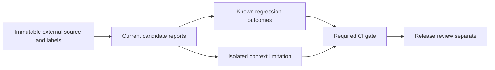
