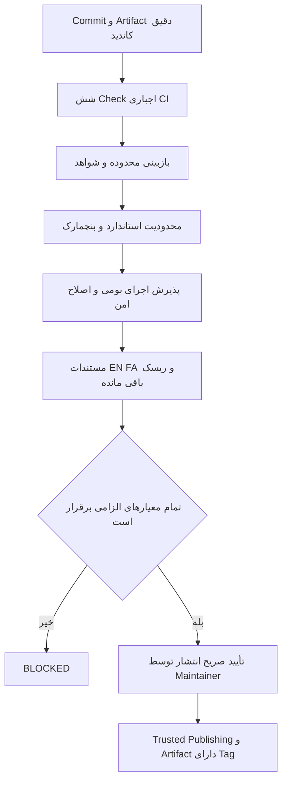

# معیار کیفیت انتشار v1.3.0 (#105)

[English](release-quality-gate.md)

**تصمیم: BLOCKED — نقطه بررسی توسعه، ۲۰۲۶-۱۱-۲۶.** این سند موجودی شواهد است، نه گواهی انطباق، تأیید انتشار یا فرمان انتشار خودکار. خط مبنای بررسی: Commit شاخه main به شناسه `8365bdee0f1e9ac6f281a586d6b332ceec912ee6`. CI تاریخی، شواهد نسخه کاندید آینده محسوب نمی‌شود.

| معیار | شواهد جاری | پذیرش باقی‌مانده |
|---|---|---|
| استانداردها (#97/#36) | ۱۴۵ کنترل، ۱۰۳ نگاشت جزئی، ۴۲ بدون نگاشت؛ ۱۷۱ شناسه رسمی، ۲۵۹ رابطه؛ [نگاشت](standards-crosswalk-FA.md) و [CI #255](https://github.com/omidkh68/security-guardian/actions/runs/45907634603). | بازبینی مستقل معنایی و محدودیت‌های باقی‌مانده؛ بدون ادعای انطباق. |
| تشخیص (#96/#37) | [بسته شواهد](independent-benchmark-FA.md)، [CI #257](https://github.com/omidkh68/security-guardian/actions/runs/45908180910)؛ تفکیک مجموعه‌های مصنوعی شناخته‌شده و خارجی، حفظ Missهای ناقص. | Holdout تازه و کور و ارزیابی مجاز Agent؛ بدون امتیاز تجمیعی. |
| مقایسه ابزار (#34/#37) | مقایسه CodeQL و Semgrep در وضعیت NOT_RUN. قرارداد خروجی Semgrep ادغام شده (#143). | تطبیق زبان، بایت ورودی، برچسب، محدوده Rule، نسخه، زمان اجرا و مخرج‌ها؛ ثبت قابلیت‌های در دسترس نبودنی. |
| اصلاح امن (#35) | [اجراکننده راستی‌آزمایی](verification-runner-FA.md)؛ شواهد واقعی نمونه Flask، Angular SSR و NestJS در CI؛ Receipt محدوده‌دار. | تأیید مستقل اصلاح نیست؛ شواهد مشتری یا Production وجود ندارد. |
| اجرای بومی (#32/#5) | [ورودی آفلاین Codex](https://github.com/omidkh68/security-guardian/actions/runs/45906929115)؛ [چرخه Marketplace محلی Claude](https://github.com/omidkh68/security-guardian/actions/runs/45909119045) روی Head قبلی #147. | Loader احرازشده، audit/verify و انتقال وضعیت Finding؛ ادغام #141 و CI آخر #147. |
| مستندات (#54) | [CI #260](https://github.com/omidkh68/security-guardian/actions/runs/45909036104): ۵۷ جفت، ۴۵۰ مقصد نسبی، ۱۱۴ بلوک Mermaid، بدون خطای Audit محدود. | رندر کامل، بازبینی مستقل ترجمه، همگام‌سازی پس از #32. |
| مخزن و توزیع (#4/#46/#64/#6/#30) | Ruleset فعال با شش Check؛ تست آفلاین نصب/npm. | گزارش خصوصی آسیب‌پذیری، Topics، شواهد جلوگیری از Merge PR غیردرفت ناموفق، Trusted Publisher و انتشار واقعی Registry/Tag؛ CI کاندید و تصمیم ریسک باقی‌مانده. |

## بررسی سازگاری و زنجیره تأمین

موارد زیر تحت #105 پیگیری می‌شوند؛ هیچ‌کدام برای تعویق بی‌صدا تأیید نشده‌اند. منابع رسمی مشخص می‌کنند چه چیزی بررسی شود، نه اینکه انطباق حاصل شده باشد. هر ردیف پیش از انتشار نیازمند پیاده‌سازی/تست یا تعویق صریح مورد تأیید Maintainer با علت، مسئول و Issue پیگیری است.

| مورد / مرجع | وضعیت جاری | شواهد پذیرش لازم |
|---|---|---|
| SARIF 2.1.0 ([OASIS](https://docs.oasis-open.org/sarif/sarif/v2.1.0/sarif-v2.1.0.html)) | NOT_IMPLEMENTED / سازگاری NOT_RUN | خروجی حذف اطلاعات حساس معتبر از نظر Schema؛ Rule ID ثابت، مسیر نسبی محدود، Fingerprint؛ Import در مصرف‌کننده سازگار؛ Candidate نه تأیید. |
| CVSS 4.0 ([FIRST](https://www.first.org/cvss/v4.0/specification-document)) | NOT_IMPLEMENTED | بردار معیار با توجیه صریح، اعتبارسنجی امتیاز و رفتار کمبود Context؛ شدت Handbook خودکار تبدیل نشود. |
| SBOM ([SPDX](https://spdx.dev/use/specifications/) / [CycloneDX](https://cyclonedx.org/specification/overview/)) | شواهد SBOM انتشار NOT_RUN | انتخاب قالب/نسخه، تولید از Artifact توزیع واقعی، اعتبارسنجی Schema و موجودی اجزا/بسته، اتصال Digest؛ تفکیک وابستگی اختیاری. |
| [OpenSSF Scorecard](https://scorecard.dev/) | NOT_RUN | اجرای واقعی تاریخ‌دار، نسخه ابزار، Revision مخزن، نتیجه هر Check و ریسک باز؛ امتیاز از قوانین شاخه استنباط نشود. |
| SLSA ([Build Track نسخه ۱٫۲](https://slsa.dev/spec/v1.2/build-track-basics)) | اعتبارسنجی منشأ Artifact در وضعیت NOT_RUN | تولید و اعتبارسنجی Attestation برای Artifact دقیق انتشار و Builder/Source مورد اعتماد؛ سطح SLSA صرفاً از npm OIDC استنباط نشود. |

## فرایند تصمیم انتشار

RFC مادر باز یا نبود شواهد، PASS محسوب نشود. SHA کاندید نهایی، نسخه، Hash، همه Checkهای اجباری، یکپارچگی Artifact، ادعاهای عمومی، یافته‌های باز و تعویق‌های تأییدشده دوباره بررسی شوند. تا بازبینی و مجوز این Gate، انتشار عمومی، Tag یا Release انجام نشود. این سند هیچ معیار اجباری را حذف نمی‌کند.
