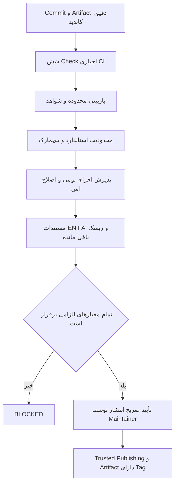

# معیار کیفیت انتشار v1.3.0 (#105)

[English](release-quality-gate.md)

**تصمیم: BLOCKED — نقطه بررسی توسعه، ۲۰۲۶-۱۱-۲۶.** این سند موجودی شواهد است، نه گواهی انطباق، تأیید انتشار یا فرمان انتشار خودکار. خط مبنای بررسی: Commit شاخه main به شناسه `8365bdee0f1e9ac6f281a586d6b332ceec912ee6`. CI تاریخی، شواهد نسخه کاندید آینده محسوب نمی‌شود.

| معیار | شواهد جاری | پذیرش باقی‌مانده |
|---|---|---|
| استانداردها (#97/#36) | ۱۴۵ کنترل، ۱۰۳ نگاشت جزئی، ۴۲ بدون نگاشت؛ ۱۷۱ شناسه رسمی، ۲۵۹ رابطه؛ [نگاشت](standards-crosswalk-FA.md) و [CI #255](https://github.com/omidkh68/security-guardian/actions/runs/45907634603). | بازبینی مستقل معنایی و محدودیت‌های باقی‌مانده؛ بدون ادعای انطباق. |
| تشخیص (#96/#37) | [بسته شواهد](independent-benchmark-FA.md)، [CI #257](https://github.com/omidkh68/security-guardian/actions/runs/45908180910)؛ تفکیک مجموعه‌های مصنوعی شناخته‌شده و خارجی، حفظ Missهای ناقص. | Holdout تازه و کور و ارزیابی مجاز Agent؛ بدون امتیاز تجمیعی. |
| مقایسه ابزار (#34/#37) | مقایسه CodeQL و Semgrep در وضعیت NOT_RUN. قرارداد خروجی Semgrep ادغام شده (#143). | تطبیق زبان، بایت ورودی، برچسب، محدوده Rule، نسخه، زمان اجرا و مخرج‌ها؛ ثبت قابلیت‌های در دسترس نبودنی. |
| اصلاح امن (#35) | [اجراکننده راستی‌آزمایی](verification-runner-FA.md)؛ شواهد واقعی نمونه Flask، Angular SSR و NestJS در CI؛ Receipt محدوده‌دار. | تأیید مستقل اصلاح نیست؛ شواهد مشتری یا Production وجود ندارد. |
| اجرای بومی (#32/#5) | [ورودی آفلاین Codex](https://github.com/omidkh68/security-guardian/actions/runs/45906929115)؛ [چرخه Marketplace محلی Claude](https://github.com/omidkh68/security-guardian/actions/runs/45909119045) روی Head قبلی #147. | Loader احرازشده، audit/verify و انتقال وضعیت Finding؛ ادغام #141 و CI آخر #147. |
| مستندات (#54) | [CI #260](https://github.com/omidkh68/security-guardian/actions/runs/45909036104): ۵۷ جفت، ۴۵۰ مقصد نسبی، ۱۱۴ بلوک Mermaid، بدون خطای Audit محدود. | رندر کامل، بازبینی مستقل ترجمه، همگام‌سازی پس از #32. |
| مخزن و توزیع (#4/#46/#64/#6/#30) | Ruleset فعال با شش Check؛ تست آفلاین نصب/npm. | گزارش خصوصی آسیب‌پذیری، Topics، شواهد جلوگیری از Merge PR غیردرفت ناموفق، Trusted Publisher و انتشار واقعی Registry/Tag؛ CI کاندید و تصمیم ریسک باقی‌مانده. |

## بررسی سازگاری و زنجیره تأمین

موارد زیر تحت #105 پیگیری می‌شوند؛ هیچ‌کدام برای تعویق بی‌صدا تأیید نشده‌اند. منابع رسمی مشخص می‌کنند چه چیزی بررسی شود، نه اینکه انطباق حاصل شده باشد. هر ردیف پیش از انتشار نیازمند پیاده‌سازی/تست یا تعویق صریح مورد تأیید Maintainer با علت، مسئول و Issue پیگیری است.

| مورد / مرجع | وضعیت جاری | شواهد پذیرش لازم |
|---|---|---|
| SARIF 2.1.0 ([OASIS](https://docs.oasis-open.org/sarif/sarif/v2.1.0/sarif-v2.1.0.html)) | NOT_IMPLEMENTED / سازگاری NOT_RUN | خروجی حذف اطلاعات حساس معتبر از نظر Schema؛ Rule ID ثابت، مسیر نسبی محدود، Fingerprint؛ Import در مصرف‌کننده سازگار؛ Candidate نه تأیید. |
| CVSS 4.0 ([FIRST](https://www.first.org/cvss/v4.0/specification-document)) | NOT_IMPLEMENTED | بردار معیار با توجیه صریح، اعتبارسنجی امتیاز و رفتار کمبود Context؛ شدت Handbook خودکار تبدیل نشود. |
| SBOM ([SPDX](https://spdx.dev/use/specifications/) / [CycloneDX](https://cyclonedx.org/specification/overview/)) | شواهد SBOM انتشار NOT_RUN | انتخاب قالب/نسخه، تولید از Artifact توزیع واقعی، اعتبارسنجی Schema و موجودی اجزا/بسته، اتصال Digest؛ تفکیک وابستگی اختیاری. |
| [OpenSSF Scorecard](https://scorecard.dev/) | NOT_RUN | اجرای واقعی تاریخ‌دار، نسخه ابزار، Revision مخزن، نتیجه هر Check و ریسک باز؛ امتیاز از قوانین شاخه استنباط نشود. |
| SLSA ([Build Track نسخه ۱٫۲](https://slsa.dev/spec/v1.2/build-track-basics)) | اعتبارسنجی منشأ Artifact در وضعیت NOT_RUN | تولید و اعتبارسنجی Attestation برای Artifact دقیق انتشار و Builder/Source مورد اعتماد؛ سطح SLSA صرفاً از npm OIDC استنباط نشود. |

## فرایند تصمیم انتشار

RFC مادر باز یا نبود شواهد، PASS محسوب نشود. SHA کاندید نهایی، نسخه، Hash، همه Checkهای اجباری، یکپارچگی Artifact، ادعاهای عمومی، یافته‌های باز و تعویق‌های تأییدشده دوباره بررسی شوند. تا بازبینی و مجوز این Gate، انتشار عمومی، Tag یا Release انجام نشود. این سند هیچ معیار اجباری را حذف نمی‌کند.

## نقطه بررسی ۲۰۲۶-۱۱-۲۸

جدول بالا تاریخی است. #206 در `8045c1e54a3d53bb44683388d4fa4f854b9d2185` ادغام شد؛ CI روی همان Commit [موفق](https://github.com/omidkh68/security-guardian/actions/runs/46118458477) و Workflow منشأ پیش‌نمایش خصوصی [موفق](https://github.com/omidkh68/security-guardian/actions/runs/46118458474) است. برای وضعیت جدید SARIF، CVSS، SBOM و Scorecard به [شواهد استانداردها](standards-acceptance-FA.md) مراجعه کنید. شواهد واقعی Artifact و پذیرش مستقل #149 تا #160 و #105 هنوز نیازمند بازبینی است؛ انتشار مسدود است.

## ترتیب شواهد Artifact انتشار — ۲۰۲۶-۱۱-۲۸

PRهای #208 تا #212 ادغام شده‌اند. [CI #398](https://github.com/omidkh68/security-guardian/actions/runs/46128201878) هر ده Job را با موفقیت گذرانده است. [Provenance پیش‌نمایش خصوصی](https://github.com/omidkh68/security-guardian/actions/runs/46127735027) اعتبارسنجی مثبت و هر دو آزمون منفی را گذرانده است. [Standards #51](https://github.com/omidkh68/security-guardian/actions/runs/46127759522) موفق بوده و موجودی پیش‌نمایش ۱۷۲ فایل عادی دارد. این شواهد پیش‌نمایش هستند، نه پذیرش نهایی انتشار. جزئیات و محدودیت‌ها در #157 تا #160 ثبت شده‌اند.

دروازه پیشنهادی SBOM نهایی از همان Tarball آزموده‌شده استفاده می‌کند و پیش از استخراج، Manifest مرجع، نسخه پایدار، وضعیت عمومی صریح، اعلام کاربرد دوگانه، Disclosure، هش و اندازه رسید و Commit سورس را بررسی می‌کند. SPDX 2.3 و CycloneDX 1.5 از Lockfile بسته استخراج‌شده به‌صورت آفلاین تولید و با Schemaهای پین‌شده موجود اعتبارسنجی می‌شوند؛ شواهد همراه، هش هر فایل عادی توزیع‌شده و هر دو SBOM را ثبت می‌کنند. اعتبارسنجی و بارگذاری SBOM باید قبل از امضا و Stage بسته موفق باشد. بازبینی مجوز تک‌تک فایل‌ها، وابستگی‌های Python و بازبینی انسانی مستقل جداگانه باقی می‌مانند؛ ادعای انطباق کامل زنجیره تأمین نشود.

Gate پیش از Tag شواهد محدود پیش‌نمایش و بررسی‌های نهایی قابل اعمال را بازبینی می‌کند. اجرای prepare/stage روی Tag نهایی باید SBOM دقیق نهایی و Provenance امضاشده را پیش از هر تغییر مجاز رجیستری تولید و اعتبارسنجی کند. تطبیق رجیستری پس از تأیید 2FA مالک انجام می‌شود. بررسی نهایی قبل از اجرای واقعی تکمیل‌شده محسوب نشود. هیچ معیار پذیرشی حذف نشده و #105 تا بازبینی واقعی پذیرش مسدود می‌ماند.

## منابع SLSA نسخه 1.2 و مرز شواهد Build L2 (#160)

[الزامات SLSA نسخه 1.2](https://github.com/slsa-framework/slsa/blob/19e4e2f005f871270c4f555fc47afecfb37f3efe/docs/spec/v1.2/build-requirements.md)، اسناد Provenance و توزیع آن و [مجوز Community Specification License 1.0](https://github.com/slsa-framework/slsa/blob/19e4e2f005f871270c4f555fc47afecfb37f3efe/LICENSE.md) در Revision دقیق ناشر پین شده‌اند. ساخت پیش‌نمایش خصوصی چهار Git Blob را اعتبارسنجی و هش‌ها را ثبت می‌کند و ورودی تغییریافته یا ناقص را می‌آزماید. این اعتبارسنجی منبع، ارزیابی سطح نیست.

| الزام Build L2 (SLSA v1.2) | مرز شواهد |
|---|---|
| بستر مناسب و فرایند یکسان | GitHub Actions میزبانی‌شده، Workflow پین‌شده و رسید بسته آزموده؛ اجرای Candidate نهایی باقی است. |
| وجود Provenance | Attestation واقعی پیش‌نمایش و هش دقیق بسته؛ نسخه نهایی باقی است. |
| اصالت | بررسی فقط‌خواندنی جداگانه امضا، مخزن، Workflow، سورس و Predicate با gh؛ آزمون‌های منفی واقعی پیش‌نمایش موفق بودند. |
| صحت Control Plane | مرز اعتماد Attestation بستر میزبانی باید ارزیابی شود؛ Workflow به‌تنهایی این الزام را اثبات نمی‌کند. |
| ساخت میزبانی‌شده | Runner میزبانی‌شده و رد Self-hosted؛ اجرای Tag نهایی باقی است. |
| توزیع Provenance | Attestation پیش‌نمایش GitHub موجود است؛ دریافت مصرف‌کننده نهایی و تطبیق توزیع npm باقی است. |
| اصول امنیتی | Main محافظت‌شده، کمترین دسترسی و اکشن‌های پین‌شده؛ ریسک‌های باقی‌مانده جدا بازبینی می‌شوند. |

L2 از OIDC یا امضای موفق به‌تنهایی استنباط نشود. شواهد پیش‌نمایش قبلی واقعی اما مختص Commit آن است. این PR پس از Merge پیش‌نمایش خصوصی جدید روی main راه می‌اندازد؛ بدون Tag یا انتشار. الزامات بسته نهایی قبل از Stage همچنان اجباری‌اند و شواهد توزیع پس از انتشار مجاز بررسی می‌شوند. هیچ معیار حذف نشده و ادعای سطح محقق‌شده نداریم.
