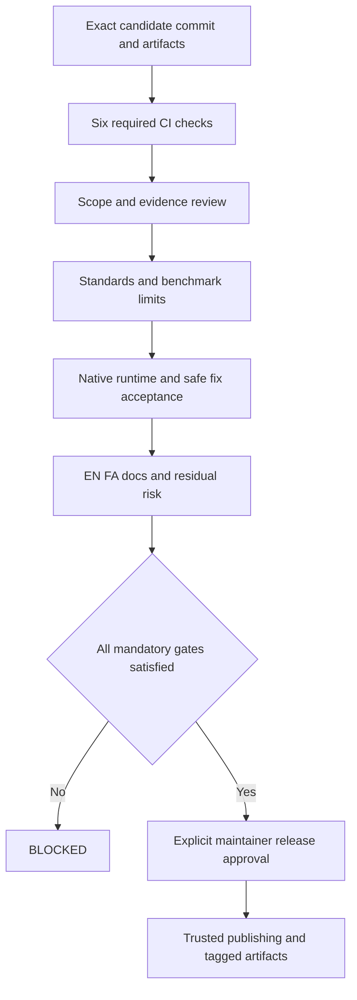

# v1.3.0 release quality gate (#105)

[فارسی](release-quality-gate-FA.md)

**Decision: BLOCKED — development checkpoint, 2026-11-26.** This is an evidence inventory, not certification, a release approval, or an automatic publishing command. Reviewed base: main commit `8365bdee0f1e9ac6f281a586d6b332ceec912ee6`. Historical CI results do not attest to a future release candidate.

| Gate | Current evidence | Remaining acceptance |
|---|---|---|
| Standards (#97/#36) | 145 controls, 103 partial, 42 unmapped; 171 official IDs, 259 relationships; [crosswalk](standards-crosswalk.md) and [CI #255](https://github.com/omidkh68/security-guardian/actions/runs/45907634603). | Independent semantic review and residual limitations; no compliance claim. |
| Detection (#96/#37) | [Benchmark bundle](independent-benchmark.md), [CI #257](https://github.com/omidkh68/security-guardian/actions/runs/45908180910); exposed synthetic and external cohorts separated, partial misses retained. | Fresh blind holdout and authorized agent evaluation; no pooled score. |
| Comparator evidence (#34/#37) | CodeQL and Semgrep comparison NOT_RUN. Semgrep output contract merged (#143). | Match language, input bytes, labels, rule scope, versions, runtime and denominators; document unavailable capabilities. |
| Safe remediation (#35) | [Verification runner](verification-runner.md); real Flask, Angular SSR and NestJS fixture evidence in CI; scoped receipts. | Not independent fix attestation; no customer or production evidence. |
| Native runtime (#32/#5) | [Offline Codex input](https://github.com/omidkh68/security-guardian/actions/runs/45906929115); [Claude local marketplace lifecycle](https://github.com/omidkh68/security-guardian/actions/runs/45909119045) on #147 prior head. | Authenticated native loaders, audit/verify and finding transitions; #141 integration and latest #147 CI. |
| Documentation (#54) | [CI #260](https://github.com/omidkh68/security-guardian/actions/runs/45909036104): 57 pairs, 450 relative targets, 114 Mermaid fences, no bounded audit problems. | Full rendering, independent translation review, post-#32 synchronization. |
| Repository & distribution (#4/#46/#64/#6/#30) | Active six-check ruleset; offline install/npm smoke. | Private vulnerability reporting, topics, failing non-draft PR protection evidence, Trusted Publisher and actual registry/tag release; final candidate CI and residual risk decision. |

## Interoperability and supply chain review

The following are tracked under #105; none is approved for silent deferral. Official specification references identify what to evaluate, not conformance. Each row needs an implementation/test or an explicit maintainer-approved deferral with reason, owner and follow-up issue before release.

| Item / reference | Current disposition | Acceptance evidence required |
|---|---|---|
| SARIF 2.1.0 ([OASIS](https://docs.oasis-open.org/sarif/sarif/v2.1.0/sarif-v2.1.0.html)) | NOT_IMPLEMENTED / interoperability NOT_RUN | Schema-valid redacted export; stable rule IDs, bounded relative locations and fingerprints; import in a compatible consumer; candidates not confirmations. |
| CVSS 4.0 ([FIRST](https://www.first.org/cvss/v4.0/specification-document)) | NOT_IMPLEMENTED | Explicit justified metric vector, score validation and missing-context behavior; never convert handbook severity automatically. |
| SBOM ([SPDX](https://spdx.dev/use/specifications/) / [CycloneDX](https://cyclonedx.org/specification/overview/)) | Release SBOM evidence NOT_RUN | Pick format/version, generate from actual distributed artifacts, validate schema and package/component inventory, bind digests; distinguish optional dependencies. |
| [OpenSSF Scorecard](https://scorecard.dev/) | NOT_RUN | Actual dated run, tool version, repo revision, individual check results and unresolved risks; no inferred score from branch rules. |
| SLSA ([v1.2 build track](https://slsa.dev/spec/v1.2/build-track-basics)) | Artifact provenance verification NOT_RUN | Generate and verify attestation for exact release artifacts and trusted builder/source; do not infer SLSA level from npm OIDC alone. |

## Release decision procedure

Do not treat an open parent RFC or missing evidence as PASS. Recheck final candidate SHA, versions, hashes, all required checks, artifact integrity, public claims, outstanding findings and approved deferrals. No public publish, tag or release until this gate is reviewed and authorized. No mandatory gate is removed by this document.

## 2026-11-28 checkpoint

The table above is historical. #206 merged as `8045c1e54a3d53bb44683388d4fa4f854b9d2185`; exact-commit [main CI](https://github.com/omidkh68/security-guardian/actions/runs/46118458477) and [private preview provenance workflow](https://github.com/omidkh68/security-guardian/actions/runs/46118458474) succeeded. See [standards evidence](standards-acceptance.md) for newer SARIF, CVSS, SBOM and Scorecard evidence. Actual artifact evidence and independent acceptance of #149–160 and #105 still require review; publication remains blocked.
