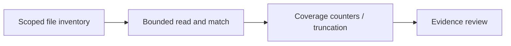

# Scanner coverage and bounded evidence

Priority: P0. Maintainer: [@omidkh68](https://github.com/omidkh68). Related: [#49](https://github.com/omidkh68/security-guardian/issues/49), RFC #34 and #37. [فارسی](scanner-coverage-FA.md)

## Coverage contract

The scanner preserves the existing selected-file counters (including `scanned_source_files` for compatibility) and separately exposes `scan_coverage.selected_files`, `read_files` and `inspected_files`. The last counter excludes intentionally skipped test fixtures. Unreadable source and invalid UTF-8 are skipped with a sanitized reason, and mark source coverage truncated. Existing traversal limits remain in effect.

## Evidence limits

The complete count of matched heuristic rules is `heuristic_signals`. Storage is bounded: up to 2,000 global signals and 100 per control; each control includes its total `signal_count`. The global and per-control lists are independent views; their omitted counts can overlap. `signal_coverage` states both limits, exact omission counts and truncation. Markdown displays at most 150 stored global signals and identifies additional stored signals. Order follows the existing traversal and rule order.

The tracker exposes both coverage objects in its begin response and records incomplete coverage in RUN.md. A completed workflow does not imply complete scanner coverage or verified safety. Only stored global candidates are automatically imported into the ledger; omitted candidates require additional scoped review. Older reports lacking the new keys remain readable.

## Verification and residual risk

Regression tests cover malformed encoding, unreadable source, intentional fixture exclusion, evidence caps and tracker visibility. Required checks:

```bash
python3 scripts/validate_package.py
python3 -m unittest discover -s plugins/security-guardian/skills/security-guardian/tests -v
```

This is still static heuristic triage, not a vulnerability confirmation engine. Encoding errors and resource limits can hide real indicators. A zero candidate count is never a clean bill of health. Revert the code and tests if compatibility issues arise; no ledger migration or historical snapshot rewrite is required.

## Architecture and testing value (#49)



Coverage tests distinguish skipped files, errors and capped signals; an incomplete scan is not clean evidence.
