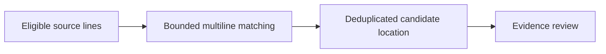

# اسکنر: تشخیص محدود الگوهای چندخطی

وضعیت: پیاده‌سازی پیشنهادی، منوط به موفقیت CI. اولویت: P0. نگه‌دارنده: [@omidkh68](https://github.com/omidkh68). مرتبط با [#47](https://github.com/omidkh68/security-guardian/issues/47) و RFCهای #34 و #37. [English](scanner-multiline.md)

## رفتار
علاوه بر بررسی تک‌خطی موجود، چهار الگوی قبلی می‌توانند روی دو خط مجاور تطابق داشته باشند: انتساب مستقیم innerHTML، مقدار false برای whitelist در ValidationPipe، مقدار false برای forbidNonWhitelisted و فراخوانی ناامن Raw SQL در Prisma. تطابق باید در خط اول آغاز و از مرز آن عبور کند. تطابق تک‌خطی برای همان قانون و شماره خط اول اولویت دارد. شناسه کنترل و وضعیت صرفاً Candidate حفظ می‌شود.

پنجره بررسی حداکثر ۴۰۹۶ کاراکتر با احتساب خط جدید است. خط خالی، نشانه‌های آشکار کامنت و پنجره بزرگ‌تر مانع تطابق چندخطی می‌شوند. بررسی Regex کل فایل، قانون جدید، دسترسی شبکه و تغییر پروژه اضافه نشده است. فیلتر محدوده و حذف فایل‌های تست بدون تغییر باقی می‌مانند.

## راستی‌آزمایی
دستورهای زیر اجرا شوند:
```bash
python3 scripts/validate_package.py
python3 -m unittest discover -s plugins/security-guardian/skills/security-guardian/tests -v
```
تست‌های رگرسیون هر چهار الگو، شماره خط آغاز، جداسازی محدوده، جلوگیری از تکرار، مقادیر سالم، کامنت، خط خالی، عبارت نامرتبط و سقف پنجره را بررسی می‌کنند.

## محدودیت‌ها و بازگردانی
این روش اکتشافی است، نه Parser یا یافته تأییدشده. عبارت‌های سه‌خطی یا بیشتر، قوانین انتخاب‌نشده، پنجره‌های بزرگ و کامنت‌ها یا رشته‌های پیچیده ممکن است پوشش داده نشوند؛ نبود Candidate به‌معنی امنیت نیست. سقف خروجی و گزارش خواندن ناقص در مرحله مستقل P0 بررسی می‌شوند. در صورت نیاز تغییر اسکنر و تست‌های آن بازگردانده شوند؛ مهاجرت یا بازنویسی Ledger لازم نیست.

## معماری و ارزش تست (#47)



رگرسیون تطابق و عدم تطابق چندخطی محدود را می‌سنجد؛ Parser چندخطی دلخواه نیست.
