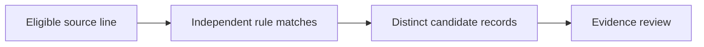

# اسکنر: شناسایی چند سیگنال روی یک خط

**وضعیت:** تغییر در PR پیشنهاد شده و تا موفقیت CI تأیید نهایی نشده است.  
**اولویت:** P0 · **RFC مرجع:** [#34](https://github.com/omidkh68/security-guardian/issues/34) · **نگه‌دارنده:** [@omidkh68](https://github.com/omidkh68)  
**انگلیسی:** [English](scanner-multiple-signals.md)

## مشکل
در نسخه قبلی، اسکنر آفلاین پس از تطابق اولین Rule روی هر خط، بررسی Ruleهای دیگر همان خط را متوقف می‌کرد. در نتیجه سیگنال مستقل بعدی ثبت نمی‌شد. این نقص یک **False Negative در کشف اولیه مبتنی بر الگو** بود؛ نه اثبات وجود یک آسیب‌پذیری واقعیِ کشف‌نشده.

## تغییر
اکنون تمام Ruleهای مرتبط، برای هر خط مجاز و غیرکامنت بررسی می‌شوند. مثلاً خطی با `whitelist: false` و `forbidNonWhitelisted: false` می‌تواند دو سیگنال احتمالی برای `API-01` ایجاد کند؛ خطی با انتساب مستقیم `innerHTML` و ذخیره توکن در مرورگر می‌تواند سیگنال‌های `ANG-01` و `ANG-04` تولید کند. ترتیب Ruleها، کنترل‌های موجود و وضعیت `HEURISTIC_REVIEW_ONLY` تغییر نکرده‌اند.

## آزمون و پوشش
تست‌های رگرسیون دو Rule با شناسه کنترل یکسان، دو کنترل متفاوت، نمونه سالم بدون Match، شماره خط صحیح و وضعیت صرفاً Candidate را بررسی می‌کنند.

```bash
python3 scripts/validate_package.py
python3 -m unittest discover -s plugins/security-guardian/skills/security-guardian/tests -v
```

پیش از ادغام، ماتریس CI باید در نسخه‌های Python پشتیبانی‌شده موفق شود. تطابق یک الگوی Heuristic هرگز به‌تنهایی اثبات آسیب‌پذیری یا تأیید اصلاح نیست. این اسکن هیچ درخواست شبکه‌ای اجرا نمی‌کند و سورس پروژه هدف را تغییر نمی‌دهد.

## محدودیت‌های باقی‌مانده
- تطابق همچنان **خط‌به‌خط** است و ممکن است عبارت‌های چندخطی تشخیص داده نشوند.
- سقف عمق و حجم فایل، خطاهای خواندن و ناقص‌بودن خروجی در ادامه P0 و RFC #34 بررسی خواهند شد.
- چند Candidate ممکن است شناسه کنترل مشترک داشته باشند؛ نباید با آسیب‌پذیری تأییدشده یا معیار Precision/Recall اشتباه گرفته شوند.
- این PR نه بسته تخصصی React/Vue/Next اضافه می‌کند، نه موتور اجرای تست.
- گزارش‌ها ممکن است پس از اصلاح تعداد Candidate بیشتری داشته باشند؛ Ledgerهای قبلی نباید بازنویسی شوند.

## بازگردانی تغییر
در صورت اثبات ناسازگاری مصرف‌کنندگان گزارش، تغییر حلقه اسکن و تست‌های همراه آن بازگردانده شوند و تاریخچه Ledger حفظ شود. پروژه‌های هدف به مهاجرت داده نیاز ندارند.

## معماری و ارزش تست (#45)



نمونه‌ها تطابق متعدد و پایداری هویت در یک خط را می‌سنجند؛ آسیب‌پذیری تأیید نمی‌شود.
