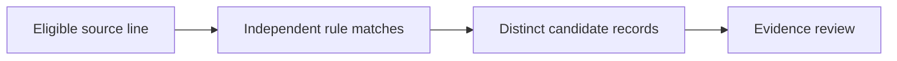

# Scanner: multiple signals on a source line

**Status:** Implementation proposed in a PR; not independently validated until CI succeeds.  
**Priority:** P0 · **Parent RFC:** [#34](https://github.com/omidkh68/security-guardian/issues/34) · **Maintainer:** [@omidkh68](https://github.com/omidkh68)  
**Persian:** [فارسی](scanner-multiple-signals-FA.md)

## Problem
Before this patch, the offline triage scanner stopped checking a source line after the first matching regular-expression rule. A second independent heuristic on that line was omitted from the candidate report. This caused an avoidable **false negative in heuristic discovery**, not a verified undetected vulnerability.

## Change
Each applicable rule is now checked on each eligible non-comment line. For example, a line containing both `whitelist: false` and `forbidNonWhitelisted: false` can produce two *candidate signals* for `API-01`; a line with direct `innerHTML` assignment and browser token storage can produce `ANG-01` and `ANG-04` candidates. The existing rule sequence, controls and status `HEURISTIC_REVIEW_ONLY` remain unchanged.

## Verification and coverage
The regression tests cover two different rules with the same control ID, two distinct control IDs, a safe negative fixture, correct line numbers and candidate-only status.

```bash
python3 scripts/validate_package.py
python3 -m unittest discover -s plugins/security-guardian/skills/security-guardian/tests -v
```

The CI matrix must pass on the repository-supported Python versions before merge. Do not mark a fix verified solely because a heuristic pattern matched. No network calls or source modifications occur in the target repository.

## Remaining limitations
- Matching is still **line-oriented**: multiline expressions may not be detected.
- Existing directory/file size budgets, unreadable files, and any truncated results remain separate P0 follow-up work under #34.
- Multiple candidates may share a control ID; they must not be conflated with confirmed vulnerabilities or accuracy/recall metrics.
- This patch is scoped to scanner detection semantics; it does not introduce React/Vue/Next framework packs or a test execution engine.
- Existing report/ledger consumers should preserve candidate records; a subsequent scan may report more candidates than before.

## Rollback
Revert the scanner loop change and its tests if unexpected downstream reporting incompatibility is demonstrated; preserve prior ledger snapshots. This does not require application migrations.

## Architecture and testing value (#45)



Fixtures exercise multiple matches and identity stability on one line; no vulnerability confirmation.
