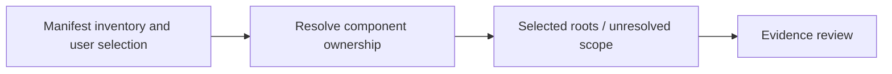

# شناخت فناوری و حل محدوده بررسی

[English](scope-resolution.md)

**قابلیت توسعه، RFC [#31](https://github.com/omidkh68/security-guardian/issues/31).** در v1.2.1 وجود ندارد. کشف مبتنی بر شواهد Manifest است، نه پشتیبانی تأییدشده، نسخه نصب‌شده یا مجوز. Rule یا Control ID جدیدی معرفی نمی‌شود.

## Workflow

1. قواعد موجود پروژه و قصد صریح کاربر را بخوانید.
2. `security_scan.py --root <repo> --discover --profile auto` را اجرا کنید. این فرمان Manifestهای واجد شرایط و ریشه Componentها را فهرست می‌کند؛ نه تحلیل سورس برنامه، تغییر، Run جدید یا درخواست شبکه. پیمایش فایل به سقف‌های موجود Scanner محدود است.
3. در `NEEDS_SELECTION` محدوده را صریح انتخاب کنید: `frontend`، `backend`، `fullstack`، `mobile` یا `custom` با `--component <relative-root>` تکرارشونده. Auto فقط یک Component فعال بدون ابهام را انتخاب می‌کند؛ ریشه‌های متعدد یا ترکیبی، Manifest نامعتبر و موجودی ناقص نیازمند تصمیم‌اند. Fallback پروژه عمومی تک‌ریشه نیازمند بازبینی دستی است، نه PASS.
4. همان پروفایل و ریشه‌های صریح را به `security_tracker.py begin --root <repo> --mode audit --profile <profile> [--component <root> ...]` بدهید. Candidate فقط از مسیرهای متعلق به Component منتخب و خانواده Rule قدیمی مجاز می‌آید. فراداده محدوده ثبت‌شده را بررسی کنید؛ اگر نسبت به Preview تغییر داشت، پیش از بازنگری PARTIAL نهایی کنید.
5. Componentهای خارج و وابستگی بین مخزن‌ها را بدون مجوز جداگانه از بازبینی سورس، اصلاح و تست خارج نگه دارید. تاریخچه موجود تجمعی می‌ماند.

## پروفایل‌ها و مرزها

| پروفایل | انتخاب |
|---|---|
| auto | یک Component بدون ابهام، از جمله پروژه عمومی ناشناخته؛ در غیر این صورت سؤال |
| frontend | Component صرفاً Frontend کشف‌شده؛ Ruleهای Angular فقط روی Angular |
| backend | Component صرفاً Backend؛ خانواده Rule API/business، بدون Angular/mobile |
| fullstack | نیازمند شواهد هر دو Frontend و Backend؛ Componentهای وب/بک‌اند منتخب، نه موبایل نامرتبط |
| mobile | Component صرفاً موبایل کشف‌شده |
| custom | ریشه دایرکتوری نسبی موجود و صریح، حتی بدون Manifest؛ بازبینی دستی ناشناخته‌ها |

ریشه Component از Manifest و انتخاب صریح می‌آید. Component تودرتو متعلق به عمیق‌ترین ریشه شناخته‌شده است؛ انتخاب والد فرزند کشف‌شده جداگانه را پنهانی شامل نمی‌کند. ریشه تجمیع Workspace با وجود فرزند برنامه مستقل تلقی نمی‌شود؛ ریشه مشترک را در صورت نیاز صریح انتخاب کنید. زیردایرکتوری صریح بدون Manifest شواهد محیط را به ارث می‌برد؛ ریشه ناشناخته بازبینی دستی می‌خواهد. Manifestهای با نقش ترکیبی در یک ریشه تنها با این موجودی به‌شکل امن بر اساس لایه جدا نمی‌شوند. Fullstack یا custom می‌تواند صریحاً شاملشان شود. Symlink موجود، traversal و دایرکتوری مستثنا رد می‌شوند. فایل ریشه خارج از مالکیت Component منتخب اسکن نمی‌شود؛ وابستگی پیکربندی خارجی/مشترک را ثبت کنید. تمام یال‌های وابستگی Workspace یا مالکیت دقیق در سطح کد از Manifest استنباط نمی‌شود.

نشانه‌های Manifest فریم‌ورک شامل Angular، React/Next، Vue/Nuxt، Svelte/SvelteKit، NestJS، Express/Fastify، Koa/Hono، Flutter و فریم‌ورک‌های منتخب Python/Java/.NET/PHP هستند. سایر Manifestها به بازبینی عمومی می‌رسند. بررسی اختصاصی فریم‌ورک‌های تازه RFC #33 است. قابلیت‌ها نشانه‌هایی مثل SSR، browser، GraphQL، WebSocket، database، Redis، OAuth و PWA هستند؛ Scanner سورس منتخب نشانه‌های موجود کد را اضافه می‌کند. عدم تطابق یا کاربرد ناشناخته به معنی امنیت نیست. کشف هیچ نسخه وابستگی را اجرا یا برنمی‌گرداند.

## نمونه‌ها

```bash
python3 security_scan.py --root . --discover --profile backend
python3 security_scan.py --root . --discover --profile custom --component apps/api
python3 security_scan.py --root . --profile backend --format json
python3 security_tracker.py begin --root . --mode audit --profile backend --scope "Backend review"
```

`scope_resolution` به JSON Scanner منتخب، خروجی begin و Manifest Run اضافه می‌شود؛ برچسب خوانای محدوده در RUN.md و PDF ریشه‌های منتخب/خارج را توضیح می‌دهد. Snapshot و Ledger ID قبلی تغییر نمی‌کنند. محدوده Sandbox سیستم‌عامل نیست؛ Agent باید آن را رعایت کند و فرمت record/import سازگار می‌ماند. Adapter اختیاری قدیمی Semgrep جداسازی انتخاب را پیاده‌سازی نمی‌کند؛ Run محدوده‌دار Skill تا #34 آن را صریحاً رد می‌کند؛ هرگز PASS نگوید یا کل Repo اجرا نکند. فرمان مستقیم Scanner/Tracker بدون profile رفتار قدیمی تمام مخزن را برای اسکریپت موجود حفظ می‌کند. خارج از فراداده هر Run پروفایلی ذخیره نمی‌شود؛ دستورالعمل پروژه تغییر نمی‌کند (RFC #32).

## تست‌ها

```bash
python3 -m unittest discover -s plugins/security-guardian/skills/security-guardian/tests -p test_scope.py -v
```

Fixture مصنوعی کشف، جداسازی سورس منتخب، ابهام چند Component، Fallback عمومی، Flag محدوده، Manifest نامعتبر، محصور بودن مسیر و عدم ایجاد Ledger برای محدوده حل‌نشده را بررسی می‌کند. این تست‌ها Benchmark Recall آسیب‌پذیری نیستند.

## معماری و ارزش تست (#31)



تست محدوده ریشه منتخب و خارج را می‌سنجد؛ ابهام نباید بی‌صدا محدوده را توسعه دهد.


توسعه پیشنهادی #32: [پروفایل پایدار](project-profile-FA.md) برای انتخاب تأییدشده و بررسی مجدد موجودی است؛ تا پذیرش Loader واقعی و Merge این RFC، آن را قابلیت منتشرشده ندانید.
