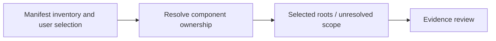

# Stack intelligence and scope resolution

**Development feature, RFC [#31](https://github.com/omidkh68/security-guardian/issues/31).** Not included in v1.2.1. Discovery is manifest evidence, not verified support, installed version or permission. No new scanner rules or control IDs are introduced.

## Workflow

1. Read existing project rules and explicit user intent.
2. Run `security_scan.py --root <repo> --discover --profile auto`. This inventories eligible manifest files and component roots; no application source analysis, changes, new run or network requests. The file traversal is bounded by existing scanner limits.
3. If `NEEDS_SELECTION`, select scope explicitly: `frontend`, `backend`, `fullstack`, `mobile`, or `custom` with repeatable `--component <relative-root>`. Auto chooses only a single unambiguous active component; multiple or mixed component roots, malformed manifests and incomplete inventory require a decision. Generic single-project fallback is manual review, not PASS.
4. Pass the same requested profile and explicit roots to `security_tracker.py begin --root <repo> --mode audit --profile <profile> [--component <root> ...]`. Scanner candidates only come from selected component-owned paths and allowed legacy rule families. Inspect persisted scope metadata; if changed from preview, finalize partial before reconsidering.
5. Keep excluded components and cross-repository dependencies out of source review, fixes and tests unless separately authorized. All existing history remains cumulative.

## Profiles and boundaries

| Profile | Selection |
|---|---|
| auto | Single unambiguous component, including unknown generic project; otherwise ask |
| frontend | Detected frontend-only components; Angular rules only on Angular components |
| backend | Detected backend-only components; API/business rule families, no Angular/mobile rule family |
| fullstack | Both frontend and backend evidence required; selected web/backend components, not unrelated mobile |
| mobile | Detected mobile-only components |
| custom | Explicit existing relative directory roots, even when no manifest is present; manual review of unknowns |

Component roots derive from manifests and explicit selection. Nested components belong to the deepest known root; selecting a parent does not silently include separately discovered child components. Workspace aggregation roots are not treated as independent apps when child components are present; explicitly select shared roots if needed. Explicit non-manifest subdirectories inherit containing evidence; unknown roots require manual review. Same-root mixed role manifests cannot be safely separated by layer using this inventory alone. Fullstack or custom may include them explicitly. Existing symlinks, traversal and excluded directories are rejected. Root-level files outside selected component ownership are not scanned; note external/shared config dependencies. No attempt to infer all workspace dependency edges or exact code-level ownership from manifests.

Framework manifest hints include Angular, React/Next, Vue/Nuxt, Svelte/SvelteKit, NestJS, Express/Fastify, Koa/Hono, Flutter and selected Python/Java/.NET/PHP frameworks. Other manifests yield generic review. Dedicated framework checks for newly recognized frameworks are RFC #33. Capabilities are hints such as SSR, browser, GraphQL, WebSocket, database, Redis, OAuth and PWA; the selected-source scanner adds existing code hints. Nonmatching/applicability unknown does not mean secure. No dependency versions are executed or returned by discovery.

## Examples

```bash
python3 security_scan.py --root . --discover --profile backend
python3 security_scan.py --root . --discover --profile custom --component apps/api
python3 security_scan.py --root . --profile backend --format json
python3 security_tracker.py begin --root . --mode audit --profile backend --scope "Backend review"
```

`scope_resolution` is additive in selected scanner JSON, begin output and run manifest; RUN.md and PDF human-readable scope label describe selected/excluded roots. Prior snapshots and ledger IDs are unchanged. Scope is not an OS sandbox. The agent must obey the scope; record/import formats remain compatible. The optional legacy Semgrep adapter does not implement selection isolation, so scoped skill runs explicitly skip it until #34; never report it passing or run it over the whole repo. Direct no-profile scanner/tracker calls preserve legacy whole-repository behavior for existing scripts. No profile is persisted outside the per-run metadata; project instructions are not modified (RFC #32).

## Tests

```bash
python3 -m unittest discover -s plugins/security-guardian/skills/security-guardian/tests -p test_scope.py -v
```

Synthetic fixtures check discovery, selected source isolation, multi-component ambiguity, generic fallback, scope flags, malformed manifests, path containment, and no ledger creation for an unresolved scope. These tests are not a vulnerability-recall benchmark.

## Architecture and testing value (#31)



Scope fixtures check selected and excluded roots; unresolved scope must not widen silently.


Proposed #32 extension: [persistent profile](project-profile.md) covers explicit approved selection and inventory revalidation; do not treat it as released until native loader acceptance and RFC merge.
