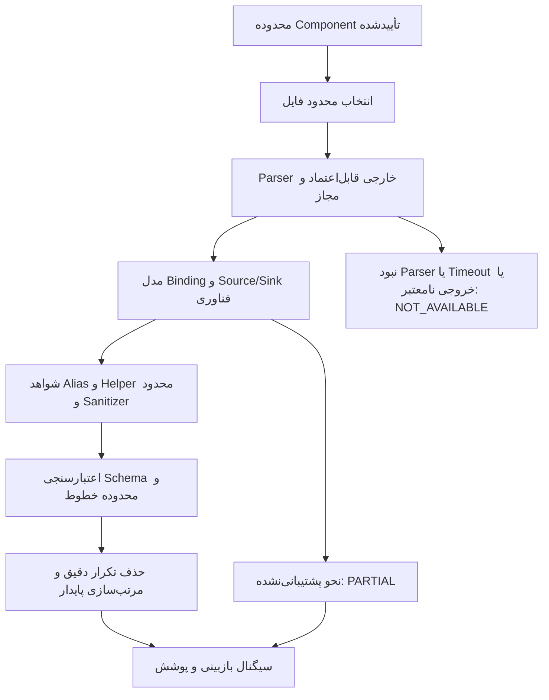

# قرارداد معنایی AST

Issue [#94](https://github.com/omidkh68/security-guardian/issues/94) · [English](semantic-contract.md)

دامنه مدل عمداً محدود و قابل‌اندازه‌گیری است. چهار Adapter اختیاری JS قرارداد نسخه‌دار مشترک Parser و اعتبارسنجی دارند؛ مدل Python با کتابخانه استاندارد، ورودی و Benchmark موجود را حفظ می‌کند. کد، وابستگی و تنظیمات پروژه اجرا یا بارگذاری نمی‌شوند. شواهد پیشنهادی‌اند، نه اثبات آسیب‌پذیری یا امنیت.

## قرارداد Source و Sink و Binding

| مدل | منبع | مقصد | اتصال و استثنا |
|---|---|---|---|
| Python Flask SQL | request.args/form واردشده | آرگومان SQL در sqlite3 execute | Alias واردشده و مسیر محلی و Helper یک‌مرحله‌ای و Context Manager محدود؛ پارامتر جدا |
| JS DOM | window.location.hash/search | innerHTML روی عنصر شناخته‌شده | Alias و شاخه محلی و Helper یک‌مرحله‌ای؛ textContent رندر خام نیست |
| Node SQL | ورودی Route یا پارامتر Nest | متن Query در pg Pool/Client واردشده | Alias و الحاق؛ آرایه پارامتر جدا |
| SSR | درخواست Route/Page شناخته‌شده و هدر اعتبارنامه مشخص | HTML خام یا Response یا TransferState | ورودی و Import فناوری و اتصال محلی؛ JSON.stringify معادل Escape HTML نیست |
| Authorization | درخواست و فیلد ظاهری Principal | شرط منبع Prisma/TypeORM | Route و گیرنده صریح و Alias محلی؛ Guard صرفاً شاهد است |

دامنه دقیق در مستندات [Python](python-sql-flow-FA.md)، [DOM](js-dom-flow-FA.md)، [SQL](js-sql-flow-FA.md)، [SSR](js-ssr-flow-FA.md) و [Authorization](js-authz-flow-FA.md) تعریف شده است. تحلیل عمومی Helper میان فایل‌ها، Sanitizer سفارشی، Dispatch پویا و اتصال کل برنامه مدل نشده‌اند. قالب و Hydration در Vue/Svelte، DI سفارشی، شرط تودرتو و سیاست بین ماژول‌ها نیازمند بازبینی دستی هستند. Benchmark مستقل (#96) و Verification واقعی (#35) معیارهای جداگانه‌اند.

## مدل Sanitizer

در DOM فقط Import پیش‌فرض از dompurify و فراخوانی مستقیم sanitize با یک آرگومان در ماژول محدود (توابع، دستور خالی و همین Importها) شناخته می‌شود. Shadowing، تغییر Binding، کاربرد ناشناخته، تنظیمات ناشناخته و دستور سطح ماژول پشتیبانی‌نشده به‌جای اعتماد، ناقص گزارش می‌شوند. خطوط منبع حفظ شده و خطوط فراخوانی Sanitizer و وجود مسیر Candidate بدون مشاهده Sanitizer ثبت می‌شوند. مشاهده فراخوانی اثبات صحت، نسخه نصب‌شده، تنظیمات یا پاک‌سازی کل مقدار نیست؛ الحاق ممکن است داده خام داشته باشد. هیچ Sanitizer باعث حذف Candidate نمی‌شود. Encoding و پارامتری‌سازی وابسته به زمینه‌اند؛ مقصد متنی یا پارامتر جدا معادل پاک‌سازی عمومی نیست.

## قرارداد شواهد و خطا

چهار Adapter JS محدودیت مشترک Timeout بیست‌ثانیه‌ای، ۱۲۸ فایل، ۱۲۸ هزار بایت هر فایل، ۲ میلیون بایت Batch، صد ردیف و ۱۶ خط منبع دارند. Parser خارجی باید صریحاً مجاز و خارج از پروژه باشد. اجرا در مسیر موقت با محیط محدود است، نه Sandbox. تکرار دقیق شواهد پیش از خروجی حذف و مرتب‌سازی بر اساس مسیر، خط و شواهد canonical انجام می‌شود؛ زمینه‌های متفاوت ادغام نمی‌شوند. نوع و محدوده خطوط، تعداد نتایج، نسخه Parser و وضعیت اعتبارسنجی می‌شوند. Schema نامعتبر و شکست Parser برابر NOT_AVAILABLE است، نه موفقیت. پوشش ناقص آشکار باقی می‌ماند. Ledger تغییر نمی‌کند. Python قرارداد موجود حذف تکرار مقصد و پوشش را حفظ می‌کند.

## ارزش معماری در تست

| تست | هدف |
|---|---|
| Benchmarkهای موجود | حفظ مثبت‌ها، منفی‌ها و موارد عدم تشخیص قبلی |
| Sanitizer صریح، Alias، الحاق و شاخه | حفظ Candidate و ثبت شواهد فراخوانی |
| مقصد متنی، Sanitizer جعلی یا Shadowing و تنظیمات ناشناخته | تفکیک مقصد و Binding؛ پوشش ناقص |
| ساختار خروجی نامعتبر یا خط خارج از محدوده | رد شواهد نامعتبر |
| شواهد تکراری | خروجی پایدار بدون ادغام زمینه‌های متفاوت |
| نبود Parser یا Parser داخل پروژه و Timeout شبیه‌سازی‌شده | Fail closed بدون اجرای هدف |
| Manifest سخت‌گیرانه npm | وجود فایل اجرایی Python مشترک |

تست واحد Timeout شکست Subprocess را بدون انتظار شبیه‌سازی می‌کند؛ CI مجموعه رگرسیون واقعی Parser نسخه ثابت را نیز اجرا می‌کند. این قرارداد Benchmark مستقل جدید آسیب‌پذیری نیست. بازگشت با Revert و بدون مهاجرت Ledger است.

توسعه #107: برای مدل‌های جاری و محدودیت‌ها و ارزیابی جداگانه، [توسعه پوشش معنایی](semantic-expansion-FA.md) را ببینید. توضیحات نسخه‌های قبلی خط مبنای تاریخی هستند.

## سخت‌گیری قرارداد Parser #94

اعتبارسنجی سورس و بودجه بایت/خط در مرز مشترک Parser، رد کلید JSON تکراری و نوع reason نامعتبر. مدل تشخیص توسعه نیافته؛ Parser خارجی قابل اعتماد الزامی و فرایند Sandbox نیست. تست منفی آفلاین افزوده شد؛ تست‌های واقعی Parser قبلی همچنان الزامی‌اند. CI در انتظار است.

## اجرای واقعی Semgrep اختیاری (#34)

Workflow اختصاصی CI نسخه 1.140.0 ابزار Semgrep را در محیط مجازی موقت Runner نصب می‌کند و Ruleهای محلی موجود را روی شش فایل مصنوعی مثبت و یک فایل منفی در فضای شبکه جدا و بدون اعتبارنامه موروثی اجرا می‌کند. هویت دقیق Rule/مسیر/خط، وضعیت صرفاً Candidate، حذف پوشه خصوصی ممیزی، عدم افشای متن و یکپارچگی بایت فایل‌های Fixture بررسی می‌شوند. این بازپخش Rule ساختاری است، نه دقت معنایی مستقل یا Sandbox سیستم‌عامل برای Adapter نصب‌شده کاربر. ابزار اختیاری توسط محصول خودکار نصب نمی‌شود. پذیرش نیازمند مشاهده موفقیت CI است.

اجرای واقعی CLI نشان داد پیشوند مسیر Rule ID از سقف موجود Adapter عبور می‌کند. اکنون بازنویسی Rule ID و بررسی نسخه صریحاً غیرفعال‌اند. خروجی جدید شناسه اصلی Rule را دارد؛ گزارش تاریخی پیشونددار تغییر نمی‌کند. محیط صرفاً آزمایشی برای سازگاری راه‌اندازی Semgrep/MCP نسخه Pydantic 2.12.5 را ثابت و `pip check` اجرا می‌کند؛ وابستگی محصول نصب‌شده تغییر نمی‌کند و Sandbox ابزار خارجی دلخواه اثبات نمی‌شود.
