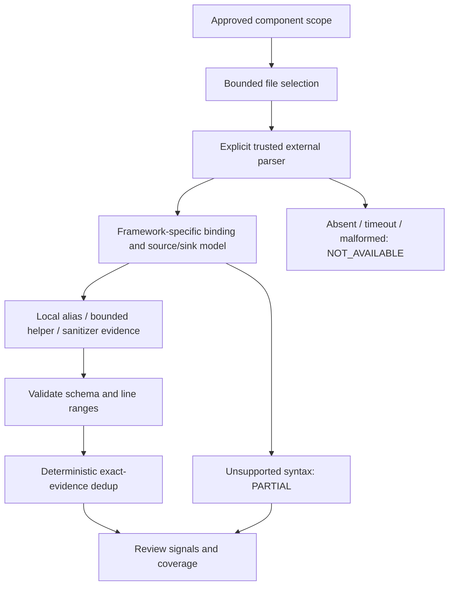
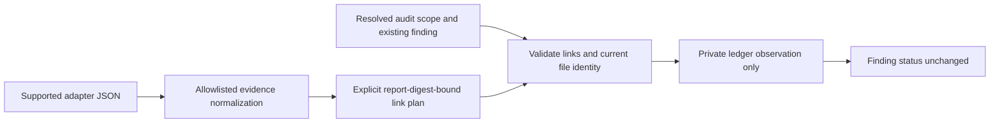

# Semantic AST contract

Issue [#94](https://github.com/omidkh68/security-guardian/issues/94) · [فارسی](semantic-contract-FA.md)

The supported subset is intentionally finite. Four optional JS adapters now share a versioned parser/validation contract; the Python standard-library model retains its existing entry point and benchmark. The adapters do not execute audited source or load its dependencies/configuration. Evidence is advisory, never a confirmed vulnerability or safety verdict.



## Source / sink / binding contract

| Model | Source | Sink | Binding and exclusion |
|---|---|---|---|
| Python Flask SQL | imported request.args/form/headers/cookies | sqlite3 execute SQL argument | direct import aliases, local paths, bounded loops/slots, simple source-only helper context and bounded context manager; bound parameters separate |
| JS DOM | window.location.hash/search | recognized DOM element innerHTML | local alias, branch paths, one-hop local helper; textContent is not raw HTML |
| Node SQL | explicit route request / Nest parameters | imported pg Pool/Client query text | local alias, concatenation; parameter array separate |
| SSR | recognized route/page request, explicit credential headers | framework raw HTML / response / TransferState | framework-specific entry/import and local bindings; JSON.stringify is not HTML escaping |
| Authorization | request and principal-shaped fields | Prisma / TypeORM resource selectors | explicit routes and receiver identity, local aliases; guards are evidence only |

See the paired [Python](python-sql-flow.md), [DOM](js-dom-flow.md), [SQL](js-sql-flow.md), [SSR](js-ssr-flow.md) and [authorization](js-authz-flow.md) docs for exact supported syntax and residuals. No general cross-file taint or arbitrary helper inference, custom sanitizers, arbitrary dynamic dispatch or whole-program binding is claimed. Vue/Svelte template and hydration, custom DI, nested predicates and cross-module authorization remain manual review. Independent corpus (#96) and runtime verification (#35) remain separate acceptance gates.

## Sanitizer model

The DOM adapter recognizes only a default import from dompurify and direct one-argument sanitize call in a restricted module (functions, empty statements and those imports). It rejects shadowing, writes, unknown uses, unknown configuration and unmodeled top-level statements rather than trusting them. Source lines remain; candidate output additionally records sanitizer call lines and whether any candidate path has no observed sanitizer. Observed calls are not proof of sanitizer correctness, installed version, configuration or full coverage of the value (a concatenation can include raw data). No sanitizer removes a candidate. Encoding and parameterization are context-specific; a text sink or separate SQL parameters are not evidence of universal sanitization.

## Evidence and failure contract

JS adapters share a 20-second timeout, 128-file/128,000-byte per file/2,000,000-byte batch caps, 100 retained rows and 16 source lines. The external compiler must be explicitly authorized and outside the audited project. The process uses a temporary working directory and restricted environment; this is not a sandbox. Exact duplicate hits are removed before output, sorted by path, line and canonical evidence; distinct contexts are not merged. Line types/ranges, result count, parser version and state are validated. Unknown schema or parser failure is NOT_AVAILABLE, never success. Partial analysis stays visible. No ledger mutation. The Python scanner retains its existing per-sink dedup and coverage contract.

## Testing value

| Test | Purpose |
|---|---|
| Existing benchmarks | Preserve previous positives, negatives and known misses |
| Explicit sanitizer, alias, mixed, branch | Preserve candidate and record observed call evidence |
| Text sink, fake/shadowed sanitizer, unsupported options | Distinguish sink and binding; unsupported remains partial |
| Malformed envelope / out-of-range lines | Reject invalid evidence |
| Duplicate evidence | Stable output without combining different contexts |
| Missing/target-local parser and simulated timeout | Fail closed, no target execution |
| Strict npm manifest | Shared Python runtime asset included automatically |

The timeout unit test simulates a subprocess timeout without sleeping; CI also runs the real pinned compiler regression suite. The contract is not a new independent vulnerability benchmark. Revert PR to roll back; no ledger migration.


Expansion #107: see [semantic coverage expansion](semantic-expansion.md) for current model boundaries and separate evaluation. Prior version sections describe historical baselines.

## Shared parser contract hardening (#94)

Validate input source and byte/line budgets inside the common parser boundary, reject duplicate JSON keys and malformed reason types. No expanded detection model; trusted external parser remains required, process is not a sandbox. Added offline negative tests; all existing optional real parser suites remain required. CI pending.

## Real optional Semgrep replay (#34)

The dedicated CI workflow installs Semgrep 1.140.0 in a disposable runner virtual environment and executes the existing local rules over six synthetic positive files and one negative file in a separate network namespace without inherited credentials. It checks exact rule/path/line identities, candidate-only status, private audit directory exclusion, redaction and byte integrity of fixture files. This is a structural-rule replay, not independent semantic accuracy or an OS sandbox for the installed user-facing adapter. The optional tool is not installed automatically by the product. Acceptance requires observed successful CI.

Real CLI replay exposed path-prefixed rule IDs that exceeded the adapter's existing ID bound. The adapter now explicitly disables rule ID rewriting and version checks. New outputs use canonical configured rule IDs; historical prefixed reports are unchanged. The test-only environment pins Pydantic 2.12.5 for the selected Semgrep/MCP startup combination and runs `pip check`; this does not change installed product dependencies or establish a sandbox for arbitrary external tools.

## Adapter resource and benchmark checkpoint (#34)

Semgrep now captures stdout/stderr with live byte budgets (16 MB / 1 MB), a deadline, and process-group termination on POSIX; failed or oversized capture never returns a clean result. Exact rule/path/line/severity duplicates retain occurrence counts and a stable SHA-256 fingerprint; distinct evidence remains separate. Metadata binds the local config digest and reports tool version when supplied by JSON. Fingerprints are not ledger IDs, and automatic ledger linking is NOT_LINKED. This is not a memory/CPU sandbox, arbitrary descendant confinement on Windows, filesystem write prevention or network denial on arbitrary hosts. The existing offline runner fixture provides scoped evidence only. A new external author-labeled DOM probe reads pinned GitHub CodeQL source files without executing them, compares all four explicitly labeled innerHTML assignments in two selected files, reports misses and partial coverage, and deliberately has no negative labels or precision/F1. It is not an independent blind holdout or a CodeQL execution comparison. No closure of #34 before reviewed acceptance of the remaining gaps.

## Unified adapter observations and explicit ledger linking (#34)

The dependency-free `security_evidence.py` normalizes versioned reports from the four supported JS/TS AST packs and bundled Semgrep rules. It allowlists rules and structured fields, recomputes Semgrep fingerprints, retains distinct source-line/sanitizer/scope evidence and duplicate occurrence counts, and excludes arbitrary descriptions or snippets. The observation identity includes adapter, rule, location and structured evidence; edits or line movement can yield a new identity. Semgrep control associations are review hints, not semantic equivalence. Other pack versions, custom Semgrep configs and raw scanner output are deliberately unsupported.

```bash
python3 plugins/security-guardian/skills/security-guardian/scripts/security_evidence.py --report /path/to/adapter.json
python3 plugins/security-guardian/skills/security-guardian/scripts/security_tracker.py link-evidence --root /path/to/project --run RUN_ID --report /path/to/adapter.json --plan /path/to/links.json
```

The plan is an explicit JSON object with `schema_version: 1`, `run_id`, `report_sha256` (exact report bytes), and `links` (array of objects containing only `evidence_id` and `finding_id`). Review these IDs before linking. The active run must have resolved scope; the current scope and component inventory must agree, and the existing finding must match the suggested control and exact relative path. Excluded, private and symlinked paths are rejected. The local file fingerprint records the current file, **not** proof it was scanned. No new finding, confirmation, closure, automatic reassignment or verification is performed. Identical retries in the same run are idempotent; a conflicting link is rejected. Observations are stored under `adapter_observations` on the existing finding, with run and report digest, and a count in RUN.md. Private ledger content is not an attestation or public export. Authorization matrices and native Python scanner signals are not imported by this first boundary; they remain available in their original reports. Existing tracker multi-file persistence is not a transactional database.


