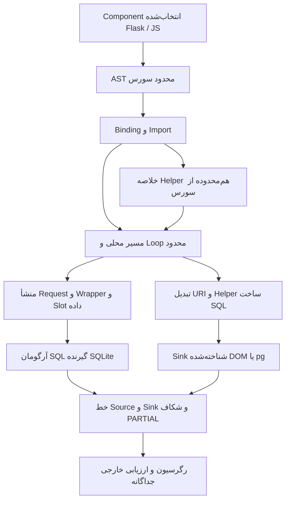

# توسعه پوشش تحلیل معنایی (#107)

[English](semantic-expansion.md)

خط مبنای #96 و Manifest قبلی حفظ شده‌اند. توسعه محدود است، نه تحلیل Taint کل برنامه یا اثبات آسیب‌پذیری. شناسه Rule و Control ثابت‌اند. Pack پایتون نسخه ۵، DOM نسخه ۴ و Node SQL نسخه ۲ هستند.



## مدل‌ها و مرز اعتماد

در Python، Factory ثبت Route با یک پارامتر و Decorator مسیر ثابت به‌شکل نحوی شناسایی می‌شود؛ Handler تودرتو مستقل از Closure تحلیل می‌شود. Factory ساده اتصال SQLite، Import نسبی فایل همسایه و Import واجد شرایط از ریشه همان Component از روی سورس خلاصه می‌شوند. ماژول برای تابع بدون آرگومان و یک Return اتصال SQLite یا کلاس ساده نگهدارنده Request بدون ارث‌بری بررسی می‌شود. Import محلی در مسیر ثبت می‌شود؛ هیچ ماژول، Initialization یا کد هدف اجرا نمی‌شود. حل Import معادل اثبات هویت زمان اجرا نیست؛ این موارد PARTIAL می‌مانند. Collectionهای args، form، headers و cookies پوشش دارند. خط فراخوانی متد Wrapper مرز Source در Caller است، نه تعریف Helper. عملیات محدود URI/base64 و encode/decode احتمال Taint را حفظ می‌کنند؛ هیچ تبدیل واقعی اجرا نمی‌شود. کلید ثابت Dictionary و Slot بخش/گزینه ConfigParser در هر مسیر مستقل‌اند؛ بازنویسی داده قبلی را جایگزین می‌کند. Loop روی List/Tuple تا هشت عضو، ابتدا مقادیر را ثبت و مسیر عادی را باز می‌کند؛ break/continue، Iterator دلخواه و Exception پشتیبانی نمی‌شوند.

در DOM، فراخوانی صریح و بدون Shadowing تبدیل URI در شکل محدود ماژول Taint را حفظ و شواهد Sanitizer قبلی را برای مقدار تبدیل‌شده باطل می‌کند. در Node SQL، Helper محلی خالص با یک Return، پارامترهای موضعی، الحاق و Template پشتیبانی دارد؛ فراخوانی تودرتوی آرگومان محدود است و تعریف بازگشتی یا پویا پشتیبانی نمی‌شود. گیرنده pg و مالکیت Request همچنان Framework-specific هستند.

سقف‌های ۱۲۸ KB، ده‌هزار Node، ۶۴ مسیر و ۴۰۹۶ گام برقرارند؛ حداکثر ۱۲۸ خواندن Factory بین فایل‌ها از موجودی انتخاب‌شده هم‌مالک، بدون Test و Symlink. Slotهای Dictionary و Config حداکثر ۳۲ و Section حداکثر ۱۶، Arity Helper حداکثر ۱۶ است. نحو ناشناخته مسیر را با وضعیت ناقص متوقف می‌کند. تحلیل عمومی بین فایل‌ها، Import/Dispatch پویا، Alias شیء دلخواه، Exception، ORM گسترده و Source/Sinkهای دیگر خارج از مدل هستند.

## ارزش تست و ارزیابی قابل بازتولید

تست توسعه ثبت تودرتو، پارامتر امن، ترتیب و سقف Loop، حل سورس همسایه و Qualified، Scope، Shadowing، متد ثابت Wrapper، بازنویسی Dictionary/Config، انتقال Taint، Sink متنی DOM و باطل شدن شواهد Sanitizer و وابستگی/Arity Helper Node را بررسی می‌کند. بازپخش Contextual روی هر ۱۶ برچسب CWE-89 قبلی OWASP به‌همراه Helperهای اصلی ثابت است؛ جدا از خط مبنای فایل جداشده. هیچ کد Fixture اجرا نمی‌شود. ارزیابی تازه از جفت Route مستقیم HTTP SQLite پروژه EyalSec/vulnerable-python با برچسب نویسنده و Revision ثابت 5e2e2b1874d4626f2ff3d09e29c9af52a9b6c476 (MIT) استفاده می‌کند. موتور پیش از مشاهده سورس آن ثابت شده است. فایل کامل بدون تغییر و خطوط دقیق Sink بررسی می‌شوند؛ Import انجام نمی‌شود. مجموعه کوچک است و Benchmark مستقل جامع نیست. Miss ناقص حذف نمی‌شود؛ نتیجه از اجرای واقعی CI استخراج می‌شود. روی مجموعه تازه تنظیم انجام نشود؛ توسعه بعدی Cohort جدید می‌خواهد. Hash سورس، Scope و مخرج‌ها در گزارش‌اند.

```bash
python scripts/benchmark_semantic_context.py --external-git /path/to/pinned-owasp-bare-repo
python scripts/benchmark_semantic_context.py --fresh-flask
```

فرمان دوم تنها سورس عمومی ثابت را دریافت و Git Blob را اعتبارسنجی می‌کند. هر دو در CI پایتون 3.12 اجرا می‌شوند. خط مبنای قبلی در CI و کامنت #96 حفظ شده است. توسعه فعلی ادعای دقت عمومی، انطباق یا Verification زمان اجرا نیست.

## بازبینی پذیرش #107

CI #235 نتایج SQL با Context و گیت Runtime را حفظ کرد. برچسب‌های مصنوعی قبلاً مشاهده‌شده اکنون رگرسیون اجباری شامل py-loop، dom-transform و sql-helper هستند؛ معنای اسکنر و برچسب تاریخی تغییر ندارد. Holdout مستقل تازه و ریسک Context ناقص در #37/#105 باقی است. CI این تغییر در انتظار است.

### بازبینی بازگشت برابری Tenant

در آزمایش نگه‌دارنده، Gemini ضعف مالکیت در همان Tenant را ندید. قانون BACKEND.AUTHZ.TENANT_ONLY_RETURN در Pack محدود Node Backend برای بازگشت تک‌خطی برابری سخت tenantId فقط Candidate با اطمینان پایین تولید می‌کند. Legacy، مؤلفه خارج محدوده و Fixture تست بدون تغییر می‌مانند. Guard قبلی یا سیاست دسترسی در کل Tenant می‌تواند سیگنال را بی‌خطر کند. موارد چندخطی، Alias و Dynamic خارج محدوده‌اند. قرارداد واقعی تست بررسی شود؛ دسته صریح object_level_authorization به BIZ-01 نگاشت می‌شود نه تأیید خودکار. شناسه تاریخی مهاجرت نمی‌کند. CI و تست مجدد باقی است.
