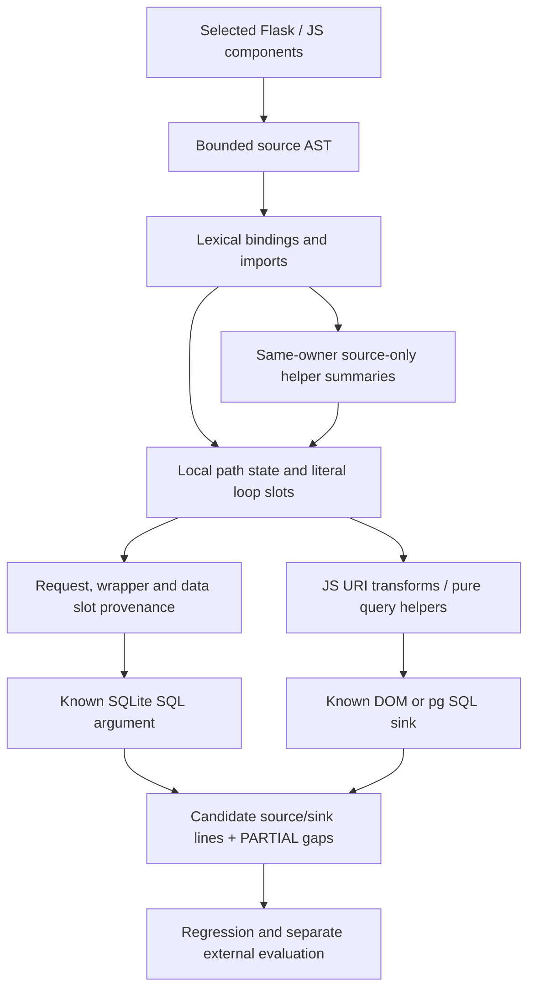

# Semantic coverage expansion (#107)

[فارسی](semantic-expansion-FA.md)

The original #96 baseline and manifest are retained. This is a bounded expansion, not whole-program taint analysis or vulnerability proof. Stable rule/control IDs are retained. Python pack v5, DOM pack v4 and Node SQL pack v2 replace the previous versions.



## Models and trust boundaries

Python supports a syntactic one-argument route registration factory with nested literal route decorators; nested functions are analyzed independently, not via an inferred closure. Direct SQLite receiver factories, exact sibling relative imports and qualified component-root module paths can be summarized from source. Qualified modules are inspected only for zero-argument single-return SQLite factory definitions and simple noninherited request-holder classes. Explicit local imports are tracked on each path. No import, module initialization or target code is executed. Qualified resolution is not a proof of runtime import identity; such files remain PARTIAL. Request source collections include args, form, headers and cookies. Request-holder method-call lines represent the caller-side source boundary, not the helper definition. Known URI/base64 and encode/decode operations preserve possible taint; no decoding/encoding is executed. Literal dictionary keys and ConfigParser section/option slots are path-local; overwrite replaces prior data. Bounded literal list/tuple loops (up to eight elements) evaluate elements once and unroll normal paths; break/continue, arbitrary iterators and exceptions remain unsupported.

JS DOM recognizes explicit unshadowed URI encoding/decoding calls in restricted module shape; transformed values preserve candidate taint and invalidate prior sanitizer observations. Node SQL recognizes pure local single-return positional helpers over literals/parameters, concatenation and template expressions; nested call arguments are bounded, recursive/dynamic helper definitions unsupported. pg receivers and request ownership remain framework-specific.

Budgets: existing 128 KB / 10k AST nodes / 64 paths / 4096 steps; cross-file factory reads at most 128 per scan, same owner, selected file inventory, no test or symlink paths. Dictionary and config slots capped at 32, sections at 16, helper arity 16. Unsupported syntax stops that path visibly; known candidates remain review-only. General cross-file taint, dynamic import/dispatch, arbitrary object aliasing, exceptions, broader ORM and other sources/sinks are not supported.

## Testing value and reproducible evaluation

Development tests cover nested registration, safe bound parameters, literal loop order and limits, sibling and qualified source resolution, scope isolation, shadowing, wrapper constant method, dictionary/config overwrite, transform propagation, DOM text sinks and sanitizer invalidation, Node helper dependency/arity. External contextual replay uses all 16 OWASP CWE-89 labels from #96 with the original pinned helper files; report separately from the isolated-file baseline. No fixture code executes. Fresh externally author-labeled evaluation is the paired direct HTTP SQLite routes from EyalSec/vulnerable-python at 5e2e2b1874d4626f2ff3d09e29c9af52a9b6c476 (MIT). The engine was frozen before reading that source; compare exact sink lines on the unchanged file, without importing it. The pair is small and not an independent comprehensive benchmark. Unknown/partial cases are not dropped. No score is asserted until actual CI evidence is reviewed. Do not tune on the fresh pair; a future expansion requires a new evaluation cohort. Scope, source hashes and denominators are in the reports.

```bash
python scripts/benchmark_semantic_context.py --external-git /path/to/pinned-owasp-bare-repo
python scripts/benchmark_semantic_context.py --fresh-flask
```

The second command fetches only pinned public source artifacts and validates Git blob hashes; no code executes. CI runs both in Python 3.12. Previous baseline remains in #96 CI and comments. Current improvement is not a generic accuracy, compliance or runtime verification claim.

## Current acceptance review (#107)

CI #235 preserved SQL contextual metrics and runtime gates. The original exposed synthetic labels are now required regressions, including py-loop, dom-transform and sql-helper; no changes to scanner semantics or historical labels. New independent holdout work and missing-context residual risk remain #37/#105. CI for this increment pending.
