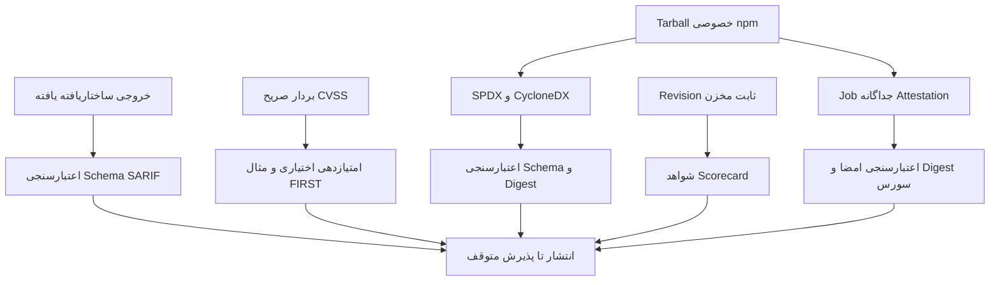

# شواهد سازگاری استانداردها و زنجیره تأمین پیش‌نمایش (#155–160)

[English](standards-acceptance.md)

این یک نقطه بررسی توسعه است، نه گواهی یا مجوز انتشار. بسته خصوصی می‌ماند؛ انتشار npm یا Release عمومی انجام نمی‌شود.

| مسیر | محدوده پیاده‌سازی | پذیرش باقی‌مانده |
|---|---|---|
| SARIF 2.1.0 (#155) | خروجی ساختاریافته یافته بدون مسیر؛ Rule ID و Fingerprint ثابت؛ حذف رکورد بسته و علامت Review برای Candidate؛ اعتبارسنجی Schema ثابت OASIS در CI اختیاری. | Import واقعی مصرف‌کننده و خروجی مسیر امن با مجوز صریح؛ سازگاری GitHub code scanning در وضعیت NOT_RUN. |
| CVSS 4.0 (#156) | بردار صریح و سخت‌گیرانه با ترتیب معیار؛ امتیازدهی اختیاری `cvss==3.6`؛ گزارش بردار، امتیاز، شدت و B/BT/BE/BTE. چهار نمونه (سه مثال FIRST و یک Fixture بدون اثر). | بررسی مجموعه کامل بردار و شواهد معیار یافته؛ بدون استنباط شدت Handbook یا امتیازدهی خودکار Ledger. |
| SPDX 2.3 (#157) | SBOM npm از بسته استخراج‌شده Tarball پیش‌نمایش خصوصی؛ اعتبارسنجی Schema ثابت و هویت بسته. | Artifact نهایی و موجودی اجزا/مجوز خارج npm. |
| CycloneDX 1.5 (#158) | همان Tarball، Schema جدا و بررسی purl؛ ثبت SHA-256 هر دو SBOM و Tarball. | موجودی نهایی انتشار، داوری کامل وابستگی و مجوز. |
| OpenSSF Scorecard (#159) | نسخه ثابت 5.7.0 و Digest منتشرشده؛ CI فقط خواندنی روی SHA دقیق Base، خروجی Checkها. | نتیجه واقعی موفق و بازبینی اصلاحات؛ Metadata زنده مخزن ممکن است تغییر کند. |
| منشأ SLSA (#160) | Workflow دستی پیش‌نمایش فقط روی main، Job جداگانه Build و Attestation، مجوز محدود، Action ثابت GitHub و اعتبارسنجی Digest سورس. | اجرای واقعی روی main و اعتبارسنجی Attestation پیش‌نمایش؛ تکرار برای Artifact نهایی؛ بدون ادعای سطح SLSA. |

## بازتولید

```bash
python3 <skill-dir>/scripts/security_sarif.py --source /path/to/structured-report.json
python3 -m venv /tmp/sg-standards
/tmp/sg-standards/bin/python -m pip install cvss==3.6
/tmp/sg-standards/bin/python <skill-dir>/scripts/security_cvss.py 'CVSS:4.0/AV:L/AC:L/AT:P/PR:L/UI:N/VC:H/VI:H/VA:H/SC:N/SI:N/SA:N'
python3 scripts/standards_inventory.py
```

از ابزار مورد اعتماد در محیط جدا استفاده کنید. SARIF مسیر پروژه، قطعه سورس، شرح دلخواه و شواهد خام ندارد؛ شناسه نامعتبر، وضعیت نامشخص و خروجی خصوصی رد می‌شوند. شناسه یافته و Fingerprint ممکن است حساس باشند؛ پیش از اشتراک‌گذاری بررسی کنید. گزارش بدون مسیر به‌عنوان قابل Import در GitHub code scanning معرفی نمی‌شود. CVSS از شدت Ledger جداست؛ بدون شواهد بردار تعیین نکنید. امتیازدهنده اختیاری باید صریح نصب شود؛ وابستگی پنهانی به Skill اضافه نمی‌شود.



منابع رسمی: [SARIF 2.1.0](https://docs.oasis-open.org/sarif/sarif/v2.1.0/sarif-v2.1.0.html)، [مثال‌های FIRST](https://www.first.org/cvss/v4.0/examples)، [SPDX 2.3](https://spdx.github.io/spdx-spec/v2.3/)، [CycloneDX 1.5](https://cyclonedx.org/docs/1.5/json/)، [npm SBOM](https://docs.npmjs.com/cli/commands/npm-sbom/)، [Scorecard v5.7.0](https://github.com/ossf/scorecard/releases/tag/v5.7.0)، [اعتبارسنجی Attestation](https://docs.github.com/en/actions/how-tos/secure-your-work/use-artifact-attestations/use-artifact-attestations). Git blobهای Schema و نسخه ابزار در پیاده‌سازی و Workflow ثبت شده‌اند. متن استانداردها همراه بسته توزیع نمی‌شود. نتیجه اجرای واقعی را گزارش کنید؛ تعریف Workflow به‌تنهایی شاهد اجرا نیست.
