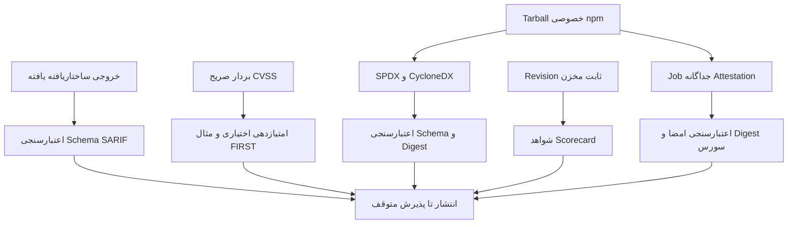

# شواهد سازگاری استانداردها و زنجیره تأمین پیش‌نمایش (#155–160)

[English](standards-acceptance.md)

این یک نقطه بررسی توسعه است، نه گواهی یا مجوز انتشار. بسته خصوصی می‌ماند؛ انتشار npm یا Release عمومی انجام نمی‌شود.

| مسیر | محدوده پیاده‌سازی | پذیرش باقی‌مانده |
|---|---|---|
| SARIF 2.1.0 (#155) | خروجی ساختاریافته یافته بدون مسیر؛ Rule ID و Fingerprint ثابت؛ حذف رکورد بسته و علامت Review برای Candidate؛ اعتبارسنجی Schema ثابت OASIS در CI اختیاری. | Import واقعی مصرف‌کننده و خروجی مسیر امن با مجوز صریح؛ سازگاری GitHub code scanning در وضعیت NOT_RUN. |
| CVSS 4.0 (#156) | بردار صریح و سخت‌گیرانه با ترتیب معیار؛ امتیازدهی اختیاری `cvss==3.6`؛ گزارش بردار، امتیاز، شدت و B/BT/BE/BTE. چهار نمونه (سه مثال FIRST و یک Fixture بدون اثر). | بررسی مجموعه کامل بردار و شواهد معیار یافته؛ بدون استنباط شدت Handbook یا امتیازدهی خودکار Ledger. |
| SPDX 2.3 (#157) | SBOM npm از بسته استخراج‌شده Tarball پیش‌نمایش خصوصی؛ اعتبارسنجی Schema ثابت و هویت بسته. | Artifact نهایی و موجودی اجزا/مجوز خارج npm. |
| CycloneDX 1.5 (#158) | همان Tarball، Schema جدا و بررسی purl؛ ثبت SHA-256 هر دو SBOM و Tarball. | موجودی نهایی انتشار، داوری کامل وابستگی و مجوز. |
| OpenSSF Scorecard (#159) | نسخه ثابت 5.7.0 و Digest منتشرشده؛ CI فقط خواندنی روی SHA دقیق Base، خروجی Checkها. | نتیجه واقعی موفق و بازبینی اصلاحات؛ Metadata زنده مخزن ممکن است تغییر کند. |
| منشأ SLSA (#160) | Workflow دستی پیش‌نمایش فقط روی main، Job جداگانه Build و Attestation، مجوز محدود، Action ثابت GitHub و اعتبارسنجی Digest سورس. | اجرای واقعی روی main و اعتبارسنجی Attestation پیش‌نمایش؛ تکرار برای Artifact نهایی؛ بدون ادعای سطح SLSA. |

## بازتولید

```bash
python3 <skill-dir>/scripts/security_sarif.py --source /path/to/structured-report.json
python3 -m venv /tmp/sg-standards
/tmp/sg-standards/bin/python -m pip install cvss==3.6
/tmp/sg-standards/bin/python <skill-dir>/scripts/security_cvss.py 'CVSS:4.0/AV:L/AC:L/AT:P/PR:L/UI:N/VC:H/VI:H/VA:H/SC:N/SI:N/SA:N'
python3 scripts/standards_inventory.py
```

از ابزار مورد اعتماد در محیط جدا استفاده کنید. SARIF مسیر پروژه، قطعه سورس، شرح دلخواه و شواهد خام ندارد؛ شناسه نامعتبر، وضعیت نامشخص و خروجی خصوصی رد می‌شوند. شناسه یافته و Fingerprint ممکن است حساس باشند؛ پیش از اشتراک‌گذاری بررسی کنید. گزارش بدون مسیر به‌عنوان قابل Import در GitHub code scanning معرفی نمی‌شود. CVSS از شدت Ledger جداست؛ بدون شواهد بردار تعیین نکنید. امتیازدهنده اختیاری باید صریح نصب شود؛ وابستگی پنهانی به Skill اضافه نمی‌شود.



منابع رسمی: [SARIF 2.1.0](https://docs.oasis-open.org/sarif/sarif/v2.1.0/sarif-v2.1.0.html)، [مثال‌های FIRST](https://www.first.org/cvss/v4.0/examples)، [SPDX 2.3](https://spdx.github.io/spdx-spec/v2.3/)، [CycloneDX 1.5](https://cyclonedx.org/docs/1.5/json/)، [npm SBOM](https://docs.npmjs.com/cli/commands/npm-sbom/)، [Scorecard v5.7.0](https://github.com/ossf/scorecard/releases/tag/v5.7.0)، [اعتبارسنجی Attestation](https://docs.github.com/en/actions/how-tos/secure-your-work/use-artifact-attestations/use-artifact-attestations). Git blobهای Schema و نسخه ابزار در پیاده‌سازی و Workflow ثبت شده‌اند. متن استانداردها همراه بسته توزیع نمی‌شود. نتیجه اجرای واقعی را گزارش کنید؛ تعریف Workflow به‌تنهایی شاهد اجرا نیست.

## اجرای منشأ پیش‌نمایش و تثبیت Actionها

Workflow منشأ با ادغام تغییر فایل خودش در main نیز اجرا می‌شود؛ روی PR اجرا یا بسته منتشر نمی‌شود. امضای پیش‌نمایش با مخزن مورد انتظار، Workflow امضاکننده، Source ref شاخه main و Digest دقیق سورس بررسی شود؛ نتیجه امضا باید آرایه JSON غیرخالی باشد. Actionهای هر دو Workflow جدید استانداردها روی Commit دقیق ثابت شده‌اند. این بهبود فقط زنجیره تأمین Workflow جدید است؛ یافته‌های Scorecard کل مخزن، از جمله Actionهای قدیمی ثابت‌نشده، نیازمند بازبینی‌اند. سطح SLSA یا منشأ انتشار نهایی ادعا نشود.

## سخت‌سازی Workflow مخزن (#159)

در تغییر تکمیلی، همه Actionهای موجود Workflowهای main روی SHA دقیق Commit ثابت می‌شوند، نگه‌داری اعتبارنامه checkout غیرفعال می‌شود و راستی‌آزمایی انتشار (فقط خواندنی) از Job ایجاد Release (مجوز contents: write، بدون checkout) جدا می‌شود. CI اجباری کنترل متنی محدود Workflow و تست رگرسیون آن را اجرا می‌کند. کنترل فقط قالب YAML جاری مخزن را بررسی می‌کند؛ تحلیل‌گر عمومی امنیت YAML، تضمین یکپارچگی وابستگی یا جایگزین Scorecard نیست. نتایج قبلی Scorecard تاریخی‌اند؛ پیش از ادعای بهبود، Revision ادغام‌شده دوباره بررسی شود. گزارش خصوصی آسیب‌پذیری، رویه واقعی Review، یافته‌های وابستگی و پذیرش انتشار جداگانه باقی می‌مانند. Release یا انتشار npm انجام نمی‌شود.

## مسیر اختیاری SARIF و توسعه تست CVSS (#155–156)

خروجی پیش‌فرض SARIF همچنان بدون مسیر است. برای افشای صریح بازبینی‌شده، گزینه `--reviewed-locations locations.json` را همراه `--source report.json` بدهید. فایل جانبی به SHA-256 بایت‌های دقیق منبع متصل است و فقط شناسه یافته منتخب، مسیر نسبی ASCII و شماره خط مثبت دارد. پیمایش مسیر، مسیر مطلق، Escape URI، بخش مخفی مسیر، نام‌ها و پسوندهای حساس منتخب، Digest قدیمی و شناسه بسته/ناشناخته رد می‌شوند. این بررسی نحوی است، نه اثبات ایمنی افشا: مسیر می‌تواند پروژه خصوصی را مشخص کند. فایل هدف باز یا بررسی نمی‌شود؛ مسیر ارائه‌شده توسط کاربر شاهد مستقل نیست. پیش از اشتراک بازبینی کنید؛ آپلود خودکار یا ادعای سازگاری GitHub code scanning وجود ندارد.

```json
{"schema_version":1,"source_sha256":"<64 lowercase hex digits of report.json SHA-256>","locations":{"SG-API-07-123456789ABC":{"path":"src/demo.ts","line":7}}}
```

CI اختیاری هر دو خروجی را با Schema ثابت OASIS می‌سنجد و مصرف‌کننده واقعی CSV ابزار Microsoft [sarif-tools 3.0.0](https://pypi.org/project/sarif-tools/3.0.0/) را روی داده مصنوعی اجرا می‌کند و دو رکورد و وضعیت‌ها و مسیرهای متمایز را بررسی می‌کند. این آزمون همه مصرف‌کننده‌ها نیست. مجموعه تست CVSS اکنون ۱۲ بردار دارد؛ ۱۱ مورد از [مثال‌های FIRST، سند نسخه ۱٫۹](https://www.first.org/cvss/v4.0/examples) و یک بردار مصنوعی بدون اثر؛ حالت‌های Base، Threat، Environmental و ترکیبی پوشش داده می‌شوند. امتیازدهنده اختیاری ثابت، سیاست بردار صریح و محدودیت شواهد بدون تغییرند. مجموعه نمونه انتخاب‌شده اعتبارسنجی جامع نیست. قبل از ادعای موفقیت تست باید نتیجه CI مشاهده شود.

## راستی‌آزمایی جداگانه و فقط‌خواندنی Provenance (#160)

گردش‌کار Preview خصوصی، ساخت، امضا و راستی‌آزمایی را در سه Job جدا انجام می‌دهد. فقط Job امضا مجوز نوشتن توکن و Attestation دارد؛ مرحله راستی‌آزمایی مجدداً Preview دقیق را دریافت می‌کند، Digest را بررسی می‌کند و فرمان `gh attestation verify` را با مخزن، گردش‌کار امضاکننده، main و Commit دقیق اجرا می‌کند. رسید مکمل SHA-256 فایل، هش JSON راستی‌آزمایی و شناسه Run را ثبت می‌کند. اجرای main پیش‌شرط ادعای موفقیت است؛ انتشار عمومی npm یا ادعای سطح SLSA نداریم.

## موجودی فایل‌های توزیع‌شده (#157–158)

شواهد Preview اکنون همه فایل‌های عادی Tarball دقیق npm از جمله فایل‌های Python، JavaScript و منابع را فهرست و هش می‌کند. مسیر ناامن، عضو تکراری، لینک و آرشیو فراتر از محدودیت رد می‌شوند. مجوز اعلام‌شده بسته جدا از NOASSERTION در سطح فایل است. این موجودی مکمل است، نه تغییر SBOM تولیدشده SPDX یا CycloneDX و نه داوری کامل مجوز یا وابستگی Python. اعتبارسنجی فایل منتشرشده نهایی باقی است.

## مسیر قابل‌حمل SARIF و بررسی خروجی CVSS (#155–156)

فایل جانبی اختیاری مسیر، نام‌های رزروشده دستگاه در Windows را در تمام بخش‌های مسیر رد می‌کند. هویت Fingerprint با تغییر وضعیت یا شدت رکورد ثابت می‌ماند. خروجی CVSS از نظر عدد متناهی با یک رقم اعشار در بازه ۰ تا ۱۰ و تطابق شدت کیفی بررسی می‌شود. عضویت معیارهای محیطی صریح است؛ معیارهای تکمیلی و مقدار صریح Not Defined نام‌گذاری B/BT/BE/BTE را تغییر نمی‌دهند. تست‌های جدید این مرزها و خروجی نامعتبر ماشین حساب را پوشش می‌دهند. این بررسی جامع امتیازدهی یا شاهد ورود به GitHub code scanning نیست.

## اصلاح آسیب‌پذیری‌های Scorecard (#159)

JSON واقعی Scorecard برای مبنای `dce0edab69154c956495e8bb469fbce33133c3e0` (اجرای 46082477887، Artifact 15236998997، ۲۰۲۶-۱۱-۲۷) پنج Advisory گزارش کرده است: [PYSEC-2026-2151](https://osv.dev/vulnerability/PYSEC-2026-2151) (Flask) و [PYSEC-2026-2044](https://osv.dev/vulnerability/PYSEC-2026-2044)، [PYSEC-2026-2046](https://osv.dev/vulnerability/PYSEC-2026-2046)، [PYSEC-2026-2320](https://osv.dev/vulnerability/PYSEC-2026-2320)، [PYSEC-2026-4312](https://osv.dev/vulnerability/PYSEC-2026-4312) (Werkzeug). وابستگی Fixture ایزوله CI از Flask 3.1.2 به [3.1.3](https://pypi.org/project/Flask/3.1.3/) و Werkzeug 3.1.3 به [3.1.9](https://pypi.org/project/Werkzeug/3.1.9/) ارتقا می‌یابد. تست‌های اجباری Runtime و بررسی نسخه بدون تغییر باقی هستند. این وابستگی‌ها متعلق به Fixture در CI هستند نه Runtime بسته Node. نصب واقعی، نتیجه Regression و اندازه‌گیری مجدد Scorecard روی main جدید باقی است. Code-Review صفر از ۳۰ تغییر تأییدشده است؛ ۴۲ از ۴۲ اکشن متعلق به GitHub با SHA پین شده‌اند، اما شش فرمان npm و دو فرمان pip طبق گزارش فاقد پین هش هستند. ادعای نبود آسیب‌پذیری نداریم.

## Provenance بسته آزموده‌شده و اعتبارسنجی قبل از استخراج (#157 #158 #160)

مرحله ساخت Provenance خصوصی همان Tarball آزموده‌شده آفلاین را خروجی می‌دهد، هش را بررسی و بدون بسته‌بندی مجدد تغییر نام می‌دهد. Job جداگانه فقط خواندنی، Attestation گیت‌هاب و اتصال رسید بسته آزموده‌شده به Commit دقیق، بسته و هش بایت‌ها را بررسی می‌کند. هش رسید در کنار شواهد ثبت می‌شود. Workflow مربوط به SBOM پیش از استخراج، اعضای عادی آرشیو و Manifest خصوصی مرجع را اعتبارسنجی می‌کند. هیچ‌کدام در npm منتشر نمی‌کنند. Artifact قبلی CI به شماره 15236429458 با تطبیق هش ۱۷۰ فایل بسته، هش Tarball و هر دو SBOM مستقلاً بررسی شد؛ بسته نهایی و بررسی مستقل مجوزها باقی هستند. اجرای واقعی Provenance روی main لازم است و ادعای سطح SLSA نداریم.
